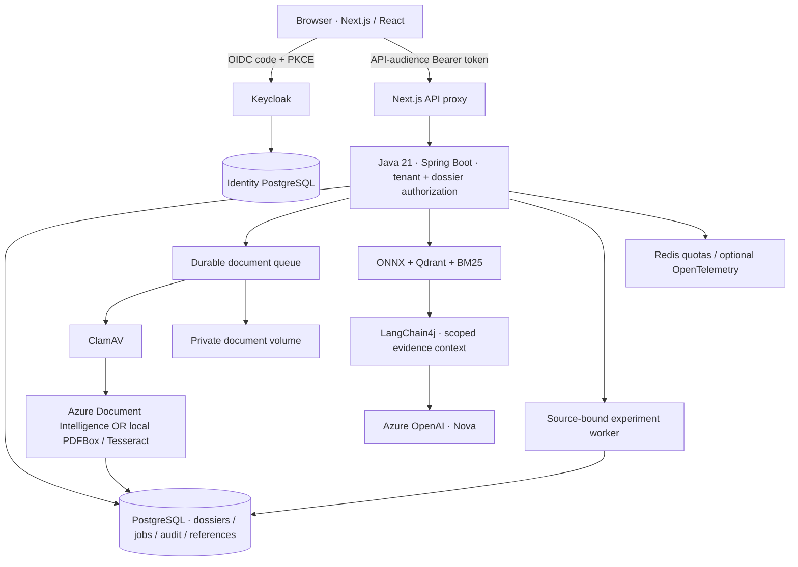

# Document Intelligence Lab

A hands-on **Azure AI document research lab** for studying how to turn PDFs into traceable, reviewable answers.

The project investigates **document extraction, retrieval-augmented generation (RAG), source-grounded explanations, measurable evaluation and human review** across three domains: **banking/payroll**, **insurance** and **general business documents**. Azure Document Intelligence and Azure OpenAI connect to a Java backend, while authentication, databases, document storage and the web workspace run locally with Docker.

**Java 21 · Spring Boot · LangChain4j · Azure Document Intelligence · Azure OpenAI · Next.js · PostgreSQL · Qdrant · Keycloak · Docker**

[Research scope](#what-this-project-researches) · [Feature inventory](#feature-inventory) · [Local setup](#run-locally) · [Azure setup](#connect-azure-ai-for-local-nova) · [Screenshots](#workspace-tour) · [Architecture](#architecture)

> Research software, not a banking or insurance product. Use fictional or explicitly permitted documents. No payments, automated credit decisions, underwriting, claim settlement or automatic email delivery.

## What this project researches

1. **Document understanding:** extract text, layout, tables, dates and amounts; compare cloud extraction with a local PDFBox/Tesseract baseline. Inspect OCR confidence without presenting it as measured accuracy.
2. **Evidence-grounded AI:** answer questions about selected documents, retrieve supporting passages and connect answers back to original PDF pages instead of treating model output as verified fact.
3. **Retrieval quality:** compare lexical BM25, semantic vector search and hybrid retrieval on independently checked questions and target pages.
4. **Reproducible evaluation:** version source-bound reference labels, measure extraction precision/recall/F1 and retrieval hit rate@5/MRR@5, and detect stale references after a source changes.
5. **Human oversight and trust:** review extracted fields beside the original, record corrections, report incorrect answers and distinguish machine output from human confirmation.
6. **Practical AI integration:** connect Java/LangChain4j, Entra-authenticated Azure services, durable processing jobs, persistent data and tenant-scoped access in one inspectable application.

| Document domain | Research material | Example questions |
| --- | --- | --- |
| Banking & payroll | Official fictional DATEV LODAS payroll pages; permitted income evidence and statements | How do net earnings differ from payout? Which page supports an amount? Is a matching income entry available in the statement? |
| Insurance / Versicherungen | Included fictional policy and claim-notification PDFs | What are the policy reference, premium, deductible and coverage dates? Which facts are missing or inconsistent? |
| General documents | Included fictional invoice; permitted contracts and reports | What are the identifiers, dates, amounts and relevant passages? Can an answer be checked against the original? |

This is an engineering/research workspace, **not a claim of representative model accuracy, regulatory compliance or production certification**. The examples and small reference sets demonstrate specific workflows; they do not establish general payroll, insurance or OCR performance.

## Feature inventory

### AI and document-processing features

| Feature | What it does | Actual engine / boundary | Where to use it |
| --- | --- | --- | --- |
| OCR and layout | Reads text, tables and page structure from confirmed uploads | **Azure Document Intelligence `prebuilt-layout`** in Azure mode; PDFBox/Tesseract in local mode | Documents & review |
| Structured field extraction | Presents values, quotations and available confidence/geometry for review | Extraction provider **plus Java field rules**; not a trained payroll/insurance model | View result & PDF |
| Semantic evidence search | Finds relevant passages by meaning | **Local MiniLM ONNX embeddings + Qdrant** | AI Studio |
| Hybrid RAG retrieval | Combines semantic retrieval with lexical matching | Local vector search + BM25; **not Azure AI Search** | AI Studio / AI Experiments |
| Nova document Q&A | Explains the selected dossier with sources and scoped read-only tools | **Azure OpenAI through Java/LangChain4j**; requires Azure for evidence analysis | Nova → Evidence analysis |
| Controlled AI tasks | Drafts summaries, comparisons, inconsistency explanations, document requests and review checklists | User-sent Azure OpenAI prompts; drafts require review | AI transparency & review → Task library |
| Language support for evidence | Explains German terminology or drafts a paired German–Vietnamese evidence summary | Azure OpenAI; preserve source names, labels and amounts | Task library / Nova |
| Local app assistance | Explains features and offers navigation/help without a cloud model | Application guidance logic, **not an LLM response** | Nova → App guidance / page tours |

The seven controlled task templates are **dossier summary**, **cross-document comparison**, **inconsistency explanation**, **document-request draft**, **review checklist**, **German terminology** and **German–Vietnamese summary**. Selecting a template prepares a prompt; the user reviews and sends it. No task makes a financial decision or sends an email automatically.

### Review, research and workspace features

| Feature | What is implemented | AI or application logic? |
| --- | --- | --- |
| Multi-domain dossiers | Create, search and edit banking/payroll, insurance and general-document dossiers | Application/database logic |
| Private PDF review | Original PDF beside extracted fields; page navigation, zoom and evidence links | PDF.js + authenticated document APIs |
| Human field verification | Correct and confirm values with review history | Human action, stored by Java |
| Document validation | Domain-specific missing-document checks, normalized amounts/dates and supported consistency checks | Deterministic Java rules; not an autonomous risk/compliance assessment |
| Extraction evaluation | Independently checked field labels; precision, recall and F1 for a saved source version | Deterministic scoring, not an LLM judge |
| Retrieval experiments | Compare BM25/vector/hybrid using labelled target pages; hit rate@5 and MRR@5 | Search experiment + deterministic scoring |
| Dataset/version tracking | Source hashes, saved reference versions and stale-reference safeguards | Application logic |
| Answer feedback and reviewer tasks | Report incorrect evidence, prepare revisions and track manual review | Human workflow + persisted history |
| AI transparency and controls | Explain data destinations, inspect task/model metadata and control features according to role | Application controls, not a compliance certificate |
| Data assets and exports | Inspect source/processed/reference layers and explicitly export private JSON/JSONL research inputs | Local preparation; does not execute Data Factory or Foundry |
| Guided workspace | English/German/Vietnamese UI, page tours, Nova navigation, Enter-to-send and expandable reading area | UI behavior; source documents are not translated automatically |

### Platform and security features

- **Keycloak OAuth 2.0 / OIDC:** authorization code + PKCE, Bearer-protected APIs, API audience checks, roles and tenant/dossier isolation.
- **Persistent PostgreSQL:** separate application and identity databases; Flyway migrations for application data.
- **Durable processing:** asynchronous document jobs, processing status, retry history and private original-file storage.
- **Upload safeguards:** explicit analysis consent, ClamAV scanning, file/page limits and document-retention controls.
- **Operational visibility:** activity/audit records, health/readiness endpoints, processing queues and optional OpenTelemetry tracing.
- **Shared AI limits:** Redis-backed request/token reservations; these are safety estimates, not Azure billing or a guaranteed cost cap.
- **Verification tooling:** frontend/Java tests, OAuth/Docker acceptance checks and CI dependency/container scans.

Document classification, field normalization and citation-ID validation use application rules. An existing citation ID does not prove that every statement is supported. No calibrated groundedness score, learned reranker or automatic retraining is claimed. **Azure Foundry evaluation, Data Factory orchestration, Blob ingestion and Application Insights are not connected by default.**

## Run locally

These instructions cover the standard local workflows directly in this README. Linked guides provide further reference material, not missing mandatory setup steps.

### Choose your setup

| Setup | Runs on your computer | Calls Azure | Best for |
| --- | --- | --- | --- |
| **A. Full Docker, no Azure** | Web, Java, Keycloak, databases, local extraction, search and research tools | No | First run, PDF review and experiments |
| **B. Docker + Azure AI** | The same local stack; host CLI supplies a short-lived Entra token | Confirmed document analysis and user-sent Nova requests | Real Azure OCR/layout and document Q&A |
| **C. Frontend development** | Backend in Docker; Next.js on the host | Only if backend option B is active | UI editing with hot reload |

### Common prerequisites

- Git and Docker Desktop with Compose v2, or Docker Engine + Compose on Linux.
- Suggested Docker allocation: **4 CPUs, 8 GB RAM, 15 GB free disk**.
- Available local ports: **3000**, **8080**, **8081**.
- Internet for images, build dependencies and initial ClamAV signatures.
- Commands use a macOS/Linux shell; on Windows, use a Docker-enabled WSL2 environment.
- Repository access while it is private. No Vercel account or Azure VM is required.

Confirm Docker is running, then clone once:

```bash
docker version
docker compose version
git clone https://github.com/quocvietphung/document-intelligence-lab.git
cd document-intelligence-lab
mkdir -p .local/reference-pdfs
```

For an existing checkout, open a terminal in that repository instead of cloning again. Run all following commands from the repository root.

### Option A — full local Docker, no Azure

No host Java, Maven, Node.js or Azure account is required. **No `.env` file is required**: Compose supplies the local service configuration.

```bash
docker compose -f docker-compose.yml -f docker-compose.platform.yml config --quiet
docker compose -f docker-compose.yml -f docker-compose.platform.yml \
  up --build -d --wait --wait-timeout 900
```

Use **both Compose files** for the full research workspace. The base file alone is not the complete platform. First-time builds and ClamAV initialization may take several minutes; keep malware scanning enabled.

#### Check services and sign in

```bash
docker compose -f docker-compose.yml -f docker-compose.platform.yml ps --all
curl --fail http://localhost:8081/actuator/health
```

Expected state:

```text
case-db, identity-db, keycloak, credit-api, redis, clamav: running / healthy
qdrant, web: running (no Compose healthcheck)
storage-init: exited with code 0 (initialization completed successfully)
Java health endpoint: status UP
```

Open **[http://localhost:3000/en](http://localhost:3000/en)**. German: `/de`; Vietnamese: `/vi`. Use `localhost`, not a different hostname: the local OIDC issuer/redirect settings use it. Do not run host Next.js/Java on ports already used by these containers.

| Local account | Username | Password |
| --- | --- | --- |
| App user: ADVISOR + REVIEWER | `advisor.demo` | `demo-password` |
| Keycloak admin: `http://localhost:8080/admin/` | `admin` | `local-admin-only` |

These published development credentials apply to a **fresh local identity database**. Existing volumes retain their accounts/passwords; importing a realm does not reset them. Do not delete an identity volume to fix login. Never expose this realm publicly or reuse these passwords in a cloud deployment.

#### Try the complete local document workflow

1. Sign in and create a **General documents** dossier.
2. In **Documents & review**, upload `public/samples/invoice-fictional.pdf`. Review upload/analysis consent and confirm when prompted; opening a page does not upload a sample automatically.
3. Find **Analysis results**, above the sample library. Open **View result & PDF** to compare the original, extracted fields and tables. For job status/history, open **Data Pipelines → Processing queue**.
4. Use **AI Studio** to retrieve source passages.
5. Use **AI Experiments** to label fields/questions and evaluate them.
6. For insurance, create an **Insurance** dossier and use `public/samples/insurance-policy-fictional.pdf` and `public/samples/insurance-claim-fictional.pdf`. For payroll, prepare the private DATEV pages using the steps below.

**Without Azure:** local PDFBox/Tesseract extraction, PDF review, hybrid evidence search, experiments, queues and audit work. Nova's **App guidance** works locally. Nova's **Evidence analysis** requires Azure OpenAI; no fake LLM response or local model is substituted.

## Connect Azure AI for local Nova

### Option B — local Docker with Azure AI

Docker still runs on your computer. Only confirmed document analysis and user-sent model requests call Azure. **No VM, AKS, Vercel deployment or Azure API key is needed.**

1. Prepare an Azure OpenAI resource with a compatible deployed chat model, and a Document Intelligence resource with a custom-subdomain endpoint.
2. Have an authorized administrator grant your developer account **Cognitive Services OpenAI User** on OpenAI and **Cognitive Services User** on the document resource.
3. Install Azure CLI and Node.js 22+ on the host. Sign in to the tenant/subscription containing those resources.

For the role grants, an authorized administrator opens each resource's **Access control (IAM) → Add role assignment**, selects the role above and the correct developer user, and reviews the exact resource scope. Local startup scripts do not grant access. Do not grant subscription-wide Owner access for this walkthrough.

In the Azure OpenAI resource's model deployment screen, deploy a compatible chat/tool-calling model with available quota and record its **deployment name**. Document Intelligence uses `prebuilt-layout`; no custom payroll/insurance model training is required. Creating resources/deployments may incur charges and is not performed by this project.

#### Sign in and create private configuration

```bash
az login --tenant YOUR-TENANT-ID
az account set --subscription YOUR-SUBSCRIPTION-ID
az account show --query '{subscription:name,id:id,tenant:tenantId}' -o table
node --version
```

Copy the template only if the private file is missing. This command preserves any existing configuration:

```bash
test -f .env.azure.local || cp .env.azure.example .env.azure.local
```

Edit `.env.azure.local` with **your** values:

```dotenv
AZURE_DOCUMENT_INTELLIGENCE_ENDPOINT=https://YOUR-DOCUMENT-RESOURCE.cognitiveservices.azure.com/
AZURE_OPENAI_ENDPOINT=https://YOUR-OPENAI-RESOURCE.openai.azure.com/
AZURE_OPENAI_DEPLOYMENT=YOUR-CHAT-DEPLOYMENT
```

Use resource-root endpoints, **not** a Foundry project URL, deployment URL or `/openai/v1` path. The deployment value is the deployed model's name, not necessarily its model family. The current local workspace has been exercised with `gpt-4.1-mini`; availability and compatibility depend on your resource.

#### Start Docker and renew the Azure token

Start the Azure-enabled Docker profile and keep token renewal running:

```bash
node scripts/docker-azure.mjs up
```

The helper reads the ignored configuration, obtains a short-lived Entra token, mounts only its private token directory into Java and renews every five minutes. It does not print the token, mount your Azure CLI cache, create resources or grant permissions. **Ctrl+C stops renewal, not the containers.** After restarting your computer, run the helper again.

| Helper command | Behavior |
| --- | --- |
| `node scripts/docker-azure.mjs up` | Build/start containers and keep token renewal active |
| `node scripts/docker-azure.mjs start` | Start existing images and keep renewal active |
| `node scripts/docker-azure.mjs watch` | Renew the token only; no container startup |
| `node scripts/docker-azure.mjs prepare` | Refresh once; no ongoing renewal |

The helper supplies base + Azure + platform Compose files. Keycloak authenticates the **app user**; Entra authorizes **Java calling Azure**. The local developer-token bridge is not Managed Identity, and app requests still need their Keycloak access token. Keep your organization's approved network restrictions; do not make a private resource public to bypass a connection problem.

#### Verify actual Azure calls

1. Open `http://localhost:3000/en` and sign in with the local app account.
2. Analyze an included fictional PDF or a permitted DATEV reference in the matching domain. Confirmed analysis sends that file to Azure Document Intelligence.
3. Open **Analysis results → View result & PDF**. Inspect provider/model, original page, extracted fields and tables. OCR confidence is not independently measured accuracy.
4. Open **Nova → Evidence analysis** and ask: “What amounts are stated in this document? Cite the source page and say which values need human verification.” Enter sends; Shift+Enter adds a line break.
5. Inspect the Azure OpenAI reply and open its sources. A greeting, configured-engine badge or local **App guidance** reply alone is not proof of a successful model call.

Azure Compose limits include **2 PDF pages, 6 MP images and 3 MB files**. Shared request/token reservations are finite lab safeguards, not billed usage or a monetary cap.

See [the complete Azure setup](docs/AZURE_AI.md) for resource/deployment preparation, exact RBAC examples, identity boundaries, validation, limits and error diagnosis. Azure inference may incur usage charges.

#### Switch back to local-only extraction

Stop the renewal helper with Ctrl+C, then recreate the app services without the Azure override:

```bash
docker compose -f docker-compose.yml -f docker-compose.platform.yml \
  up -d --build --force-recreate credit-api web
```

Named data volumes remain. Existing analyzed records retain their original provider metadata; switching mode does not re-analyze them.

## Frontend development and local operation

### Option C — host Next.js with Docker backend

For UI hot reload, start backend option A or B first. Install host Node.js 22+, then stop only the Docker web container to free port 3000:

```bash
docker compose -f docker-compose.yml -f docker-compose.platform.yml stop web
npm ci
CREDIT_API_URL=http://localhost:8081 \
NEXT_PUBLIC_DEMO_MODE=false \
NEXT_PUBLIC_KEYCLOAK_URL=http://localhost:8080 \
NEXT_PUBLIC_KEYCLOAK_REALM=credit-intelligence \
NEXT_PUBLIC_KEYCLOAK_CLIENT_ID=credit-intelligence-web \
npm run dev
```

Open `http://localhost:3000/en`. Java, Keycloak and databases still run in Docker. If using Azure, keep its renewal helper in a separate terminal. Browser-visible Keycloak values are identifiers, not credentials; the Java URL is server-only.

When finished, stop host Next.js with Ctrl+C, then restore the Docker web service:

```bash
docker compose -f docker-compose.yml -f docker-compose.platform.yml up -d --no-deps web
```

### Optional — prepare the private DATEV payroll pages

The payroll library uses only the official fictional **DATEV LODAS 2025 Robert-Muster and Melanie-Muster** pages. Publisher originals/derived PDFs are not bundled in GitHub or the image; DATEV retains its rights.

1. After reviewing the publisher's terms, download the unchanged 30-page [official DATEV sample PDF](https://www.datev.de/content/dam/markenassets/themen-und-produktgruppen/zielgruppen/zielgruppenuebergreifend/shop-assets/personalwirtschaft/lodas-musterauswertung-2025-deutsch.pdf) to `.local/datev-lodas-musterauswertung-2025.pdf`.
2. With Python 3 installed, create a private helper environment and split the permitted pages:

```bash
python3 -m venv .local/datev-tools
.local/datev-tools/bin/python -m pip install pypdf
.local/datev-tools/bin/python scripts/prepare-datev-reference.py \
  .local/datev-lodas-musterauswertung-2025.pdf
```

The helper validates the source and refuses to overwrite existing references. Expected files:

```text
.local/reference-pdfs/datev-lodas-2025-robert-muster.pdf
.local/reference-pdfs/datev-lodas-2025-melanie-muster.pdf
```

3. In a **Banking & payroll** dossier, open **Documents & review → Official DATEV payroll library**. Preview a page, choose **Import & analyze**, confirm its destination and inspect **Analysis results** above the library.
4. In Azure mode, ask Nova to distinguish net earnings from payout with a page citation. Robert-Muster's reference values are **2.967,11 EUR** net and **2.882,11 EUR** payout—not the same field.

Previewing does not send a prepared PDF to Azure; confirmed analysis does. Keep third-party PDFs outside `public/` and Git. Source labels/number formatting remain unchanged across interface languages. [Reference details](docs/PUBLIC_PAYROLL_TESTS.md).

### Stop, restart and inspect logs

Stop without deleting data:

```bash
docker compose -f docker-compose.yml -f docker-compose.platform.yml stop
```

Restart option A:

```bash
docker compose -f docker-compose.yml -f docker-compose.platform.yml \
  up -d --build --wait --wait-timeout 900
```

For option B, use `node scripts/docker-azure.mjs start` instead so the Azure overrides and renewal remain active. Do not start two renewal helpers simultaneously.

Inspect logs privately:

```bash
docker compose -f docker-compose.yml -f docker-compose.platform.yml \
  logs --tail=80 credit-api web keycloak
docker compose -f docker-compose.yml -f docker-compose.platform.yml \
  logs --tail=40 clamav
```

PostgreSQL, private documents, Qdrant, Redis and ClamAV definitions use named volumes. Optional private samples live in `.local/reference-pdfs/`; short-lived Azure credentials live in ignored `.local/azure-auth/`. **Do not use `down -v`, volume prune or system prune to troubleshoot startup/login**: these can erase data. Never print token files or share unredacted logs.

### Common local problems

| Symptom | Check / remedy |
| --- | --- |
| Docker unavailable | Start Docker Desktop/Engine; `docker version` must include the server |
| Port in use | Stop only the recognized conflicting app; do not run host and Docker web together |
| ClamAV starting | Allow initial signatures; inspect scanner logs instead of bypassing scanning |
| `storage-init` exited 0 | Expected: the one-shot permissions task completed |
| Login fails | Use `localhost`, check Keycloak health; existing accounts retain their passwords |
| App API `401/403` | Check the session, audience, tenant and role; keep JWT validation enabled |
| Azure `401/403` | Check tenant/resource, token renewal, resource-scoped inference role and approved network access |
| Deployment `404` | Actual deployment name and matching resource-root endpoint |
| Analysis `503` | Current provider, renewal/service readiness and newest job; old failures remain history |
| Nova unavailable in option A | Expected for Evidence analysis; local App guidance/search are separate |
| `429` | Distinguish app request/token reservations from Azure quota; wait for the relevant reset |
| Stale-reference `409` | Refresh the dossier and independently verify/save labels for the new source version |
| Foundry / Data Factory not connected | Expected: exports prepare research inputs, not cloud execution |

## Workspace tour

Current local UI in English. Screenshots show an existing research workspace, not dossiers preloaded into a fresh clone. German labels and number formatting inside source evidence are deliberately preserved.

### Multi-domain overview


### DATEV original and extraction

The current viewer places the private original beside extracted fields, source quotations and page links. **Net earnings and payout are separate values.** OCR confidence is inspectable under recognition details; it is not measured accuracy. The visible DATEV excerpt is from a fictional publisher sample, not a redistributed original PDF.


### Insurance document review


### Nova, grounded in the selected dossier

A real local Azure OpenAI conversation about the approved fictional DATEV sample. Source links make the answer inspectable; they do not replace human verification.


### Source-bound experiments

Read labels independently from the original, save a reference version, then evaluate extraction or compare BM25/vector/hybrid retrieval. Results belong to that labelled sample, not general model accuracy.


## Architecture



Two separate identities:

- **Keycloak** authenticates the app user and supplies roles, tenant and API audience.
- **Microsoft Entra** authorizes Java to call Azure. The local developer token bridge is **not Managed Identity**. An Azure-hosted application would use its own appropriately scoped Managed Identity.

| Service | Local access / responsibility |
| --- | --- |
| `web` | `http://localhost:3000` — Next.js UI and authenticated API proxy |
| `credit-api` | `http://localhost:8081` — Java APIs, extraction, search and workers |
| `keycloak` | `http://localhost:8080` — OIDC, users, roles and sessions |
| `case-db` / `identity-db` | Separate internal PostgreSQL databases with named volumes |
| `qdrant` / `redis` | Internal evidence index and shared quotas, persisted locally |
| `clamav` | Scans uploads before extraction; persistent signature volume |
| `storage-init` | One-shot private-volume ownership task |
| `otel-collector` | Optional local tracing override; no automatic cloud export |

Development ports bind to `127.0.0.1`. Historical `credit-*` service/realm/volume names are retained for data compatibility; renaming the Compose project creates different volumes rather than migrating them.

## Data, privacy and operation

- Included fictional PDFs: invoice, insurance policy and claim notification under `public/samples/`.
- Payroll examples: only the two official fictional **DATEV LODAS 2025 Robert/Melanie** pages in the user-facing library. Older payroll fixtures exist only as regression-test resources.
- Original documents are private and Bearer-protected; PDF.js assets are served locally, not from a document-viewer CDN.
- Upload consent, malware scanning, reviewer history and case/tenant isolation remain enabled.
- Document retention is separate from chat/reference history; see the retention limits in [Nova privacy](docs/NOVA_TRUST.md).
- The former Azure VM backend was decommissioned. **Local Docker is the primary runtime**; the old Vercel frontend is not a working backend/login environment.
- No cloud resource is created by the local startup commands. Never commit private PDFs, `.env.azure.local`, tokens, database dumps or Terraform state.

[Backup, monitoring and recovery](docs/RELIABILITY_LAB.md).

## Development and tests

```bash
npm ci
npm run verify
node --test scripts/docker-azure-config.test.mjs
mvn -f services/credit-api/pom.xml verify
```

For a running **no-Azure** full Docker profile:

```bash
TEST_SHOWCASE=1 node scripts/test-oauth.mjs
```

The acceptance script creates labelled fictional records and tests OIDC/PKCE, protected web/Java APIs, upload scanning/extraction, private originals, retrieval and durable research jobs. Azure-specific opt-in tests can make billable calls; read their prerequisites before enabling them.

## Project guide

| Location | Purpose |
| --- | --- |
| `app/`, `components/workspace/` | Localized web UI, document review, Nova and research workspaces |
| `lib/` | Contracts, translation tables, transports and frontend tests |
| `services/credit-api/` | Java security, AI integration, workers and Flyway migrations |
| `infra/keycloak/` | Local development realm |
| `infra/azure/` | Optional infrastructure source; not required locally |
| `scripts/` | Azure token bridge, private sample preparation and verification |

Documentation: [Docker](docs/DOCKER_LOCAL.md) · [Azure AI](docs/AZURE_AI.md) · [Document samples](docs/PUBLIC_PAYROLL_TESTS.md) · [Research](docs/RESEARCH_WORKSPACES.md) · [Nova](docs/NOVA_TRUST.md) · [Operations](docs/RELIABILITY_LAB.md).

## License

Project code: [MIT](LICENSE). Third-party software and publisher documents retain their own terms; this license does not grant redistribution rights to DATEV originals.
