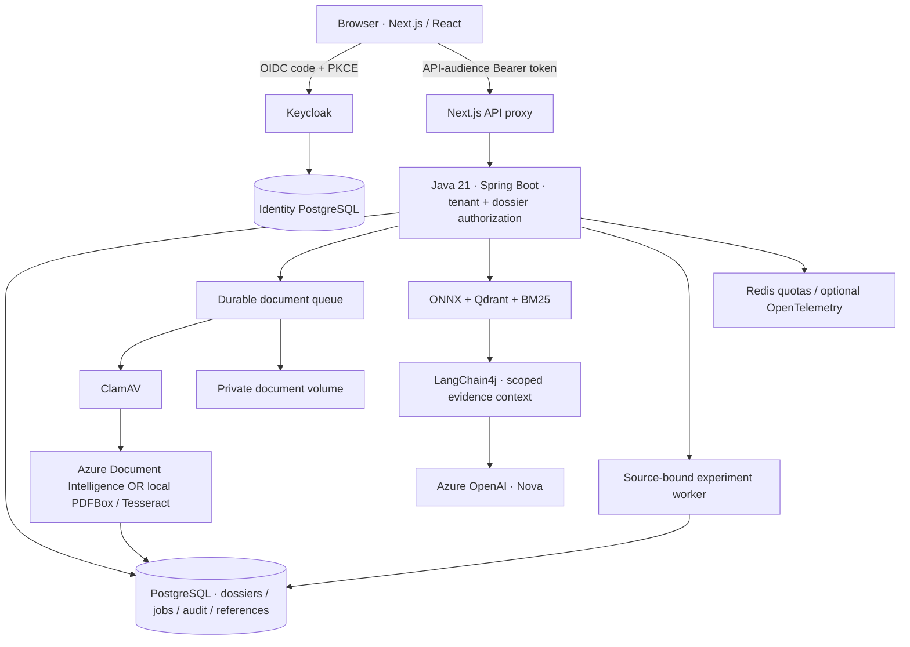

# Document Intelligence Lab

An evidence-first research workspace for banking/payroll, insurance and general documents.

**Java 21 · Spring Boot · LangChain4j · Azure Document Intelligence · Azure OpenAI · Next.js · PostgreSQL · Qdrant · Keycloak · Docker**

Upload a permitted PDF, extract text and tables, inspect the original, retrieve evidence and discuss it with Nova. Keep model output separate from extraction rules and human verification.

[Run with Docker](#run-locally) · [Connect Azure AI](#connect-azure-ai-for-local-nova) · [AI features](#what-uses-ai) · [Screenshots](#workspace-tour) · [Architecture](#architecture)

> Research software, not a banking or insurance product. Use fictional or explicitly permitted documents. No payments, automated credit decisions, underwriting, claim settlement or automatic email delivery.

## Workspace tour

Current local UI in English. Screenshots show an existing research workspace, not data preloaded into a fresh installation. German labels and number formatting inside source evidence are deliberately preserved.

### Three document domains

DATEV payroll stays in **Banking & payroll**. Insurance policies/claims and general documents have separate dossier types and review requirements.


### DATEV original and extraction

The current PDF viewer places the private original beside extracted fields, source quotations and page links. **Net earnings and payout are separate values.** OCR confidence can be inspected under recognition details; it is not a measured accuracy percentage.


The visible DATEV excerpt is from a fictional publisher sample. Original/derived PDF files are not distributed in this repository; DATEV retains its rights. [Prepare the private references](docs/PUBLIC_PAYROLL_TESTS.md).

### Insurance documents

Included fictional policy, claim-notification and invoice PDFs let a fresh clone exercise the document workflow without payroll files.


### Nova, grounded in the selected dossier

A real local Azure OpenAI conversation about the approved DATEV sample. Nova separates net earnings from payout, cites the source and leaves the financial interpretation to the reviewer.


### Source-bound experiments

Read labels independently from the original, save a reference version, then evaluate saved extraction or compare BM25/vector/hybrid retrieval. Results belong to that labelled sample, not general model accuracy.


## Run locally

### Requirements

- Git and Docker Desktop with Compose v2, or Docker Engine + Compose on Linux.
- Suggested Docker allocation: **4 CPUs, 8 GB RAM, 15 GB free disk**.
- Available local ports: **3000**, **8080**, **8081**.
- Internet for images, build dependencies and initial ClamAV signatures.
- No host Java, Maven, Node.js or Azure account required for the base Docker profile.

```bash
git clone https://github.com/quocvietphung/document-intelligence-lab.git
cd document-intelligence-lab
mkdir -p .local/reference-pdfs
docker compose -f docker-compose.yml -f docker-compose.platform.yml up --build -d --wait --wait-timeout 900
```

Open **[http://localhost:3000/en](http://localhost:3000/en)**. German: `/de`; Vietnamese: `/vi`. Access to the repository is required while it is private.

| Local account | Username | Password |
| --- | --- | --- |
| App user: ADVISOR + REVIEWER | `advisor.demo` | `demo-password` |
| Keycloak admin: `http://localhost:8080/admin/` | `admin` | `local-admin-only` |

These published development credentials apply to a **fresh local identity database**. Existing volumes retain their accounts/passwords. Do not expose this realm publicly or reuse the passwords in a cloud deployment.

No `.env` file is required for the base profile. ClamAV initialization may take several minutes. `storage-init` **exiting with code 0 is expected**: its directory-permissions task has finished.

### Try a document

1. Sign in and create a **General documents** dossier.
2. Upload `public/samples/invoice-fictional.pdf` and explicitly confirm analysis.
3. Open **View result & PDF** to compare the original, extracted fields and tables.
4. Use **AI Studio** to retrieve source passages.
5. Use **AI Experiments** to label fields/questions and evaluate them.
6. For insurance, create an Insurance dossier and use the included policy/claim PDFs. For payroll, prepare the two private DATEV pages before opening the DATEV library.

**Without Azure:** local PDFBox/Tesseract extraction, PDF review, hybrid evidence search, experiments, queues and audit work. Nova's **App guidance** works locally. Nova's **Evidence analysis** requires Azure OpenAI; no fake LLM response or local model is substituted.

[Full Docker guide: startup, persistence, stop/restart and troubleshooting](docs/DOCKER_LOCAL.md).

## What uses AI?

| Feature | Engine | Where to try it |
| --- | --- | --- |
| OCR and layout: text, tables and page evidence | Azure Document Intelligence `prebuilt-layout` in Azure mode; PDFBox/Tesseract in local mode | Documents & review → Upload / DATEV library → View result & PDF |
| Semantic + lexical evidence retrieval | Local MiniLM ONNX embeddings, Qdrant and BM25; **not Azure AI Search** | AI Studio |
| Document Q&A and source-linked explanations | Azure OpenAI through Java/LangChain4j; dossier-scoped read-only tools | Nova → Evidence analysis |
| Summary, cross-document comparison and inconsistency explanation | Controlled Azure OpenAI task prompts | AI transparency & review → Task library |
| Document-request draft and review checklist | Azure OpenAI; user edits/confirms the draft | Task library / Nova |
| German document terminology and DE–VI evidence summary | Azure OpenAI, grounded in available sources | Task library / Nova |
| Extraction precision/recall/F1 and retrieval hit rate@5/MRR@5 | Local deterministic evaluation of human-labelled references, **not an LLM judge** | AI Experiments |

Document classification, field normalization, missing-document checks, citation-ID validation and reviewer permissions use **Java/application rules**, not a trained banking/insurance model. A citation pointing to an existing page does not prove that every statement is correct. No calibrated groundedness score, learned reranker, automatic retraining or representative OCR accuracy is claimed.

**Azure Foundry evaluation, Data Factory orchestration, Blob ingestion and Application Insights are not connected by default.** Data Pipelines can prepare private JSON/JSONL exports; preparing inputs is not an executed cloud evaluation.

[Nova privacy, feedback and human review](docs/NOVA_TRUST.md) · [Research methods and metrics](docs/RESEARCH_WORKSPACES.md).

## Connect Azure AI for local Nova

Docker still runs on your computer. Only confirmed document analysis and user-sent model requests call Azure. **No VM, AKS, Vercel deployment or Azure API key is needed.**

1. Prepare an Azure OpenAI resource with a compatible deployed chat model, and a Document Intelligence resource with a custom-subdomain endpoint.
2. Have an authorized administrator grant your developer account **Cognitive Services OpenAI User** on OpenAI and **Cognitive Services User** on the document resource.
3. Install Azure CLI and Node.js 22+ on the host. Sign in to the tenant/subscription containing those resources.
4. Create your private configuration **once**:

```bash
cp .env.azure.example .env.azure.local
az login --tenant YOUR-TENANT-ID
az account set --subscription YOUR-SUBSCRIPTION-ID
```

Edit `.env.azure.local` with **your** values:

```dotenv
AZURE_DOCUMENT_INTELLIGENCE_ENDPOINT=https://YOUR-DOCUMENT-RESOURCE.cognitiveservices.azure.com/
AZURE_OPENAI_ENDPOINT=https://YOUR-OPENAI-RESOURCE.openai.azure.com/
AZURE_OPENAI_DEPLOYMENT=YOUR-CHAT-DEPLOYMENT
```

Use resource-root endpoints, **not** a Foundry project URL, deployment URL or `/openai/v1` path. The deployment value is the deployed model's name, not necessarily its model family. The current local workspace has been exercised with `gpt-4.1-mini`; availability and compatibility depend on your resource.

Start the Azure-enabled Docker profile and keep token renewal running:

```bash
node scripts/docker-azure.mjs up
```

The helper reads the ignored configuration, obtains a short-lived Entra token, mounts only its private token directory into Java and renews every five minutes. It does not print the token, mount your Azure CLI cache, create resources or grant permissions. **Ctrl+C stops renewal, not the containers.** After restarting your computer, run the helper again.

Open Nova → **Evidence analysis**, ask a question about the selected dossier and check the source links. **App guidance** is a separate local mode, not an Azure response.

See [the complete Azure setup](docs/AZURE_AI.md) for resource/deployment preparation, exact RBAC examples, identity boundaries, validation, limits and error diagnosis. Azure inference may incur usage charges.

## Architecture



Two separate identities:

- **Keycloak** authenticates the app user and supplies roles, tenant and API audience.
- **Microsoft Entra** authorizes Java to call Azure. The local developer token bridge is **not Managed Identity**. An Azure-hosted application would use its own appropriately scoped Managed Identity.

| Service | Local access / responsibility |
| --- | --- |
| `web` | `http://localhost:3000` — Next.js UI and authenticated API proxy |
| `credit-api` | `http://localhost:8081` — Java APIs, extraction, search and workers |
| `keycloak` | `http://localhost:8080` — OIDC, users, roles and sessions |
| `case-db` / `identity-db` | Separate internal PostgreSQL databases with named volumes |
| `qdrant` / `redis` | Internal evidence index and shared quotas, persisted locally |
| `clamav` | Scans uploads before extraction; persistent signature volume |
| `storage-init` | One-shot private-volume ownership task |
| `otel-collector` | Optional local tracing override; no automatic cloud export |

Development ports bind to `127.0.0.1`. Historical `credit-*` service/realm/volume names are retained for data compatibility; renaming the Compose project creates different volumes rather than migrating them.

## Data, privacy and operation

- Included fictional PDFs: invoice, insurance policy and claim notification under `public/samples/`.
- Payroll examples: only the two official fictional **DATEV LODAS 2025 Robert/Melanie** pages in the user-facing library. Older payroll fixtures exist only as regression-test resources.
- Original documents are private and Bearer-protected; PDF.js assets are served locally, not from a document-viewer CDN.
- Upload consent, malware scanning, reviewer history and case/tenant isolation remain enabled.
- Document retention is separate from chat/reference history; see the retention limits in [Nova privacy](docs/NOVA_TRUST.md).
- The former Azure VM backend was decommissioned. **Local Docker is the primary runtime**; the old Vercel frontend is not a working backend/login environment.
- No cloud resource is created by the local startup commands. Never commit private PDFs, `.env.azure.local`, tokens, database dumps or Terraform state.

Stop without deleting data:

```bash
docker compose -f docker-compose.yml -f docker-compose.platform.yml stop
```

Do not add `--volumes` to cleanup commands unless intentionally deleting your data. [Backup, monitoring and recovery](docs/RELIABILITY_LAB.md).

## Development and tests

```bash
npm ci
npm run verify
node --test scripts/docker-azure-config.test.mjs
mvn -f services/credit-api/pom.xml verify
```

For a running **no-Azure** full Docker profile:

```bash
TEST_SHOWCASE=1 node scripts/test-oauth.mjs
```

The acceptance script creates labelled fictional records and tests OIDC/PKCE, protected web/Java APIs, upload scanning/extraction, private originals, retrieval and durable research jobs. Azure-specific opt-in tests can make billable calls; read their prerequisites before enabling them.

## Project guide

| Location | Purpose |
| --- | --- |
| `app/`, `components/workspace/` | Localized web UI, document review, Nova and research workspaces |
| `lib/` | Contracts, translation tables, transports and frontend tests |
| `services/credit-api/` | Java security, AI integration, workers and Flyway migrations |
| `infra/keycloak/` | Local development realm |
| `infra/azure/` | Optional infrastructure source; not required locally |
| `scripts/` | Azure token bridge, private sample preparation and verification |

Documentation: [Docker](docs/DOCKER_LOCAL.md) · [Azure AI](docs/AZURE_AI.md) · [Document samples](docs/PUBLIC_PAYROLL_TESTS.md) · [Research](docs/RESEARCH_WORKSPACES.md) · [Nova](docs/NOVA_TRUST.md) · [Operations](docs/RELIABILITY_LAB.md).

## License

Project code: [MIT](LICENSE). Third-party software and publisher documents retain their own terms; this license does not grant redistribution rights to DATEV originals.
