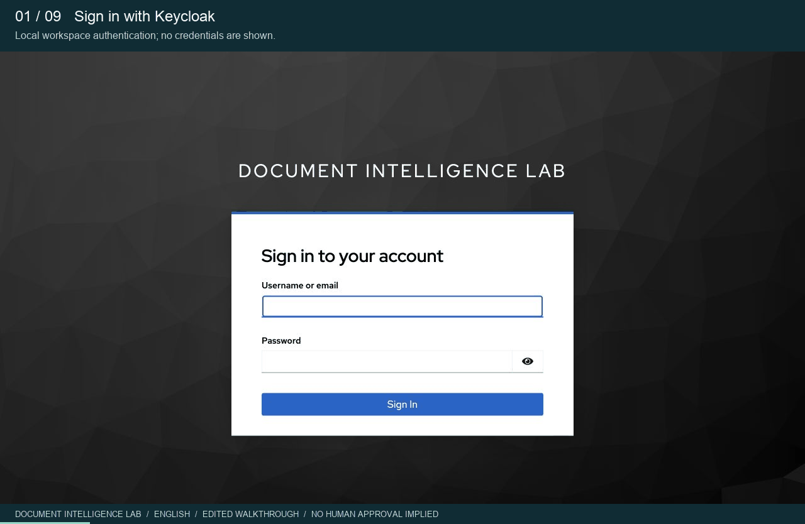
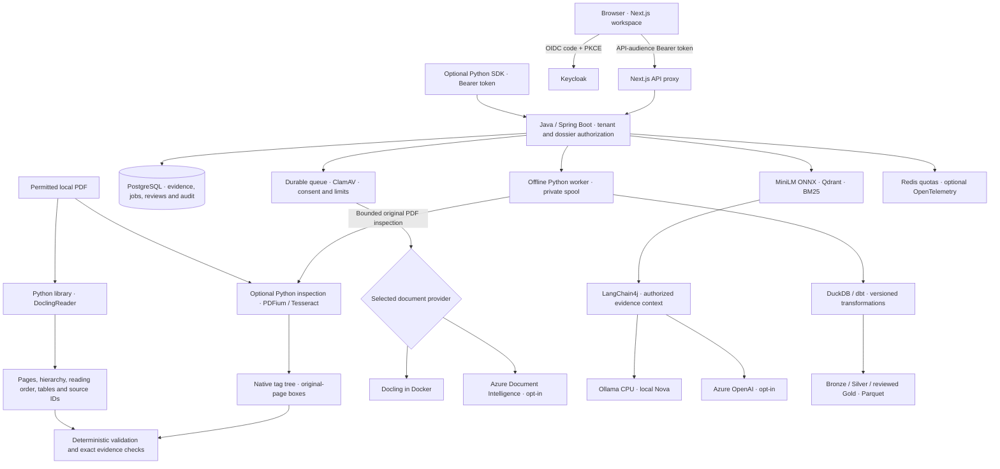
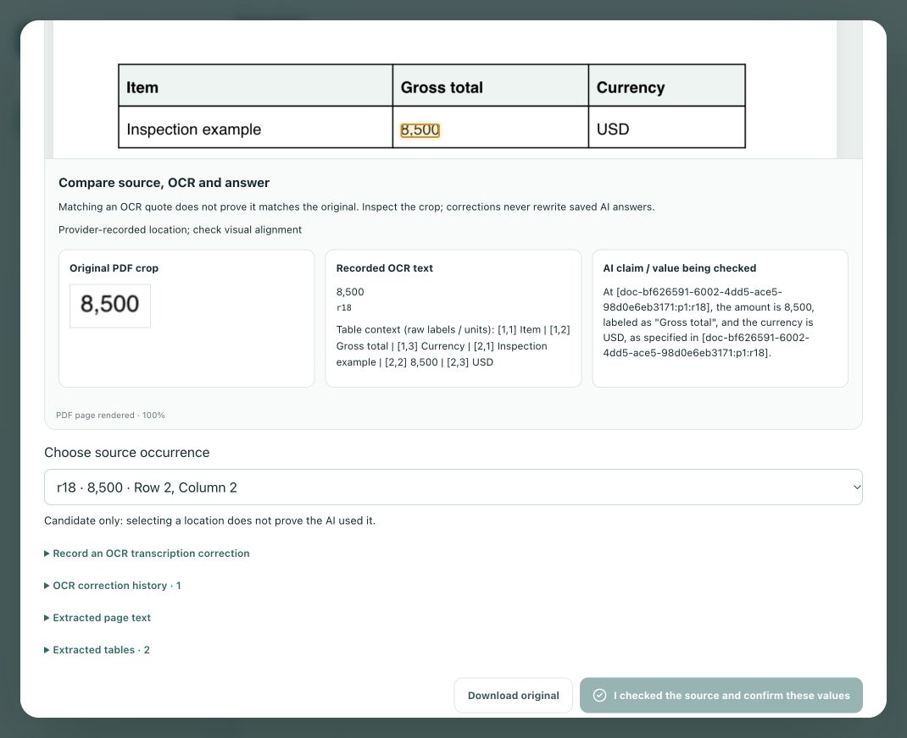
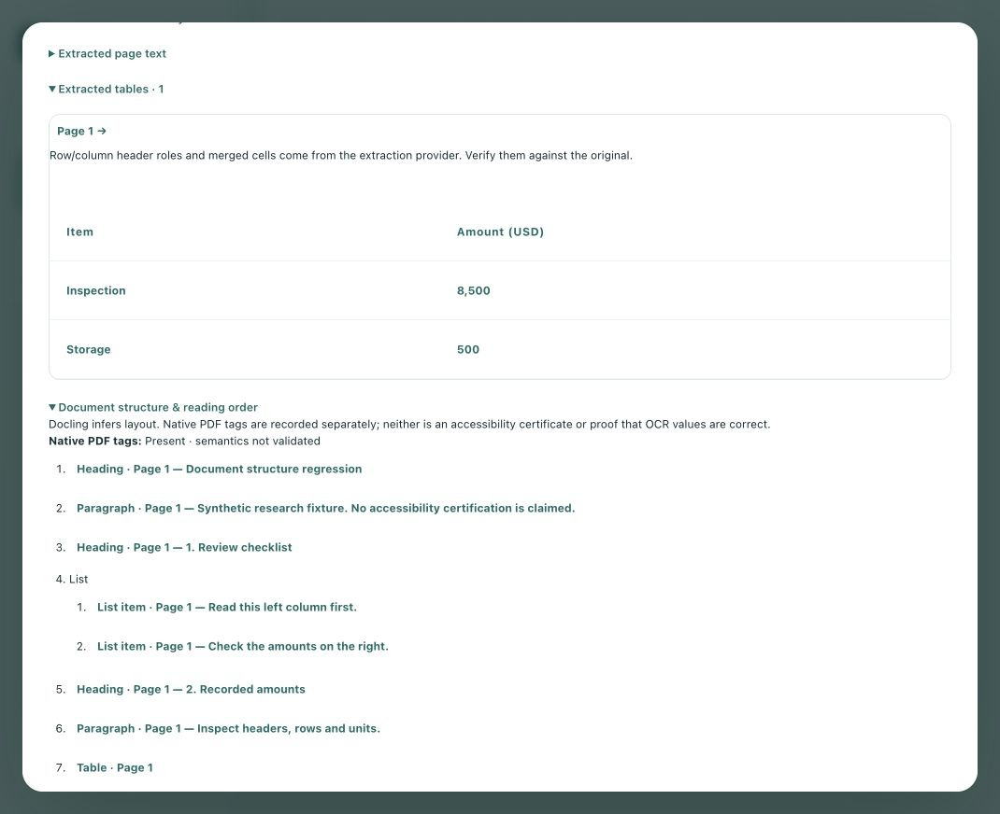
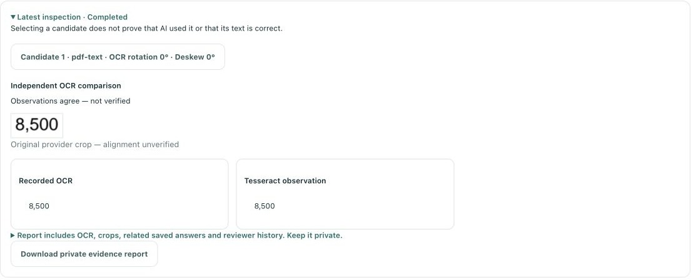
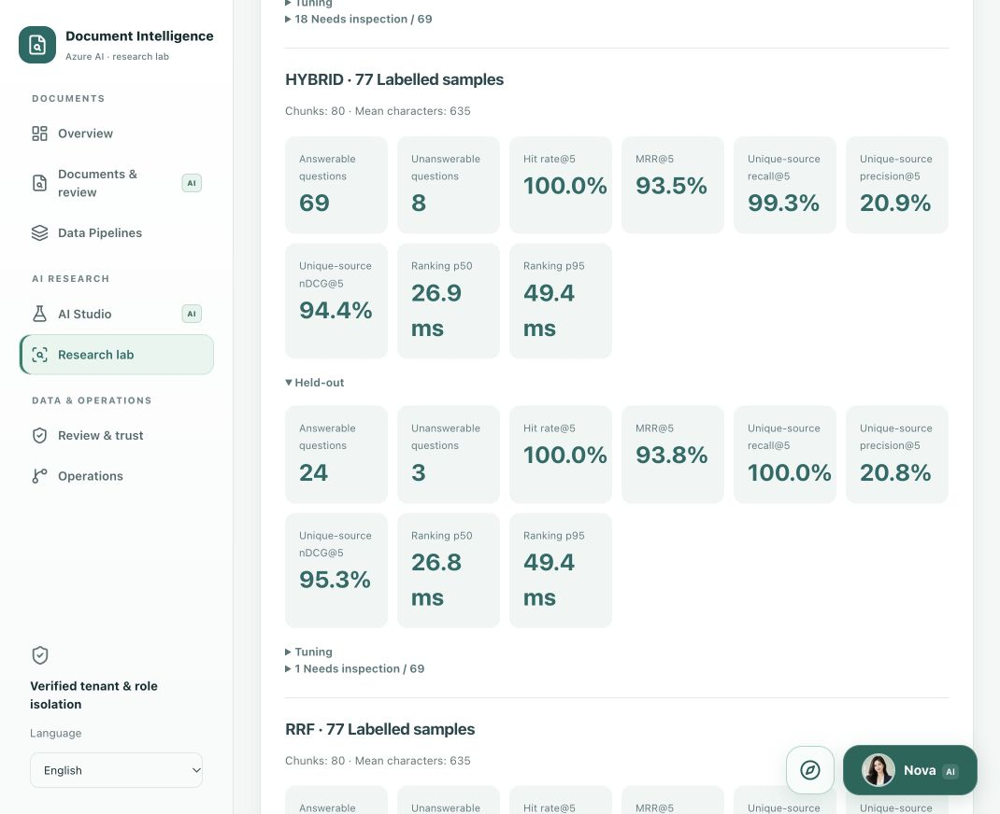

# Document Intelligence Lab

## Search the source with XERJ

[](https://hub.xerj.org/contributors/quocvietphung)

For code review, an AI agent can use XERJ to index this public repository and retrieve implementation passages with file paths. This is a separate developer tool; running the application or Nova does not require it. See the [Corpus Hub entry](https://hub.xerj.org/corpus/quocvietphung--document-intelligence-lab) for its current publication status.

The Hub reference names commit [`cd45b95171f9497bb298c4e8ad2c3d64c822f706`](https://github.com/quocvietphung/document-intelligence-lab/tree/cd45b95171f9497bb298c4e8ad2c3d64c822f706). The steps below reproduce that historical snapshot locally, independently of downloadable pack availability. Newer features on `master` may be absent; always identify the commit used in an answer. Selection for the Hub is not an audit or an accuracy certification.

<details>
<summary>Search the pinned reference locally (macOS/Linux)</summary>

Install XERJ using its [official installation guide](https://xerj.org/docs/install), then check each command's result before continuing. Use a new reference directory outside your working checkout so private PDFs, credentials and runtime files are not indexed. Port 9200 must be free; do not replace an existing node. [CLI and query reference](https://xerj.org/llms.txt).

**Terminal 1:** verify usage, clone the reference and start the local node. The node's data directory is a sibling of the indexed source, never inside it. Keep this terminal running; `Ctrl+C` stops this node.

```bash
xerj --help
mkdir document-lab-reference
cd document-lab-reference
git clone https://github.com/quocvietphung/document-intelligence-lab.git
git -C document-intelligence-lab checkout --detach cd45b95171f9497bb298c4e8ad2c3d64c822f706
git -C document-intelligence-lab rev-parse HEAD
export XERJ_DISABLE_FEEDBACK=true
xerj --insecure --bind 127.0.0.1 --port 9200 --data-dir ./xerj-data
```

Verify the checkout prints the pinned SHA and the node starts on loopback. `--insecure` disables authentication/TLS for this local reference node only; keep its listeners on loopback. Feedback submission is disabled for this walkthrough. See [XERJ's authentication and network documentation](https://xerj.org/docs/security).

**Terminal 2:** open the same `document-lab-reference` directory, index only the reference clone, inspect the map and search for an actual symbol in that snapshot:

```bash
export XERJ_DISABLE_FEEDBACK=true
xerj autoindex ./document-intelligence-lab --url http://127.0.0.1:9200 --prefix document-intelligence-la --progress plain
xerj autoindex map --url http://127.0.0.1:9200
curl --fail --silent --show-error \
  -X POST 'http://127.0.0.1:9200/document-intelligence-la-*/_search' \
  -H 'Content-Type: application/json' \
  -d '{"size":3,"_source":["ax_path","defs","body"],"query":{"multi_match":{"query":"SelectedFieldEvidence","fields":["defs^3","body","title"]}}}'
```

Read the indexing summary before querying: exit 0 means complete; exit 3 means completed with skipped/junk files that need inspection; other nonzero results require following the CLI's diagnostic. The map describes indexed fields; it does not answer a code question by itself. Check the search response has relevant hits, then inspect their passages. If it has none, report that rather than inventing an implementation.

An example question for an agent is: **“How does `SelectedFieldEvidence` restrict the evidence passed to Nova?”** Ask it to use the returned passages, cite each hit's `_source.ax_path` (and line numbers when supplied), identify the pinned commit and distinguish source findings from inference. Retain the [MIT copyright notice](LICENSE) and credit Viet Phung and the repository contributors when adapting their code. An indexed hit alone does not verify application behavior.

</details>

## About the project

**Document Validation & Evidence — a Python library and a local AI research workspace.**

An MIT-licensed project for turning PDFs into structured data, traceable answers and reviewable findings. It studies **general business documents**, **insurance wording** and **DATEV payroll/banking documents**, without making credit, underwriting, settlement or payment decisions.

**Published Python alpha:** [document-evidence-lab 0.1.0a1 on PyPI](https://pypi.org/project/document-evidence-lab/0.1.0a1/) · [release source](https://github.com/quocvietphung/document-intelligence-lab/tree/python-v0.1.0a1). Install the standalone library from PyPI, or clone this repository for the full Docker workspace.

| Entry point | Use it for | Runtime |
| --- | --- | --- |
| **Python library** | Read local PDFs with Docling; inspect page/table evidence; validate amounts, literal text labels and citations | Python only; no Java, Docker, login or LLM |
| **Research workspace** | Manage dossiers, scan uploads, ask Nova, compare RAG/prompt methods, review evidence and build data layers | Java + Next.js + Docker; Keycloak authentication |
| **Python SDK** | Access the Java platform's protected workflow, batch receipts and audit history | Lightweight Python client + an existing Java API and Bearer token |

The library validates Docling output without requiring the platform; the SDK is a separate integration. The source/wheel preview is 0.2.0a1 and is not yet published to PyPI.

[Search the source](#search-the-source-with-xerj) · [Python Quick Start](#python-quick-start) · [Docker workspace](#local-docker-workspace) · [Azure setup](#local-setup-with-azure-ai) · [PDF examples](#pdf-examples) · [AI workflows](#ai-workflows) · [Architecture](#architecture) · [Evidence](#evidence-inspection) · [RAG evaluation](#pdf-backed-rag-evaluation) · [Tests](#development-and-tests)

## AI workflows

Overview distinguishes **16 AI-assisted workflows** from **15 rule-based, navigation and human-review controls**, not 31 models. Every AI entry has a PDF exercise; opening one does not invoke inference.

| Workflow | PDF exercise |
| --- | --- |
| Text, layout and OCR | Invoice 51109301 versus its original |
| Table extraction | Invoice lines, VAT and gross total |
| Semantic/hybrid search | Shelter wording and its returned source page |
| Local embeddings | Vector versus BM25/hybrid for the same checked question |
| Nova document Q&A | Invoice number, INR currency and total |
| Selected-field explanation | DATEV net earnings versus payout |
| Evidence summary | Invoice facts and missing context |
| Cross-document/amount comparison | Invoices 51109301 and 51109302 separately; no inferred settlement |
| Discrepancy explanation | DATEV extraction versus its original |
| Document-request draft | Missing insurance context; no email delivery |
| Manual-review checklist draft | Invoice identity, totals and page sources |
| German terminology | DATEV labels without invented deductions |
| German–Vietnamese summary | Preserved labels, amounts and citations |
| Document chronology | Literal invoice date, no invented deadline |
| Clause/obligation review | Insurance wording; no legal or coverage decision |
| Sensitive-data review draft | Identifier categories; no automatic redaction |

Workflows share the selected extraction/Nova providers. MiniLM is English-focused; relevance scores are not accuracy percentages. Optional PaddleOCR, BGE-M3, reranking and vision need separately prepared weights and live evaluation. [Integration boundaries](docs/AI_INTEGRATIONS.md).

## Walkthrough



An edited walkthrough of an existing synthetic-invoice dossier in the running English workspace. The extraction and ETL receipts were already saved; Nova's invoice-number/currency answer was generated locally for this walkthrough. Waiting periods are omitted. Source links support inspection, not automatic fact-checking or human approval.

## Python Quick Start

Use **Python 3.10+**. The standalone library needs no Java, Docker, Keycloak, Azure or LLM. Install the published alpha in an isolated environment:

```bash
python3 -m venv .venv
source .venv/bin/activate
python -m pip install 'document-evidence-lab[docling]==0.1.0a1'
```

On Windows PowerShell, activate with `.venv\Scripts\Activate.ps1`. For validation/SDK only, install `document-evidence-lab==0.1.0a1` without the extra. To use the source preview, clone this repository and install `./python[docling]` instead. The package name is `document-evidence-lab`, the import is `document_evidence`, and the CLI is `document-evidence`.

### Read and validate a PDF

```python
from document_evidence import DoclingReader, normalize_money, validate_document

# First preparation explicitly permits model downloads; later reads use cached weights.
document = DoclingReader(allow_model_download=True, timeout_seconds=900).read("invoice.pdf")
report = validate_document(document, required_labels=("Invoice no",))

print(document.pages[0].text)
print(document.tables)
print(report.to_dict())
assert str(normalize_money("2967,11 EUR").amount) == "2967.11"
```

After preparation, use `DoclingReader().read("invoice.pdf")` for offline inference; missing weights fail without cloud fallback. The CLI equivalent for first preparation is:

```bash
document-evidence invoice.pdf --allow-model-download --timeout 900 --output private-result.json
```

Defaults: **unencrypted PDF, four pages, 3 MB, 180-second conversion timeout**. First-use downloads may need the longer timeout above. Models are not bundled. Existing CLI output files are not overwritten; exported text is private. Standalone parsing has no ClamAV scan. Validation preserves original values and reports ambiguous amounts, currencies and literal-label findings; it does not authenticate a document or grant approval. [Python API, offline model paths and examples](python/README.md).

## Python SDK for the Java platform

Start the [Docker workspace](#local-docker-workspace) separately, install the lightweight package and supply a valid Keycloak **API access token**:

```python
import os
from document_evidence.client import PlatformClient

client = PlatformClient("http://localhost:8081", token=lambda: os.environ["LAB_ACCESS_TOKEN"])
case_id = os.environ["LAB_CASE_ID"]
case = client.get_case(case_id)
workflow = client.workflow(case_id)
```

The callback can provide a refreshed token; the SDK does not log in or renew credentials itself. Java enforces audience, tenant, dossier and roles. Uploads require explicit consent and a persisted request UUID; a receipt is not completed OCR. [Read example](python/examples/platform_read.py) · [SDK and upload behavior](python/README.md#optional-java-sdk). Keep tokens out of source, screenshots and shell history.

<a id="local-docker-with-nova"></a>

## Local Docker workspace

Requirements: Git, **Node.js 22+**, Docker Desktop/Engine with Compose v2, free ports **3000, 8080, 8081**, at least four CPUs and **8 GB Docker RAM**. Leave memory for the host/browser. Keep at least 8 GiB free inside Docker for model preparation, plus space for images, documents and build cache.

Clone the repository, then start from its root:

```bash
git clone https://github.com/quocvietphung/document-intelligence-lab.git
cd document-intelligence-lab
mkdir -p .local/reference-pdfs
node scripts/docker-local.mjs --prepare-model
```

First setup builds the app and CPU-only Ollama runtime, then explicitly downloads **`qwen3:4b-instruct-2507-q4_K_M`** (about 2.5 GB) into a persistent volume. The helper checks space and never prunes data automatically.

Subsequent starts reuse models and databases:

```bash
node scripts/docker-local.mjs
```

Wait for the helper's readiness message. Use `--no-build` only when source and images match. This profile includes Docling, local Nova and ETL; it clears Azure chat/extraction configuration and has no silent cloud fallback.

### Sign in through Keycloak

Open [English](http://localhost:3000/en), [Deutsch](http://localhost:3000/de) or [Tiếng Việt](http://localhost:3000/vi), choose **Sign in** and use:

| Local account | Username | Password |
| --- | --- | --- |
| App user: ADVISOR + REVIEWER | `advisor.demo` | `demo-password` |
| Keycloak administrator: `http://localhost:8080/admin/` | `admin` | `local-admin-only` |

These are development credentials for a **fresh identity database**. Existing volumes keep their passwords. Use the app account on the login page, not the administrator account. Start sign-in from the app: temporary authentication URLs expire. Never expose the development realm publicly or reuse its passwords in a deployment.

### Try a complete workflow

1. Create a **General documents** dossier and prepare a permitted [PDF example](#pdf-examples).
2. In **Documents & review → Reference library**, select invoice **51109301**, preview it and confirm **Import & analyze**.
3. Follow its job in **Data Pipelines**, then open **Analysis results → View result & PDF**. Inspect the original, fields and tables.
4. Open Nova's portrait, select **Evidence analysis** and ask: *“What invoice number, currency and gross total are stated? Cite the source page.”* Enter sends; Shift+Enter adds a line break.
5. Wait for a completed **Ollama · Local LLM** answer. Open its citations and compare the PDF; source identity is not semantic verification.
6. In **Research lab → Experiments**, independently check reference values/pages before comparing retrieval, chunking or prompts.

**App guidance** and compass page tours are local navigation helpers, not document inference. Nova's portrait is an AI-generated fictional character. Expand its reading area for longer answers.

CPU generation can take several minutes. Java admits one local inference at a time (`LOCAL_MODEL_BUSY` for competing requests), with a 360-second model deadline inside the proxy's 380-second deadline. **Stop waiting & request cancellation** tracks backend status; it does not confirm provider termination. [Durable request lifecycle](docs/RELIABILITY_LAB.md#durable-nova-lifecycle).

## Local setup with Azure AI

This alternative keeps Docker on your computer while using **your own Azure OpenAI and Document Intelligence resources**. No VM, AKS or Vercel project is required. Cloud inference can be billable.

### Resources and access

Install Azure CLI. Use an authorized tenant/subscription and resource-scoped roles:

| Resource | Configuration | Developer role |
| --- | --- | --- |
| Azure OpenAI | Resource-root endpoint; compatible deployed Chat Completions/tool-calling model | Cognitive Services OpenAI User |
| Document Intelligence | Custom-subdomain endpoint; `prebuilt-layout` | Cognitive Services User |

An authorized administrator grants these through each resource's **Access control (IAM)**. Do not grant subscription-wide Owner access. Local scripts do not create resources, deploy models or grant roles.

```bash
az login --tenant YOUR-TENANT-ID
az account set --subscription YOUR-SUBSCRIPTION-ID
test -f .env.azure.local || cp .env.azure.example .env.azure.local
```

Edit the ignored `.env.azure.local` file:

```dotenv
AZURE_DOCUMENT_INTELLIGENCE_ENDPOINT=https://YOUR-DOCUMENT-RESOURCE.cognitiveservices.azure.com/
AZURE_OPENAI_ENDPOINT=https://YOUR-OPENAI-RESOURCE.openai.azure.com/
AZURE_OPENAI_DEPLOYMENT=YOUR-CHAT-DEPLOYMENT
```

Use resource-root endpoints, not Foundry project URLs or `/openai/v1` paths. The deployment value is the deployed model's **deployment name**. Confirm compatibility, quota, region and permitted data in your resource.

### Start and test Azure mode

```bash
node scripts/docker-azure.mjs up
```

Keep this terminal running. The helper obtains/renews an Entra token and mounts only its private token directory into Java, not the Azure CLI cache. It never prints tokens. **Ctrl+C stops renewal, not containers**; restart the helper after rebooting. This developer-token bridge is **not Managed Identity**.

Keycloak authenticates app users; Entra authorizes Java's Azure calls. Do not paste Azure tokens or API keys into Keycloak. Preserve organizational network restrictions instead of exposing private resources to bypass a connection error.

Follow the same PDF workflow and verify the extraction identifies **Azure Document Intelligence** and the completed answer identifies **Azure OpenAI**. Previewing does not send a PDF; confirmed analysis does. Azure mode limits each PDF to two pages and 3 MB. [Azure details](docs/AZURE_AI.md).

<a id="7-analyze-a-document-and-test-nova"></a>

Blob intake, the ADF operator bridge, saved-answer evaluation and Application Insights are separate opt-in adapters. They require their own credentials and live verification. Azure cannot directly reach Mac `localhost`; the project provisions no public tunnel. [Optional integration setup](docs/AI_INTEGRATIONS.md).

## PDF examples

Only use fictional or explicitly permitted documents. Private originals and model weights are not distributed with the package or repository.

<a id="kaggle-document-library"></a>

### Kaggle invoices and insurance wording

| Domain | Sample | Exercise |
| --- | --- | --- |
| General documents | Synthetic one-page invoices **51109301–51109304** | Identifiers, INR amounts, tables, evidence checks, prompts and ETL |
| Insurance | Principal definitions/administration and Shelter conditions/personal-liability excerpts | Source search and clause-review drafts; no coverage decision |
| Banking & payroll | Official fictional DATEV Robert-Muster and Melanie-Muster pages | Net earnings versus payout, person/period checks and source evidence |

Sources: [invoice dataset](https://www.kaggle.com/datasets/devp1866/high-quality-ocr-ready-invoice-pdfs) and [insurance dataset](https://www.kaggle.com/datasets/jpardovega/documents). Review source terms. Kaggle license metadata is not independent clearance of publisher-owned wording. Insurance samples are historical English-language US wording, not German policies or complete individual contracts.

Prepare the hash-pinned Kaggle samples in your activated Python environment:

```bash
python -m pip install pypdf==6.10.0
python scripts/prepare-kaggle-references.py --domain all
```

The helper verifies hashes/page mappings, refuses changed files and writes under `.local/reference-pdfs/`, outside Git. Missing or changed originals disable library cards rather than silently fetching replacements. [Sample boundaries](docs/PUBLIC_PAYROLL_TESTS.md).

<a id="datev-payroll-references"></a>

### DATEV payroll

Review the publisher's terms and download the unchanged [official DATEV LODAS sample](https://www.datev.de/content/dam/markenassets/themen-und-produktgruppen/zielgruppen/zielgruppenuebergreifend/shop-assets/personalwirtschaft/lodas-musterauswertung-2025-deutsch.pdf) to `.local/datev-lodas-musterauswertung-2025.pdf`, then run:

```bash
python scripts/prepare-datev-reference.py .local/datev-lodas-musterauswertung-2025.pdf
```

In **Banking & payroll → Documents & review → Reference library**, keep `Netto-Verdienst` separate from `Auszahlungsbetrag`. Publisher PDFs retain DATEV's rights. The Python reader can inspect these permitted pages, but its generic label checks do not implement every Java payroll-layout rule.

### Official forms for RAG evaluation

After preparing DATEV and Kaggle, add the reviewed CMS coverage example and IRS blank W-2/instructions with `python scripts/prepare-rag-benchmark.py --download`. This explicitly downloads the two official originals, verifies pinned hashes and prepares private excerpts; it does not call Azure. The [source registry](lib/rag-pdf-sources.json) records publisher links and original-page mappings. See [PDF-backed RAG evaluation](#pdf-backed-rag-evaluation) for results and limits.

## Document pipeline operations

**Data Pipelines** separates processing, batch intake and exports. Batch intake accepts one to four permitted files, a source note and check profile. Each file is scanned; provider limits still apply per file. Profiles are versioned field checks, not trained classifiers.

Receipts record hashes, provider, extraction counts, attempts and actual stages. The same request UUID/content returns its receipt; changed content is rejected. Duplicate/cancel/retry controls do not guarantee exactly-once inference. Manual retry is limited to pinned DATEV/Kaggle bytes within retention; inspect arbitrary failed uploads before resubmitting. [Queue details](docs/DOCKER_LOCAL.md).

### Bronze, Silver and Gold

After extraction, open **Data layers & exports**, review the private-copy notice and choose **Build data layers**:

- **Bronze:** immutable extraction snapshots and recorded hashes, without another PDF/OCR copy.
- **Silver:** raw fields, normalized amounts, currency and quality findings; ambiguous `03/07/2023` remains unchanged.
- **Gold:** only reviewer-confirmed values, grouped separately by field and currency. Empty Gold is valid for unreviewed evidence.

The offline DuckDB/dbt worker has no network, public port or database password. SCD Type 2 tracks observed changes, not inferred business-effective dates. Unchanged sources may reuse a completed receipt for the current method; past exports stay unchanged. Parquet downloads require dossier authorization and contain private data. Original-PDF expiry does **not** delete analytical copies, chat history or research labels.

## Architecture



Python and Java do not require the same runtime. Shared fixtures compare citations and supported validation cases; Python output is not automatically trusted or inserted into the Java database. Java's Docling bridge remains intact. No extra Python HTTP microservice is needed for package installation.

In the workspace, one document provider and one Nova provider are selected; the branches are alternatives, not an ensemble or cloud fallback. Standalone Python never calls Nova. Cloud adapters require separate credentials and explicit execution. Keycloak authenticates users; Entra authorizes Azure service calls.

## Research scope

The lab studies document extraction, evidence preservation, multilingual retrieval and source-bound generation across general business, insurance and payroll documents. [AI workflows](#ai-workflows) lists the user-facing tasks; [architecture](#architecture) shows their providers and trust boundaries.

### Evidence inspection

Open **Documents & review → View result & PDF** and inspect a field, table cell or recorded source occurrence:

- Compare the **original crop, recorded OCR and answer value**. Matching a citation does not prove the OCR read the original correctly.
- Repeated values retain separate occurrence IDs. Selecting a candidate is explicit; page references cannot identify the correct occurrence by themselves.
- Inspect Docling's heading/list/table hierarchy, reading order, header roles and cell spans. Native PDF tags are reported separately from inferred structure; neither certifies accessibility.
- Choose **Check source location & OCR → Inspect locally** for an independent PDFium/Tesseract inspection through the offline ETL worker. Geometry and unsupported orientations remain visible limitations.
- Reviewer OCR corrections, field confirmation and revised AI answers are separate, audited actions. Original OCR and previous answers remain unchanged.



<details>
<summary>Structure and independent local inspection</summary>





Agreement is labelled **not verified**. Reports contain private source text/crops and must stay private. For exact-location inspection and `evaluate_document`, use the **source/wheel preview 0.2.0a1**; these APIs are not in the published PyPI 0.1.0a1. See the [Python inspection guide](python/README.md#inspect-native-tags-and-exact-pdf-locations), [quality dimensions](python/README.md#source-bound-quality-dimensions) and [measured reports](#development-and-tests).

</details>

### PDF-backed RAG evaluation

The lab now includes a [registry of nine prepared PDF references](lib/rag-pdf-sources.json) and [77 authored questions](lib/rag-pdf-questions.json) covering DATEV payroll, invoices, insurance and blank tax forms. CMS and IRS add official examples; publisher-owned references stay private. CFPB links that could not be downloaded are recorded separately and are not counted in measured results.

In **Research lab → Experiments**, compare **BM25 / Vector / Hybrid / RRF / Previous Hybrid** with multiple relevant pages, tuning/held-out groups, Hit@5, Recall@5, unique-source Precision@5, nDCG@5, MRR@5 and ranking p50/p95. Unanswerable questions remain explicit; retrieval does not certify a model's refusal or answer correctness. Lexical matching now uses term frequency, compound identifiers and a small explicit EN/DE/VI glossary; it never rewrites stored source amounts.

All nine prepared PDFs passed the local ClamAV/Docling intake. The [measured report](docs/benchmarks/rag-pdf-retrieval.json) compares the same 69 answerable questions; eight unanswerable questions are kept separately:

| Docling extraction · page labels | Hit@5 | Multi-source Recall@5 | MRR@5 |
| --- | ---: | ---: | ---: |
| Previous Hybrid | 95.65% | 94.93% | 87.44% |
| Current Hybrid | 100.00% | 99.28% | 93.53% |

These are development measurements, not overall RAG accuracy. Excerpts of the same original stay in one group; two invoice originals still share a template. BM25 alone performs competitively and RRF does not consistently improve results. The report includes every method, separate tuning/held-out metrics and a separate native-text comparison. Cross-page text retains its own page spans; overlapping table predictions are withheld with an explicit warning while source text remains inspectable.



[Preparation, actual Docker pipeline, native-text comparison and metric definitions](docs/RESEARCH_WORKSPACES.md#reproducible-multi-domain-pdf-rag-benchmark). No new model download or paid Azure service is required for this benchmark.

## Development and tests

Core Python checks need no model, cloud credentials, Java or Docker. Run from a prepared source environment:

```bash
python -m pip install './python[dev]'
python -m unittest discover -s python/tests -v
python -m build python
python -m twine check python/dist/*.whl python/dist/*.tar.gz
python python/tools/check_distribution.py python/dist
```

Workspace checks require Node.js and JDK 21/Maven; authenticated acceptance also needs the running Docker stack:

```bash
npm run verify
mvn --batch-mode -f services/credit-api/pom.xml verify
node scripts/test-oauth.mjs
TEST_EVIDENCE_INSPECTION=1 node scripts/test-oauth.mjs
TEST_DOCUMENT_STRUCTURE=1 node scripts/test-oauth.mjs
TEST_RAG_PDFS=prepare node scripts/test-oauth.mjs
TEST_RAG_PDFS=measure node scripts/test-oauth.mjs
```

Prepare the [PDF sources](#pdf-examples) first for RAG acceptance. These checks create research records, not human approvals. [Research recipes and metric definitions](docs/RESEARCH_WORKSPACES.md) · [Python wheel/Docling checks](python/README.md#development) · [Nova, recovery and cancellation](docs/RELIABILITY_LAB.md).

| Measured artifact | Scope and limits |
| --- | --- |
| [PDF RAG comparison](docs/benchmarks/rag-pdf-retrieval.json) | Nine prepared PDFs, 77 questions; page-level retrieval, not answer factuality |
| [Synthetic source locations](docs/benchmarks/synthetic-grounding.json) | 128/128 labelled locations at IoU ≥ 0.5 across 32 generated PDFs; not representative business accuracy |
| [Text, table and reading order](docs/benchmarks/structure-quality.json) | One generated page: six cell matches, 15 anchor-pair matches, six character edits in 369 reference characters; not TEDS or general OCR accuracy |

Labels and PDF hashes are recorded in each report. Synthetic labels come from generated content; the business-reference pack was prepared by the development agent, not independently human-approved. Parser tests, retrieval tests and model-generation tests measure different things.

### CI and package releases

Platform CI checks web, Java, ETL, Keycloak and Docker/OIDC. Python CI checks **3.10–3.14**, wheel/sdist metadata, licence and package contents; its opt-in Docling smoke job downloads models explicitly. Pushing `master`/`develop` **does not publish PyPI or deploy Azure/Vercel**.

The published package is **0.1.0a1**; source/wheel preview is **0.2.0a1**. A future release requires a reviewed matching `python-v<version>` tag, the manual `python-publish.yml` workflow and owner approval of the protected `pypi` environment. Its Trusted Publisher is scoped to this repository/workflow/environment. TestPyPI is not configured. Verify a clean installation before announcing a release; existing PyPI files and descriptions are not updated by README edits. [Release workflow](.github/workflows/python-publish.yml).

## Storage and troubleshooting

The local helper builds application services sequentially, caps service RAM/CPU and keeps one Docling conversion worker. Nova loads on first use and releases idle model memory after five minutes; `--warmup` is explicit. On the tested 16 GB host, Docker used an 8 GiB allocation. Avoid concurrent OCR, generation and builds on a constrained laptop. [Resource limits](docs/DOCKER_LOCAL.md#local-memory-profile).

- **Private data:** keep PDFs, reports, models, tokens, environment files, dumps and Terraform state out of Git. [Security](SECURITY.md) · [Third-party terms](THIRD_PARTY_NOTICES.md).
- **Preserve volumes:** accounts, PDFs, databases, models and ETL persist separately. Do not use `down -v`, volume prune or system prune as troubleshooting shortcuts.
- **Nova/Azure errors:** check the selected provider, service logs, token renewal and resource-scoped permissions. App login is separate from Azure login. Busy/uncertain model calls are not retried automatically; check saved answer history before resubmitting.
- **Backups and retention:** use `node scripts/backup-workspace.mjs --create`, then verify the printed backup with `--verify`. Restores use isolated destinations. History cleanup defaults to dry run; PDF expiry does not erase analytical/chat/reference history. [Recovery and cleanup instructions](docs/RELIABILITY_LAB.md#backup-and-restore-checks).

Stop all local services without deleting their data:

```bash
OLLAMA_CHAT_MODEL=qwen3:4b-instruct-2507-q4_K_M docker compose \
  -f docker-compose.yml -f docker-compose.platform.yml -f docker-compose.docling.yml \
  -f docker-compose.nova-local.yml -f docker-compose.etl.yml stop
```

`storage-init`/`etl-init` exiting 0 is expected. Ports bind to loopback. Historical `credit-*` realm/service/volume names preserve compatibility; changing the Compose project name does not migrate data. [Docker diagnostics](docs/DOCKER_LOCAL.md#logs-and-troubleshooting).

## Project guide

| Location | Responsibility |
| --- | --- |
| `python/` | Standalone library, SDK, CLI, examples and tests |
| `python/src/document_evidence/contracts/` | Shared synthetic validation fixtures |
| `app/`, `components/workspace/`, `lib/` | Localized web UI, contracts and frontend tests |
| `services/credit-api/` | Java authorization, processing, evidence, workflows and audit |
| `services/document-etl/` | Offline DuckDB/dbt and Parquet |
| `infra/keycloak/` | Local development realm |
| `scripts/` | Startup, Azure token bridge, private sample preparation and acceptance |
| `.github/workflows/` | Platform checks and separately gated Python packaging/release |

More: [Python](python/README.md) · [Docker](docs/DOCKER_LOCAL.md) · [Local document AI](docs/LOCAL_DOCUMENT_AI.md) · [Azure AI](docs/AZURE_AI.md) · [Research](docs/RESEARCH_WORKSPACES.md) · [Nova](docs/NOVA_TRUST.md) · [Operations](docs/RELIABILITY_LAB.md).

## License and limits

Project code: [MIT](LICENSE). Contributions: [CONTRIBUTING](CONTRIBUTING.md). Software, model weights and publisher PDFs retain their own terms. This is research software, not a production-certified banking/insurance system, certified translation service, legal advisor or payment application. Human review remains required for consequential use.
