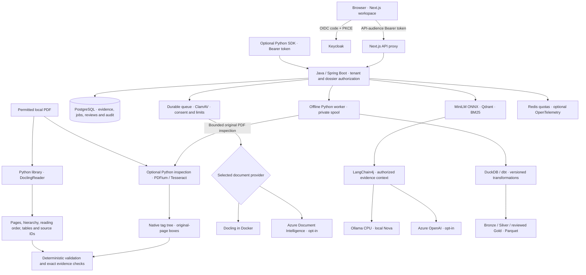

# Document Intelligence Lab

**Document Validation & Evidence — a Python library and a local AI research workspace.**

An MIT-licensed project for turning PDFs into structured data, traceable answers and reviewable findings. It studies **general business documents**, **insurance wording** and **DATEV payroll/banking documents**, without making credit, underwriting, settlement or payment decisions.

**Published Python alpha:** [document-evidence-lab 0.1.0a1 on PyPI](https://pypi.org/project/document-evidence-lab/0.1.0a1/) · [release source](https://github.com/quocvietphung/document-intelligence-lab/tree/python-v0.1.0a1). Install the standalone library from PyPI, or clone this repository for the full Docker workspace.

| Entry point | Use it for | Runtime |
| --- | --- | --- |
| **Python library** | Read local PDFs with Docling; inspect page/table evidence; validate amounts, literal text labels and citations | Python only; no Java, Docker, login or LLM |
| **Research workspace** | Manage dossiers, scan uploads, ask Nova, compare RAG/prompt methods, review evidence and build data layers | Java + Next.js + Docker; Keycloak authentication |
| **Python SDK** | Access the Java platform's protected workflow, batch receipts and audit history | Lightweight Python client + an existing Java API and Bearer token |

The library does not require the platform. The SDK is an explicit integration, not a hidden Java dependency or another microservice.

[Python Quick Start](#python-quick-start) · [Docker workspace](#local-docker-workspace) · [Azure setup](#local-setup-with-azure-ai) · [PDF examples](#pdf-examples) · [AI workflows](#ai-workflows) · [Architecture](#architecture) · [Tests](#development-and-tests) · [Search the source](#search-the-source-with-xerj)

## Walkthrough


An edited walkthrough of an existing synthetic-invoice dossier in the running English workspace. The extraction and ETL receipts were already saved; Nova's invoice-number/currency answer was generated locally for this walkthrough. Waiting periods are omitted. Source links support inspection, not automatic fact-checking or human approval.

## Research scope

- **Document AI:** text, layout, OCR and tables through local Docling or Azure Document Intelligence; unknown confidence stays unknown.
- **Validation and evidence:** preserved raw values, currency-aware parsing, page-bound sources and exact citation/quote checks.
- **Hybrid RAG:** MiniLM ONNX, Qdrant and BM25, evaluated against independently checked source pages.
- **Grounded generation:** Nova through explicitly selected Ollama or Azure OpenAI, with missing-evidence handling, citations and unapproved answer history.
- **Controlled experiments:** fixed, recursive, embedding-semantic and hierarchical-child chunking; zero-shot/few-shot structured output with reference answers hidden from the model.
- **Local ETL:** DuckDB/dbt, Bronze/Silver/Gold Parquet, quality findings and SCD Type 2 history. Only reviewer-confirmed amounts enter Gold.
- **Platform controls:** consent, ClamAV scanning, durable jobs, version checks, feedback, reviewer tasks, tenant isolation and audit history.

The Python package adds **validation around Docling's output** rather than replacing its parser. It does not bundle a chatbot, malware scanner, authentication service or workflow engine.

### Inspect the original, not only the citation

In **Documents & review → View result & PDF**, choose **Inspect evidence** beside a field, a located table cell, or **Choose source occurrence**. The comparison shows the original PDF crop, recorded OCR text and the value being checked together. Opening a claim's source in Nova also carries the saved claim text into this view.

A question citing a valid stored occurrence ID uses that occurrence and its recorded table context, without adding broad retrieval hits or exposing document-wide tools. General page/chunk citations still describe a wider scope; they do not identify a unique repeated value.


- **Repeated text:** Docling and Azure line locations retain page-local occurrence IDs. Four identical values remain four locations. Page/chunk citations do not magically identify an exact occurrence; ambiguous matches require an explicit selection, labelled as a candidate rather than proof of the model's attention.
- **Coordinates:** Docling top/bottom origins are normalized once. Crops are taken from the same locally rendered PDF canvas, including zoom and device scale. Mismatched page proportions, invalid bounds and provider locations on intrinsically rotated pages produce no location claim. Exact PDF text-layer matching supports rotated glyphs; image-only pages cannot use that fallback. Provider boxes are still estimates to check visually, not pixel-certified alignment.
- **OCR mismatch:** a quote can match `3,500` even if the original image says `8,500`. Citation membership is not visual verification. No missing region is fabricated and no confidence percentage is treated as accuracy.
- **Tables:** located Docling cells open their source crop with row/column, provider-reported header roles/spans and raw units. Legacy cells without header roles use explicitly untyped positional context. Header roles are extraction evidence to review; missing cell locations remain unknown.
- **Separate corrections:** a reviewer/admin can record an OCR transcription and a reason. The API requires a Bearer token, the current dossier version and the exact stored source text. Original OCR, original field values and old answers remain unchanged. The append-only correction is audited, returns the document to review and is not silently used by Nova or Gold. Reviewing fields or preparing a revised AI answer is a separate action.

Try the fully [synthetic evidence regression PDF](services/credit-api/src/test/resources/evidence/evidence-inspection-regression.pdf): four `Total: $500` occurrences, an upright page, a 90°-rotated page, a table and an explicitly injected OCR discrepancy. The `3,500` observation is a test input, **not** a measured failure by Docling/Azure. Regenerate with `python scripts/build-evidence-regression.py /private/path/evidence-regression.pdf` after installing `reportlab` and `pypdf`. Existing dossiers without saved coordinates remain usable, with location unavailable rather than invented; a new analysis is needed to capture provider geometry.

### Structure, reading order and local PDF inspection

In **Documents & review → View result & PDF → Document structure & reading order**, inspect Docling's recorded heading/list/table hierarchy and open its source page. New Docling analyses follow the body-tree reading order for the text used downstream; missing, cyclic or partial structure is reported. Tables retain provider-reported header roles and merged-cell spans. Native PDF tag presence is shown separately from inferred layout; neither certifies accessibility or OCR correctness. Historic extractions without structure need a new analysis.


The **Python source/wheel preview `0.2.0a1`** adds standalone `read_pdf_structure`, `ground_pdf` and `validate_structure`. The published PyPI alpha remains `0.1.0a1`; the new APIs require the source preview or a locally built wheel. [Installation, examples and wheel checks](python/README.md#inspect-native-tags-and-exact-pdf-locations).

Python inspection uses native PDFium glyph boxes or selective Tesseract when native text cannot match the requested value. Native rotation/crop offsets and inverse-projected coordinates after conservative Hough-line deskew are covered by real regression tests. Repeated values stay ambiguous until explicitly selected; no currency/digit repair, LLM call, automatic cloud fallback or PDF rewrite occurs. Boxes are relative to the original displayed page. Inspecting a match does not establish factual correctness; mixed-content pages and arbitrary visual scan orientations remain evaluation cases.

Use the [two-column/tagged fixture](services/credit-api/src/test/resources/evidence/structure-regression.pdf) and [upright/skewed scans](services/credit-api/src/test/resources/evidence/scanned-skew-regression.pdf). Their generator is `scripts/build-structure-regression.py`; all examples are self-authored, with no customer/publisher data. The tagged fixture deliberately draws the right column before the left and is **not** a valid PDF/UA reference. Accessibility auditing remains a separate task; PDF4WCAG/veraPDF are not bundled or silently called.

### Local evidence quality workflow

In **Documents & review → View result & PDF**, select a recorded occurrence, expand **Check source location & OCR**, review the exact text and consent, then choose **Inspect locally**. The existing offline ETL worker runs the Python library with PDFium/Tesseract; no new HTTP service, Docling model download or Azure call is required. The full local Docker profile enables this worker. A queued receipt is not a completed inspection; source changes mark old receipts historical.


Completed inspection of the self-authored `8,500` regression cell. Both observations agree; the UI deliberately retains **not verified** and keeps previous inspections separate.

- **Source candidates:** repeated text returns separate locations. Choose one explicitly to highlight it in the original, including supported native rotations and mild scan skew. Mixed pages can invoke OCR when their native layer has no exact requested text. Image-only OCR can try clockwise 0°/90°/180°/270° corrections or an explicitly chosen orientation. Auto mode stops at the first orientation with an exact requested-text match; this is a location candidate, not verified page orientation. The original PDF is never rotated or rewritten.
- **Independent observation:** for an upright provider region with matching page proportions, inspect its source crop, stored OCR and a separate Tesseract reading. A disagreement, including `3,500` versus `8,500`, is reported without selecting a winner or changing stored evidence. Agreement is labelled **not verified**. Unsupported geometry remains unavailable.
- **Private report:** download a receipt with original hash, engine/code versions, options, coordinates, OCR observations, reviewer corrections and up to ten saved answers referencing that document. Sharing a document ID does not prove an answer is supported. Reports contain private text/crops; keep them private. They omit the whole PDF. Temporary inspection source copies are removed after processing; saved reports/history have no automatic purge.
- **Nova lifecycle:** each question has a request ID. **Stop waiting & request cancellation** requests backend interruption and tracks the result; repeated request IDs never dispatch twice in the same API process. A cancelled result is discarded before answer persistence. Provider-side termination is not confirmed. With PostgreSQL enabled, request IDs, phase and terminal status survive API restarts. A 90-second renewable lease protects the final answer transaction against cross-instance cancellation. An expired request becomes **Interrupted**, is never redispatched automatically and cannot later save a response. Provider termination remains unconfirmed; consult saved answer history before retrying. Nonpersistent test mode remains process-local.
- **Sign-in navigation:** restrictive-browser silent SSO falls back to explicit sign-in. The app restores a recent, same-origin dossier/page location after successful authentication; tokens remain in memory.

Try the included `structure-regression.pdf` for its `8,500` table cell and `scanned-skew-regression.pdf` page 2 for four repeated `Total: $500` values. `TEST_EVIDENCE_QUALITY=1 TEST_QUALITY_CASE=<structure-test-case> node scripts/test-oauth.mjs` exercises the actual queue and private export. Add `TEST_QUALITY_NOVA_CANCEL=1` to also test cancellation during **local** model generation; use `TEST_QUALITY_NOVA_CANCEL=only` for a separate Nova-only pass against that existing dossier on a constrained machine. The cancellation test refuses Azure.

The [32-PDF synthetic location report](docs/benchmarks/synthetic-grounding.json) records **128/128 locations at IoU ≥ 0.5**: native 48/48, mild-skew scans 32/32, mixed pages 32/32, visual 90°/180°/270° challenge scans 16/16. This report uses the expanded rotation fixtures; do not treat it as a controlled comparison with an older report that used only 90° scans. Labels come from known generated content/geometry, **not human-approved or representative business ground truth**. Reading-order correctness, table semantics and general OCR accuracy are not measured by this location suite. Timings depend on hardware and warm caches. The unmatched challenge cases remain in the denominator.

```bash
python -m pip install './python[inspection]' reportlab
python scripts/build-quality-corpus.py /private/path/quality-corpus
python -m document_evidence.benchmark /private/path/quality-corpus/manifest.json --output /private/path/quality-results.json
```

Existing corpus/report files are never overwritten. The PDFs are generated locally rather than bundled into the package or repository. [OmniDocBench](https://github.com/opendatalab/OmniDocBench) informed the separation of evaluation dimensions; this lightweight location suite is not an OmniDocBench/TEDS implementation or score.

### Measure text, tables and reading order separately

The source/wheel preview adds `evaluate_document(document, reference)`. Labels must name the original PDF SHA-256 and their provenance; a changed source is rejected. It reports character edit errors, labelled table-cell text and structure matches, and pairwise order of unique reading anchors. Missing or duplicate anchors remain failures. There is no combined accuracy percentage, automatic approval or TEDS claim.

Use the included [structure PDF](services/credit-api/src/test/resources/evidence/structure-regression.pdf) with its [independently prepared generated-input labels](python/examples/references/structure-quality.json):

```bash
python python/examples/evaluate_pdf.py \
  services/credit-api/src/test/resources/evidence/structure-regression.pdf \
  python/examples/references/structure-quality.json --output private-quality.json
```

This example uses Docling with already prepared local weights; `--allow-model-download` is an explicit first-preparation option. The [measured local Docling result](docs/benchmarks/structure-quality.json) records six of six labelled cell texts/structures, 15 of 15 anchor pairs, and six character edits across 369 reference characters. One synthetic page is not representative business accuracy. For DATEV, permitted insurance wording and invoices, prepare independent labels from each actual PDF instead of copying predictions.

The same original has [three measured English/German/Vietnamese retrieval questions](docs/benchmarks/multilingual-retrieval.json). BM25, vector and hybrid each retrieved the labelled page within five results; hybrid ranked the English question first and German/Vietnamese questions third. This small regression does not establish multilingual accuracy or that hybrid always improves ranking. Reproduce it against the structure-test dossier with `TEST_EVIDENCE_QUALITY=1 TEST_QUALITY_CASE=YOUR_CASE TEST_QUALITY_RETRIEVAL=1 TEST_QUALITY_RESTART_RUNS=1 node scripts/test-oauth.mjs`; the restart flag intentionally restarts the local API. This run uses no LLM or cloud call.

## Python Quick Start

Use **Python 3.10+**; check `python3 --version` first and use a supported interpreter if your system Python is older. Create an isolated environment, then install the published alpha with local Docling support:

```bash
python3 -m venv .venv
source .venv/bin/activate
python -m pip install 'document-evidence-lab[docling]==0.1.0a1'
```

On Windows PowerShell, activate with `.venv\Scripts\Activate.ps1` instead. For the dependency-free validation core and SDK only, use this install command in the environment:

```bash
python -m pip install 'document-evidence-lab==0.1.0a1'
```

The `[docling]` extra installs parser dependencies; model downloads still require explicit first-use permission. No models or publisher PDFs are bundled. Installing either variant does **not** start the web UI or Nova; use the [Docker workspace](#local-docker-workspace) for those. This is an **alpha**, not a production-certified document validation service.

To run or contribute from source instead:

```bash
git clone https://github.com/quocvietphung/document-intelligence-lab.git
cd document-intelligence-lab
python3 -m venv .venv
source .venv/bin/activate
python -m pip install './python[docling]'
```

Install `./python` without extras for the dependency-free validation core and SDK. The distribution is named `document-evidence-lab`, Python imports use `document_evidence`, and the CLI is `document-evidence`.

### Read a local PDF

```python
from document_evidence import DoclingReader, validate_document

# Explicit first-use permission to download Docling's model weights.
document = DoclingReader(allow_model_download=True, timeout_seconds=900).read("invoice.pdf")
report = validate_document(document, required_labels=("Invoice no",))

print(document.pages[0].text)
print(document.tables)
print(report.to_dict())
```

Use your own permitted PDF or a prepared [example](#pdf-examples). No Java, Docker, Node.js, Keycloak or Azure account is needed. After preparation, `DoclingReader().read("invoice.pdf")` uses cached weights in offline mode; missing weights fail without cloud fallback. Pass `artifacts_path="/path/to/models"` for a separately prepared directory; see [Docling offline setup](https://docling-project.github.io/docling/usage/advanced_options/#model-prefetching-and-offline-usage).

CLI equivalent:

```bash
document-evidence invoice.pdf --allow-model-download --timeout 900 --output private-result.json
```

JSON output contains document text: keep it private. Existing output files are never overwritten. Defaults are **unencrypted PDF, four pages, 3 MB and a 180-second timeout**. A short-lived Python child process bounds conversion time and scopes offline settings; it is not a server or security sandbox. Remote OCR services and external plugins are disabled. Use trusted/permitted files: standalone parsing does **not** include the platform's ClamAV scan.

First preparation caches layout, table and RapidOCR Torch weights, including OCR weights that a text-only invoice might not exercise. Downloads require internet and disk space and may exceed the usual conversion deadline; the examples allow 900 seconds for this first preparation. Later offline conversions keep the 180-second default. The offline child also rejects DNS/socket connection attempts, including model-download paths outside Hugging Face; this is an application safeguard, not an OS sandbox. Local parsing uses your CPU/RAM, not a paid inference API. Test OCR quality against your document language; successful conversion is not an accuracy guarantee.

### Validate amounts and evidence

```python
from document_evidence import check_evidence, normalize_money, validate_citations

money = normalize_money("2967,11 EUR")
assert str(money.amount) == "2967.11"
assert money.currency == "EUR"

source = document.sources[0]
assert check_evidence(document, source.id, source.text)
answer = validate_citations(f"Observed excerpt [{source.id}].", [source.id])
```

The strict parser supports EUR, INR, USD and GBP; ambiguous separators and mixed/unknown currencies remain findings. Original source strings are unchanged. `validate_document` checks source structure, empty pages, ambiguous numeric dates and required literal labels, not trained classification or document authenticity.

Normalized results contain a **SHA-256 identity**, page-bound IDs, optional top-left bounding boxes, table cells/spans and `None` for unknown confidence. `check_evidence` tests exact quote/value containment, not meaning. `validate_citations` checks allowed IDs, not factual correctness. No finding-free report grants human approval. [Python API and examples](python/README.md).

## Python SDK for the Java platform

Install the lightweight `document-evidence-lab==0.1.0a1` package from PyPI (or `./python` from source), start the [Docker workspace](#local-docker-workspace) separately and supply an existing Keycloak **access token**:

```python
import os
from document_evidence.client import PlatformClient

client = PlatformClient("http://localhost:8081", token=lambda: os.environ["LAB_ACCESS_TOKEN"])
case_id = os.environ["LAB_CASE_ID"]
case = client.get_case(case_id)
workflow = client.workflow(case_id)
audit = client.audit(case_id)
```

The callback can supply a refreshed token; the SDK does not log in, store passwords or renew credentials automatically. Obtain short-lived credentials through your approved Keycloak/OIDC flow. Do not paste tokens into code, screenshots, shell history or issues. Azure tokens and Keycloak ID tokens are not the app API access token.

Read methods: `list_cases`, `get_case`, `workflow`, `trust`, `audit`, `batches`. Java enforces API audience, tenant, dossier and roles. HTTPS is required outside loopback; redirects and environment-discovered proxies are disabled to avoid forwarding credentials elsewhere.

Upload is explicit and persists data in the selected dossier:

```python
from uuid import uuid4

request_id = str(uuid4())  # Persist this UUID before sending.
receipt = client.submit_pdf(
    case_id, "invoice.pdf", consent=True,
    request_id=request_id, profile="invoice",
)
```

A receipt is **not finished OCR**. Inspect `batches(case_id)` and `workflow(case_id)` for progress. Reuse the same UUID, content and metadata when investigating an uncertain submission; nothing is retried automatically. The Java queue owns scanning and extraction. Python source IDs are not Java dossier IDs; the SDK uploads the original PDF, not self-asserted trusted evidence or approval. [SDK example](python/examples/platform_read.py).

<a id="local-docker-with-nova"></a>

## Local Docker workspace

Requirements: Git, **Node.js 22+**, Docker Desktop/Engine with Compose v2, and free ports **3000, 8080, 8081**. Allow at least four CPUs and 8 GB Docker RAM, with additional host memory for the browser and operating system. Keep at least 8 GiB free **inside Docker** for model preparation; images, documents and build cache need additional storage. Parsing and generation compete for memory: on a constrained laptop, run OCR/ETL acceptance and Nova inference separately. Swapping can exhaust their deadlines even when containers remain healthy; do not increase timeouts or treat health checks as completed inference.

From the repository root:

```bash
mkdir -p .local/reference-pdfs
node scripts/docker-local.mjs --prepare-model
```

First setup builds the app and CPU-only Ollama runtime, then explicitly downloads **`qwen3:4b-instruct-2507-q4_K_M`** into a persistent volume. The approximately 2.5-GB model is separate from its image. No model or publisher PDF is committed. The helper checks space and never prunes data automatically.

Subsequent starts reuse models and databases:

```bash
node scripts/docker-local.mjs
```

Use `--no-build` only when source and images match. Wait for the helper's final readiness message. Model weights stay on disk; Nova loads them on its first question and releases idle model memory after five minutes by default. Add `--warmup` to preload explicitly; warmup is not a quality test. This profile includes Docling, local Nova and ETL; it clears Azure chat/extraction configuration and has no silent cloud fallback.

### Sign in through Keycloak

Open [English](http://localhost:3000/en), [Deutsch](http://localhost:3000/de) or [Tiếng Việt](http://localhost:3000/vi), choose **Sign in** and use:

| Local account | Username | Password |
| --- | --- | --- |
| App user: ADVISOR + REVIEWER | `advisor.demo` | `demo-password` |
| Keycloak administrator: `http://localhost:8080/admin/` | `admin` | `local-admin-only` |

These are development credentials for a **fresh identity database**. Existing volumes keep their passwords. Use the app account on the login page, not the administrator account. Start sign-in from the app: temporary authentication URLs expire. Never expose the development realm publicly or reuse its passwords in a deployment.

### Try a complete workflow

1. Create a **General documents** dossier and prepare a permitted [PDF example](#pdf-examples).
2. In **Documents & review → Reference library**, select invoice **51109301**, preview it and confirm **Import & analyze**.
3. Follow its job in **Data Pipelines**, then open **Analysis results → View result & PDF**. Inspect the original, fields and tables.
4. Open Nova's portrait, select **Evidence analysis** and ask: *“What invoice number, currency and gross total are stated? Cite the source page.”* Enter sends; Shift+Enter adds a line break.
5. Wait for a completed **Ollama · Local LLM** answer. Open its citations and compare the PDF; source identity is not semantic verification.
6. In **Research lab → Experiments**, independently check reference values/pages before comparing retrieval, chunking or prompts.

**App guidance** and compass page tours are local navigation helpers, not document inference. Nova's portrait is an AI-generated fictional character. Expand its reading area for longer answers.

CPU generation can take several minutes or time out. The local Java process admits one inference at a time; competing requests receive `LOCAL_MODEL_BUSY`. The model has a 360-second limit inside the web proxy's 380-second deadline. No automatic retry/cloud fallback occurs. Replies arrive after generation; stopping the browser request does not guarantee cancellation of every backend inference. Check answer history before retrying an uncertain request.

## Local setup with Azure AI

This alternative keeps Docker on your computer while using **your own Azure OpenAI and Document Intelligence resources**. No VM, AKS or Vercel project is required. Cloud inference can be billable.

### Resources and access

Install Azure CLI. Use an authorized tenant/subscription and resource-scoped roles:

| Resource | Configuration | Developer role |
| --- | --- | --- |
| Azure OpenAI | Resource-root endpoint; compatible deployed Chat Completions/tool-calling model | Cognitive Services OpenAI User |
| Document Intelligence | Custom-subdomain endpoint; `prebuilt-layout` | Cognitive Services User |

An authorized administrator grants these through each resource's **Access control (IAM)**. Do not grant subscription-wide Owner access. Local scripts do not create resources, deploy models or grant roles.

```bash
az login --tenant YOUR-TENANT-ID
az account set --subscription YOUR-SUBSCRIPTION-ID
test -f .env.azure.local || cp .env.azure.example .env.azure.local
```

Edit the ignored `.env.azure.local` file:

```dotenv
AZURE_DOCUMENT_INTELLIGENCE_ENDPOINT=https://YOUR-DOCUMENT-RESOURCE.cognitiveservices.azure.com/
AZURE_OPENAI_ENDPOINT=https://YOUR-OPENAI-RESOURCE.openai.azure.com/
AZURE_OPENAI_DEPLOYMENT=YOUR-CHAT-DEPLOYMENT
```

Use resource-root endpoints, not Foundry project URLs or `/openai/v1` paths. The deployment value is the deployed model's **deployment name**. Confirm compatibility, quota, region and permitted data in your resource.

### Start and test Azure mode

```bash
node scripts/docker-azure.mjs up
```

Keep this terminal running. The helper obtains/renews an Entra token and mounts only its private token directory into Java, not the Azure CLI cache. It never prints tokens. **Ctrl+C stops renewal, not containers**; restart the helper after rebooting. This developer-token bridge is **not Managed Identity**.

Keycloak authenticates app users; Entra authorizes Java's Azure calls. Do not paste Azure tokens or API keys into Keycloak. Preserve organizational network restrictions instead of exposing private resources to bypass a connection error.

Follow the same PDF workflow and verify the extraction identifies **Azure Document Intelligence** and the completed answer identifies **Azure OpenAI**. Previewing does not send a PDF; confirmed analysis does. Azure mode limits each PDF to two pages and 3 MB. [Azure details](docs/AZURE_AI.md).

<a id="7-analyze-a-document-and-test-nova"></a>

Blob intake, the ADF operator bridge, saved-answer evaluation and Application Insights are separate opt-in adapters. They require their own credentials and live verification. Azure cannot directly reach Mac `localhost`; the project provisions no public tunnel. [Optional integration setup](docs/AI_INTEGRATIONS.md).

## PDF examples

Only use fictional or explicitly permitted documents. Private originals and model weights are not distributed with the package or repository.

<a id="kaggle-document-library"></a>

### Kaggle invoices and insurance wording

| Domain | Sample | Exercise |
| --- | --- | --- |
| General documents | Synthetic one-page invoices **51109301–51109304** | Identifiers, INR amounts, tables, evidence checks, prompts and ETL |
| Insurance | Principal definitions/administration and Shelter conditions/personal-liability excerpts | Source search and clause-review drafts; no coverage decision |
| Banking & payroll | Official fictional DATEV Robert-Muster and Melanie-Muster pages | Net earnings versus payout, person/period checks and source evidence |

Sources: [invoice dataset](https://www.kaggle.com/datasets/devp1866/high-quality-ocr-ready-invoice-pdfs) and [insurance dataset](https://www.kaggle.com/datasets/jpardovega/documents). Review source terms. Kaggle license metadata is not independent clearance of publisher-owned wording. Insurance samples are historical English-language US wording, not German policies or complete individual contracts.

Prepare the hash-pinned Kaggle samples in your activated Python environment:

```bash
python -m pip install pypdf==6.10.0
python scripts/prepare-kaggle-references.py --domain all
```

The helper verifies hashes/page mappings, refuses changed files and writes under `.local/reference-pdfs/`, outside Git. Missing or changed originals disable library cards rather than silently fetching replacements. [Sample boundaries](docs/PUBLIC_PAYROLL_TESTS.md).

<a id="datev-payroll-references"></a>

### DATEV payroll

Review the publisher's terms and download the unchanged [official DATEV LODAS sample](https://www.datev.de/content/dam/markenassets/themen-und-produktgruppen/zielgruppen/zielgruppenuebergreifend/shop-assets/personalwirtschaft/lodas-musterauswertung-2025-deutsch.pdf) to `.local/datev-lodas-musterauswertung-2025.pdf`, then run:

```bash
python scripts/prepare-datev-reference.py .local/datev-lodas-musterauswertung-2025.pdf
```

In **Banking & payroll → Documents & review → Reference library**, keep `Netto-Verdienst` separate from `Auszahlungsbetrag`. Publisher PDFs retain DATEV's rights. The Python reader can inspect these permitted pages, but its generic label checks do not implement every Java payroll-layout rule.

## AI workflows

Overview distinguishes **16 AI-assisted workflows** from **15 rule-based, navigation and human-review controls**, not 31 models. Every AI entry has a PDF exercise; opening one does not invoke inference.

| Workflow | PDF exercise |
| --- | --- |
| Text, layout and OCR | Invoice 51109301 versus its original |
| Table extraction | Invoice lines, VAT and gross total |
| Semantic/hybrid search | Shelter wording and its returned source page |
| Local embeddings | Vector versus BM25/hybrid for the same checked question |
| Nova document Q&A | Invoice number, INR currency and total |
| Selected-field explanation | DATEV net earnings versus payout |
| Evidence summary | Invoice facts and missing context |
| Cross-document/amount comparison | Invoices 51109301 and 51109302 separately; no inferred settlement |
| Discrepancy explanation | DATEV extraction versus its original |
| Document-request draft | Missing insurance context; no email delivery |
| Manual-review checklist draft | Invoice identity, totals and page sources |
| German terminology | DATEV labels without invented deductions |
| German–Vietnamese summary | Preserved labels, amounts and citations |
| Document chronology | Literal invoice date, no invented deadline |
| Clause/obligation review | Insurance wording; no legal or coverage decision |
| Sensitive-data review draft | Identifier categories; no automatic redaction |

Workflows share the selected extraction/Nova providers. MiniLM is English-focused; relevance scores are not accuracy percentages. Optional PaddleOCR, BGE-M3, reranking and vision need separately prepared weights and live evaluation. [Integration boundaries](docs/AI_INTEGRATIONS.md).

## Document pipeline operations

**Data Pipelines** separates processing, batch intake and exports. Batch intake accepts one to four permitted files, a source note and check profile. Each file is scanned; provider limits still apply per file. Profiles are versioned field checks, not trained classifiers.

Receipts record hashes, provider, extraction counts, attempts and actual stages. The same request UUID/content returns its receipt; changed content is rejected. Duplicate/cancel/retry controls do not guarantee exactly-once inference. Manual retry is limited to pinned DATEV/Kaggle bytes within retention; inspect arbitrary failed uploads before resubmitting. [Queue details](docs/DOCKER_LOCAL.md).

### Bronze, Silver and Gold

After extraction, open **Data layers & exports**, review the private-copy notice and choose **Build data layers**:

- **Bronze:** immutable extraction snapshots and recorded hashes, without another PDF/OCR copy.
- **Silver:** raw fields, normalized amounts, currency and quality findings; ambiguous `03/07/2023` remains unchanged.
- **Gold:** only reviewer-confirmed values, grouped separately by field and currency. Empty Gold is valid for unreviewed evidence.

The offline DuckDB/dbt worker has no network, public port or database password. SCD Type 2 tracks observed changes, not inferred business-effective dates. Unchanged sources may reuse a completed receipt for the current method; past exports stay unchanged. Parquet downloads require dossier authorization and contain private data. Original-PDF expiry does **not** delete analytical copies, chat history or research labels.

## Architecture



Python and Java do not require the same runtime. Shared fixtures compare citations and supported validation cases; Python output is not automatically trusted or inserted into the Java database. Java's Docling bridge remains intact. No extra Python HTTP microservice is needed for package installation.

In the workspace, one document provider and one Nova provider are selected; the branches are alternatives, not an ensemble or cloud fallback. Standalone Python never calls Nova. Cloud adapters require separate credentials and explicit execution. Keycloak authenticates users; Entra authorizes Azure service calls.

## Development and tests

Core Python tests need no model, cloud credentials, Java or Docker:

```bash
python -m pip install './python[dev]'
python -m unittest discover -s python/tests -v
python -m build python
python -m twine check python/dist/*
python python/tools/check_distribution.py python/dist
```

Actual local Docling conversion is explicit:

```bash
TEST_PYTHON_PDF=.local/reference-pdfs/kaggle-invoice-51109301.pdf \
TEST_PYTHON_EXPECT_TEXT=51109301 TEST_PYTHON_MIN_TABLES=1 \
TEST_ALLOW_MODEL_DOWNLOAD=1 TEST_DOCLING_TIMEOUT=900 \
python -m unittest discover -s python/tests -p test_docling_smoke.py -v
```

Omit the download flag for cached/offline inference. Synthetic-export unit tests exercise the adapter contract, not OCR quality. Shared fixtures under `python/src/document_evidence/contracts/` are also consumed by Java and ETL tests. Strict money rules match ETL; Java's permissive comparison helper is checked only on the declared compatible subset, not ambiguous inputs.

Workspace checks:

```bash
npm run verify
mvn --batch-mode -f services/credit-api/pom.xml test
node scripts/test-oauth.mjs
TEST_EVIDENCE_INSPECTION=1 node scripts/test-oauth.mjs
TEST_DOCUMENT_STRUCTURE=1 node scripts/test-oauth.mjs
TEST_DOCUMENT_UPGRADE=1 node scripts/test-oauth.mjs
TEST_NOVA_LOCAL=1 TEST_NOVA_TASKS=1 TEST_NOVA_CONCURRENCY=1 node scripts/test-oauth.mjs
```

Acceptance tests need the running stack and prepared samples. They create labelled records and unapproved drafts, not fabricated approval. Model calls take CPU time; Azure-mode tests can be billable. Scoped examples are not general accuracy, security or production certifications.

The evidence-inspection acceptance test requires the **local Docling stack** and uses the included synthetic PDF, without private reference downloads or model calls. It checks repeated occurrence IDs, table-cell geometry and labels, authenticated/versioned OCR corrections, immutable original OCR and PostgreSQL readback. It leaves a labelled test dossier available for visual inspection.

The document-structure acceptance uploads the included tagged/two-column and image-only/skewed PDFs through ClamAV and actual Docling, checks native tag presence separately from inferred headings/table roles, and verifies that a separate OCR correction does not erase structure or table metadata. With its printed case ID, `TEST_PYTHON_SDK=1 TEST_SDK_STRUCTURE=1 TEST_PYTHON_CASE=<case-id> TEST_PYTHON_EXECUTABLE=<wheel-environment>/bin/python node scripts/test-oauth.mjs` checks the installed wheel's authenticated SDK against the same persisted evidence.

With the prepared local Nova model, add `TEST_EVIDENCE_NOVA=1` to that command to verify a real answer through the authenticated web proxy, its exact table-occurrence citation and saved review history. This explicitly invokes the local model and can take several minutes on CPU; the test refuses a cloud provider.

### Python CI and publishing

`python-package.yml` checks Python **3.10–3.14**, builds wheel/sdist and checks metadata, license and distribution contents. A manually enabled Docling smoke job converts a synthetic regression PDF and explicitly downloads its dependencies/models.

The published alpha is [0.1.0a1](https://pypi.org/project/document-evidence-lab/0.1.0a1/), built from tag [`python-v0.1.0a1`](https://github.com/quocvietphung/document-intelligence-lab/tree/python-v0.1.0a1). The `pypi` environment uses a required owner review and a `python-v*` tag policy. Its Trusted Publisher is scoped to `quocvietphung/document-intelligence-lab`, `python-publish.yml` and environment `pypi`.

Pushing `master` or `develop` does **not** publish a Python release or deploy Azure/Vercel. For a future package release:

1. Bump the package version, review the distribution contents and pass the Python checks. Existing PyPI release files cannot be replaced; do not reuse `0.1.0a1`.
2. Create a reviewed `python-v<version>` tag matching `python/pyproject.toml`.
3. Run [Publish Python package (manual)](https://github.com/quocvietphung/document-intelligence-lab/actions/workflows/python-publish.yml) on that tag, select the configured registry **`pypi`**, and approve the protected environment after inspecting the build.
4. Verify installation from PyPI in a clean virtual environment before announcing the release.

The workflow defaults to `testpypi`, but **TestPyPI is not configured for this project**. To stage there, first configure its separate Trusted Publisher and protected `testpypi` environment; a PyPI publisher does not grant TestPyPI access. The workflow checks tag/version and uses job-scoped OIDC, not a stored API token. Local setup creates no publisher, account, tag or release. GitHub README edits do not update an already published PyPI version's description. [PyPI Trusted Publishing](https://docs.pypi.org/trusted-publishers/using-a-publisher/).

### Memory-conscious local startup

`node scripts/docker-local.mjs` applies `docker-compose.local-resources.yml`: bounded service RAM/CPU, one Docling conversion worker and lazy Nova loading. Weights stay on disk; Nova loads on the first question and the engine releases them after five idle minutes by default. The first answer can therefore take longer. Use `--warmup` only when needed. The parser keeps its tested 3 GiB limit; memory caps are ceilings, not reservations or guaranteed total usage.

The default helper builds application services sequentially. On a 16 GB host, an 8 GiB Docker allocation is the tested starting point; leave memory for macOS and avoid running model inference while rebuilding or benchmarking OCR. Do not delete model/PDF/database volumes to save RAM. `docker stats --no-stream` measures current container use; build cache and images affect disk space separately.

### Backup, restore and scoped history retention

Create a private backup and validate it in isolated destinations:

```bash
node scripts/backup-workspace.mjs --create
node scripts/backup-workspace.mjs --verify .local/backups/workspace-YOUR-BACKUP
```

The helper briefly pauses running writers, streams PostgreSQL dumps and private original/ETL/vector/Redis/reference archives to disk, records SHA-256 hashes and resumes services in `finally`. Volume archives are crash-consistent, not Qdrant logical snapshots. Verification checks every archive first, then restores into **new** databases/volumes; it never replaces live data. Temporary restore copies are removed after verification; add `--keep-restores` to retain them for inspection. Model weights, antivirus signatures, Azure credentials/resources and downloaded browser reports are excluded. Keep backups private and preserve the matching image/model versions separately. [Recovery details](docs/RELIABILITY_LAB.md).

Saved inspection/answer/feedback history has an explicit, tenant/case-scoped operator cleanup. It defaults to **dry run**, excludes running/queued inspections and never removes original PDFs, OCR corrections, reviewer tasks or reference datasets. Applying it requires repeating the exact case ID with `--confirm-case`; an audit summary remains. Nothing is purged automatically.

```bash
node scripts/retention-lab.mjs --tenant YOUR_TENANT --case YOUR_CASE --before YYYY-MM-DDT00:00:00Z
```

## Storage and troubleshooting

- **Private data:** keep PDFs, exports, models, tokens, `.env.azure.local`, dumps and Terraform state out of Git. See [SECURITY](SECURITY.md) and [third-party notices](THIRD_PARTY_NOTICES.md).
- **Retained volumes:** databases, originals, models and ETL use named Docker volumes. Do not troubleshoot with `down -v`, volume prune or system prune.
- **Python parser unavailable:** install `document-evidence-lab[docling]==0.1.0a1` from PyPI or `./python[docling]` from source, then explicitly prepare models before offline use. Errors return safe codes, not document content or parser tracebacks.
- **Nova slow/busy:** wait for warmup and avoid simultaneous large experiments. There is no automatic retry/cloud fallback.
- **SDK unauthorized:** use an unexpired Keycloak access token with the API audience and allowed tenant/role; refresh through your approved client flow.
- **Azure unavailable:** check renewal, endpoint, deployment, resource-scoped role, network and quota. App login is separate from Azure login.
- **OCR confidence:** unknown is not zero or 100%; counts and schema validity are not accuracy scores.

Stop the local profile without deleting data:

```bash
OLLAMA_CHAT_MODEL=qwen3:4b-instruct-2507-q4_K_M docker compose \
  -f docker-compose.yml -f docker-compose.platform.yml -f docker-compose.docling.yml \
  -f docker-compose.nova-local.yml -f docker-compose.etl.yml stop
```

`storage-init`/`etl-init` exit code 0 is expected. Ports bind to loopback. Historical `credit-*` realm/service/volume names preserve compatibility; changing the Compose project name does not migrate data. Local Docker is the primary workspace runtime; this README provisions no Azure VM or Vercel deployment.

## Search the source with XERJ

[](https://hub.xerj.org/contributors/quocvietphung)

For code review, an AI agent can use XERJ to index this public repository and retrieve implementation passages with file paths. This is a separate developer tool; running the application or Nova does not require it. See the [Corpus Hub entry](https://hub.xerj.org/corpus/quocvietphung--document-intelligence-lab) for its current publication status.

The Hub reference names commit [`cd45b95171f9497bb298c4e8ad2c3d64c822f706`](https://github.com/quocvietphung/document-intelligence-lab/tree/cd45b95171f9497bb298c4e8ad2c3d64c822f706). The steps below reproduce that historical snapshot locally, independently of downloadable pack availability. Newer features on `master` may be absent; always identify the commit used in an answer. Selection for the Hub is not an audit or an accuracy certification.

<details>
<summary>Search the pinned reference locally (macOS/Linux)</summary>

Install XERJ using its [official installation guide](https://xerj.org/docs/install), then check each command's result before continuing. Use a new reference directory outside your working checkout so private PDFs, credentials and runtime files are not indexed. Port 9200 must be free; do not replace an existing node. [CLI and query reference](https://xerj.org/llms.txt).

**Terminal 1:** verify usage, clone the reference and start the local node. The node's data directory is a sibling of the indexed source, never inside it. Keep this terminal running; `Ctrl+C` stops this node.

```bash
xerj --help
mkdir document-lab-reference
cd document-lab-reference
git clone https://github.com/quocvietphung/document-intelligence-lab.git
git -C document-intelligence-lab checkout --detach cd45b95171f9497bb298c4e8ad2c3d64c822f706
git -C document-intelligence-lab rev-parse HEAD
export XERJ_DISABLE_FEEDBACK=true
xerj --insecure --bind 127.0.0.1 --port 9200 --data-dir ./xerj-data
```

Verify the checkout prints the pinned SHA and the node starts on loopback. `--insecure` disables authentication/TLS for this local reference node only; keep its listeners on loopback. Feedback submission is disabled for this walkthrough. See [XERJ's authentication and network documentation](https://xerj.org/docs/security).

**Terminal 2:** open the same `document-lab-reference` directory, index only the reference clone, inspect the map and search for an actual symbol in that snapshot:

```bash
export XERJ_DISABLE_FEEDBACK=true
xerj autoindex ./document-intelligence-lab --url http://127.0.0.1:9200 --prefix document-intelligence-la --progress plain
xerj autoindex map --url http://127.0.0.1:9200
curl --fail --silent --show-error \
  -X POST 'http://127.0.0.1:9200/document-intelligence-la-*/_search' \
  -H 'Content-Type: application/json' \
  -d '{"size":3,"_source":["ax_path","defs","body"],"query":{"multi_match":{"query":"SelectedFieldEvidence","fields":["defs^3","body","title"]}}}'
```

Read the indexing summary before querying: exit 0 means complete; exit 3 means completed with skipped/junk files that need inspection; other nonzero results require following the CLI's diagnostic. The map describes indexed fields; it does not answer a code question by itself. Check the search response has relevant hits, then inspect their passages. If it has none, report that rather than inventing an implementation.

An example question for an agent is: **“How does `SelectedFieldEvidence` restrict the evidence passed to Nova?”** Ask it to use the returned passages, cite each hit's `_source.ax_path` (and line numbers when supplied), identify the pinned commit and distinguish source findings from inference. Retain the [MIT copyright notice](LICENSE) and credit Viet Phung and the repository contributors when adapting their code. An indexed hit alone does not verify application behavior.

</details>

## Project guide

| Location | Responsibility |
| --- | --- |
| `python/` | Standalone library, SDK, CLI, examples and tests |
| `python/src/document_evidence/contracts/` | Shared synthetic validation fixtures |
| `app/`, `components/workspace/`, `lib/` | Localized web UI, contracts and frontend tests |
| `services/credit-api/` | Java authorization, processing, evidence, workflows and audit |
| `services/document-etl/` | Offline DuckDB/dbt and Parquet |
| `infra/keycloak/` | Local development realm |
| `scripts/` | Startup, Azure token bridge, private sample preparation and acceptance |
| `.github/workflows/` | Platform checks and separately gated Python packaging/release |

More: [Python](python/README.md) · [Docker](docs/DOCKER_LOCAL.md) · [Local document AI](docs/LOCAL_DOCUMENT_AI.md) · [Azure AI](docs/AZURE_AI.md) · [Research](docs/RESEARCH_WORKSPACES.md) · [Nova](docs/NOVA_TRUST.md) · [Operations](docs/RELIABILITY_LAB.md).

## License and limits

Project code: [MIT](LICENSE). Contributions: [CONTRIBUTING](CONTRIBUTING.md). Software, model weights and publisher PDFs retain their own terms. This is research software, not a production-certified banking/insurance system, certified translation service, legal advisor or payment application. Human review remains required for consequential use.
