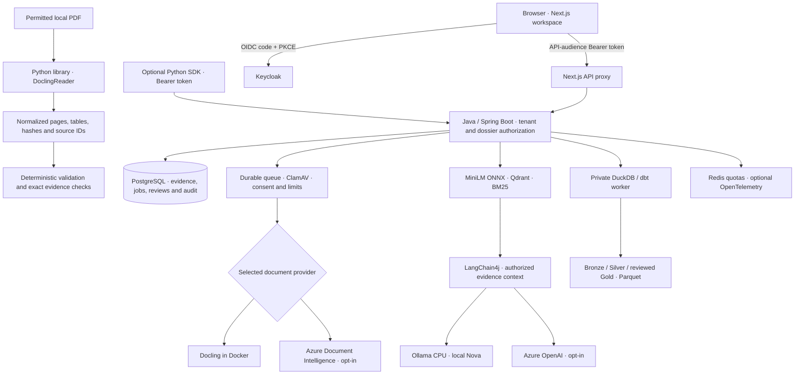

# Document Intelligence Lab

**Document Validation & Evidence — a Python library and a local AI research workspace.**

An MIT-licensed project for turning PDFs into structured data, traceable answers and reviewable findings. It studies **general business documents**, **insurance wording** and **DATEV payroll/banking documents**, without making credit, underwriting, settlement or payment decisions.

| Entry point | Use it for | Runtime |
| --- | --- | --- |
| **Python library** | Read local PDFs with Docling; inspect page/table evidence; validate amounts, literal text labels and citations | Python only; no Java, Docker, login or LLM |
| **Research workspace** | Manage dossiers, scan uploads, ask Nova, compare RAG/prompt methods, review evidence and build data layers | Java + Next.js + Docker; Keycloak authentication |
| **Python SDK** | Access the Java platform's protected workflow, batch receipts and audit history | Lightweight Python client + an existing Java API and Bearer token |

The library does not require the platform. The SDK is an explicit integration, not a hidden Java dependency or another microservice.

[Python Quick Start](#python-quick-start) · [Docker workspace](#local-docker-workspace) · [Azure setup](#local-setup-with-azure-ai) · [PDF examples](#pdf-examples) · [AI workflows](#ai-workflows) · [Architecture](#architecture) · [Tests](#development-and-tests)

## Walkthrough


An edited walkthrough of an existing synthetic-invoice dossier in the running English workspace. The extraction and ETL receipts were already saved; Nova's invoice-number/currency answer was generated locally for this walkthrough. Waiting periods are omitted. Source links support inspection, not automatic fact-checking or human approval.

## Research scope

- **Document AI:** text, layout, OCR and tables through local Docling or Azure Document Intelligence; unknown confidence stays unknown.
- **Validation and evidence:** preserved raw values, currency-aware parsing, page-bound sources and exact citation/quote checks.
- **Hybrid RAG:** MiniLM ONNX, Qdrant and BM25, evaluated against independently checked source pages.
- **Grounded generation:** Nova through explicitly selected Ollama or Azure OpenAI, with missing-evidence handling, citations and unapproved answer history.
- **Controlled experiments:** fixed, recursive, embedding-semantic and hierarchical-child chunking; zero-shot/few-shot structured output with reference answers hidden from the model.
- **Local ETL:** DuckDB/dbt, Bronze/Silver/Gold Parquet, quality findings and SCD Type 2 history. Only reviewer-confirmed amounts enter Gold.
- **Platform controls:** consent, ClamAV scanning, durable jobs, version checks, feedback, reviewer tasks, tenant isolation and audit history.

The Python package adds **validation around Docling's output** rather than replacing its parser. It does not bundle a chatbot, malware scanner, authentication service or workflow engine.

## Python Quick Start

Use **Python 3.10+**. From a new checkout:

```bash
git clone https://github.com/quocvietphung/document-intelligence-lab.git
cd document-intelligence-lab
python3 -m venv .venv
source .venv/bin/activate
python -m pip install './python[docling]'
```

On Windows, activate with `.venv\Scripts\Activate.ps1`. Install `./python` without extras for the dependency-free validation core and SDK. The package is an **alpha prepared for publication**; source installation works without claiming a PyPI release already exists.

### Read a local PDF

```python
from document_evidence import DoclingReader, validate_document

# Explicit first-use permission to download Docling's model weights.
document = DoclingReader(allow_model_download=True, timeout_seconds=900).read("invoice.pdf")
report = validate_document(document, required_labels=("Invoice no",))

print(document.pages[0].text)
print(document.tables)
print(report.to_dict())
```

Use your own permitted PDF or a prepared [example](#pdf-examples). No Java, Docker, Node.js, Keycloak or Azure account is needed. After preparation, `DoclingReader().read("invoice.pdf")` uses cached weights in offline mode; missing weights fail without cloud fallback. Pass `artifacts_path="/path/to/models"` for a separately prepared directory; see [Docling offline setup](https://docling-project.github.io/docling/usage/advanced_options/#model-prefetching-and-offline-usage).

CLI equivalent:

```bash
document-evidence invoice.pdf --allow-model-download --timeout 900 --output private-result.json
```

JSON output contains document text: keep it private. Existing output files are never overwritten. Defaults are **unencrypted PDF, four pages, 3 MB and a 180-second timeout**. A short-lived Python child process bounds conversion time and scopes offline settings; it is not a server or security sandbox. Remote OCR services and external plugins are disabled. Use trusted/permitted files: standalone parsing does **not** include the platform's ClamAV scan.

First preparation caches layout, table and RapidOCR Torch weights, including OCR weights that a text-only invoice might not exercise. Downloads require internet and disk space and may exceed the usual conversion deadline; the examples allow 900 seconds for this first preparation. Later offline conversions keep the 180-second default. The offline child also rejects DNS/socket connection attempts, including model-download paths outside Hugging Face; this is an application safeguard, not an OS sandbox. Local parsing uses your CPU/RAM, not a paid inference API. Test OCR quality against your document language; successful conversion is not an accuracy guarantee.

### Validate amounts and evidence

```python
from document_evidence import check_evidence, normalize_money, validate_citations

money = normalize_money("2967,11 EUR")
assert str(money.amount) == "2967.11"
assert money.currency == "EUR"

source = document.sources[0]
assert check_evidence(document, source.id, source.text)
answer = validate_citations(f"Observed excerpt [{source.id}].", [source.id])
```

The strict parser supports EUR, INR, USD and GBP; ambiguous separators and mixed/unknown currencies remain findings. Original source strings are unchanged. `validate_document` checks source structure, empty pages, ambiguous numeric dates and required literal labels, not trained classification or document authenticity.

Normalized results contain a **SHA-256 identity**, page-bound IDs, optional top-left bounding boxes, table cells/spans and `None` for unknown confidence. `check_evidence` tests exact quote/value containment, not meaning. `validate_citations` checks allowed IDs, not factual correctness. No finding-free report grants human approval. [Python API and examples](python/README.md).

## Python SDK for the Java platform

Install `./python`, start the [Docker workspace](#local-docker-workspace) separately and supply an existing Keycloak **access token**:

```python
import os
from document_evidence.client import PlatformClient

client = PlatformClient("http://localhost:8081", token=lambda: os.environ["LAB_ACCESS_TOKEN"])
case_id = os.environ["LAB_CASE_ID"]
case = client.get_case(case_id)
workflow = client.workflow(case_id)
audit = client.audit(case_id)
```

The callback can supply a refreshed token; the SDK does not log in, store passwords or renew credentials automatically. Obtain short-lived credentials through your approved Keycloak/OIDC flow. Do not paste tokens into code, screenshots, shell history or issues. Azure tokens and Keycloak ID tokens are not the app API access token.

Read methods: `list_cases`, `get_case`, `workflow`, `trust`, `audit`, `batches`. Java enforces API audience, tenant, dossier and roles. HTTPS is required outside loopback; redirects and environment-discovered proxies are disabled to avoid forwarding credentials elsewhere.

Upload is explicit and persists data in the selected dossier:

```python
from uuid import uuid4

request_id = str(uuid4())  # Persist this UUID before sending.
receipt = client.submit_pdf(
    case_id, "invoice.pdf", consent=True,
    request_id=request_id, profile="invoice",
)
```

A receipt is **not finished OCR**. Inspect `batches(case_id)` and `workflow(case_id)` for progress. Reuse the same UUID, content and metadata when investigating an uncertain submission; nothing is retried automatically. The Java queue owns scanning and extraction. Python source IDs are not Java dossier IDs; the SDK uploads the original PDF, not self-asserted trusted evidence or approval. [SDK example](python/examples/platform_read.py).

<a id="local-docker-with-nova"></a>

## Local Docker workspace

Requirements: Git, **Node.js 22+**, Docker Desktop/Engine with Compose v2, and free ports **3000, 8080, 8081**. Allow at least four CPUs and 8 GB Docker RAM. Keep at least 8 GiB free **inside Docker** for model preparation; images, documents and build cache need additional storage. Parsing and generation compete for memory.

From the repository root:

```bash
mkdir -p .local/reference-pdfs
node scripts/docker-local.mjs --prepare-model
```

First setup builds the app and CPU-only Ollama runtime, then explicitly downloads **`qwen3:4b-instruct-2507-q4_K_M`** into a persistent volume. The approximately 2.5-GB model is separate from its image. No model or publisher PDF is committed. The helper checks space and never prunes data automatically.

Subsequent starts reuse models and databases:

```bash
node scripts/docker-local.mjs
```

Use `--no-build` only when source and images match. Wait for the helper's final readiness message after it preloads the model with an empty prompt. Warmup is not a quality test. This profile includes Docling, local Nova and ETL; it clears Azure chat/extraction configuration and has no silent cloud fallback.

### Sign in through Keycloak

Open [English](http://localhost:3000/en), [Deutsch](http://localhost:3000/de) or [Tiếng Việt](http://localhost:3000/vi), choose **Sign in** and use:

| Local account | Username | Password |
| --- | --- | --- |
| App user: ADVISOR + REVIEWER | `advisor.demo` | `demo-password` |
| Keycloak administrator: `http://localhost:8080/admin/` | `admin` | `local-admin-only` |

These are development credentials for a **fresh identity database**. Existing volumes keep their passwords. Use the app account on the login page, not the administrator account. Start sign-in from the app: temporary authentication URLs expire. Never expose the development realm publicly or reuse its passwords in a deployment.

### Try a complete workflow

1. Create a **General documents** dossier and prepare a permitted [PDF example](#pdf-examples).
2. In **Documents & review → Reference library**, select invoice **51109301**, preview it and confirm **Import & analyze**.
3. Follow its job in **Data Pipelines**, then open **Analysis results → View result & PDF**. Inspect the original, fields and tables.
4. Open Nova's portrait, select **Evidence analysis** and ask: *“What invoice number, currency and gross total are stated? Cite the source page.”* Enter sends; Shift+Enter adds a line break.
5. Wait for a completed **Ollama · Local LLM** answer. Open its citations and compare the PDF; source identity is not semantic verification.
6. In **Research lab → Experiments**, independently check reference values/pages before comparing retrieval, chunking or prompts.

**App guidance** and compass page tours are local navigation helpers, not document inference. Nova's portrait is an AI-generated fictional character. Expand its reading area for longer answers.

CPU generation can take several minutes or time out. The local Java process admits one inference at a time; competing requests receive `LOCAL_MODEL_BUSY`. The model has a 360-second limit inside the web proxy's 380-second deadline. No automatic retry/cloud fallback occurs. Replies arrive after generation; stopping the browser request does not guarantee cancellation of every backend inference. Check answer history before retrying an uncertain request.

## Local setup with Azure AI

This alternative keeps Docker on your computer while using **your own Azure OpenAI and Document Intelligence resources**. No VM, AKS or Vercel project is required. Cloud inference can be billable.

### Resources and access

Install Azure CLI. Use an authorized tenant/subscription and resource-scoped roles:

| Resource | Configuration | Developer role |
| --- | --- | --- |
| Azure OpenAI | Resource-root endpoint; compatible deployed Chat Completions/tool-calling model | Cognitive Services OpenAI User |
| Document Intelligence | Custom-subdomain endpoint; `prebuilt-layout` | Cognitive Services User |

An authorized administrator grants these through each resource's **Access control (IAM)**. Do not grant subscription-wide Owner access. Local scripts do not create resources, deploy models or grant roles.

```bash
az login --tenant YOUR-TENANT-ID
az account set --subscription YOUR-SUBSCRIPTION-ID
test -f .env.azure.local || cp .env.azure.example .env.azure.local
```

Edit the ignored `.env.azure.local` file:

```dotenv
AZURE_DOCUMENT_INTELLIGENCE_ENDPOINT=https://YOUR-DOCUMENT-RESOURCE.cognitiveservices.azure.com/
AZURE_OPENAI_ENDPOINT=https://YOUR-OPENAI-RESOURCE.openai.azure.com/
AZURE_OPENAI_DEPLOYMENT=YOUR-CHAT-DEPLOYMENT
```

Use resource-root endpoints, not Foundry project URLs or `/openai/v1` paths. The deployment value is the deployed model's **deployment name**. Confirm compatibility, quota, region and permitted data in your resource.

### Start and test Azure mode

```bash
node scripts/docker-azure.mjs up
```

Keep this terminal running. The helper obtains/renews an Entra token and mounts only its private token directory into Java, not the Azure CLI cache. It never prints tokens. **Ctrl+C stops renewal, not containers**; restart the helper after rebooting. This developer-token bridge is **not Managed Identity**.

Keycloak authenticates app users; Entra authorizes Java's Azure calls. Do not paste Azure tokens or API keys into Keycloak. Preserve organizational network restrictions instead of exposing private resources to bypass a connection error.

Follow the same PDF workflow and verify the extraction identifies **Azure Document Intelligence** and the completed answer identifies **Azure OpenAI**. Previewing does not send a PDF; confirmed analysis does. Azure mode limits each PDF to two pages and 3 MB. [Azure details](docs/AZURE_AI.md).

<a id="7-analyze-a-document-and-test-nova"></a>

Blob intake, the ADF operator bridge, saved-answer evaluation and Application Insights are separate opt-in adapters. They require their own credentials and live verification. Azure cannot directly reach Mac `localhost`; the project provisions no public tunnel. [Optional integration setup](docs/AI_INTEGRATIONS.md).

## PDF examples

Only use fictional or explicitly permitted documents. Private originals and model weights are not distributed with the package or repository.

<a id="kaggle-document-library"></a>

### Kaggle invoices and insurance wording

| Domain | Sample | Exercise |
| --- | --- | --- |
| General documents | Synthetic one-page invoices **51109301–51109304** | Identifiers, INR amounts, tables, evidence checks, prompts and ETL |
| Insurance | Principal definitions/administration and Shelter conditions/personal-liability excerpts | Source search and clause-review drafts; no coverage decision |
| Banking & payroll | Official fictional DATEV Robert-Muster and Melanie-Muster pages | Net earnings versus payout, person/period checks and source evidence |

Sources: [invoice dataset](https://www.kaggle.com/datasets/devp1866/high-quality-ocr-ready-invoice-pdfs) and [insurance dataset](https://www.kaggle.com/datasets/jpardovega/documents). Review source terms. Kaggle license metadata is not independent clearance of publisher-owned wording. Insurance samples are historical English-language US wording, not German policies or complete individual contracts.

Prepare the hash-pinned Kaggle samples in your activated Python environment:

```bash
python -m pip install pypdf==6.10.0
python scripts/prepare-kaggle-references.py --domain all
```

The helper verifies hashes/page mappings, refuses changed files and writes under `.local/reference-pdfs/`, outside Git. Missing or changed originals disable library cards rather than silently fetching replacements. [Sample boundaries](docs/PUBLIC_PAYROLL_TESTS.md).

<a id="datev-payroll-references"></a>

### DATEV payroll

Review the publisher's terms and download the unchanged [official DATEV LODAS sample](https://www.datev.de/content/dam/markenassets/themen-und-produktgruppen/zielgruppen/zielgruppenuebergreifend/shop-assets/personalwirtschaft/lodas-musterauswertung-2025-deutsch.pdf) to `.local/datev-lodas-musterauswertung-2025.pdf`, then run:

```bash
python scripts/prepare-datev-reference.py .local/datev-lodas-musterauswertung-2025.pdf
```

In **Banking & payroll → Documents & review → Reference library**, keep `Netto-Verdienst` separate from `Auszahlungsbetrag`. Publisher PDFs retain DATEV's rights. The Python reader can inspect these permitted pages, but its generic label checks do not implement every Java payroll-layout rule.

## AI workflows

Overview distinguishes **16 AI-assisted workflows** from **15 rule-based, navigation and human-review controls**, not 31 models. Every AI entry has a PDF exercise; opening one does not invoke inference.

| Workflow | PDF exercise |
| --- | --- |
| Text, layout and OCR | Invoice 51109301 versus its original |
| Table extraction | Invoice lines, VAT and gross total |
| Semantic/hybrid search | Shelter wording and its returned source page |
| Local embeddings | Vector versus BM25/hybrid for the same checked question |
| Nova document Q&A | Invoice number, INR currency and total |
| Selected-field explanation | DATEV net earnings versus payout |
| Evidence summary | Invoice facts and missing context |
| Cross-document/amount comparison | Invoices 51109301 and 51109302 separately; no inferred settlement |
| Discrepancy explanation | DATEV extraction versus its original |
| Document-request draft | Missing insurance context; no email delivery |
| Manual-review checklist draft | Invoice identity, totals and page sources |
| German terminology | DATEV labels without invented deductions |
| German–Vietnamese summary | Preserved labels, amounts and citations |
| Document chronology | Literal invoice date, no invented deadline |
| Clause/obligation review | Insurance wording; no legal or coverage decision |
| Sensitive-data review draft | Identifier categories; no automatic redaction |

Workflows share the selected extraction/Nova providers. MiniLM is English-focused; relevance scores are not accuracy percentages. Optional PaddleOCR, BGE-M3, reranking and vision need separately prepared weights and live evaluation. [Integration boundaries](docs/AI_INTEGRATIONS.md).

## Document pipeline operations

**Data Pipelines** separates processing, batch intake and exports. Batch intake accepts one to four permitted files, a source note and check profile. Each file is scanned; provider limits still apply per file. Profiles are versioned field checks, not trained classifiers.

Receipts record hashes, provider, extraction counts, attempts and actual stages. The same request UUID/content returns its receipt; changed content is rejected. Duplicate/cancel/retry controls do not guarantee exactly-once inference. Manual retry is limited to pinned DATEV/Kaggle bytes within retention; inspect arbitrary failed uploads before resubmitting. [Queue details](docs/DOCKER_LOCAL.md).

### Bronze, Silver and Gold

After extraction, open **Data layers & exports**, review the private-copy notice and choose **Build data layers**:

- **Bronze:** immutable extraction snapshots and recorded hashes, without another PDF/OCR copy.
- **Silver:** raw fields, normalized amounts, currency and quality findings; ambiguous `03/07/2023` remains unchanged.
- **Gold:** only reviewer-confirmed values, grouped separately by field and currency. Empty Gold is valid for unreviewed evidence.

The offline DuckDB/dbt worker has no network, public port or database password. SCD Type 2 tracks observed changes, not inferred business-effective dates. Unchanged sources may reuse a completed receipt for the current method; past exports stay unchanged. Parquet downloads require dossier authorization and contain private data. Original-PDF expiry does **not** delete analytical copies, chat history or research labels.

## Architecture



Python and Java do not require the same runtime. Shared fixtures compare citations and supported validation cases; Python output is not automatically trusted or inserted into the Java database. Java's Docling bridge remains intact. No extra Python HTTP microservice is needed for package installation.

In the workspace, one document provider and one Nova provider are selected; the branches are alternatives, not an ensemble or cloud fallback. Standalone Python never calls Nova. Cloud adapters require separate credentials and explicit execution. Keycloak authenticates users; Entra authorizes Azure service calls.

## Development and tests

Core Python tests need no model, cloud credentials, Java or Docker:

```bash
python -m pip install './python[dev]'
python -m unittest discover -s python/tests -v
python -m build python
python -m twine check python/dist/*
python python/tools/check_distribution.py python/dist
```

Actual local Docling conversion is explicit:

```bash
TEST_PYTHON_PDF=.local/reference-pdfs/kaggle-invoice-51109301.pdf \
TEST_PYTHON_EXPECT_TEXT=51109301 TEST_PYTHON_MIN_TABLES=1 \
TEST_ALLOW_MODEL_DOWNLOAD=1 TEST_DOCLING_TIMEOUT=900 \
python -m unittest discover -s python/tests -p test_docling_smoke.py -v
```

Omit the download flag for cached/offline inference. Synthetic-export unit tests exercise the adapter contract, not OCR quality. Shared fixtures under `python/src/document_evidence/contracts/` are also consumed by Java and ETL tests. Strict money rules match ETL; Java's permissive comparison helper is checked only on the declared compatible subset, not ambiguous inputs.

Workspace checks:

```bash
npm run verify
mvn --batch-mode -f services/credit-api/pom.xml test
node scripts/test-oauth.mjs
TEST_DOCUMENT_UPGRADE=1 node scripts/test-oauth.mjs
TEST_NOVA_LOCAL=1 TEST_NOVA_TASKS=1 TEST_NOVA_CONCURRENCY=1 node scripts/test-oauth.mjs
```

Acceptance tests need the running stack and prepared samples. They create labelled records and unapproved drafts, not fabricated approval. Model calls take CPU time; Azure-mode tests can be billable. Scoped examples are not general accuracy, security or production certifications.

### Python CI and publishing

`python-package.yml` checks Python **3.10–3.14**, builds wheel/sdist and checks metadata, license and distribution contents. A manually enabled Docling smoke job converts a synthetic regression PDF and explicitly downloads its dependencies/models.

Pushing a branch does **not** publish the package. For a release:

1. Confirm the final package name/version and registry availability.
2. Configure a Trusted Publisher for this repository and `python-publish.yml`, plus protected `testpypi`/`pypi` environments with required reviewers.
3. Create a reviewed matching tag, such as `python-v0.1.0a1`.
4. Run the manual publish workflow on that tag, choosing **TestPyPI first**. Inspect a clean install before approving PyPI.

The workflow checks tag/version and uses job-scoped OIDC, not a stored API token. Local setup creates no publisher, account, tag or release. [PyPI Trusted Publishing](https://docs.pypi.org/trusted-publishers/using-a-publisher/).

## Storage and troubleshooting

- **Private data:** keep PDFs, exports, models, tokens, `.env.azure.local`, dumps and Terraform state out of Git. See [SECURITY](SECURITY.md) and [third-party notices](THIRD_PARTY_NOTICES.md).
- **Retained volumes:** databases, originals, models and ETL use named Docker volumes. Do not troubleshoot with `down -v`, volume prune or system prune.
- **Python parser unavailable:** install `./python[docling]` and explicitly prepare models before offline use. Errors return safe codes, not document content or parser tracebacks.
- **Nova slow/busy:** wait for warmup and avoid simultaneous large experiments. There is no automatic retry/cloud fallback.
- **SDK unauthorized:** use an unexpired Keycloak access token with the API audience and allowed tenant/role; refresh through your approved client flow.
- **Azure unavailable:** check renewal, endpoint, deployment, resource-scoped role, network and quota. App login is separate from Azure login.
- **OCR confidence:** unknown is not zero or 100%; counts and schema validity are not accuracy scores.

Stop the local profile without deleting data:

```bash
OLLAMA_CHAT_MODEL=qwen3:4b-instruct-2507-q4_K_M docker compose \
  -f docker-compose.yml -f docker-compose.platform.yml -f docker-compose.docling.yml \
  -f docker-compose.nova-local.yml -f docker-compose.etl.yml stop
```

`storage-init`/`etl-init` exit code 0 is expected. Ports bind to loopback. Historical `credit-*` realm/service/volume names preserve compatibility; changing the Compose project name does not migrate data. Local Docker is the primary workspace runtime; this README provisions no Azure VM or Vercel deployment.

## Project guide

| Location | Responsibility |
| --- | --- |
| `python/` | Standalone library, SDK, CLI, examples and tests |
| `python/src/document_evidence/contracts/` | Shared synthetic validation fixtures |
| `app/`, `components/workspace/`, `lib/` | Localized web UI, contracts and frontend tests |
| `services/credit-api/` | Java authorization, processing, evidence, workflows and audit |
| `services/document-etl/` | Offline DuckDB/dbt and Parquet |
| `infra/keycloak/` | Local development realm |
| `scripts/` | Startup, Azure token bridge, private sample preparation and acceptance |
| `.github/workflows/` | Platform checks and separately gated Python packaging/release |

More: [Python](python/README.md) · [Docker](docs/DOCKER_LOCAL.md) · [Local document AI](docs/LOCAL_DOCUMENT_AI.md) · [Azure AI](docs/AZURE_AI.md) · [Research](docs/RESEARCH_WORKSPACES.md) · [Nova](docs/NOVA_TRUST.md) · [Operations](docs/RELIABILITY_LAB.md).

## License and limits

Project code: [MIT](LICENSE). Contributions: [CONTRIBUTING](CONTRIBUTING.md). Software, model weights and publisher PDFs retain their own terms. This is research software, not a production-certified banking/insurance system, certified translation service, legal advisor or payment application. Human review remains required for consequential use.
