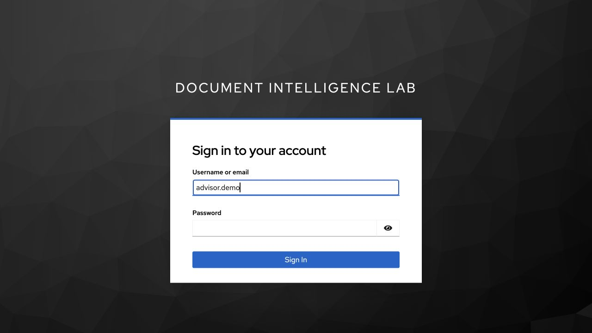
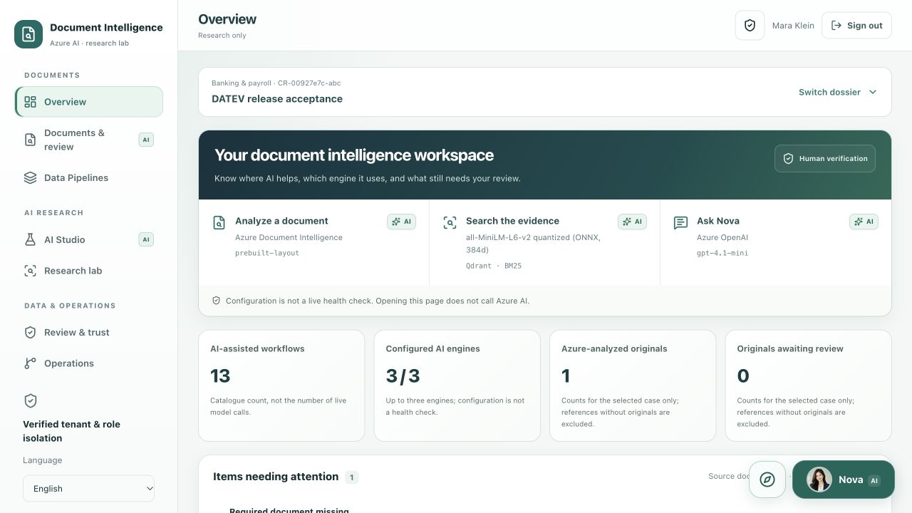
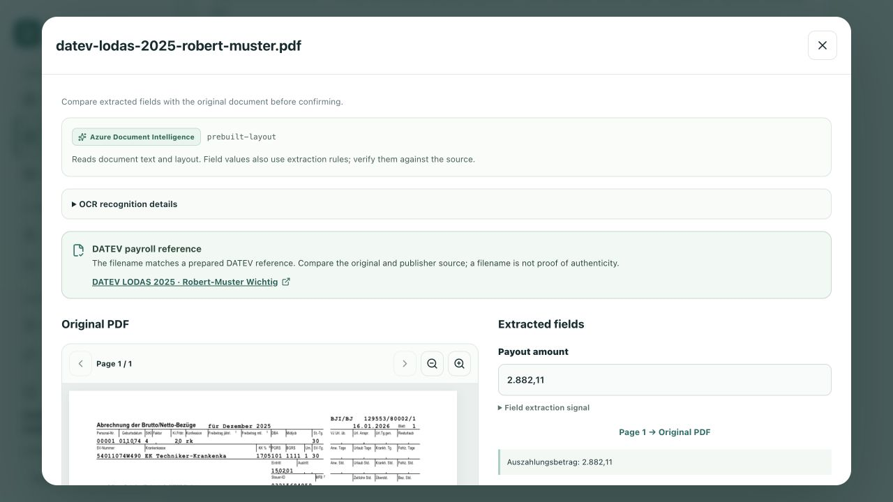
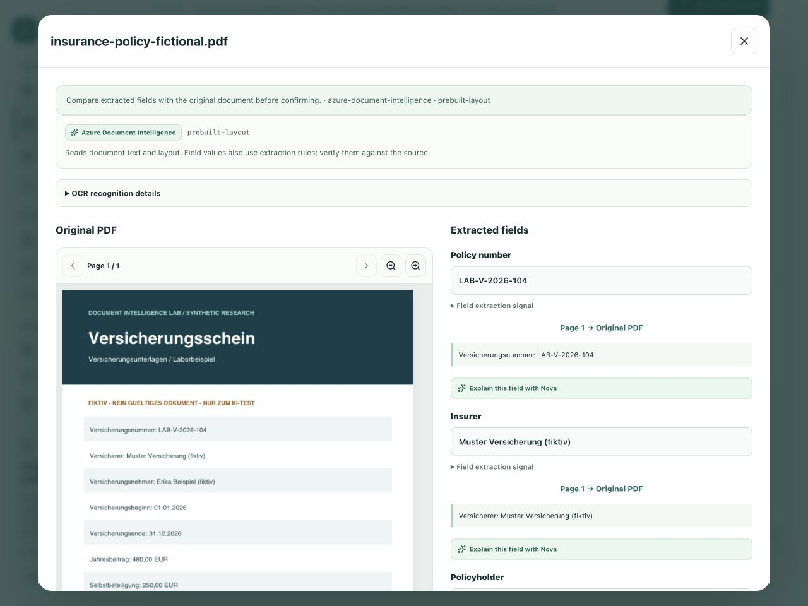
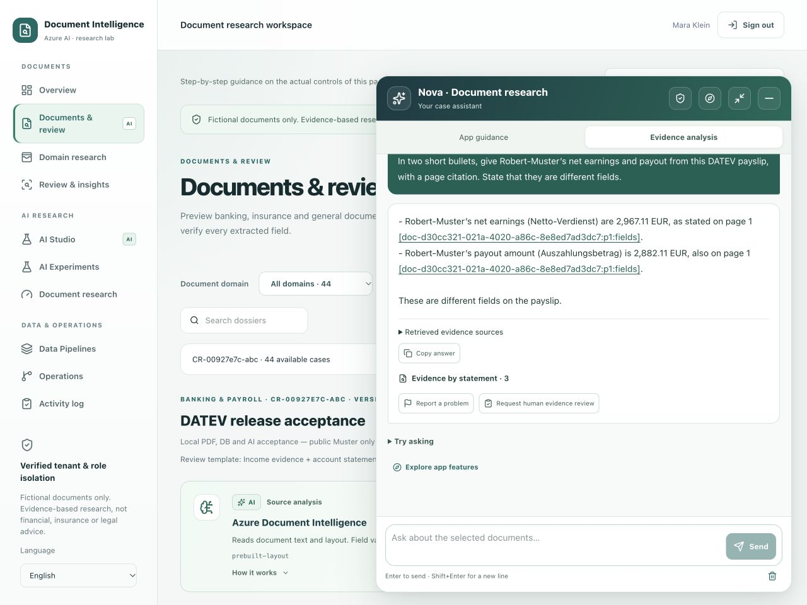
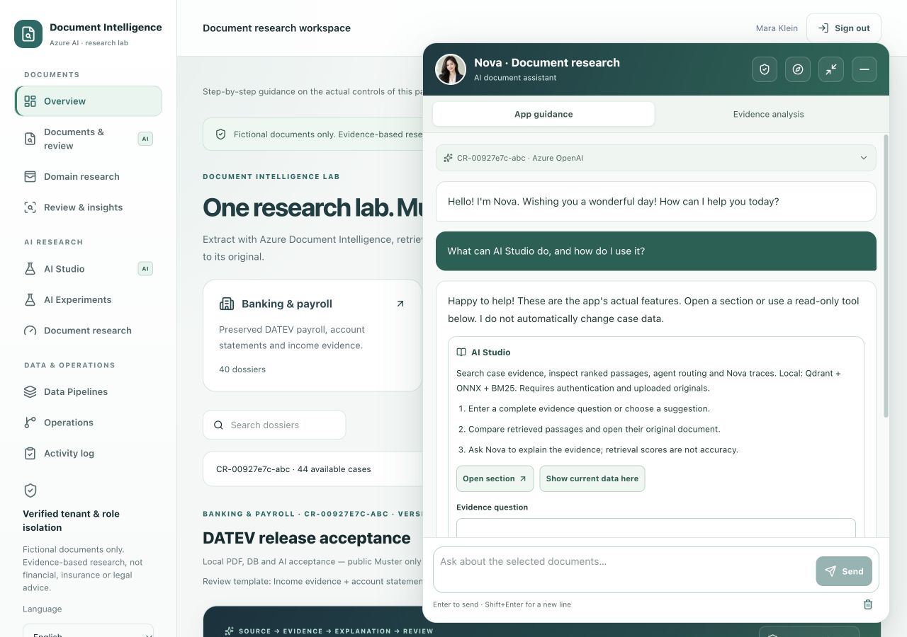
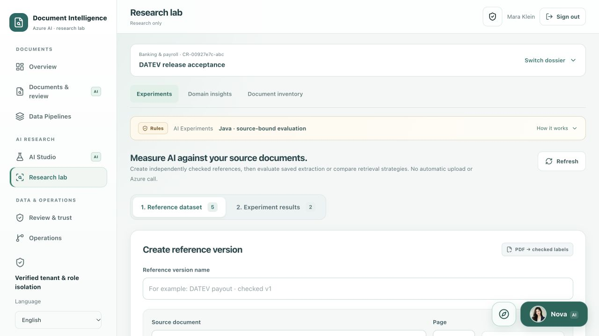
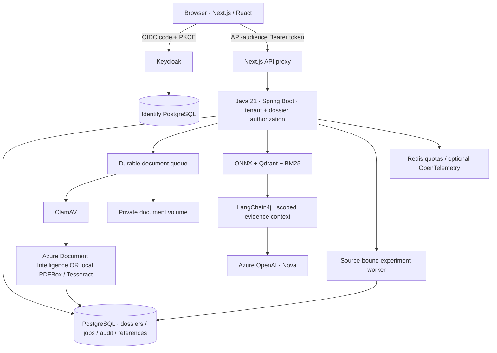

# Document Intelligence Lab

A hands-on **Azure AI document research lab** for studying how to turn PDFs into traceable, reviewable answers.

The project studies extraction, hybrid RAG, source-grounded answers and human review for **DATEV payroll/banking**, **insurance** and **general business documents**.

This README follows one setup from a fresh clone to a working Nova conversation: **run the application locally in Docker and connect it to your Azure OpenAI and Document Intelligence resources**. Web, Java, Keycloak, databases and private storage stay on your computer; confirmed AI requests call Azure.

**Java 21 · Spring Boot · LangChain4j · Azure Document Intelligence · Azure OpenAI · Next.js · PostgreSQL · Qdrant · Keycloak · Docker**

[Setup](#local-setup-with-azure-ai) · [Test Nova](#7-analyze-a-document-and-test-nova) · [Nova & page guides](#meet-nova-and-replay-a-page-guide) · [Troubleshooting](#troubleshooting) · [Screenshots](#workspace-tour) · [Architecture](#architecture)

> Research software, not a banking or insurance product. Use fictional or explicitly permitted documents. No payments, automated credit decisions, underwriting, claim settlement or automatic email delivery.

**Local preview:** after starting Docker with the setup below, open [English](http://localhost:3000/en), [Deutsch](http://localhost:3000/de) or [Tiếng Việt](http://localhost:3000/vi). Sign in through [Keycloak](#sign-in-through-keycloak), then open Nova's portrait at the bottom right. Use the compass beside Nova to replay the current page's walkthrough. These links point to your own computer, not a hosted deployment.

## Local setup with Azure AI

### 1. Install the prerequisites

- Git and Docker Desktop with Compose v2, or Docker Engine + Compose on Linux.
- Host **Node.js 22+** and **Azure CLI** for the Azure credential helper. Java and Maven run inside Docker and are not required on the host.
- Suggested Docker allocation: **4 CPUs, 8 GB RAM, 15 GB free disk**.
- Available local ports: **3000**, **8080**, **8081**.
- Internet for images, build dependencies and initial ClamAV signatures.
- Commands use a macOS/Linux shell; on Windows, use a Docker-enabled WSL2 environment.
- Repository access while it is private. No Vercel account or Azure VM is required.

Check the installed tools:

```bash
docker version
docker compose version
node --version
az version
```

### 2. Clone the project

```bash
git clone https://github.com/quocvietphung/document-intelligence-lab.git
cd document-intelligence-lab
mkdir -p .local/reference-pdfs
```

For an existing checkout, open a terminal in that repository instead of cloning again. Run all following commands from the repository root.

### 3. Prepare Azure resources and access

Use resources you are authorized to access in your own tenant/subscription:

| Resource | Required configuration | Role for your developer user |
| --- | --- | --- |
| Azure OpenAI | Resource-root endpoint and a deployed Chat Completions/tool-calling model | **Cognitive Services OpenAI User** on that resource |
| Azure Document Intelligence | Custom-subdomain resource endpoint; app uses `prebuilt-layout` | **Cognitive Services User** on that resource |

Docker remains on your computer. **No VM, AKS, Vercel project or Azure API key is needed.** Azure inference can incur charges; review your resource's region, quota, permitted data and usage controls.

For the role grants, an authorized administrator opens each resource's **Access control (IAM) → Add role assignment**, selects the role above and the correct developer user, and reviews the exact resource scope. Local startup scripts do not grant access. Do not grant subscription-wide Owner access for this walkthrough.

In the Azure OpenAI resource's model deployment screen, deploy a compatible chat/tool-calling model with available quota and record its **deployment name**. Document Intelligence uses `prebuilt-layout`; no custom payroll/insurance model training is required. Creating resources/deployments may incur charges and is not performed by this project.

### 4. Sign in and configure Azure

```bash
az login --tenant YOUR-TENANT-ID
az account set --subscription YOUR-SUBSCRIPTION-ID
az account show --query '{subscription:name,id:id,tenant:tenantId}' -o table
node --version
```

Copy the template only if the private file is missing. This command preserves any existing configuration:

```bash
test -f .env.azure.local || cp .env.azure.example .env.azure.local
```

Edit `.env.azure.local` with **your** values:

```dotenv
AZURE_DOCUMENT_INTELLIGENCE_ENDPOINT=https://YOUR-DOCUMENT-RESOURCE.cognitiveservices.azure.com/
AZURE_OPENAI_ENDPOINT=https://YOUR-OPENAI-RESOURCE.openai.azure.com/
AZURE_OPENAI_DEPLOYMENT=YOUR-CHAT-DEPLOYMENT
```

Use resource-root endpoints, **not** a Foundry project URL, deployment URL or `/openai/v1` path. The deployment value is the deployed model's name, not necessarily its model family. The current local workspace has been exercised with `gpt-4.1-mini`; availability and compatibility depend on your resource.

### 5. Start the local Docker stack

Start the Azure-enabled Docker profile and keep token renewal running:

```bash
node scripts/docker-azure.mjs up
```

The helper reads the ignored configuration, obtains a short-lived Entra token, mounts only its private token directory into Java and renews every five minutes. It does not print the token, mount your Azure CLI cache, create resources or grant permissions. **Ctrl+C stops renewal, not the containers.** After restarting your computer, run the helper again.

The helper supplies base + Azure + platform Compose files. Keycloak authenticates the **app user**; Entra authorizes **Java calling Azure**. The local developer-token bridge is not Managed Identity, and app requests still need their Keycloak access token. Keep your organization's approved network restrictions; do not make a private resource public to bypass a connection problem.

First-time builds and ClamAV signature initialization may take several minutes. Keep scanning enabled. You do not need to run `npm install`, start a separate Next.js/Java process or create additional environment files for this Docker setup.

### 6. Check services and sign in

In a second terminal, from the repository root:

```bash
docker compose -f docker-compose.yml -f docker-compose.platform.yml ps --all
curl --fail http://localhost:8081/actuator/health
```

Expected state:

```text
case-db, identity-db, keycloak, credit-api, redis, clamav: running / healthy
qdrant, web: running (no Compose healthcheck)
storage-init: exited with code 0 (initialization completed successfully)
Java health endpoint: status UP
```

Open **[http://localhost:3000/en](http://localhost:3000/en)**. German: `/de`; Vietnamese: `/vi`. Use `localhost`: the local OIDC issuer/redirect settings use it.

| Local account | Username | Password |
| --- | --- | --- |
| App user: ADVISOR + REVIEWER | `advisor.demo` | `demo-password` |
| Keycloak admin: `http://localhost:8080/admin/` | `admin` | `local-admin-only` |

#### Sign in through Keycloak

1. Open `http://localhost:3000/en` and click **Sign in**. The browser redirects to Keycloak at `http://localhost:8080/realms/credit-intelligence/…`.
2. On **Sign in to your account**, enter username **`advisor.demo`** and password **`demo-password`**, then click **Sign In**. Use the app account here, not the Keycloak administrator account.
3. Keycloak redirects back to `http://localhost:3000/en`. The workspace and **Sign out** button confirm the browser session is active; open a dossier to access its protected data.



This is the real local Keycloak screen; the password field is intentionally empty in the screenshot. If you are already signed in, the app may reuse the existing session without displaying this form. Start each login from the app instead of bookmarking a temporary Keycloak authentication URL.

**Keycloak login is separate from `az login`:** the app user signs in through this form; Azure CLI supplies the developer credential used by Java to call Azure AI. No Azure token or API key needs to be pasted into this screen.

These credentials apply to a **fresh local identity database**. Existing volumes retain their accounts/passwords; importing a realm does not reset them. Do not delete an identity volume to fix login. Never expose this development realm publicly or reuse these passwords in a cloud deployment.

### 7. Analyze a document and test Nova

1. Create a **General documents** dossier and open **Documents & review**.
2. Upload `public/samples/invoice-fictional.pdf`. Review the consent/destination and confirm analysis when prompted. The confirmed file is sent to Azure Document Intelligence; opening a page alone does not upload it.
3. Find **Analysis results**, above the sample library, and open **View result & PDF**. Inspect the Azure provider/model, original page, extracted values and tables. For progress/history, open **Data Pipelines → Processing queue**.
4. Open **Nova → Evidence analysis**, type the question below and press Enter. Shift+Enter adds a line break.

> What amounts are stated in this invoice? Cite the source page, distinguish observed facts from interpretation, and say what needs human verification.

5. Check that a completed **Azure OpenAI** answer appears. Open its source links and compare the original. A greeting, engine badge or local **App guidance** response alone is not proof that the model answered.
6. Use **AI Studio** to retrieve a passage. In **AI Experiments**, independently check labels/target pages against the PDF, save a reference and run an extraction or retrieval experiment.

For insurance, create an **Insurance** dossier and use `public/samples/insurance-policy-fictional.pdf` or `public/samples/insurance-claim-fictional.pdf`. For payroll, prepare the private DATEV references below.

Azure Compose limits include **2 PDF pages, 6 MP images and 3 MB files**. Shared request/token reservations are finite lab safeguards, not billed usage or a monetary cap.

See [Azure reference details](docs/AZURE_AI.md) for additional RBAC examples and troubleshooting. Startup requires only the steps above, not another deployment.

## DATEV payroll references

The payroll library uses only the official fictional **DATEV LODAS 2025 Robert-Muster and Melanie-Muster** pages. Publisher originals/derived PDFs are not bundled in GitHub or the image; DATEV retains its rights.

1. After reviewing the publisher's terms, download the unchanged 30-page [official DATEV sample PDF](https://www.datev.de/content/dam/markenassets/themen-und-produktgruppen/zielgruppen/zielgruppenuebergreifend/shop-assets/personalwirtschaft/lodas-musterauswertung-2025-deutsch.pdf) to `.local/datev-lodas-musterauswertung-2025.pdf`.
2. With Python 3 installed, create a private helper environment and split the permitted pages:

```bash
python3 -m venv .local/datev-tools
.local/datev-tools/bin/python -m pip install pypdf
.local/datev-tools/bin/python scripts/prepare-datev-reference.py \
  .local/datev-lodas-musterauswertung-2025.pdf
```

The helper validates the source and refuses to overwrite existing references. Expected files:

```text
.local/reference-pdfs/datev-lodas-2025-robert-muster.pdf
.local/reference-pdfs/datev-lodas-2025-melanie-muster.pdf
```

3. In a **Banking & payroll** dossier, open **Documents & review → Official DATEV payroll library**. Preview a page, choose **Import & analyze**, confirm its destination and inspect **Analysis results** above the library.
4. In Azure mode, ask Nova to distinguish net earnings from payout with a page citation. Robert-Muster's reference values are **2.967,11 EUR** net and **2.882,11 EUR** payout—not the same field.

Previewing does not send a prepared PDF to Azure; confirmed analysis does. Keep third-party PDFs outside `public/` and Git. Source labels/number formatting remain unchanged across interface languages. [Reference details](docs/PUBLIC_PAYROLL_TESTS.md).

## Stop, restart and inspect logs

Stop the token-renewal terminal with **Ctrl+C**, then stop Docker without deleting data:

```bash
docker compose -f docker-compose.yml -f docker-compose.platform.yml stop
```

To start again, open Docker Desktop/Engine and run this from the repository root:

```bash
node scripts/docker-azure.mjs start
```

Keep the helper terminal running so Azure access remains current. Do not start two renewal helpers simultaneously. After source changes, stop the existing helper and run `node scripts/docker-azure.mjs up` to rebuild.

Inspect logs privately:

```bash
docker compose -f docker-compose.yml -f docker-compose.platform.yml \
  logs --tail=80 credit-api web keycloak
docker compose -f docker-compose.yml -f docker-compose.platform.yml \
  logs --tail=40 clamav
```

PostgreSQL, private documents, Qdrant, Redis and ClamAV definitions use named volumes. Private DATEV references live in `.local/reference-pdfs/`; short-lived Azure credentials live in ignored `.local/azure-auth/`. **Do not use `down -v`, volume prune or system prune to troubleshoot startup/login**: these can erase data. Never print token files or share unredacted logs.

## Troubleshooting

| Symptom | Check / remedy |
| --- | --- |
| Docker unavailable | Start Docker Desktop/Engine; `docker version` must include the server |
| Port in use | Stop only the recognized conflicting app; do not run host and Docker web together |
| ClamAV starting | Allow initial signatures; inspect scanner logs instead of bypassing scanning |
| `storage-init` exited 0 | Expected: the one-shot permissions task completed |
| Login fails | Use `localhost`, check Keycloak health; existing accounts retain their passwords |
| App API `401/403` | Check the session, audience, tenant and role; keep JWT validation enabled |
| Azure `401/403` | Check tenant/resource, token renewal, resource-scoped inference role and approved network access |
| Deployment `404` | Actual deployment name and matching resource-root endpoint |
| Analysis `503` | Current provider, renewal/service readiness and newest job; old failures remain history |
| Nova unavailable | Keep the Azure helper running; verify OpenAI endpoint, deployment and inference role. App guidance is local, not a substitute for a model answer |
| `429` | Distinguish app request/token reservations from Azure quota; wait for the relevant reset |
| Stale-reference `409` | Refresh the dossier and independently verify/save labels for the new source version |
| Foundry / Data Factory not connected | Expected: exports prepare research inputs, not cloud execution |

Configuration checks do not call Azure or expose credentials:

```bash
node --test scripts/docker-azure-config.test.mjs
```

## Features at a glance

| Feature | Implementation | Where |
| --- | --- | --- |
| Document OCR and layout | Azure Document Intelligence `prebuilt-layout`; Java field normalization/classification rules | Documents & review |
| Semantic and hybrid RAG | Local MiniLM ONNX embeddings, Qdrant and BM25—not Azure AI Search | AI Studio |
| Document Q&A and source explanations | Azure OpenAI through Java/LangChain4j; dossier-scoped read-only tools | Nova → Evidence analysis |
| Controlled AI drafts | Summary, cross-document comparison, inconsistency explanation, document request, review checklist, German terminology and DE–VI summary | AI transparency & review → Task library |
| Source-bound evaluation | Human-checked reference labels; deterministic extraction precision/recall/F1 and retrieval hit rate@5/MRR@5 | AI Experiments |
| Evidence review and research exports | Private PDF viewer, corrections/history, reviewer tasks, source hashes and private JSON/JSONL exports | Documents & review / Data Pipelines |

The platform also provides Keycloak OAuth 2.0/OIDC + PKCE, Bearer-protected tenant/dossier access, PostgreSQL persistence, durable jobs, ClamAV, Redis limits, audit history and English/German/Vietnamese UI/page tours. Nova **App guidance** is local application logic, not an LLM response.

OCR confidence is not measured accuracy; citation-ID validation does not prove that every statement is supported. Financial decisions remain outside scope. Azure Foundry evaluation, Data Factory orchestration, Blob ingestion and Application Insights are **not connected by default**. [Research methods](docs/RESEARCH_WORKSPACES.md) · [Nova privacy and review](docs/NOVA_TRUST.md).

## Workspace tour

Current local UI in English. Screenshots show an existing research workspace, not dossiers preloaded into a fresh clone. German labels and number formatting inside source evidence are deliberately preserved.

### Multi-domain overview



### DATEV original and extraction

The current viewer places the private original beside extracted fields, source quotations and page links. **Net earnings and payout are separate values.** OCR confidence is inspectable under recognition details; it is not measured accuracy. The visible DATEV excerpt is from a fictional publisher sample, not a redistributed original PDF.



### Insurance document review



### Nova, grounded in the selected dossier

A real local Azure OpenAI conversation about the approved fictional DATEV sample. Source links make the answer inspectable; they do not replace human verification.



### Meet Nova and replay a page guide

Nova's portrait is an **AI-generated fictional character**, not a real advisor. The same avatar appears on the chat launcher, conversation header and page-tour coachmarks. It is bundled locally; no external avatar service receives requests.


Open the portrait button at the bottom right. Choose **App guidance** for local instructions and links, or **Evidence analysis** for source-based Azure OpenAI questions. The **compass icon** starts a step-by-step guide for the current page; **Expand reading area** gives longer answers more room. Enter sends; Shift+Enter adds a line break.



### Source-bound experiments

Read labels independently from the original, save a reference version, then evaluate extraction or compare BM25/vector/hybrid retrieval. Results belong to that labelled sample, not general model accuracy.



## Architecture



Two separate identities:

- **Keycloak** authenticates the app user and supplies roles, tenant and API audience.
- **Microsoft Entra** authorizes Java to call Azure. The local developer token bridge is **not Managed Identity**. An Azure-hosted application would use its own appropriately scoped Managed Identity.

| Service | Local access / responsibility |
| --- | --- |
| `web` | `http://localhost:3000` — Next.js UI and authenticated API proxy |
| `credit-api` | `http://localhost:8081` — Java APIs, extraction, search and workers |
| `keycloak` | `http://localhost:8080` — OIDC, users, roles and sessions |
| `case-db` / `identity-db` | Separate internal PostgreSQL databases with named volumes |
| `qdrant` / `redis` | Internal evidence index and shared quotas, persisted locally |
| `clamav` | Scans uploads before extraction; persistent signature volume |
| `storage-init` | One-shot private-volume ownership task |
| `otel-collector` | Optional local tracing override; no automatic cloud export |

Development ports bind to `127.0.0.1`. Historical `credit-*` service/realm/volume names are retained for data compatibility; renaming the Compose project creates different volumes rather than migrating them.

## Data, privacy and operation

- Included fictional PDFs: invoice, insurance policy and claim notification under `public/samples/`.
- Payroll examples: only the two official fictional **DATEV LODAS 2025 Robert/Melanie** pages in the user-facing library. Older payroll fixtures exist only as regression-test resources.
- Original documents are private and Bearer-protected; PDF.js assets are served locally, not from a document-viewer CDN.
- Upload consent, malware scanning, reviewer history and case/tenant isolation remain enabled.
- Document retention is separate from chat/reference history; see the retention limits in [Nova privacy](docs/NOVA_TRUST.md).
- The former Azure VM backend and Vercel project have been removed. **Local Docker is the primary runtime**. A future cloud release requires a newly reviewed deployment; there is no active public frontend for this lab.
- No cloud resource is created by the local startup commands. Never commit private PDFs, `.env.azure.local`, tokens, database dumps or Terraform state.

[Backup, monitoring and recovery](docs/RELIABILITY_LAB.md).

## Project guide

| Location | Purpose |
| --- | --- |
| `app/`, `components/workspace/` | Localized web UI, document review, Nova and research workspaces |
| `lib/` | Contracts, translation tables, transports and frontend tests |
| `services/credit-api/` | Java security, AI integration, workers and Flyway migrations |
| `infra/keycloak/` | Local development realm |
| `infra/azure/` | Optional infrastructure source; not required locally |
| `scripts/` | Azure token bridge, private sample preparation and verification |

Documentation: [Docker](docs/DOCKER_LOCAL.md) · [Azure AI](docs/AZURE_AI.md) · [Document samples](docs/PUBLIC_PAYROLL_TESTS.md) · [Research](docs/RESEARCH_WORKSPACES.md) · [Nova](docs/NOVA_TRUST.md) · [Operations](docs/RELIABILITY_LAB.md).

## License

Project code: [MIT](LICENSE). Third-party software and publisher documents retain their own terms; this license does not grant redistribution rights to DATEV originals.
