# Document Intelligence Lab

A hands-on, **MIT-licensed document AI research lab** for studying how to turn PDFs into traceable, reviewable answers with Azure AI and local open-source processing.

The project studies extraction, hybrid RAG, source-grounded answers and human review for **DATEV payroll/banking**, **insurance** and **general business documents**.

The current workspace brings those experiments into one evidence-first workflow:

- **Read documents:** extract page text, layout and tables with Azure Document Intelligence or the optional local Docling provider.
- **Find and explain evidence:** compare keyword/vector/hybrid retrieval, then ask Nova source-based questions through local Ollama or Azure OpenAI.
- **Review the result:** compare fields with the private original, record corrections and keep AI output separate from human approval.
- **Measure, not assume:** create checked reference versions and evaluate extraction or retrieval on those specific documents.
- **Compare research methods:** benchmark fixed, recursive, embedding-semantic and hierarchical-child chunking on the same checked PDF pages; compare zero-shot/few-shot JSON-schema extraction with a reference hidden from the model.
- **Build local data products:** run private DuckDB/dbt ETL in Docker, with Bronze/Silver/Gold Parquet, quality findings, SCD Type 2 history and currency-separated, reviewer-confirmed aggregates.
- **Operate locally:** sign in through Keycloak; follow durable processing jobs, batch receipts and activity history in Docker.

Seven main destinations replace a long flat menu. Overview keeps **31 capabilities in six expandable groups**: **16 AI-assisted workflows** and **15 rule-based, navigation or human-review controls**, not 31 AI models. The three new source-based Nova tasks are **document chronology**, **clause/obligation review** and **sensitive-data review drafts**. Every AI workflow has a collapsible PDF exercise, not an invented passing result.

Start with **local Docker: Docling reads documents and Ollama runs Nova on your computer**. Model preparation is an explicit download, stored once in a named Docker volume. No Azure account or API charges are required for this profile. The separate Azure walkthrough below connects the same app to your own Azure OpenAI and Document Intelligence resources; confirmed cloud inference can be billable. Providers are selected explicitly, never used as silent fallbacks.

**Java 21 · Spring Boot · LangChain4j · Azure Document Intelligence · Azure OpenAI · Next.js · PostgreSQL · Qdrant · Keycloak · Docker**

### New local research and ETL exercises

The normal `node scripts/docker-local.mjs` startup now includes the small CPU-only ETL worker. It has **no network access or public port**, no database password and no AI/model download. Its private `lab_etl` Docker volume contains extracted document data and derived artifacts. Do not publish that volume. The selected local Nova model is reused for explicit prompt comparisons; no Azure fallback is selected.

| Capability | Concrete PDF exercise | What is actually measured or stored |
| --- | --- | --- |
| Chunking comparison | Import the private Shelter conditions excerpt. Independently label the page that states `POLICY COVERAGE PERIOD`. In **AI Experiments**, save the question/page reference and choose **Compare chunking strategies**. | Fixed 780/160, boundary-aware recursive, embedding-similarity semantic, and hierarchical parent-labelled child chunks. Same page targets and hybrid ranker; chunk counts, hit rate@5 and MRR@5. Evaluation never replaces the live Qdrant index. Parent-context expansion is not implemented. |
| Prompt/schema comparison | On `kaggle-invoice-51109301.pdf`, check `invoiceNumber = 51109301`, page 1, in the original. Save it as the first field in a reference version, then choose **Compare zero-shot / few-shot JSON**. | Two real local model calls. Expected values are evaluator-only. Reports JSON parsing/schema validity, exact quote/value support, reference match and runtime for this single field, not universal factuality. |
| Bounded Nova drafts | Ask for chronology, obligations or identifier categories on the same invoice. | Schema-constrained model output, exact original quote/ID checks, literal dated phrases and category-only privacy rendering. An invalid draft is rejected; no fabricated successful replacement. Absence is limited to the inspected excerpts. |
| Cross-document comparison | Import invoices `51109301` and `51109302` into the same **General documents** dossier. Ask Nova to compare their numbers, dates, currencies and totals separately, with sources. | These are different invoices, not matching payment evidence. No inferred settlement, merged identities or cross-currency totals. |
| Bronze/Silver/Gold ETL | On invoice `51109301`, open **Data Pipelines → Data layers & exports**, read the copy/retention notice, consent and choose **Build data layers**. | Immutable source snapshots, original hashes where recorded, preserved raw values, locale-aware amount parsing, unknown/ambiguous-date findings, source-version receipts and actual Parquet. Bronze references do not copy PDF bytes. |
| Reviewed Gold and SCD Type 2 | Compare the original INR `1,844,673.60` and literal `03/07/2023`. An authorized reviewer can confirm the evidence, then rerun ETL after refreshing the dossier. | Unreviewed fields stay out of Gold. Amounts are grouped by field and currency. Changed document snapshots close the prior dimension version; unchanged snapshots reuse the last completed receipt without another OCR call. SCD dates are observation times, not inferred business-effective dates. |

The UI keeps the original **16 AI-assisted workflows**; research comparisons and ETL extend the existing control entries, rather than being counted as extra deployed AI models. The PDF exercise directory now covers **18 entries: 16 AI workflows plus the research-comparison and data-lineage controls**. A completed ETL run does not certify that a model answer is correct.

The first live schema comparison on the pinned invoice found an exact, source-supported result with zero-shot, while few-shot abstained. That failed sample remains visible as a zero reference match: few-shot is not assumed to be better. The acceptance script verifies schema output and independently recomputes source/reference matches; it does not force every experimental variant to score 100%.

The ETL worker writes Bronze/Silver snapshots before dbt validates Gold. Only a successful, current-source receipt is displayed as current in the app. Failed/stale runs do not replace a current app result. Artifacts remain private; **expiry of an original PDF does not delete analytical exports, chat history or research labels**. Remove only identified disposable test artifacts after reviewing your retention requirements; never use `docker compose down -v` against a lab you intend to keep.

For a non-destructive SQL deduplication exercise, inspect the private DuckDB `silver_fields` table. Conflicting field candidates must be quarantined, not silently selected as correct:

```sql
SELECT run_id, document_id, page, field_key, COUNT(*) AS candidates
FROM silver_fields
GROUP BY run_id, document_id, page, field_key
HAVING COUNT(*) > 1;

WITH ranked AS (
  SELECT *, ROW_NUMBER() OVER (
    PARTITION BY run_id, document_id, page, field_key
    ORDER BY rowid
  ) AS candidate_number
  FROM silver_fields
)
SELECT * FROM ranked WHERE candidate_number > 1;
```

Explicit local verification after preparing the pinned private invoice:

```bash
TEST_DOCUMENT_UPGRADE=1 TEST_PROMPTING=1 node scripts/test-oauth.mjs
TEST_PIPELINE=1 TEST_PIPELINE_PROVIDER=docling node scripts/test-oauth.mjs
TEST_NOVA_LOCAL=1 TEST_NOVA_CASE=CR-485a8c32-047 TEST_NOVA_TASKS=1 node scripts/test-oauth.mjs
python3 -B scripts/test_practice_document_data.py
```

The first command uses the existing synthetic-invoice dossier `CR-485a8c32-047`; set `TEST_UPGRADE_CASE` to your own dossier containing the same prepared original. It creates private references, measured experiment records and ETL receipts, including `.local/verification/document-upgrade-latest.json`; keep that report private. The second creates an isolated processing-test dossier, scans actual PDFs and exercises duplicate/cancel/security boundaries. The third checks real Nova responses on the prepared dossier, including chronology, clause absence, identifier categories and EN/DE/VI source citations. Set `TEST_NOVA_CASE` to your own matching dossier. CPU inference takes minutes, not the sub-second time of a configuration check. None of these commands calls Azure in the local profile. PDF preparation instructions below still apply; PDFs are not bundled in Git.

Python parity/primality, class weights, training-only over/undersampling and macro/micro/weighted F1 are isolated interview exercises in `scripts/practice-document-data.py`, not application AI features. Export a private research bundle and run `python3 scripts/practice-document-data.py /private/path/bundle.json` to exercise its actual PDF page metadata. SCD Type 0 means preserve the original value, Type 1 overwrites it, and this ETL implements Type 2 historical snapshots. Split datasets by source PDF before any resampling; these ten prepared documents are not a representative ML training benchmark. SMOTE, LangGraph, autonomous local tools, full multimodal image retrieval, cloud evaluation, HA and a backup/restore SLA are not claimed by these additions.

[Document walkthrough](#document-walkthrough) · [16 AI workflows](#ai-workflow-directory) · [Local Docker](#local-docker-with-nova) · [Azure setup](#local-setup-with-azure-ai) · [Document pipeline](#document-pipeline-operations) · [Nova & page guides](#meet-nova-and-replay-a-page-guide) · [Troubleshooting](#troubleshooting) · [Screenshots](#workspace-tour) · [Architecture](#architecture)

> Research software, not a banking or insurance product. Use fictional or explicitly permitted documents. No payments, automated credit decisions, underwriting, claim settlement or automatic email delivery.

**Local preview:** after starting Docker with the setup below, open [English](http://localhost:3000/en), [Deutsch](http://localhost:3000/de) or [Tiếng Việt](http://localhost:3000/vi). Sign in through [Keycloak](#sign-in-through-keycloak), then open Nova's portrait at the bottom right. Use the compass beside Nova to replay the current page's walkthrough. These links point to your own computer, not a hosted deployment.

## Document walkthrough

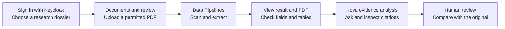

Try synthetic invoice **51109301** in a **General documents** dossier. After confirming **Import & analyze**, follow its job in **Data Pipelines**, then open **View result & PDF** from **Analysis results**. Ask Nova: *“What invoice number, currency and gross total are stated? Cite the source page.”* Open each citation and compare the original; a generated answer is not human approval. Local CPU generation can take minutes and can fail or return an incorrect draft; see the [validation status and setup](#local-docker-with-nova).

### English screen walkthrough

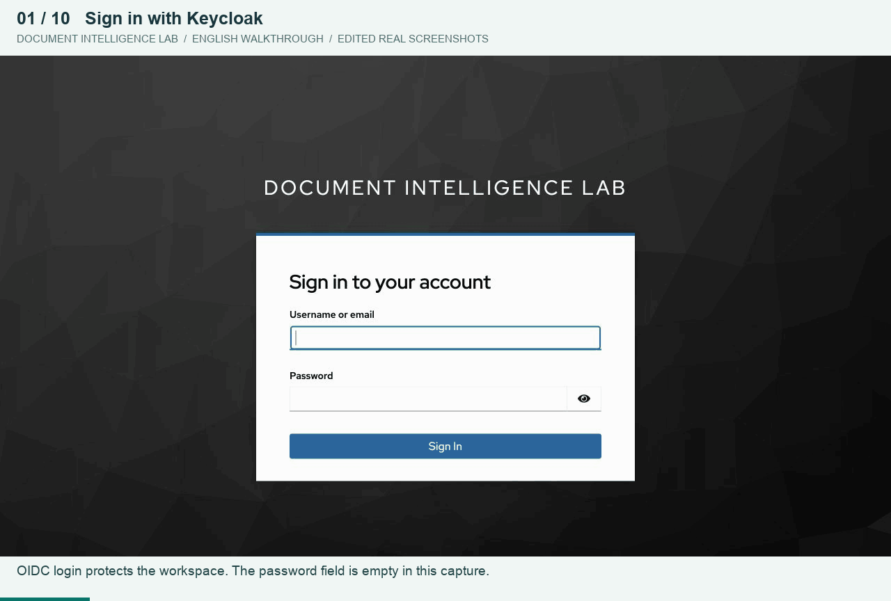

Captured from the running English Docker workspace on **21 October 2026**: **10 real screenshots, 58 seconds**, with English captions outside the unmodified UI captures. Follow Keycloak sign-in → the 16-workflow overview → saved Docling results → the original invoice PDF → processing stages → hybrid evidence search → Nova answer history → local Bronze/Silver/Gold ETL → source-linked quality findings → zero-shot/few-shot experiments. This is an **edited walkthrough**, not continuous video or a latency benchmark; waits are omitted. The Keycloak password field is empty.

**What the recording demonstrates:** the invoice extraction was saved on **20 October** and reopened, not uploaded again. Building data layers reused the completed **21 October** DuckDB/dbt receipt for the unchanged source: **Bronze 1, Silver 2, Gold 0**; unreviewed fields remain outside Gold. The ambiguous date is preserved and linked to its source. The experiment shows a correct zero-shot field and a few-shot abstention on one labelled sample, not general model accuracy.

**Nova recording limitation:** two fresh CPU Ollama requests timed out during this capture session. Scene 7 therefore opens the genuine, previously saved English response from **21 October, 22:00:33 Europe/Berlin**, with its model, prompt version, source citations and **not human-approved** label visible. It does **not** depict a new successful generation, and linked citations are not automatic fact-checking. Earlier scoped acceptance results do not remove this observed reliability limitation. See the [full-size screen gallery](#workspace-tour) and [local Nova setup and limitations](#local-docker-with-nova).

## Open-source scope

The project code is available under [MIT](LICENSE); contributions are welcome through [CONTRIBUTING](CONTRIBUTING.md). Read [SECURITY](SECURITY.md) before reporting vulnerabilities and [third-party boundaries](THIRD_PARTY_NOTICES.md) before redistributing documents, images or models. `private: true` in `package.json` prevents accidental npm publishing; it does not make the GitHub repository private or restrict the MIT license.

| Capability | Available implementation |
| --- | --- |
| Local document AI | Optional **Docling CPU** profile for layout, OCR and tables; existing PDFBox/Tesseract baseline remains available |
| Local Nova | **Ollama + Qwen3 4B Instruct 2507 Q4**, private local model volume, CPU-only runtime image, explicit source citations and no cloud fallback |
| Cloud document AI and Nova | Azure Document Intelligence and Azure OpenAI; own authorized resource/configuration required, usage can be billable |
| Local retrieval | MiniLM ONNX + Qdrant + BM25; English-focused embedding, not a newly installed multilingual model |
| Review and governance | Private originals, page evidence, deterministic checks, experiments, audit and human approval |

Downloaded DATEV/Kaggle PDFs, local credentials, customer documents and model caches are not part of the public source distribution. Unit tests use fictional fixtures and do not need Azure credentials. CI is a set of checks, not certification of model accuracy, production security or third-party rights.

## AI workflow directory

Overview lists **16 workflows**, not 16 independently deployed models. Extraction tasks share the configured document provider; generative drafts share the configured Nova model. Every entry includes a collapsible **PDF exercise** with a sample, question and review focus. Opening an entry or preparing a prompt does not start inference.

| # | Workflow | Where to try it | PDF example / review focus |
| --- | --- | --- | --- |
| 1 | Document text, layout and OCR | Documents & review | Invoice 51109301: compare extracted text with the original |
| 2 | Table extraction | Documents & review → result | Invoice rows, quantities, net, VAT and gross |
| 3 | Semantic / hybrid evidence search | AI Studio | Insurance wording: inspect the retrieved page |
| 4 | Local semantic embeddings | AI Studio | Compare vector retrieval with BM25/hybrid on the same insurance question |
| 5 | Nova document Q&A | Nova → Evidence analysis | Invoice number, INR currency and gross total, with page citations |
| 6 | Selected-field explanation | Documents & review → result | DATEV: distinguish Netto-Verdienst from Auszahlungsbetrag |
| 7 | Evidence summary | Review & trust → Task library | Invoice facts, missing evidence and manual checks |
| 8 | Cross-document / amount comparison | Review & trust → Task library | Compare invoice lines with totals; report insufficient evidence |
| 9 | Discrepancy explanation | Review & trust → Task library | DATEV extraction versus the original; do not invent deductions |
| 10 | Document-request draft | Review & trust → Task library | Insurance excerpt: request missing context; no email is sent |
| 11 | Manual-review checklist draft | Review & trust → Task library | Invoice identity, number, currency, totals and pages |
| 12 | German terminology explanation | Review & trust → Task library | DATEV labels, unchanged amounts and page sources |
| 13 | German–Vietnamese summary | Review & trust → Task library | Preserve DATEV labels and amounts; not a certified translation |
| 14 | Document chronology | Review & trust → Task library | Invoice issue date as written; no invented deadline |
| 15 | Clause & obligation review | Review & trust → Task library | Insurance conditions and exclusions; no coverage decision |
| 16 | Sensitive-data review draft | Review & trust → Task library | Invoice identifier categories; no automatic redaction |

Prepare the private [Kaggle](#kaggle-document-library) or [DATEV](#datev-payroll-references) samples, or use your own permitted PDF. Choose the matching **General documents**, **Insurance** or **Banking & payroll** dossier. Library metadata is not analyzed evidence: import, wait for the scanned extraction and open its result before asking Nova. These are research exercises, not claims of passing model benchmarks; see the [current validation status](#local-docker-with-nova).

The other **15 controls** cover classification/field rules, batch intake, lineage, source-bound evaluation, citation checks, feedback, human review, transparency, governance, observed metrics, app guidance and injection guards. They are not extra models. [Optional adapters](docs/AI_INTEGRATIONS.md) for PaddleOCR, BGE, reranking, vision and Azure services require separate setup and live verification.

## Local Docker with Nova

Prerequisites: Git, Node.js 22+, Docker Desktop/Engine with Compose v2; free ports **3000, 8080, 8081**. Allow **4 CPUs and 8 GB Docker RAM**. Model inference competes with Docling and other services; do not run several optional large-model experiments simultaneously on an 8-GB Docker VM. Java/Maven run in the image; Python is needed only for separate sample-preparation helpers. A fresh clone has no private PDFs, saved research results or model weights.

```bash
git clone https://github.com/quocvietphung/document-intelligence-lab.git
cd document-intelligence-lab
mkdir -p .local/reference-pdfs
node scripts/docker-local.mjs --prepare-model
```

The explicit first setup builds the app and a CPU-only Ollama image from a pinned official release, then downloads **[`qwen3:4b-instruct-2507-q4_K_M`](https://ollama.com/library/qwen3:4b-instruct-2507-q4_K_M) (~2.5 GB)**. This explicit non-thinking checkpoint is intentional; a generic `qwen3:4b` reasoning alias is not an equivalent replacement. The upstream build input is larger because it bundles GPU backends; those are omitted from the final CPU image. Measured on **Linux ARM64 / Ollama 0.40.6**, the CPU runtime is **181 MB**, versus **4.24 GB** for the official full image (about 96% smaller); other architectures can differ. Weights remain separate. Leave at least **8 GiB free inside Docker** for preparation; the full document stack and first-build cache need additional space. The helper checks free space before starting and never prunes images or data automatically. No model weights are committed or embedded in the application image.

After services start, the helper explicitly loads the selected model into RAM using an empty prompt (no PDF or question) and keeps it warm for 30 minutes. Wait for the final workspace message. On a memory-constrained Mac, loading can take several minutes; close unnecessary heavy apps before starting. Warmup is not a document-answer quality test. The smaller 0.6B/1.7B trials were not selected: they confused identifiers, document clauses or privacy categories. Local chat reads authorized context without autonomous tool calls; Azure's separately configured read-only agent remains available.

Subsequent starts reuse both the model and the existing databases:

```bash
node scripts/docker-local.mjs
```

If application images already exist and source code has not changed, use `node scripts/docker-local.mjs --no-build`. After pulling code changes, use the normal command above to rebuild. Neither command downloads a missing model automatically; initial preparation requires `--prepare-model`. This profile does not need `.env.azure.local`, Azure CLI sign-in or a token-renewal helper.

Open [http://localhost:3000/en](http://localhost:3000/en), choose **Sign in**, then use **`advisor.demo` / `demo-password`** on the [Keycloak login screen](#sign-in-through-keycloak). These are development credentials for a fresh identity database; retained volumes keep their existing passwords. Do not expose the local realm publicly.

1. Create a **General documents** dossier. Upload a permitted PDF, or prepare the [private Kaggle library](#kaggle-document-library) and import synthetic invoice **51109301** after reviewing consent.
2. In **Documents & review**, wait for **Analysis results → View result & PDF**. The selected extraction provider should be **Docling**. Scanning stays enabled.
3. Open **Nova → Evidence analysis**, ask “What invoice number and currency are written in this document? Cite the source page.” Enter sends; Shift+Enter inserts a line break.
4. Check **Ollama · Local LLM**, the actual answer and its source page against the original. Neither engine health nor a greeting proves model quality. Extraction and AI responses remain unapproved until reviewed by a human.

The runtime has no public Ollama/Docling port or model-download egress. Stopping or recreating containers retains model, database and PDF volumes. **Do not use `down -v` to troubleshoot.** To stop this profile while keeping all data:

```bash
OLLAMA_CHAT_MODEL=qwen3:4b-instruct-2507-q4_K_M docker compose -f docker-compose.yml -f docker-compose.platform.yml \
  -f docker-compose.docling.yml -f docker-compose.nova-local.yml stop
```

Supply `OLLAMA_CHAT_MODEL=qwen3:4b-instruct-2507-q4_K_M` to manual Compose commands if required. The helper supplies it automatically. After preparing the private synthetic invoice library, run the explicit authenticated, real-model acceptance check:

```bash
TEST_NOVA_LOCAL=1 TEST_NOVA_TASKS=1 node scripts/test-oauth.mjs
```

This creates a labelled local test dossier and retains its evidence/history. It does not call Azure. Passing these sample checks is not a general accuracy or prompt-injection guarantee. See [optional integrations](docs/AI_INTEGRATIONS.md) for model limits and separately reviewed experiments.

To inspect the exact local profile without changing it:

```bash
OLLAMA_CHAT_MODEL=qwen3:4b-instruct-2507-q4_K_M docker compose -f docker-compose.yml -f docker-compose.platform.yml \
  -f docker-compose.docling.yml -f docker-compose.nova-local.yml ps --all
curl --fail http://localhost:8081/actuator/health
```

`storage-init` exiting with code **0** is expected. A healthy service is not proof of answer quality. For this profile, a new Nova evidence answer should identify **Ollama · Local LLM**. Previous saved Azure results retain their original provider; switching profiles does not rerun or relabel them. Keep the original PDF and check its amounts, currency and page citations independently.

**Validation status — 21 October 2026:** production-format Docker builds passed, alongside **278 frontend tests**, **276 Java tests (two skipped)**, **seven ETL tests including real dbt**, and **four separate Python exercises**. Explicit local acceptance passed **46 document-research/ETL checks**, **34 OAuth/document-pipeline checks** and **70 Nova checks** using the pinned synthetic invoice. On the rebuilt Nova path, chronology, clause absence and identifier-category checks passed; English, German and Vietnamese responses preserved the invoice identifier with exact available citations, and English also preserved the independently inspected INR gross total. A question without passport evidence was answered as unavailable, and the tested instruction-override request was blocked. The earlier chronology and nested-citation failures remain historical unapproved drafts; the current local contract rejects invalid evidence/citations rather than inventing replacements. These are scoped checks on one invoice, not a claim that all 16 workflows, arbitrary PDFs or optional model/cloud adapters are accurate or protected against every attack. Few-shot still abstains in the recorded comparison above. No Azure or Vercel deployment is included.

## Local setup with Azure AI

### 1. Install the prerequisites

- Git and Docker Desktop with Compose v2, or Docker Engine + Compose on Linux.
- Host **Node.js 22+** and **Azure CLI** for the Azure credential helper. Java and Maven run inside Docker and are not required on the host.
- Suggested Docker allocation: **4 CPUs, 8 GB RAM, 15 GB free disk**.
- Available local ports: **3000**, **8080**, **8081**.
- Internet for images, build dependencies and initial ClamAV signatures.
- Commands use a macOS/Linux shell; on Windows, use a Docker-enabled WSL2 environment.
- No Vercel account or Azure VM is required. Clone the public source directly.

Check the installed tools:

```bash
docker version
docker compose version
node --version
az version
```

### 2. Clone the project

```bash
git clone https://github.com/quocvietphung/document-intelligence-lab.git
cd document-intelligence-lab
mkdir -p .local/reference-pdfs
```

For an existing checkout, open a terminal in that repository instead of cloning again. Run all following commands from the repository root.

### 3. Prepare Azure resources and access

Use resources you are authorized to access in your own tenant/subscription:

| Resource | Required configuration | Role for your developer user |
| --- | --- | --- |
| Azure OpenAI | Resource-root endpoint and a deployed Chat Completions/tool-calling model | **Cognitive Services OpenAI User** on that resource |
| Azure Document Intelligence | Custom-subdomain resource endpoint; app uses `prebuilt-layout` | **Cognitive Services User** on that resource |

Docker remains on your computer. **No VM, AKS, Vercel project or Azure API key is needed.** Azure inference can incur charges; review your resource's region, quota, permitted data and usage controls.

For the role grants, an authorized administrator opens each resource's **Access control (IAM) → Add role assignment**, selects the role above and the correct developer user, and reviews the exact resource scope. Local startup scripts do not grant access. Do not grant subscription-wide Owner access for this walkthrough.

In the Azure OpenAI resource's model deployment screen, deploy a compatible chat/tool-calling model with available quota and record its **deployment name**. Document Intelligence uses `prebuilt-layout`; no custom payroll/insurance model training is required. Creating resources/deployments may incur charges and is not performed by this project.

### 4. Sign in and configure Azure

```bash
az login --tenant YOUR-TENANT-ID
az account set --subscription YOUR-SUBSCRIPTION-ID
az account show --query '{subscription:name,id:id,tenant:tenantId}' -o table
node --version
```

Copy the template only if the private file is missing. This command preserves any existing configuration:

```bash
test -f .env.azure.local || cp .env.azure.example .env.azure.local
```

Edit `.env.azure.local` with **your** values:

```dotenv
AZURE_DOCUMENT_INTELLIGENCE_ENDPOINT=https://YOUR-DOCUMENT-RESOURCE.cognitiveservices.azure.com/
AZURE_OPENAI_ENDPOINT=https://YOUR-OPENAI-RESOURCE.openai.azure.com/
AZURE_OPENAI_DEPLOYMENT=YOUR-CHAT-DEPLOYMENT
```

Use resource-root endpoints, **not** a Foundry project URL, deployment URL or `/openai/v1` path. The deployment value is the deployed model's name, not necessarily its model family. The current local workspace has been exercised with `gpt-4.1-mini`; availability and compatibility depend on your resource.

### 5. Start the local Docker stack

Start the Azure-enabled Docker profile and keep token renewal running:

```bash
node scripts/docker-azure.mjs up
```

The helper reads the ignored configuration, obtains a short-lived Entra token, mounts only its private token directory into Java and renews every five minutes. It does not print the token, mount your Azure CLI cache, create resources or grant permissions. **Ctrl+C stops renewal, not the containers.** After restarting your computer, run the helper again.

The helper supplies base + Azure + platform Compose files. Keycloak authenticates the **app user**; Entra authorizes **Java calling Azure**. The local developer-token bridge is not Managed Identity, and app requests still need their Keycloak access token. Keep your organization's approved network restrictions; do not make a private resource public to bypass a connection problem.

First-time builds and ClamAV signature initialization may take several minutes. Keep scanning enabled. You do not need to run `npm install`, start a separate Next.js/Java process or create additional environment files for this Docker setup.

### 6. Check services and sign in

In a second terminal, from the repository root:

```bash
docker compose -f docker-compose.yml -f docker-compose.platform.yml ps --all
curl --fail http://localhost:8081/actuator/health
```

Expected state:

```text
case-db, identity-db, keycloak, credit-api, redis, clamav: running / healthy
qdrant, web: running (no Compose healthcheck)
storage-init: exited with code 0 (initialization completed successfully)
Java health endpoint: status UP
```

Open **[http://localhost:3000/en](http://localhost:3000/en)**. German: `/de`; Vietnamese: `/vi`. Use `localhost`: the local OIDC issuer/redirect settings use it.

| Local account | Username | Password |
| --- | --- | --- |
| App user: ADVISOR + REVIEWER | `advisor.demo` | `demo-password` |
| Keycloak admin: `http://localhost:8080/admin/` | `admin` | `local-admin-only` |

#### Sign in through Keycloak

1. Open `http://localhost:3000/en` and click **Sign in**. The browser redirects to Keycloak at `http://localhost:8080/realms/credit-intelligence/…`.
2. On **Sign in to your account**, enter username **`advisor.demo`** and password **`demo-password`**, then click **Sign In**. Use the app account here, not the Keycloak administrator account.
3. Keycloak redirects back to `http://localhost:3000/en`. The workspace and **Sign out** button confirm the browser session is active; open a dossier to access its protected data.


This is the real local Keycloak screen; the password field is intentionally empty in the screenshot. If you are already signed in, the app may reuse the existing session without displaying this form. Start each login from the app instead of bookmarking a temporary Keycloak authentication URL.

**Keycloak login is separate from `az login`:** the app user signs in through this form; Azure CLI supplies the developer credential used by Java to call Azure AI. No Azure token or API key needs to be pasted into this screen.

If the browser blocks Keycloak's silent cookie check, initialization fails closed instead of leaving **Loading…** indefinitely. Use **Sign in** for a top-level Keycloak redirect; interactive sign-in and OAuth callbacks do not depend on the silent third-party-cookie iframe. PKCE, API audience/tenant validation and role checks remain required.

These credentials apply to a **fresh local identity database**. Existing volumes retain their accounts/passwords; importing a realm does not reset them. Do not delete an identity volume to fix login. Never expose this development realm publicly or reuse these passwords in a cloud deployment.

### 7. Analyze a document and test Nova

1. Create a **General documents** dossier and open **Documents & review**.
2. Prepare the [Kaggle document library](#kaggle-document-library), then expand **Reference library → Document research library** and select invoice **51109301**. Preview it, choose **Import & analyze** and confirm the destination. Only the confirmed PDF is sent to Azure Document Intelligence.
3. Find **Analysis results**, above the sample library, and open **View result & PDF**. Inspect the Azure provider/model, original page, extracted values and tables. For progress/history, open **Data Pipelines → Processing queue**.
4. Open **Nova → Evidence analysis**, type the question below and press Enter. Shift+Enter adds a line break.

> What amounts are stated in this invoice? Cite the source page, distinguish observed facts from interpretation, and say what needs human verification.

5. Check that a completed **Azure OpenAI** answer appears. Open its source links and compare the original. A greeting, engine badge or local **App guidance** response alone is not proof that the model answered.
6. Use **AI Studio** to retrieve a passage. In **Research lab → Experiments**, independently check labels/target pages against the PDF, save a reference and run an extraction or retrieval experiment.

For insurance, use the four private Kaggle references below. For payroll, prepare the private DATEV references.

Azure Compose limits include **2 PDF pages, 6 MP images and 3 MB files**. Shared request/token reservations are finite lab safeguards, not billed usage or a monetary cap.

See [Azure reference details](docs/AZURE_AI.md) for additional RBAC examples and troubleshooting. Startup requires only the steps above, not another deployment.

## Document pipeline operations

### Batch intake and extraction check profiles

Open **Data Pipelines → Batch intake**. Alternatively, find **Multi-document batch intake** in Overview's capability directory. Select **1–4 permitted PDFs/images**, each at most **3 MB**, enter a source/provenance note and choose a check profile. Review the file list and provider before **Confirm analysis**. Azure mode still limits each PDF to **2 pages**; a batch does not increase the per-file limits. Each accepted file is scanned separately before the selected document provider analyzes it.

Profiles are **versioned Java field checks**, not trained Azure classifiers or new LLM calls:

| Profile | Expected review |
| --- | --- |
| General documents | Inspect page text and tables without required business fields. |
| Invoice | Check `invoiceNumber` and `invoiceTotal`; retain original currency. |
| DATEV payroll | Check `netIncome` separately from `payoutAmount`; verify identity/period against the original. |
| Insurance wording | Inspect wording and source pages; no personal-policy completeness or settlement decision is inferred. |

The private intake receipt is stored in PostgreSQL `lab_records` under `document-batch`; per-file jobs remain in `lab_jobs`. It records declared provenance (not independently verified provenance), file SHA-256, profile version and accepted/duplicate/rejected outcomes. Open **Result & PDF** beside completed files. Duplicate receipts link existing jobs; linked manual retries follow their latest result without overwriting the original intake. Missing expected fields and type mismatches are review signals, **not confidence or accuracy scores**. Extraction never marks a document human-approved. Receipt metadata stays in case history; the document-file retention job does not automatically purge these receipts.

For supported invoice summary tables, a conservative Java rule maps an explicitly labelled **Total × Gross Worth** cell to `invoiceTotal`, retaining the observed currency, page and table evidence. Net totals, VAT-only amounts and multiple ambiguous gross totals are not substituted. This adds no model call, invents no confidence score and does not retroactively rewrite older saved extractions.

Repeated submission of the same request ID and identical content returns its receipt; changed content with that ID is rejected. New duplicate submissions do not create another active processing job. A receipt may contain partial acceptance. After an interrupted intake, inspect the queue before resubmitting; this is not an atomic all-or-nothing batch or an exactly-once inference guarantee. Waiting/retry jobs retain the existing cancel controls; manual retry remains limited to pinned DATEV/Kaggle bytes.

**Cloud integrations remain off by default.** Optional Blob intake now supports scoped, consented imports into the existing Java queue. ADF has an explicit operator CLI bridge for an existing pipeline; the batch screen does not provision ADF, expose localhost or report unverified cloud runs as completed. See [optional integrations and lightweight tests](docs/AI_INTEGRATIONS.md). Keep source notes and downloaded receipts private. Up to 60 recent batch receipts are listed per dossier; this is not an all-time operational dashboard.

The **Overview AI capability directory** lists all 31 current entries: 16 AI-assisted workflows and 15 rule-based, navigation, review or governance controls, each with a tool destination and, for AI workflows, a PDF exercise. Local Ollama, Azure OpenAI, document providers and ONNX/Qdrant retrieval are distinguished. Counts describe catalogue entries, not independent models, live health checks or successful inference calls.

See the [current six-group directory](#multi-domain-overview) in the workspace tour.

To verify the complete local OAuth → proxy → Java → PostgreSQL → scan → Azure → protected PDF flow with two pinned, public synthetic Kaggle invoices:

```bash
TEST_BATCHES=1 node scripts/test-oauth.mjs
```

This explicit test may incur Azure inference charges and leaves labelled test records for inspection. It checks repeat-request safety, duplicates, bounds, protected history and original hashes. It does not delete existing dossiers or auto-confirm extracted values.

Add `TEST_BATCH_CHAT=1` to that command to also test a real Azure OpenAI answer with source links and unchanged INR currency. A passing check on these two samples is not general model-accuracy certification.

Open a dossier, then **Data Pipelines → Processing queue → Processing control room**. The queue exposes six stages:

`Received → Security scan → AI extraction → Content checks → Save evidence → Human review`

Expand **From PDF to reviewed evidence** for the wider lifecycle: explicit intake/consent → secure queue → extraction/checks → human review → on-demand search/Nova → independently labelled evaluation/private export → retention/operations. Only the six processing stages are job events; the app never invents indexing/evaluation completion. This is a coherent local research pipeline, **not** a complete enterprise ingestion platform: automatic ADF/Event Grid orchestration, full backup/restore drills, enterprise deletion and cloud delivery SLAs remain outside the verified local workflow. File retention does not purge case/chat history.

| Control | What it does |
| --- | --- |
| State counters and filters | Show in-progress, review-ready, failed and reviewer-confirmed files. Counts use the latest submission per SHA-256 within the latest **30 loaded submissions**, not all-time platform totals. |
| Search and earlier submissions | Search filename, job ID or hash. Enable **Include earlier submissions** to inspect prior failures without confusing them with the current result. |
| Processing details | Inspect recorded timestamps, source hash, attempt, previous-job link, provider/model and actual page/field/table counts. Historical jobs without stage events are explicitly labelled; no timeline is invented. |
| Open result & PDF | Open the saved extraction beside the protected original. Successful extraction means **ready for review**, not human approval or verified accuracy. |
| Download processing manifest | Download local JSON containing source hash, job state, event history and extraction counts. It excludes PDF bytes, extracted text, credentials and internal storage paths. Treat dossier IDs and filenames as private operational metadata. |
| Cancel waiting job | Cancel only a queued job or waiting retry, after confirmation. An already-running provider request cannot be interrupted; cancellation does not reverse prior charges or erase the original. Normal retention still applies. |

PostgreSQL stores jobs and stage events together through a database trigger. The worker checks the stored bytes against their SHA-256 before scanning, bounds attempts to three and uses delayed retries for transient service/rate-limit errors. Authentication, permissions, unsupported content and security failures stop without repeated automatic calls. Fix the cause before retrying.

Manual retry creates a linked job and retains the failed record. It is restricted to the **exact approved DATEV/Kaggle reference bytes**, within retention, and repeats scanning. A saved extraction can be reused after a later-stage failure. This is **not an exactly-once inference guarantee**: a lost provider response before a checkpoint can still require another billable call. Arbitrary uploads must be reviewed and submitted again through the normal consent flow.

The six steps describe document processing, **not** vector indexing. AI Studio builds its dossier search/RAG index on demand. A completed OCR job or downloaded manifest does not certify index readiness, source truth, human approval or compliance.

### Design references

The control room adapts patterns from [Docling Serve](https://github.com/docling-project/docling-serve/blob/main/docs/usage.md) (asynchronous tasks and separate status/results), [Unstructured ingestion](https://docs.unstructured.io/open-source/ingestion/overview) (explicit processing stages and metadata) and [Paperless-ngx](https://github.com/paperless-ngx/paperless-ngx/blob/dev/docs/usage.md) (background processing and inspectable tasks). These are architectural references, not installed engines or a standards certification. Java, PostgreSQL, ClamAV and the configured extraction provider remain this application's runtime.

### Verify the queue end to end

With Azure Docker running and the private Kaggle files prepared, run:

```bash
TEST_PIPELINE=1 node scripts/test-oauth.mjs
```

This localhost-only acceptance test creates a labelled research dossier, analyzes one pinned synthetic Kaggle invoice with Azure, verifies the original hash and six recorded stages, checks duplicate protection and cancellation, and submits an inert negative-control file that must stop before Azure. It also checks authentication/authorization boundaries. Azure inference may be billable. Test records remain inspectable; no existing dossiers are deleted or AI values automatically approved.

## Kaggle document library

**Insurance** and **General documents** now offer Kaggle PDFs only. The old self-authored policy, claim and invoice are no longer public samples; they remain test-only fixtures. Existing dossier originals/history are not deleted or relabelled. **The two official DATEV payroll references remain unchanged** in Banking & payroll.

| Domain | Source | Prepared documents |
| --- | --- | --- |
| Insurance | [Insurance Documents](https://www.kaggle.com/datasets/jpardovega/documents), version 3 | Principal definitions (source pages 9, 12), Principal administration (16–17), Shelter conditions (11–12), Shelter personal liability (23–24) |
| General documents | [OCR-ready invoice PDFs](https://www.kaggle.com/datasets/devp1866/high-quality-ocr-ready-invoice-pdfs), version 1 | Four complete one-page invoices: 51109301–51109304; different product tables, original INR currency |

There are **8 prepared PDFs**: four reviewed two-page insurance excerpts and four byte-identical original invoices. Search the library by title, publisher, filename or language. Each card shows source/version, declared license, document origin and PDF-page mapping.

The insurance documents are **historical US wording in English, not German-standard insurance policies**, customer certificates or complete contracts. Only generic pages were selected; the first pages with names/addresses are excluded. The app classifies these excerpts as `insurance-wording`; they do not satisfy the individual-policy checklist or prove coverage.

The invoice author explicitly describes the dataset as **fully synthetic**. This is Kaggle-sourced test data, not actual transactions. Keep INR as INR; do not infer German VAT compliance or convert the figures into EUR. The dataset's paired labels are development references, not proof of held-out performance.

Review source terms before preparing private copies. Kaggle reports **Apache 2.0** for both datasets; for publisher-owned policy wording this is **not independent verification of the underlying publishers' rights**. No Kaggle PDF or extracted source-page image is bundled in Git or public assets.

Prepare the library before following step 7 above:

```bash
python3 -m venv .local/kaggle-tools
.local/kaggle-tools/bin/python -m pip install pypdf==6.10.0
.local/kaggle-tools/bin/python scripts/prepare-kaggle-references.py
```

The helper downloads only allowlisted files, verifies source/version hashes and exact page markers, checks prepared PDF hashes and refuses to overwrite different existing files. Insurance originals stay in `.local/kaggle-insurance/`; invoice originals in `.local/kaggle-invoices/`; ready PDFs in `.local/reference-pdfs/`, already mounted read-only into Docker web. Invoice PDF bytes are preserved, not re-created by this app. **Preparation never calls Azure or writes to the database.** No Kaggle API key is required for these public files.

1. Create/open an **Insurance** or **General documents** dossier, then **Documents & review**.
2. Expand **Reference library → Document research library**, search/select a document and choose **Preview PDF**. Viewing stays local and shows the source-page mapping.
3. Choose **Import & analyze**, review the destination and confirm. The authenticated queue scans that PDF with ClamAV, calls the configured document provider and stores the original/result privately in the dossier. Azure mode sends only that confirmed PDF to Azure Document Intelligence.
4. Stay on the page: processing and **View result & PDF** appear **above** the library. Exact prepared-file matches open their existing results instead of re-analyzing.
5. Ask Nova about source wording, missing context, invoice number or totals. Check page citations; field counts and OCR signals are not accuracy scores.

Keep the Azure token-renewal helper running for cloud analysis. Missing or modified private PDFs disable their cards; the web app never silently downloads a replacement. The old `prepare-insurance-references.py` entry point remains compatible and prepares only the four insurance references.

The [current screen gallery](#workspace-tour) uses the synthetic invoice example. Insurance and DATEV follow the same protected result/PDF workflow, but those domains were not freshly recorded in this walkthrough; their publisher PDFs remain private.

With the Azure Docker stack running and all eight private files prepared, this explicit integration test creates two local research dossiers, scans/analyzes all eight PDFs and checks Nova's source links and original INR currency. It uses your configured Azure inference and may incur usage charges:

```bash
TEST_KAGGLE=1 TEST_KAGGLE_CHAT=1 node scripts/test-oauth.mjs
```

It does not delete old dossiers, confirm AI-extracted values as human-checked labels or send any actual customer documents. Insurance results show extracted page counts: reference wording is not expected to contain personal policy fields.

## DATEV payroll references

The payroll library uses only the official fictional **DATEV LODAS 2025 Robert-Muster and Melanie-Muster** pages. Publisher originals/derived PDFs are not bundled in GitHub or the image; DATEV retains its rights.

1. After reviewing the publisher's terms, download the unchanged 30-page [official DATEV sample PDF](https://www.datev.de/content/dam/markenassets/themen-und-produktgruppen/zielgruppen/zielgruppenuebergreifend/shop-assets/personalwirtschaft/lodas-musterauswertung-2025-deutsch.pdf) to `.local/datev-lodas-musterauswertung-2025.pdf`.
2. With Python 3 installed, create a private helper environment and split the permitted pages:

```bash
python3 -m venv .local/datev-tools
.local/datev-tools/bin/python -m pip install pypdf
.local/datev-tools/bin/python scripts/prepare-datev-reference.py \
  .local/datev-lodas-musterauswertung-2025.pdf
```

The helper validates the source and refuses to overwrite existing references. Expected files:

```text
.local/reference-pdfs/datev-lodas-2025-robert-muster.pdf
.local/reference-pdfs/datev-lodas-2025-melanie-muster.pdf
```

3. In a **Banking & payroll** dossier, open **Documents & review → Reference library** to reveal the official DATEV payroll library. Preview a page, choose **Import & analyze**, confirm its destination and inspect **Analysis results** above the library.
4. In Azure mode, ask Nova to distinguish net earnings from payout with a page citation. Robert-Muster's reference values are **2.967,11 EUR** net and **2.882,11 EUR** payout—not the same field.

Previewing does not send a prepared PDF to Azure; confirmed analysis does. Keep third-party PDFs outside `public/` and Git. Source labels/number formatting remain unchanged across interface languages. [Reference details](docs/PUBLIC_PAYROLL_TESTS.md).

## Stop, restart and inspect logs

Stop the token-renewal terminal with **Ctrl+C**, then stop Docker without deleting data:

```bash
docker compose -f docker-compose.yml -f docker-compose.platform.yml stop
```

To start again, open Docker Desktop/Engine and run this from the repository root:

```bash
node scripts/docker-azure.mjs start
```

Keep the helper terminal running so Azure access remains current. Do not start two renewal helpers simultaneously. After source changes, stop the existing helper and run `node scripts/docker-azure.mjs up` to rebuild.

Inspect logs privately:

```bash
docker compose -f docker-compose.yml -f docker-compose.platform.yml \
  logs --tail=80 credit-api web keycloak
docker compose -f docker-compose.yml -f docker-compose.platform.yml \
  logs --tail=40 clamav
```

PostgreSQL, private documents, Qdrant, Redis and ClamAV definitions use named volumes. Private DATEV references live in `.local/reference-pdfs/`; short-lived Azure credentials live in ignored `.local/azure-auth/`. **Do not use `down -v`, volume prune or system prune to troubleshoot startup/login**: these can erase data. Never print token files or share unredacted logs.

## Troubleshooting

| Symptom | Check / remedy |
| --- | --- |
| Docker unavailable | Start Docker Desktop/Engine; `docker version` must include the server |
| Port in use | Stop only the recognized conflicting app; do not run host and Docker web together |
| ClamAV starting | Allow initial signatures; inspect scanner logs instead of bypassing scanning |
| `storage-init` exited 0 | Expected: the one-shot permissions task completed |
| Login fails | Use `localhost`, check Keycloak health; existing accounts retain their passwords |
| App API `401/403` | Check the session, audience, tenant and role; keep JWT validation enabled |
| Azure `401/403` | Check tenant/resource, token renewal, resource-scoped inference role and approved network access |
| Deployment `404` | Actual deployment name and matching resource-root endpoint |
| Analysis `503` | Current provider, renewal/service readiness and newest job; old failures remain history |
| Local Nova unavailable | Start the combined local profile, confirm the exact installed model and sufficient Docker RAM; inspect `ollama` / `credit-api` logs privately. No Azure fallback occurs |
| Azure Nova unavailable | Keep the Azure helper running; verify endpoint, deployment and inference role. App guidance is local logic, not a substitute for a model answer |
| Local Nova slow or incomplete | CPU generation can take minutes. Avoid concurrent model experiments; incomplete output is rejected. Do not substitute a generic reasoning alias for the Instruct checkpoint |
| `429` | Distinguish app request/token reservations from Azure quota; wait for the relevant reset |
| Stale-reference `409` | Refresh the dossier and independently verify/save labels for the new source version |
| Foundry / Data Factory not connected | Expected: exports prepare research inputs, not cloud execution |

Configuration checks do not call Azure or expose credentials:

```bash
node --test scripts/docker-azure-config.test.mjs
```

## Features at a glance

| Feature | Implementation | Where |
| --- | --- | --- |
| Document OCR and layout | Azure Document Intelligence `prebuilt-layout`, optional local Docling, or PDFBox/Tesseract baseline; Java field normalization/classification rules | Documents & review |
| Semantic and hybrid RAG | Local MiniLM ONNX embeddings, Qdrant and BM25—not Azure AI Search | AI Studio |
| Document Q&A and source explanations | Java/LangChain4j; local Ollama receives authorized context without tools, while the separate Azure agent retains scoped read-only tools | Nova → Evidence analysis |
| Chronology / obligations / privacy review | Three distinct controlled LLM drafts with PDF/page sources; no legal deadline calculation, binding coverage opinion or automatic redaction | Nova → AI task library |
| Controlled AI drafts | Summary, cross-document comparison, inconsistency explanation, document request, review checklist, German terminology and DE–VI summary | Review & trust → Task library |
| Source-bound evaluation | Human-checked reference labels; deterministic extraction precision/recall/F1 and retrieval hit rate@5/MRR@5 | Research lab → Experiments |
| Traceable processing control room | Durable stages/events, current-versus-historical filters, bounded retries, waiting-job cancellation and metadata-only manifests | Data Pipelines → Processing queue |
| Evidence review and research exports | Private PDF viewer, corrections/history, reviewer tasks, source hashes and private JSON/JSONL exports | Documents & review / Data Pipelines |
| Optional local AI adapters | Bounded PaddleOCR/vision contracts, isolated BGE-M3 index and learned reranker; their weights are not installed or tested by the lightweight checks | Research lab |
| Optional Azure bridges | Scoped Blob intake, existing-ADF CLI, private Azure AI Evaluation SDK export and traces-only Application Insights configuration; not live-connected by default | Data Pipelines / Research lab / Operations |

The platform also provides Keycloak OAuth 2.0/OIDC + PKCE, Bearer-protected tenant/dossier access, PostgreSQL persistence, durable jobs, ClamAV, Redis limits, audit history and English/German/Vietnamese UI/page tours. Nova **App guidance** is local application logic, not an LLM response.

OCR confidence is not measured accuracy. Citation checks now include currency/amount membership in the cited excerpts, but do not prove semantic correctness, identity or period. Financial decisions remain outside scope. Azure evaluation, Data Factory, Blob intake and Application Insights are **not connected by default**. [Integration setup, boundaries and light tests](docs/AI_INTEGRATIONS.md) · [Research methods](docs/RESEARCH_WORKSPACES.md) · [Nova privacy and review](docs/NOVA_TRUST.md).

### Local Docling: what changed

The optional Docker profile now connects the existing **Java document-provider interface** to **Docling Serve CPU**. It reads text, page layout and tables locally; the result uses the same private PDF viewer, queue and review workflow as Azure extraction. The service is pinned by image digest, has no host port or network egress, and receives document bytes rather than source URLs or app credentials. Missing confidence stays unknown; Java field checks are not a trained classifier.

Follow the [Docling setup and real-model smoke test](docs/LOCAL_DOCUMENT_AI.md) separately from the main Azure walkthrough. That profile alone retains database volumes but clears Azure model configuration: **it does not provide a generative Nova model or silently fall back to Azure**. A separate [Ollama profile](docs/AI_INTEGRATIONS.md#nova-using-a-local-model) can provide local Nova after explicit model preparation. Existing saved results keep their original provider. PaddleOCR, BGE-M3, learned reranking and vision adapters are now present; their model weights remain uninstalled and require live benchmarking before use.

## Workspace tour

The sidebar has seven destinations. Related research and operations pages use local section tabs, rather than repeating similar entries in the main menu.

| Destination | What to do here |
| --- | --- |
| Overview | Start document analysis, evidence search or Nova; see dossier warnings before the capability directory. All 31 capabilities remain available in six expandable groups; searching opens matching groups. |
| Documents & review | Add a source, open the result and original PDF, inspect fields/tables, and confirm with reviewer permission. Expand **Reference library** for private DATEV or Kaggle samples. |
| Data Pipelines | Follow processing jobs, use one status filter, inspect receipts, or switch to batch intake and data assets. |
| AI Studio | Retrieve evidence with local hybrid search and prepare a question for Nova. |
| Research lab | Switch between **Experiments**, **Domain insights** and **Document inventory**. |
| Review & trust | Inspect deterministic warnings and the case-scoped human-review workflow. |
| Operations | Inspect configuration/runbooks or switch to **Activity log**. |

Existing `#banking`, `#evaluation` and `#audit` links still open the correct section. Navigation, directory filters and page guides never start inference automatically. The optional Docling provider and the active Azure configuration are unchanged by the UI grouping.

Interface screenshots were captured from the local app on **21 October 2026**, in English. The existing gallery uses a **1280 × 720** browser viewport; the new ETL quality capture below uses the actual compact in-app browser viewport. They show the **16-workflow directory, PDF exercises and Ollama configuration**, alongside an existing synthetic invoice dossier. They are not preloaded results in a fresh clone and do not prove every optional integration works. The displayed extraction/receipt retains its original **20 October** processing date. Original document wording, identifiers and INR formatting are preserved; the example invoice is declared synthetic by its Kaggle author. No passwords, access tokens or real customer documents are shown.

### Multi-domain overview


The directory separates AI from rules and human review. Expand a group or search for a task to find its engine, limits and direct destination; opening a destination does not run inference.

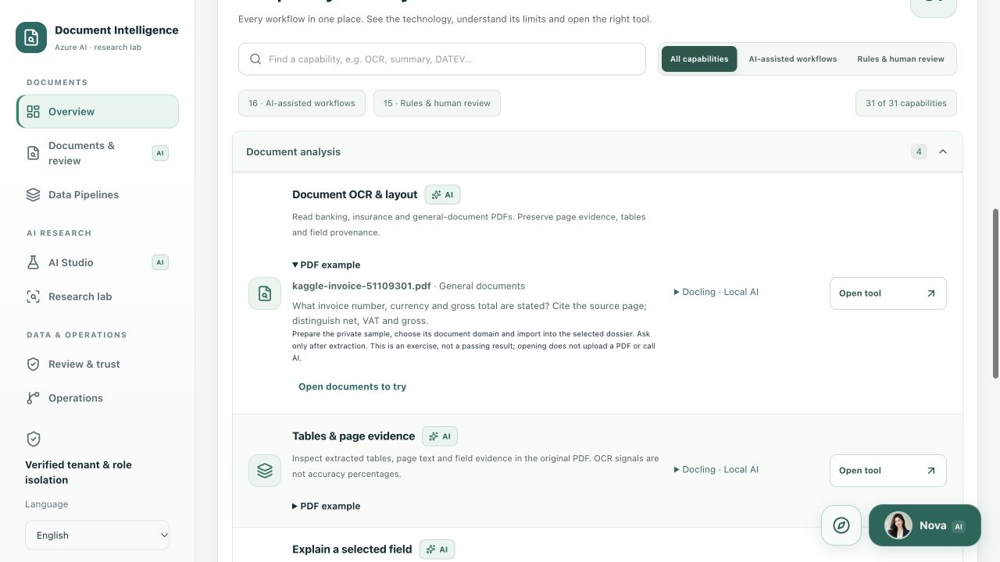

### Results first, references when needed

**Analysis results** is the destination after import. Each compact result links directly to **View result & PDF** and Nova; the reference library stays collapsed until needed. Field/page/table counts describe extraction output, not accuracy.

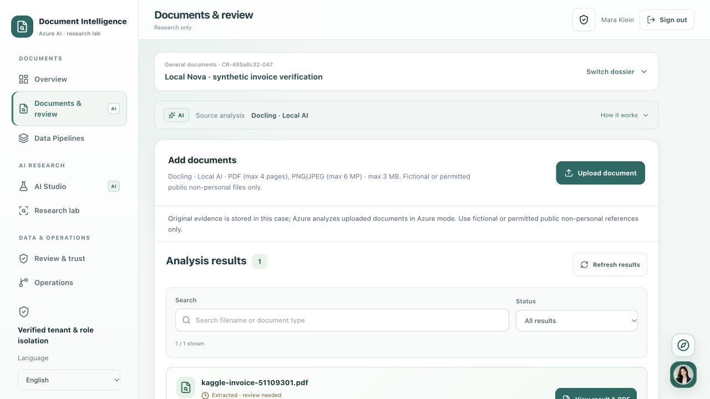

### Original PDF and extraction

The viewer places the protected original beside extracted fields, source quotations and page links. This fresh capture shows synthetic invoice **51109301** and the original **INR 1,844,673.60** gross total, not a converted EUR amount. OCR signals are inspectable under recognition details; they are not measured accuracy. Extraction remains awaiting independent human review.

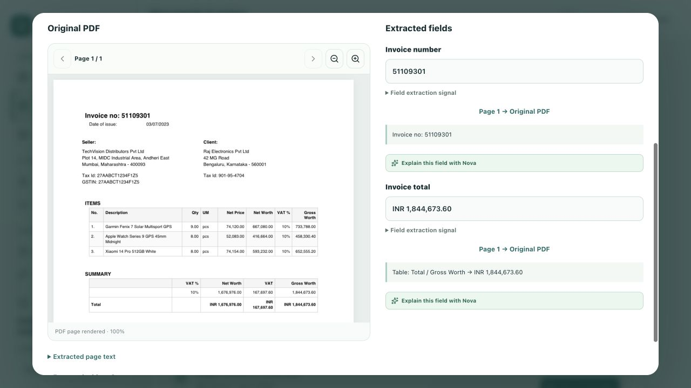

For payroll, keep **Netto-Verdienst** and **Auszahlungsbetrag** separate; use the [private DATEV references](#datev-payroll-references). Insurance uses the [private Kaggle reference library](#kaggle-document-library) with explicit source/rights information. The screenshot is a reviewed UI illustration, not redistribution of the source PDF bundle; full originals remain private.

### Document processing control room

The queue shows the saved invoice extraction as **Ready for review**, not reviewer-confirmed. One set of status chips filters submissions; **Batch intake** and **Data layers & exports** are separate tabs. Expand processing/storage settings only when needed. ClamAV remains enabled. Earlier gallery captures retain the prior assets-tab label; the new local ETL capture below shows the added data-layer workflow.

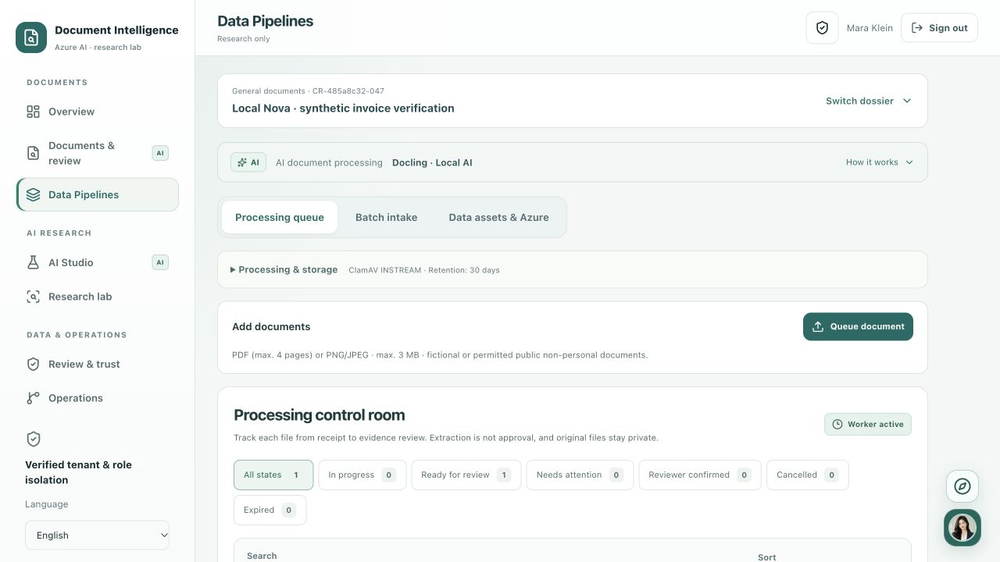

Open **Processing details** for source identity, actual extraction counts and recorded events. The pictured receipt records **one page, two fields and two tables**, the Docling provider and its original submission/finish times. **Download processing manifest** exports metadata only. Reopening this receipt is not a new model run, and the human-review stage is not approval.

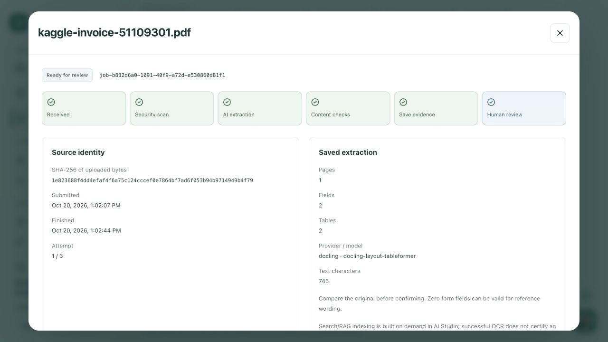

### Actual local ETL and quality findings

The new Docker worker processed the scanned synthetic invoice into **one Bronze snapshot and two Silver fields**. **Gold is zero because the source has not been reviewer-confirmed**, not because the transform failed. The receipt passed real dbt checks. The ambiguous literal date `03/07/2023` is preserved and linked back to page 1 of the original. Parquet downloads are private and require consent plus authentication. This is a single measured run, not a general quality benchmark.

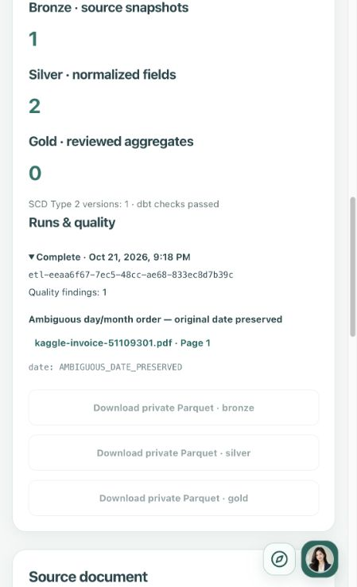

### Compare prompts without hiding failures

On the independently checked invoice-number field, zero-shot matched the exact source/reference. Few-shot produced valid JSON but no supported value. The UI retains **0% reference/quote match**, the empty observation and a direct link to the original. The **100% schema validity** in this one-sample experiment means format compliance only, not accuracy. Four chunking strategies are measured separately on the same checked page.

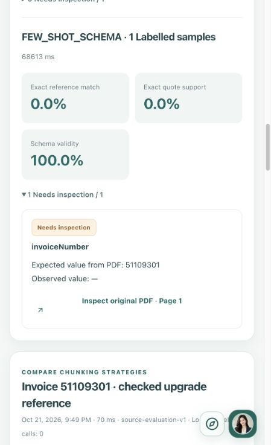

### Retrieve evidence in AI Studio

Search the selected dossier for **invoice number and gross total**, then inspect the ranked snippets and **Open source** links. This capture shows a real local retrieval over seven indexed chunks; the time and scores belong to this single request, not a benchmark. Route cards are application metadata, not proof that an LLM invoked the listed tools. MiniLM is English-focused and relevance scores are not answer-accuracy percentages.

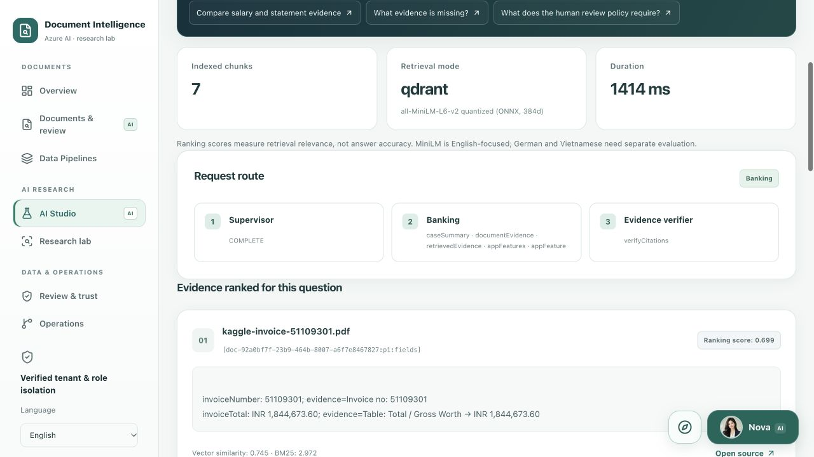

### Meet Nova and replay a page guide

Nova's portrait is an **AI-generated fictional character**, not a real advisor. The same avatar appears on the chat launcher, conversation header and page-tour coachmarks. It is bundled locally; no external avatar service receives requests.


Open the portrait button at the bottom right. Choose **App guidance** for local instructions and links, or **Evidence analysis** for source-based questions to the explicitly configured local/Azure model. The **compass icon** starts a step-by-step guide for the current page; **Expand reading area** gives longer answers more room. Enter sends; Shift+Enter adds a line break.

The fresh screenshot shows **Evidence analysis** immediately after pressing Enter on a question about the invoice number and currency. **Generation is still pending**; it is not a completed local/Azure answer or an approved result. To test the model, follow [Local Docker with Nova](#local-docker-with-nova) or [Azure Test Nova](#7-analyze-a-document-and-test-nova), wait for a completed answer and independently inspect its sources. Source links do not replace human verification.

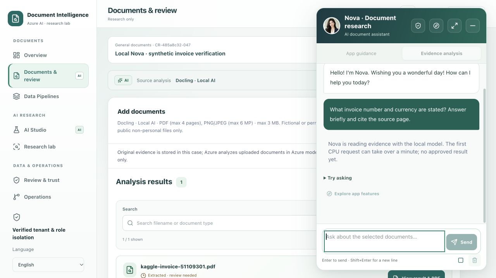

### Source-bound experiments

The **Research lab** groups **Experiments**, **Domain insights** and **Document inventory** as local tabs. Read labels independently from the original, save a reference version, then evaluate extraction or compare BM25/vector/hybrid retrieval. Results belong to that labelled sample, not general model accuracy. Operations similarly keeps **Activity log** inside its section rather than adding another main-menu entry.

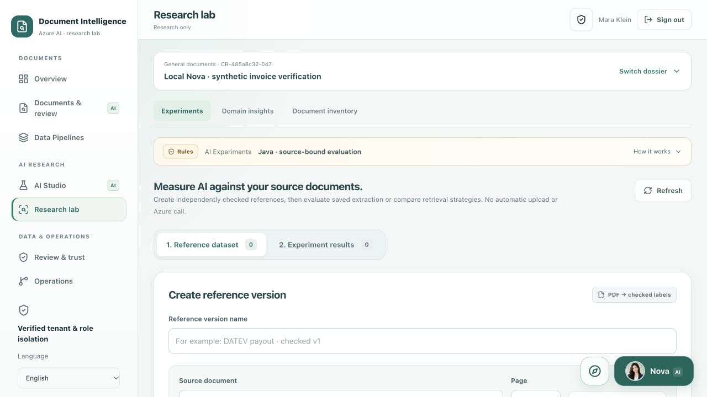

## Architecture

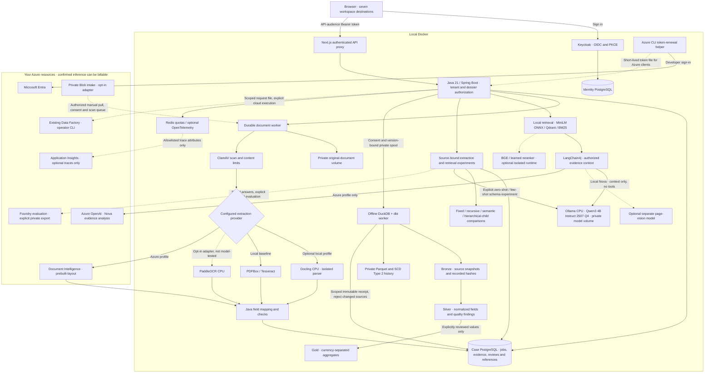

Solid paths describe configured application boundaries, not a claim that both providers run together. Dotted integrations require their own resources, credentials and explicit execution; no cloud resource is created by opening the app. The ADF CLI does not make `localhost` reachable from Azure. Foundry evaluation and monitoring delivery remain separate live-verification tasks.

Exactly one document provider and one Nova chat provider are selected by configuration; the branches are alternatives, not an ensemble or automatic cloud fallback. Dashed model paths remain optional, separately prepared experiments. Historical Azure screenshots/results retain their actual Azure provenance. Local App guidance and page tours do not use the LLM path. Retrieval indexing is built on demand, separately from OCR completion.

Two separate identities:

- **Keycloak** authenticates the app user and supplies roles, tenant and API audience.
- **Microsoft Entra** authorizes Java to call Azure. The local developer token bridge is **not Managed Identity**. An Azure-hosted application would use its own appropriately scoped Managed Identity.

| Service | Local access / responsibility |
| --- | --- |
| `web` | `http://localhost:3000` — Next.js UI and authenticated API proxy |
| `credit-api` | `http://localhost:8081` — Java APIs, extraction, search and workers |
| `keycloak` | `http://localhost:8080` — OIDC, users, roles and sessions |
| `case-db` / `identity-db` | Separate internal PostgreSQL databases with named volumes |
| `qdrant` / `redis` | Internal evidence index and shared quotas, persisted locally |
| `clamav` | Scans uploads before extraction; persistent signature volume |
| `docling` | Optional internal CPU parser, isolated network and temporary scratch storage; enabled with the separate Docling Compose profile |
| `ollama` | CPU-only local Nova engine on an internal network; weights persist separately in `lab_ollama`; no host port |
| `etl` | Offline DuckDB/dbt transforms, SCD Type 2 and private Parquet in `lab_etl`; no network or host port |
| `etl-init` | One-shot ownership setup for the private analytical volume; exit code 0 is expected |
| `storage-init` | One-shot private-volume ownership task |
| `otel-collector` | Optional local tracing override; no automatic cloud export |

Development ports bind to `127.0.0.1`. Historical `credit-*` service/realm/volume names are retained for data compatibility; renaming the Compose project creates different volumes rather than migrating them.

## Data, privacy and operation

- User-facing non-payroll samples: eight Kaggle PDFs prepared privately. The old three self-authored PDFs live only under `services/credit-api/src/test/resources/legacy-research/`, never in public assets.
- Payroll examples: only the two official fictional **DATEV LODAS 2025 Robert/Melanie** pages in the user-facing library. Older payroll fixtures exist only as regression-test resources.
- Original documents are private and Bearer-protected; PDF.js assets are served locally, not from a document-viewer CDN.
- Upload consent, malware scanning, reviewer history and case/tenant isolation remain enabled.
- Document retention is separate from chat/reference history; see the retention limits in [Nova privacy](docs/NOVA_TRUST.md).
- The former Azure VM backend and Vercel project have been removed. **Local Docker is the primary runtime**. A future cloud release requires a newly reviewed deployment; there is no active public frontend for this lab.
- No cloud resource is created by the local startup commands. Never commit private PDFs, `.env.azure.local`, tokens, database dumps or Terraform state.

[Backup, monitoring and recovery](docs/RELIABILITY_LAB.md).

## Project guide

| Location | Purpose |
| --- | --- |
| `app/`, `components/workspace/` | Localized web UI, document review, Nova and research workspaces |
| `lib/` | Contracts, translation tables, transports and frontend tests |
| `services/credit-api/` | Java security, AI integration, workers and Flyway migrations |
| `infra/keycloak/` | Local development realm |
| `infra/azure/` | Optional infrastructure source; not required locally |
| `scripts/` | Azure token bridge, private sample preparation and verification |

Review the code by following one document: `CreditWorkspace` → the Next.js case proxy → Java controllers → `DocumentJobs` → saved evidence → `DocumentEvidence`. The directory layout, API routes and database schema stay stable. Small shared helpers handle browser downloads, active-job states, table previews and verified JWT identity; domain rules stay in their existing modules.

Before contributing, run `npm run verify` and `mvn -f services/credit-api/pom.xml test`. With the Docker stack running, `node scripts/test-oauth.mjs` verifies real Keycloak login and protected API/proxy reads. Optional Azure integration checks are documented above; they may submit files or incur AI usage. Unit tests must not require Azure credentials or private PDFs.

Documentation: [Docker](docs/DOCKER_LOCAL.md) · [Azure AI](docs/AZURE_AI.md) · [Document samples](docs/PUBLIC_PAYROLL_TESTS.md) · [Research](docs/RESEARCH_WORKSPACES.md) · [Nova](docs/NOVA_TRUST.md) · [Operations](docs/RELIABILITY_LAB.md).

## License

Project code: [MIT](LICENSE). Third-party software and publisher documents retain their own terms; this license does not grant redistribution rights to DATEV originals.
