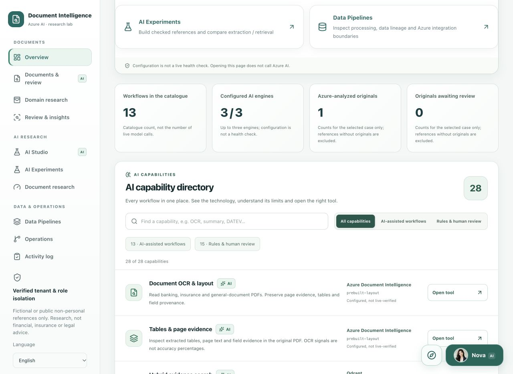
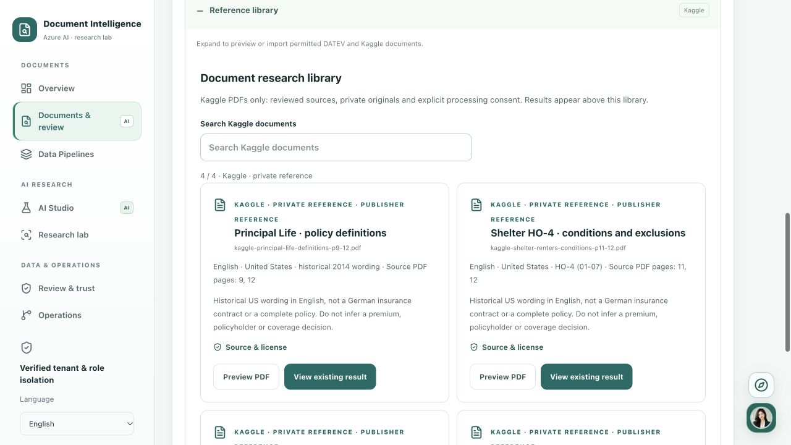
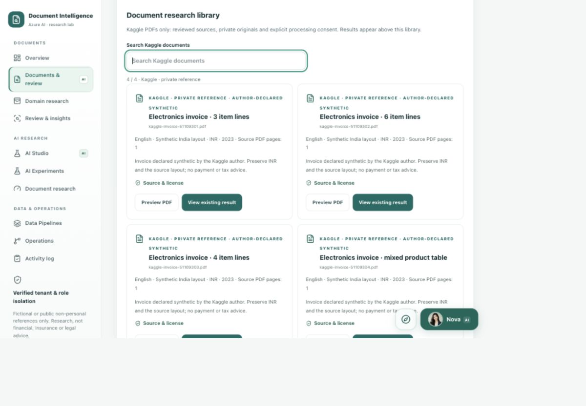
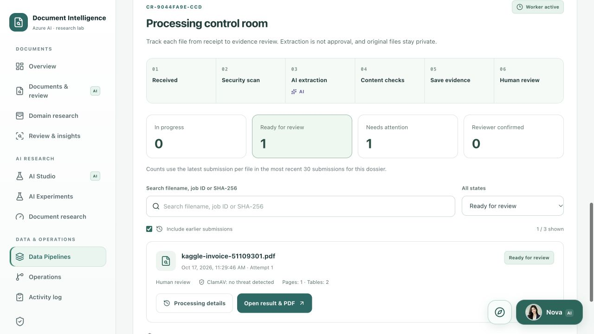
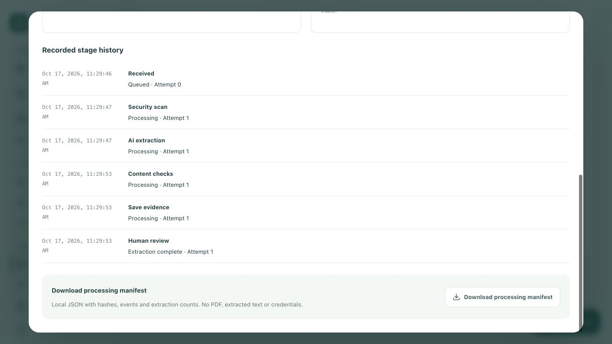
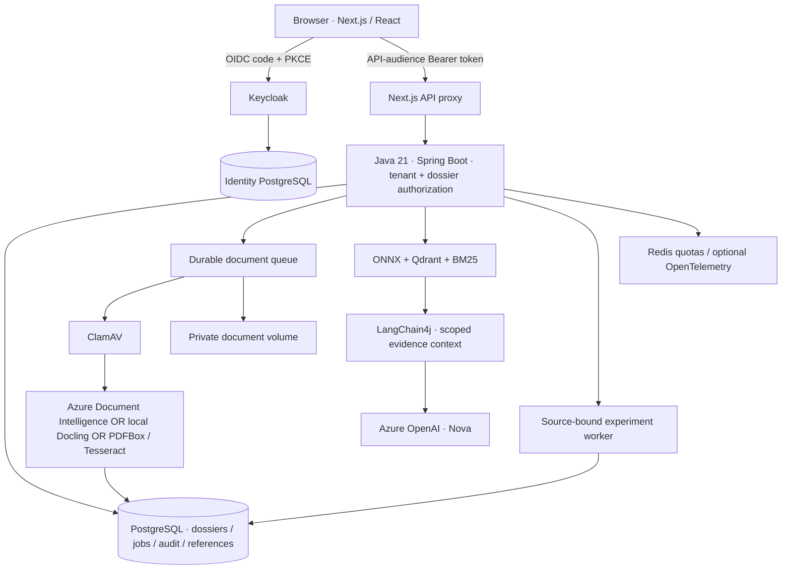

# Document Intelligence Lab

A hands-on, **MIT-licensed document AI research lab** for studying how to turn PDFs into traceable, reviewable answers with Azure AI and local open-source processing.

The project studies extraction, hybrid RAG, source-grounded answers and human review for **DATEV payroll/banking**, **insurance** and **general business documents**.

The main walkthrough follows one setup from a fresh clone to a working Nova conversation: **run the application locally in Docker and connect it to your Azure OpenAI and Document Intelligence resources**. Web, Java, Keycloak, databases and private storage stay on your computer; confirmed AI requests call Azure. For extraction without an Azure account, use the separate [local Docling guide](docs/LOCAL_DOCUMENT_AI.md); that profile does not include a generative Nova model.

**Java 21 · Spring Boot · LangChain4j · Azure Document Intelligence · Azure OpenAI · Next.js · PostgreSQL · Qdrant · Keycloak · Docker**

[Setup](#local-setup-with-azure-ai) · [Test Nova](#7-analyze-a-document-and-test-nova) · [Document pipeline](#document-pipeline-operations) · [Nova & page guides](#meet-nova-and-replay-a-page-guide) · [Troubleshooting](#troubleshooting) · [Screenshots](#workspace-tour) · [Architecture](#architecture)

> Research software, not a banking or insurance product. Use fictional or explicitly permitted documents. No payments, automated credit decisions, underwriting, claim settlement or automatic email delivery.

**Local preview:** after starting Docker with the setup below, open [English](http://localhost:3000/en), [Deutsch](http://localhost:3000/de) or [Tiếng Việt](http://localhost:3000/vi). Sign in through [Keycloak](#sign-in-through-keycloak), then open Nova's portrait at the bottom right. Use the compass beside Nova to replay the current page's walkthrough. These links point to your own computer, not a hosted deployment.

## Open-source scope

The project code is available under [MIT](LICENSE); contributions are welcome through [CONTRIBUTING](CONTRIBUTING.md). Read [SECURITY](SECURITY.md) before reporting vulnerabilities and [third-party boundaries](THIRD_PARTY_NOTICES.md) before redistributing documents, images or models. `private: true` in `package.json` prevents accidental npm publishing; it does not make the GitHub repository private or restrict the MIT license.

| Capability | Available implementation |
| --- | --- |
| Local document AI | Optional **Docling CPU** profile for layout, OCR and tables; existing PDFBox/Tesseract baseline remains available |
| Cloud document AI and Nova | Azure Document Intelligence and Azure OpenAI; own authorized resource/configuration required, usage can be billable |
| Local retrieval | MiniLM ONNX + Qdrant + BM25; English-focused embedding, not a newly installed multilingual model |
| Review and governance | Private originals, page evidence, deterministic checks, experiments, audit and human approval |

Downloaded DATEV/Kaggle PDFs, local credentials, customer documents and model caches are not part of the public source distribution. Unit tests use fictional fixtures and do not need Azure credentials. CI is a set of checks, not certification of model accuracy, production security or third-party rights.

## Local setup with Azure AI

### 1. Install the prerequisites

- Git and Docker Desktop with Compose v2, or Docker Engine + Compose on Linux.
- Host **Node.js 22+** and **Azure CLI** for the Azure credential helper. Java and Maven run inside Docker and are not required on the host.
- Suggested Docker allocation: **4 CPUs, 8 GB RAM, 15 GB free disk**.
- Available local ports: **3000**, **8080**, **8081**.
- Internet for images, build dependencies and initial ClamAV signatures.
- Commands use a macOS/Linux shell; on Windows, use a Docker-enabled WSL2 environment.
- No Vercel account or Azure VM is required. Clone the public source directly.

Check the installed tools:

```bash
docker version
docker compose version
node --version
az version
```

### 2. Clone the project

```bash
git clone https://github.com/quocvietphung/document-intelligence-lab.git
cd document-intelligence-lab
mkdir -p .local/reference-pdfs
```

For an existing checkout, open a terminal in that repository instead of cloning again. Run all following commands from the repository root.

### 3. Prepare Azure resources and access

Use resources you are authorized to access in your own tenant/subscription:

| Resource | Required configuration | Role for your developer user |
| --- | --- | --- |
| Azure OpenAI | Resource-root endpoint and a deployed Chat Completions/tool-calling model | **Cognitive Services OpenAI User** on that resource |
| Azure Document Intelligence | Custom-subdomain resource endpoint; app uses `prebuilt-layout` | **Cognitive Services User** on that resource |

Docker remains on your computer. **No VM, AKS, Vercel project or Azure API key is needed.** Azure inference can incur charges; review your resource's region, quota, permitted data and usage controls.

For the role grants, an authorized administrator opens each resource's **Access control (IAM) → Add role assignment**, selects the role above and the correct developer user, and reviews the exact resource scope. Local startup scripts do not grant access. Do not grant subscription-wide Owner access for this walkthrough.

In the Azure OpenAI resource's model deployment screen, deploy a compatible chat/tool-calling model with available quota and record its **deployment name**. Document Intelligence uses `prebuilt-layout`; no custom payroll/insurance model training is required. Creating resources/deployments may incur charges and is not performed by this project.

### 4. Sign in and configure Azure

```bash
az login --tenant YOUR-TENANT-ID
az account set --subscription YOUR-SUBSCRIPTION-ID
az account show --query '{subscription:name,id:id,tenant:tenantId}' -o table
node --version
```

Copy the template only if the private file is missing. This command preserves any existing configuration:

```bash
test -f .env.azure.local || cp .env.azure.example .env.azure.local
```

Edit `.env.azure.local` with **your** values:

```dotenv
AZURE_DOCUMENT_INTELLIGENCE_ENDPOINT=https://YOUR-DOCUMENT-RESOURCE.cognitiveservices.azure.com/
AZURE_OPENAI_ENDPOINT=https://YOUR-OPENAI-RESOURCE.openai.azure.com/
AZURE_OPENAI_DEPLOYMENT=YOUR-CHAT-DEPLOYMENT
```

Use resource-root endpoints, **not** a Foundry project URL, deployment URL or `/openai/v1` path. The deployment value is the deployed model's name, not necessarily its model family. The current local workspace has been exercised with `gpt-4.1-mini`; availability and compatibility depend on your resource.

### 5. Start the local Docker stack

Start the Azure-enabled Docker profile and keep token renewal running:

```bash
node scripts/docker-azure.mjs up
```

The helper reads the ignored configuration, obtains a short-lived Entra token, mounts only its private token directory into Java and renews every five minutes. It does not print the token, mount your Azure CLI cache, create resources or grant permissions. **Ctrl+C stops renewal, not the containers.** After restarting your computer, run the helper again.

The helper supplies base + Azure + platform Compose files. Keycloak authenticates the **app user**; Entra authorizes **Java calling Azure**. The local developer-token bridge is not Managed Identity, and app requests still need their Keycloak access token. Keep your organization's approved network restrictions; do not make a private resource public to bypass a connection problem.

First-time builds and ClamAV signature initialization may take several minutes. Keep scanning enabled. You do not need to run `npm install`, start a separate Next.js/Java process or create additional environment files for this Docker setup.

### 6. Check services and sign in

In a second terminal, from the repository root:

```bash
docker compose -f docker-compose.yml -f docker-compose.platform.yml ps --all
curl --fail http://localhost:8081/actuator/health
```

Expected state:

```text
case-db, identity-db, keycloak, credit-api, redis, clamav: running / healthy
qdrant, web: running (no Compose healthcheck)
storage-init: exited with code 0 (initialization completed successfully)
Java health endpoint: status UP
```

Open **[http://localhost:3000/en](http://localhost:3000/en)**. German: `/de`; Vietnamese: `/vi`. Use `localhost`: the local OIDC issuer/redirect settings use it.

| Local account | Username | Password |
| --- | --- | --- |
| App user: ADVISOR + REVIEWER | `advisor.demo` | `demo-password` |
| Keycloak admin: `http://localhost:8080/admin/` | `admin` | `local-admin-only` |

#### Sign in through Keycloak

1. Open `http://localhost:3000/en` and click **Sign in**. The browser redirects to Keycloak at `http://localhost:8080/realms/credit-intelligence/…`.
2. On **Sign in to your account**, enter username **`advisor.demo`** and password **`demo-password`**, then click **Sign In**. Use the app account here, not the Keycloak administrator account.
3. Keycloak redirects back to `http://localhost:3000/en`. The workspace and **Sign out** button confirm the browser session is active; open a dossier to access its protected data.


This is the real local Keycloak screen; the password field is intentionally empty in the screenshot. If you are already signed in, the app may reuse the existing session without displaying this form. Start each login from the app instead of bookmarking a temporary Keycloak authentication URL.

**Keycloak login is separate from `az login`:** the app user signs in through this form; Azure CLI supplies the developer credential used by Java to call Azure AI. No Azure token or API key needs to be pasted into this screen.

If the browser blocks Keycloak's silent cookie check, initialization fails closed instead of leaving **Loading…** indefinitely. Use **Sign in** for a top-level Keycloak redirect; interactive sign-in and OAuth callbacks do not depend on the silent third-party-cookie iframe. PKCE, API audience/tenant validation and role checks remain required.

These credentials apply to a **fresh local identity database**. Existing volumes retain their accounts/passwords; importing a realm does not reset them. Do not delete an identity volume to fix login. Never expose this development realm publicly or reuse these passwords in a cloud deployment.

### 7. Analyze a document and test Nova

1. Create a **General documents** dossier and open **Documents & review**.
2. Prepare the [Kaggle document library](#kaggle-document-library), then select invoice **51109301** in **Document research library**. Preview it, choose **Import & analyze** and confirm the destination. Only the confirmed PDF is sent to Azure Document Intelligence.
3. Find **Analysis results**, above the sample library, and open **View result & PDF**. Inspect the Azure provider/model, original page, extracted values and tables. For progress/history, open **Data Pipelines → Processing queue**.
4. Open **Nova → Evidence analysis**, type the question below and press Enter. Shift+Enter adds a line break.

> What amounts are stated in this invoice? Cite the source page, distinguish observed facts from interpretation, and say what needs human verification.

5. Check that a completed **Azure OpenAI** answer appears. Open its source links and compare the original. A greeting, engine badge or local **App guidance** response alone is not proof that the model answered.
6. Use **AI Studio** to retrieve a passage. In **AI Experiments**, independently check labels/target pages against the PDF, save a reference and run an extraction or retrieval experiment.

For insurance, use the four private Kaggle references below. For payroll, prepare the private DATEV references.

Azure Compose limits include **2 PDF pages, 6 MP images and 3 MB files**. Shared request/token reservations are finite lab safeguards, not billed usage or a monetary cap.

See [Azure reference details](docs/AZURE_AI.md) for additional RBAC examples and troubleshooting. Startup requires only the steps above, not another deployment.

## Document pipeline operations

### Batch intake and extraction check profiles

Open **Overview → Multi-document batch intake → Data Pipelines → Batch intake & extraction profiles**. Select **1–4 permitted PDFs/images**, each at most **3 MB**, enter a source/provenance note and choose a check profile. Review the file list and provider before **Confirm analysis**. Azure mode still limits each PDF to **2 pages**; a batch does not increase the per-file limits. Each accepted file is scanned separately before Azure analysis.

Profiles are **versioned Java field checks**, not trained Azure classifiers or new LLM calls:

| Profile | Expected review |
| --- | --- |
| General documents | Inspect page text and tables without required business fields. |
| Invoice | Check `invoiceNumber` and `invoiceTotal`; retain original currency. |
| DATEV payroll | Check `netIncome` separately from `payoutAmount`; verify identity/period against the original. |
| Insurance wording | Inspect wording and source pages; no personal-policy completeness or settlement decision is inferred. |

The private intake receipt is stored in PostgreSQL `lab_records` under `document-batch`; per-file jobs remain in `lab_jobs`. It records declared provenance (not independently verified provenance), file SHA-256, profile version and accepted/duplicate/rejected outcomes. Open **Result & PDF** beside completed files. Duplicate receipts link existing jobs; linked manual retries follow their latest result without overwriting the original intake. Missing expected fields and type mismatches are review signals, **not confidence or accuracy scores**. Extraction never marks a document human-approved. Receipt metadata stays in case history; the document-file retention job does not automatically purge these receipts.

For supported invoice summary tables, a conservative Java rule maps an explicitly labelled **Total × Gross Worth** cell to `invoiceTotal`, retaining the observed currency, page and table evidence. Net totals, VAT-only amounts and multiple ambiguous gross totals are not substituted. This adds no model call, invents no confidence score and does not retroactively rewrite older saved extractions.

Repeated submission of the same request ID and identical content returns its receipt; changed content with that ID is rejected. New duplicate submissions do not create another active processing job. A receipt may contain partial acceptance. After an interrupted intake, inspect the queue before resubmitting; this is not an atomic all-or-nothing batch or an exactly-once inference guarantee. Waiting/retry jobs retain the existing cancel controls; manual retry remains limited to pinned DATEV/Kaggle bytes.

**Azure Data Factory and cloud-source ingestion remain disconnected.** The batch screen works through local Java and Docker, with explicit Azure AI calls after confirmation. It does not deploy ADF, run a Foundry evaluator, expose localhost, create Azure resources or upload originals to a public container. Keep source notes and downloaded receipts private. Up to 60 recent batch receipts are listed per dossier; this is not an all-time operational dashboard.

The **Overview AI capability directory** lists all 28 current entries: 13 AI-assisted workflows and 15 rule-based, navigation, review or governance controls, each with a tool destination. Azure OpenAI, Azure Document Intelligence and local ONNX/Qdrant retrieval are distinguished. Counts describe catalogue entries, not independent models, live health checks or successful inference calls.



To verify the complete local OAuth → proxy → Java → PostgreSQL → scan → Azure → protected PDF flow with two pinned, public synthetic Kaggle invoices:

```bash
TEST_BATCHES=1 node scripts/test-oauth.mjs
```

This explicit test may incur Azure inference charges and leaves labelled test records for inspection. It checks repeat-request safety, duplicates, bounds, protected history and original hashes. It does not delete existing dossiers or auto-confirm extracted values.

Add `TEST_BATCH_CHAT=1` to that command to also test a real Azure OpenAI answer with source links and unchanged INR currency. A passing check on these two samples is not general model-accuracy certification.

Open a dossier, then **Data Pipelines → Processing queue → Processing control room**. The queue exposes six stages:

`Received → Security scan → AI extraction → Content checks → Save evidence → Human review`

| Control | What it does |
| --- | --- |
| State counters and filters | Show in-progress, review-ready, failed and reviewer-confirmed files. Counts use the latest submission per SHA-256 within the latest **30 loaded submissions**, not all-time platform totals. |
| Search and earlier submissions | Search filename, job ID or hash. Enable **Include earlier submissions** to inspect prior failures without confusing them with the current result. |
| Processing details | Inspect recorded timestamps, source hash, attempt, previous-job link, provider/model and actual page/field/table counts. Historical jobs without stage events are explicitly labelled; no timeline is invented. |
| Open result & PDF | Open the saved extraction beside the protected original. Successful extraction means **ready for review**, not human approval or verified accuracy. |
| Download processing manifest | Download local JSON containing source hash, job state, event history and extraction counts. It excludes PDF bytes, extracted text, credentials and internal storage paths. Treat dossier IDs and filenames as private operational metadata. |
| Cancel waiting job | Cancel only a queued job or waiting retry, after confirmation. An already-running provider request cannot be interrupted; cancellation does not reverse prior charges or erase the original. Normal retention still applies. |

PostgreSQL stores jobs and stage events together through a database trigger. The worker checks the stored bytes against their SHA-256 before scanning, bounds attempts to three and uses delayed retries for transient service/rate-limit errors. Authentication, permissions, unsupported content and security failures stop without repeated automatic calls. Fix the cause before retrying.

Manual retry creates a linked job and retains the failed record. It is restricted to the **exact approved DATEV/Kaggle reference bytes**, within retention, and repeats scanning. A saved extraction can be reused after a later-stage failure. This is **not an exactly-once inference guarantee**: a lost provider response before a checkpoint can still require another billable call. Arbitrary uploads must be reviewed and submitted again through the normal consent flow.

The six steps describe document processing, **not** vector indexing. AI Studio builds its dossier search/RAG index on demand. A completed OCR job or downloaded manifest does not certify index readiness, source truth, human approval or compliance.

### Design references

The control room adapts patterns from [Docling Serve](https://github.com/docling-project/docling-serve/blob/main/docs/usage.md) (asynchronous tasks and separate status/results), [Unstructured ingestion](https://docs.unstructured.io/open-source/ingestion/overview) (explicit processing stages and metadata) and [Paperless-ngx](https://github.com/paperless-ngx/paperless-ngx/blob/dev/docs/usage.md) (background processing and inspectable tasks). These are architectural references, not installed engines or a standards certification. Java, PostgreSQL, ClamAV and the configured extraction provider remain this application's runtime.

### Verify the queue end to end

With Azure Docker running and the private Kaggle files prepared, run:

```bash
TEST_PIPELINE=1 node scripts/test-oauth.mjs
```

This localhost-only acceptance test creates a labelled research dossier, analyzes one pinned synthetic Kaggle invoice with Azure, verifies the original hash and six recorded stages, checks duplicate protection and cancellation, and submits an inert negative-control file that must stop before Azure. It also checks authentication/authorization boundaries. Azure inference may be billable. Test records remain inspectable; no existing dossiers are deleted or AI values automatically approved.

## Kaggle document library

**Insurance** and **General documents** now offer Kaggle PDFs only. The old self-authored policy, claim and invoice are no longer public samples; they remain test-only fixtures. Existing dossier originals/history are not deleted or relabelled. **The two official DATEV payroll references remain unchanged** in Banking & payroll.

| Domain | Source | Prepared documents |
| --- | --- | --- |
| Insurance | [Insurance Documents](https://www.kaggle.com/datasets/jpardovega/documents), version 3 | Principal definitions (source pages 9, 12), Principal administration (16–17), Shelter conditions (11–12), Shelter personal liability (23–24) |
| General documents | [OCR-ready invoice PDFs](https://www.kaggle.com/datasets/devp1866/high-quality-ocr-ready-invoice-pdfs), version 1 | Four complete one-page invoices: 51109301–51109304; different product tables, original INR currency |

There are **8 prepared PDFs**: four reviewed two-page insurance excerpts and four byte-identical original invoices. Search the library by title, publisher, filename or language. Each card shows source/version, declared license, document origin and PDF-page mapping.

The insurance documents are **historical US wording in English, not German-standard insurance policies**, customer certificates or complete contracts. Only generic pages were selected; the first pages with names/addresses are excluded. The app classifies these excerpts as `insurance-wording`; they do not satisfy the individual-policy checklist or prove coverage.

The invoice author explicitly describes the dataset as **fully synthetic**. This is Kaggle-sourced test data, not actual transactions. Keep INR as INR; do not infer German VAT compliance or convert the figures into EUR. The dataset's paired labels are development references, not proof of held-out performance.

Review source terms before preparing private copies. Kaggle reports **Apache 2.0** for both datasets; for publisher-owned policy wording this is **not independent verification of the underlying publishers' rights**. No Kaggle PDF or extracted source-page image is bundled in Git or public assets.

Prepare the library before following step 7 above:

```bash
python3 -m venv .local/kaggle-tools
.local/kaggle-tools/bin/python -m pip install pypdf==6.10.0
.local/kaggle-tools/bin/python scripts/prepare-kaggle-references.py
```

The helper downloads only allowlisted files, verifies source/version hashes and exact page markers, checks prepared PDF hashes and refuses to overwrite different existing files. Insurance originals stay in `.local/kaggle-insurance/`; invoice originals in `.local/kaggle-invoices/`; ready PDFs in `.local/reference-pdfs/`, already mounted read-only into Docker web. Invoice PDF bytes are preserved, not re-created by this app. **Preparation never calls Azure or writes to the database.** No Kaggle API key is required for these public files.

1. Create/open an **Insurance** or **General documents** dossier, then **Documents & review**.
2. In **Document research library**, search/select a document and choose **Preview PDF**. Viewing stays local and shows the source-page mapping.
3. Choose **Import & analyze**, review the destination and confirm. The authenticated queue scans that PDF with ClamAV, calls the configured document provider and stores the original/result privately in the dossier. Azure mode sends only that confirmed PDF to Azure Document Intelligence.
4. Stay on the page: processing and **View result & PDF** appear **above** the library. Exact prepared-file matches open their existing results instead of re-analyzing.
5. Ask Nova about source wording, missing context, invoice number or totals. Check page citations; field counts and OCR signals are not accuracy scores.

Keep the Azure token-renewal helper running for cloud analysis. Missing or modified private PDFs disable their cards; the web app never silently downloads a replacement. The old `prepare-insurance-references.py` entry point remains compatible and prepares only the four insurance references.





With the Azure Docker stack running and all eight private files prepared, this explicit integration test creates two local research dossiers, scans/analyzes all eight PDFs and checks Nova's source links and original INR currency. It uses your configured Azure inference and may incur usage charges:

```bash
TEST_KAGGLE=1 TEST_KAGGLE_CHAT=1 node scripts/test-oauth.mjs
```

It does not delete old dossiers, confirm AI-extracted values as human-checked labels or send any actual customer documents. Insurance results show extracted page counts: reference wording is not expected to contain personal policy fields.

## DATEV payroll references

The payroll library uses only the official fictional **DATEV LODAS 2025 Robert-Muster and Melanie-Muster** pages. Publisher originals/derived PDFs are not bundled in GitHub or the image; DATEV retains its rights.

1. After reviewing the publisher's terms, download the unchanged 30-page [official DATEV sample PDF](https://www.datev.de/content/dam/markenassets/themen-und-produktgruppen/zielgruppen/zielgruppenuebergreifend/shop-assets/personalwirtschaft/lodas-musterauswertung-2025-deutsch.pdf) to `.local/datev-lodas-musterauswertung-2025.pdf`.
2. With Python 3 installed, create a private helper environment and split the permitted pages:

```bash
python3 -m venv .local/datev-tools
.local/datev-tools/bin/python -m pip install pypdf
.local/datev-tools/bin/python scripts/prepare-datev-reference.py \
  .local/datev-lodas-musterauswertung-2025.pdf
```

The helper validates the source and refuses to overwrite existing references. Expected files:

```text
.local/reference-pdfs/datev-lodas-2025-robert-muster.pdf
.local/reference-pdfs/datev-lodas-2025-melanie-muster.pdf
```

3. In a **Banking & payroll** dossier, open **Documents & review → Official DATEV payroll library**. Preview a page, choose **Import & analyze**, confirm its destination and inspect **Analysis results** above the library.
4. In Azure mode, ask Nova to distinguish net earnings from payout with a page citation. Robert-Muster's reference values are **2.967,11 EUR** net and **2.882,11 EUR** payout—not the same field.

Previewing does not send a prepared PDF to Azure; confirmed analysis does. Keep third-party PDFs outside `public/` and Git. Source labels/number formatting remain unchanged across interface languages. [Reference details](docs/PUBLIC_PAYROLL_TESTS.md).

## Stop, restart and inspect logs

Stop the token-renewal terminal with **Ctrl+C**, then stop Docker without deleting data:

```bash
docker compose -f docker-compose.yml -f docker-compose.platform.yml stop
```

To start again, open Docker Desktop/Engine and run this from the repository root:

```bash
node scripts/docker-azure.mjs start
```

Keep the helper terminal running so Azure access remains current. Do not start two renewal helpers simultaneously. After source changes, stop the existing helper and run `node scripts/docker-azure.mjs up` to rebuild.

Inspect logs privately:

```bash
docker compose -f docker-compose.yml -f docker-compose.platform.yml \
  logs --tail=80 credit-api web keycloak
docker compose -f docker-compose.yml -f docker-compose.platform.yml \
  logs --tail=40 clamav
```

PostgreSQL, private documents, Qdrant, Redis and ClamAV definitions use named volumes. Private DATEV references live in `.local/reference-pdfs/`; short-lived Azure credentials live in ignored `.local/azure-auth/`. **Do not use `down -v`, volume prune or system prune to troubleshoot startup/login**: these can erase data. Never print token files or share unredacted logs.

## Troubleshooting

| Symptom | Check / remedy |
| --- | --- |
| Docker unavailable | Start Docker Desktop/Engine; `docker version` must include the server |
| Port in use | Stop only the recognized conflicting app; do not run host and Docker web together |
| ClamAV starting | Allow initial signatures; inspect scanner logs instead of bypassing scanning |
| `storage-init` exited 0 | Expected: the one-shot permissions task completed |
| Login fails | Use `localhost`, check Keycloak health; existing accounts retain their passwords |
| App API `401/403` | Check the session, audience, tenant and role; keep JWT validation enabled |
| Azure `401/403` | Check tenant/resource, token renewal, resource-scoped inference role and approved network access |
| Deployment `404` | Actual deployment name and matching resource-root endpoint |
| Analysis `503` | Current provider, renewal/service readiness and newest job; old failures remain history |
| Nova unavailable | Keep the Azure helper running; verify OpenAI endpoint, deployment and inference role. App guidance is local, not a substitute for a model answer |
| `429` | Distinguish app request/token reservations from Azure quota; wait for the relevant reset |
| Stale-reference `409` | Refresh the dossier and independently verify/save labels for the new source version |
| Foundry / Data Factory not connected | Expected: exports prepare research inputs, not cloud execution |

Configuration checks do not call Azure or expose credentials:

```bash
node --test scripts/docker-azure-config.test.mjs
```

## Features at a glance

| Feature | Implementation | Where |
| --- | --- | --- |
| Document OCR and layout | Azure Document Intelligence `prebuilt-layout`, optional local Docling, or PDFBox/Tesseract baseline; Java field normalization/classification rules | Documents & review |
| Semantic and hybrid RAG | Local MiniLM ONNX embeddings, Qdrant and BM25—not Azure AI Search | AI Studio |
| Document Q&A and source explanations | Azure OpenAI through Java/LangChain4j; dossier-scoped read-only tools | Nova → Evidence analysis |
| Controlled AI drafts | Summary, cross-document comparison, inconsistency explanation, document request, review checklist, German terminology and DE–VI summary | AI transparency & review → Task library |
| Source-bound evaluation | Human-checked reference labels; deterministic extraction precision/recall/F1 and retrieval hit rate@5/MRR@5 | AI Experiments |
| Traceable processing control room | Durable stages/events, current-versus-historical filters, bounded retries, waiting-job cancellation and metadata-only manifests | Data Pipelines → Processing queue |
| Evidence review and research exports | Private PDF viewer, corrections/history, reviewer tasks, source hashes and private JSON/JSONL exports | Documents & review / Data Pipelines |

The platform also provides Keycloak OAuth 2.0/OIDC + PKCE, Bearer-protected tenant/dossier access, PostgreSQL persistence, durable jobs, ClamAV, Redis limits, audit history and English/German/Vietnamese UI/page tours. Nova **App guidance** is local application logic, not an LLM response.

OCR confidence is not measured accuracy; citation-ID validation does not prove that every statement is supported. Financial decisions remain outside scope. Azure Foundry evaluation, Data Factory orchestration, Blob ingestion and Application Insights are **not connected by default**. [Research methods](docs/RESEARCH_WORKSPACES.md) · [Nova privacy and review](docs/NOVA_TRUST.md).

## Workspace tour

The sidebar has seven destinations. Related research and operations pages use local section tabs, rather than repeating similar entries in the main menu.

| Destination | What to do here |
| --- | --- |
| Overview | Start document analysis, evidence search or Nova; see dossier warnings before the capability directory. All 28 capabilities remain available in six expandable groups; searching opens matching groups. |
| Documents & review | Add a source, open the result and original PDF, inspect fields/tables, and confirm with reviewer permission. Expand **Reference library** for private DATEV or Kaggle samples. |
| Data Pipelines | Follow processing jobs, use one status filter, inspect receipts, or switch to batch intake and data assets. |
| AI Studio | Retrieve evidence with local hybrid search and prepare a question for Nova. |
| Research lab | Switch between **Experiments**, **Domain insights** and **Document inventory**. |
| Review & trust | Inspect deterministic warnings and the case-scoped human-review workflow. |
| Operations | Inspect configuration/runbooks or switch to **Activity log**. |

Existing `#banking`, `#evaluation` and `#audit` links still open the correct section. Navigation, directory filters and page guides never start inference automatically. The optional Docling provider and the active Azure configuration are unchanged by the UI grouping.

Current local UI in English. Screenshots show an existing research workspace, not dossiers preloaded into a fresh clone. German labels and number formatting inside source evidence are deliberately preserved.

### Multi-domain overview


### DATEV original and extraction

The current viewer places the private original beside extracted fields, source quotations and page links. **Net earnings and payout are separate values.** OCR confidence is inspectable under recognition details; it is not measured accuracy. The visible DATEV excerpt is from a fictional publisher sample, not a redistributed original PDF.


### Insurance document review

The Kaggle-only library keeps references and processing results together; full originals remain private.


### Document processing control room

Actual local Azure processing of a synthetic Kaggle invoice. The review-ready filter separates a saved result from cancelled or blocked test submissions. Page/table counts are extraction output, not accuracy scores.



Open **Processing details** for the source identity, actual extraction counts and recorded events. **Download processing manifest** exports metadata only.



### Nova, grounded in the selected dossier

A real local Azure OpenAI conversation about the approved fictional DATEV sample. Source links make the answer inspectable; they do not replace human verification.


### Meet Nova and replay a page guide

Nova's portrait is an **AI-generated fictional character**, not a real advisor. The same avatar appears on the chat launcher, conversation header and page-tour coachmarks. It is bundled locally; no external avatar service receives requests.


Open the portrait button at the bottom right. Choose **App guidance** for local instructions and links, or **Evidence analysis** for source-based Azure OpenAI questions. The **compass icon** starts a step-by-step guide for the current page; **Expand reading area** gives longer answers more room. Enter sends; Shift+Enter adds a line break.


### Source-bound experiments

Read labels independently from the original, save a reference version, then evaluate extraction or compare BM25/vector/hybrid retrieval. Results belong to that labelled sample, not general model accuracy.


## Architecture



Two separate identities:

- **Keycloak** authenticates the app user and supplies roles, tenant and API audience.
- **Microsoft Entra** authorizes Java to call Azure. The local developer token bridge is **not Managed Identity**. An Azure-hosted application would use its own appropriately scoped Managed Identity.

| Service | Local access / responsibility |
| --- | --- |
| `web` | `http://localhost:3000` — Next.js UI and authenticated API proxy |
| `credit-api` | `http://localhost:8081` — Java APIs, extraction, search and workers |
| `keycloak` | `http://localhost:8080` — OIDC, users, roles and sessions |
| `case-db` / `identity-db` | Separate internal PostgreSQL databases with named volumes |
| `qdrant` / `redis` | Internal evidence index and shared quotas, persisted locally |
| `clamav` | Scans uploads before extraction; persistent signature volume |
| `storage-init` | One-shot private-volume ownership task |
| `otel-collector` | Optional local tracing override; no automatic cloud export |

Development ports bind to `127.0.0.1`. Historical `credit-*` service/realm/volume names are retained for data compatibility; renaming the Compose project creates different volumes rather than migrating them.

## Data, privacy and operation

- User-facing non-payroll samples: eight Kaggle PDFs prepared privately. The old three self-authored PDFs live only under `services/credit-api/src/test/resources/legacy-research/`, never in public assets.
- Payroll examples: only the two official fictional **DATEV LODAS 2025 Robert/Melanie** pages in the user-facing library. Older payroll fixtures exist only as regression-test resources.
- Original documents are private and Bearer-protected; PDF.js assets are served locally, not from a document-viewer CDN.
- Upload consent, malware scanning, reviewer history and case/tenant isolation remain enabled.
- Document retention is separate from chat/reference history; see the retention limits in [Nova privacy](docs/NOVA_TRUST.md).
- The former Azure VM backend and Vercel project have been removed. **Local Docker is the primary runtime**. A future cloud release requires a newly reviewed deployment; there is no active public frontend for this lab.
- No cloud resource is created by the local startup commands. Never commit private PDFs, `.env.azure.local`, tokens, database dumps or Terraform state.

[Backup, monitoring and recovery](docs/RELIABILITY_LAB.md).

## Project guide

| Location | Purpose |
| --- | --- |
| `app/`, `components/workspace/` | Localized web UI, document review, Nova and research workspaces |
| `lib/` | Contracts, translation tables, transports and frontend tests |
| `services/credit-api/` | Java security, AI integration, workers and Flyway migrations |
| `infra/keycloak/` | Local development realm |
| `infra/azure/` | Optional infrastructure source; not required locally |
| `scripts/` | Azure token bridge, private sample preparation and verification |

Review the code by following one document: `CreditWorkspace` → the Next.js case proxy → Java controllers → `DocumentJobs` → saved evidence → `DocumentEvidence`. The directory layout, API routes and database schema stay stable. Small shared helpers handle browser downloads, active-job states, table previews and verified JWT identity; domain rules stay in their existing modules.

Before contributing, run `npm run verify` and `mvn -f services/credit-api/pom.xml test`. With the Docker stack running, `node scripts/test-oauth.mjs` verifies real Keycloak login and protected API/proxy reads. Optional Azure integration checks are documented above; they may submit files or incur AI usage. Unit tests must not require Azure credentials or private PDFs.

Documentation: [Docker](docs/DOCKER_LOCAL.md) · [Azure AI](docs/AZURE_AI.md) · [Document samples](docs/PUBLIC_PAYROLL_TESTS.md) · [Research](docs/RESEARCH_WORKSPACES.md) · [Nova](docs/NOVA_TRUST.md) · [Operations](docs/RELIABILITY_LAB.md).

## License

Project code: [MIT](LICENSE). Third-party software and publisher documents retain their own terms; this license does not grant redistribution rights to DATEV originals.
