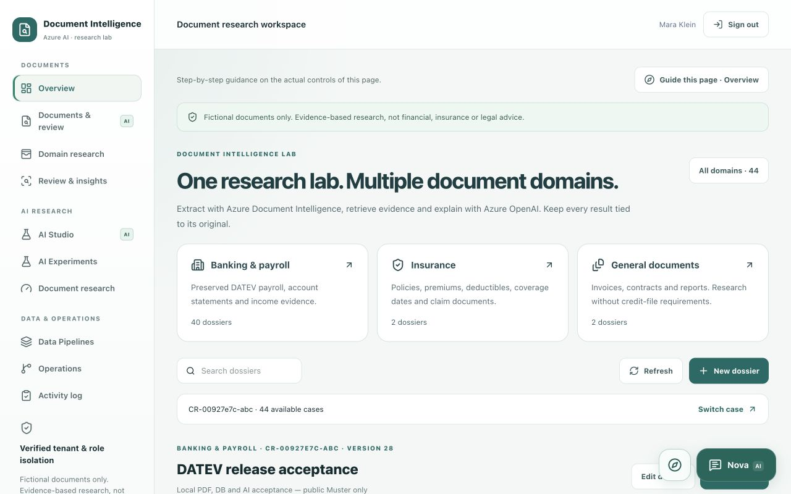
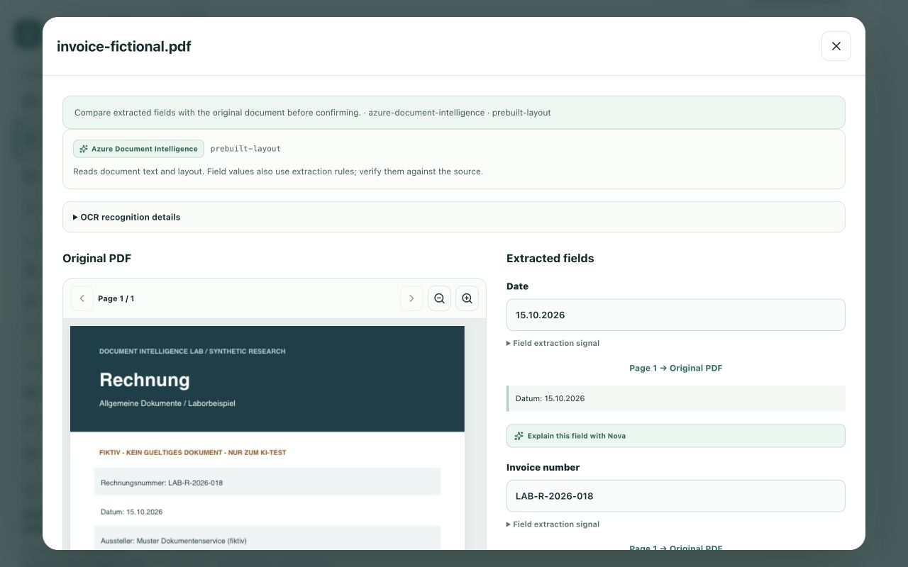
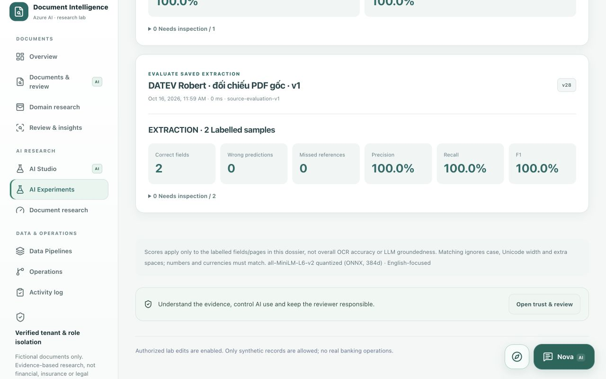
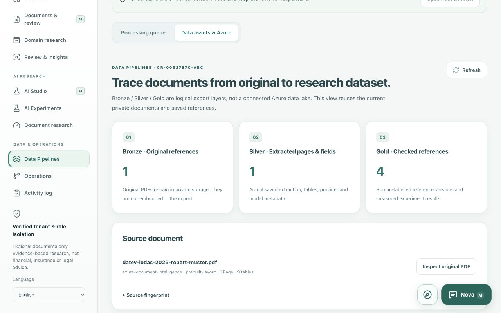
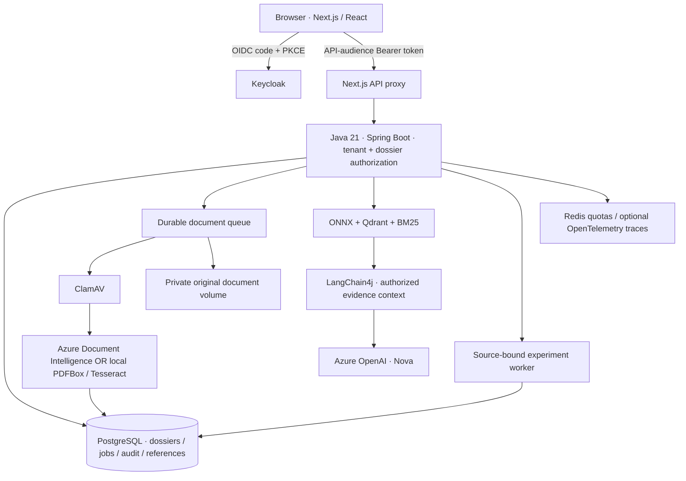

# Document Intelligence Lab

**An evidence-first Azure AI research workspace: private PDF → extraction → retrieval → explanation → human review.**

An independent engineering portfolio project for **banking/payroll, insurance and general documents**. The interface distinguishes AI output, deterministic rules, measured results and human approval.

**Java 21 · Spring Boot · LangChain4j · Azure Document Intelligence · Azure OpenAI · Next.js · PostgreSQL · Qdrant · Keycloak · Docker Compose**

[Run locally](#quick-start-no-azure-account-required) · [Azure setup](#optional-connect-your-own-azure-ai) · [Screenshots](#product-tour) · [Architecture](#architecture) · [Tests](#verification) · [Complete Docker guide](docs/DOCKER_LOCAL.md)

> Research/interview showcase, not a production banking or insurance system. Fictional documents only. No payments, credit approval, underwriting, claim settlement or automatic email sending. This release publishes source code; it does not redeploy the existing Azure/Vercel production environment.

## What this demonstrates

- **Document AI:** OCR/layout, text, tables and fields with provider/model and original-page provenance.
- **Evidence-grounded assistance:** dossier-scoped hybrid retrieval and Azure OpenAI explanations through Java, using authorized read-only tools.
- **Measurable quality:** independently checked reference versions, extraction precision/recall/F1, retrieval hit rate@5/MRR@5, failed examples and source inspection.
- **Backend engineering:** JWT-protected REST APIs, tenant/dossier authorization, validation, optimistic version checks, PostgreSQL/Flyway and durable workers.
- **Operational safeguards:** ClamAV, Redis quotas, private originals, upload consent, review history, health checks and optional OpenTelemetry traces.
- **Reproducibility:** a no-Azure Docker starting profile and opt-in keyless Azure configuration without owner-specific endpoints.

This is a working lab with explicit limitations, not a claim of compliance certification or benchmark-level accuracy.

## Quick start: no Azure account required

### Prerequisites

- Git and Docker Desktop with Compose v2, or Docker Engine + Compose on Linux.
- Suggested allocation: **4 CPUs, 8 GB Docker memory, 15 GB free disk**; practical starting recommendations, not guaranteed minimums.
- Ports **3000**, **8080**, **8081** available. Internet for images/build dependencies and initial antivirus signatures.
- Host Java/Maven/Node.js are **not needed for a Docker build**. Node.js 22+ is needed only for optional acceptance scripts/Azure helper; Java 21 + Maven for host-side Java tests.

```bash
git clone https://github.com/quocvietphung/document-intelligence-lab.git
cd document-intelligence-lab
mkdir -p .local/reference-pdfs

docker compose -f docker-compose.yml -f docker-compose.platform.yml \
  up --build -d --wait --wait-timeout 900
```

Open **[http://localhost:3000/en](http://localhost:3000/en)**. German `/de`; Vietnamese `/vi`.

| Local account | Username | Password | Purpose |
| --- | --- | --- | --- |
| App user | `advisor.demo` | `demo-password` | ADVISOR + REVIEWER in the fictional lab tenant |
| Keycloak admin | `admin` | `local-admin-only` | `http://localhost:8080/admin/` |

These are **published local examples**, imported on a new database, not cloud credentials. Never reuse them for a public deployment. Published development ports bind to `127.0.0.1`. Existing identity volumes retain existing passwords; import does not reset them.

First startup can take several minutes. ClamAV initializes signatures and uses `linux/amd64` emulation on Apple Silicon. **`storage-init` exiting with code 0 is successful completion**, not a failed service.

### First five-minute walkthrough

1. Sign in → **General documents** → create a fictional dossier. No loan amount is required.
2. In **Documents & review**, upload `public/samples/invoice-fictional.pdf`, preview and explicitly confirm analysis. Alternatively use **Data Pipelines → Processing queue**.
3. Open **View result & PDF / Inspect evidence** and compare original text, fields and tables. Local mode uses PDFBox/Tesseract, **not Azure OCR**.
4. In **AI Studio**, ask “What is the invoice total amount?” and retrieve evidence. Ranking measures relevance, not accuracy.
5. In **AI Experiments**, read expected values from the PDF yourself, label fields or question→page targets, save a reference version and run an evaluation. Jobs/reports persist in PostgreSQL.
6. In **Data Pipelines → Data assets & Azure**, inspect lineage and private JSON/JSONL exports. Exports contain source text and require acknowledgment.

**Without Azure:** login, dossiers, local OCR, PDF review, RAG, experiments, queues and audit work. Nova's app guidance is local; its evidence-analysis/LLM mode is intentionally unavailable until Azure OpenAI is configured. It does not substitute a fake model answer.

[Detailed setup, stop/restart, volumes and troubleshooting →](docs/DOCKER_LOCAL.md)

## Product tour

Actual screenshots from the local app, not design mockups. Counts and scores belong to that test workspace, not data automatically loaded into a fresh clone. Private DATEV PDFs are not bundled.

### Multi-domain workspace

Three groups separate **Documents**, **AI research**, and **Data & operations**. Domain filters organize dossiers; authorization stays server-side.



### Original and extraction evidence

The repository-authored fictional invoice can be viewed privately beside fields and page evidence.



### Source-bound AI experiments

Compare methods against a selected reference version. A high score on a small labelled sample is **not general accuracy**.



### Data lineage and Azure boundaries

Bronze/Silver/Gold are logical export layers, not a silently provisioned Azure data lake.



## Features and honest boundaries

| Capability | Implementation | Boundary |
| --- | --- | --- |
| OCR/layout | Azure Document Intelligence `prebuilt-layout`, or explicit PDFBox/Tesseract local profile | OCR confidence is not validated field accuracy |
| Document types/fields | Transparent Java classification/label/layout rules | Not a trained custom banking/insurance classifier |
| Evidence search | Quantized MiniLM ONNX + Qdrant + BM25 over page/field/table chunks | English-focused embeddings; score combination, not a learned neural reranker |
| Nova | Azure OpenAI / LangChain4j, scoped read-only tools, citations and uncertainty | User-triggered; no automatic approval or financial decisions |
| Controlled AI tasks | Summary, comparison, terminology, DE/VI draft and missing-document request draft | Editable before sending; no email delivery or certified translation |
| Review/feedback | Source verification, corrections, feedback and reviewer tasks | A valid citation does not prove every model statement |
| Extraction evaluation | Source-checked labels; precision/recall/F1 on saved fields | No new OCR call; only the labelled subset is measured |
| Retrieval evaluation | BM25/vector/hybrid; hit rate@5 and MRR@5 | One labelled document/page target per question, not multi-relevant-document Recall@5 |
| Versioning | Immutable labels/reports bound to a source-record fingerprint | Not a cryptographic attestation of PDF bytes |
| Processing | PostgreSQL upload/experiment queues, scanning, leases/recovery and retention | Old failures remain history, separate from new attempts |
| Export | Actual references, text/fields/tables, labels/results and JSONL inputs | Private download, not proof of a completed Foundry evaluation |
| Azure expansion | Document Intelligence and OpenAI integrations implemented | Foundry evaluation, Data Factory and Blob connectors are **not enabled** by this release |

Experiments use isolated local ranking without replacing the live Qdrant index. No LLM judge, calibrated groundedness score, prompt/model A/B benchmark or automatic retraining is implied. [Research methods and security](docs/RESEARCH_WORKSPACES.md).

### Domains

| Domain | Examples | Research focus |
| --- | --- | --- |
| Banking & payroll | Private official DATEV Robert/Melanie pages, income evidence, statements | Net earnings versus payout, source fields and comparisons; no credit decision |
| Insurance / Versicherungen | Included fictional policy and claim PDFs | Policy reference, premium, deductible, dates and limits; no settlement decision |
| General documents | Included invoice; permitted contracts/reports | Text/tables, identifiers, dates and amounts without banking checklist requirements |

## Architecture



**Separate identity boundaries:** Keycloak authenticates the **app user**; Entra authenticates **Java to Azure**. A Keycloak JWT is not an Azure credential.

- Local Azure mode: host Azure CLI obtains a short-lived token; Java gets a read-only file mount renewed every five minutes.
- Azure-hosted compute: use a scoped Managed Identity. The local token-file bridge is **not Managed Identity**.
- No Azure API key is needed in Git, the browser or Vercel.

| Container | Responsibility | Access / persistence |
| --- | --- | --- |
| `web` | Next.js UI/API transport | `localhost:3000` |
| `credit-api` | Java APIs, extraction, RAG, review and workers | `localhost:8081`; `/actuator/health` |
| `keycloak` | OIDC login, roles, tenant claim and API audience | `localhost:8080` |
| `case-db` | Dossiers, extraction, compatible original storage, jobs, audit/research records | Internal PostgreSQL; named volume |
| `identity-db` | Keycloak users, realm and sessions | Separate internal PostgreSQL; named volume |
| `qdrant` | Dossier-scoped vector index | Internal; named volume |
| `redis` | Distributed quotas/reservations | Internal; named volume |
| `clamav` | Scan before extraction | Internal; signature volume |
| `storage-init` | Set private document-volume ownership | One-shot success exit |
| `otel-collector` | Optional traces | Separate override; no automatic cloud export |

Historical `credit-*` service/package/realm/volume names are compatibility identifiers. Changing the Compose project name creates different volumes; it does not migrate existing data.

## Optional: connect your own Azure AI

The base profile creates **no Azure resources or Azure inference charges**. Azure mode requires your own existing resources, deployed chat model and inference permissions; review billing and data-processing requirements first.

1. An authorized administrator grants your developer identity resource-scoped **Cognitive Services User** for Document Intelligence and **Cognitive Services OpenAI User** for Azure OpenAI. The helper does not assign roles.
2. Install Node.js 22+ and Azure CLI on the host, sign in to the correct tenant/subscription.
3. Copy the template, replacing all `YOUR-*` values with your resource-root endpoints and deployment name:

```bash
cp .env.azure.example .env.azure.local
az login --tenant YOUR-TENANT-ID
az account set --subscription YOUR-SUBSCRIPTION-ID

# Edit .env.azure.local first, then:
node scripts/docker-azure.mjs up
```

If the file exists, edit it rather than overwrite it. The ignored file is read automatically; exported shell values take precedence. Configuration is validated before obtaining a token. The helper does not provision cloud resources or copy the Azure CLI credential cache into Docker.

Keep it running. **Ctrl+C stops renewal, not containers**. `start` uses existing images while renewing; `watch` renews only; `prepare` refreshes once only. The helper supports public Azure `.azure.com` endpoints; sovereign clouds require a reviewed endpoint/audience change.

The Azure Compose profile limits PDFs to **two pages**, local mode to four, uploads to **3 MB**. These are app limits, not a promise about every Azure tier. Token reservations are safety estimates, not billed token counts or a guaranteed cost cap.

Never commit `.env.azure.local`, token files, CLI caches or real documents. [Azure configuration, profile switching and troubleshooting](docs/DOCKER_LOCAL.md#azure-mode-your-resources-your-identity).

## Samples and private DATEV references

Three **repository-authored fictional** PDFs under [`public/samples/`](public/samples/) are ready after clone: policy, claim notification and invoice. `scripts/generate-research-samples.py` can regenerate them with ReportLab.

Official DATEV LODAS 2025 Robert/Melanie samples are **not redistributed**. Existing files remain in ignored `.local/reference-pdfs/`; a clone has no private files/history. Obtain the original from DATEV, check permitted use and use the validated splitter in [DATEV reference instructions](docs/PUBLIC_PAYROLL_TESTS.md). Never substitute actual employee payroll or publish originals as static assets.

Viewing a private original is separate from consenting to cloud analysis. Exports contain document text and require private handling after download.

## Verification

```bash
# Host web checks; Node.js 22+
npm ci
npm run verify
node --test scripts/docker-azure-config.test.mjs

# Host Java checks; Java 21 + Maven
mvn -f services/credit-api/pom.xml verify

# Full running no-Azure Docker stack; writes a fictional test dossier
TEST_SHOWCASE=1 node scripts/test-oauth.mjs
```

Fresh-clone acceptance exercises OIDC+PKCE, Bearer-protected Next.js/Java APIs, private PDF upload, ClamAV, local extraction, Qdrant, durable research jobs and export readback. It needs neither DATEV nor an owner's existing dossier/Azure account.

Recent baseline: **204 frontend tests passed; 196 Java tests passed and one live-Azure test skipped; five Azure configuration tests passed**. See [release verification](docs/SHOWCASE_RELEASE.md) for final Docker/browser results. These checks establish tested behavior, not general OCR/LLM accuracy.

CI includes web/Java/Keycloak checks, Docker OAuth acceptance, dependency/image scans and SBOM generation. Signed image publication is an explicit manual workflow; its presence does not prove an image was already signed or audited.

## Repository map

```text
app/                         Localized entry points and API transport
components/workspace/        PDF review, Nova, retrieval, research and operations UI
lib/                         Schemas, transports, localization and unit tests
services/credit-api/         Java security, AI integration, workers and migrations
infra/keycloak/              Development realm/identity configuration
infra/azure/                 Optional cloud infrastructure, not needed locally
scripts/                     Token bridge, sample preparation, acceptance tests
public/samples/              Authored fictional documents
docs/                        Runbooks, research methods and screenshots
```

Start with [Docker setup](docs/DOCKER_LOCAL.md), [research workspaces](docs/RESEARCH_WORKSPACES.md), [Azure integration](docs/AZURE_AI.md) and [Nova trust/review](docs/NOVA_TRUST.md). Older dated reports describe historical releases, not necessarily this version.

## Release and responsible use

- `master` is the showcase release; `develop` is synchronized after release. New work uses `feature/*`.
- Git-triggered Vercel deployments are disabled in `vercel.json` for this source-only release. Cloud publication is separate and requires environment, identity, data and release checks.
- Existing users, volumes and originals are preserved. No destructive migration or cloud resource rename.
- Use only fictional/explicitly permitted documents. The lab does not replace a privacy, security, legal or compliance assessment.
- No fabricated answers/accuracy claims, financial decisions or hidden automatic uploads.

For an interview, demonstrate one complete slice: **upload → scan → extract → inspect → retrieve → explain → evaluate → review**. Explain evidence, permissions, failure handling and measurement, not only a successful AI call.

## License

Project code is provided under the [MIT License](LICENSE). Third-party components and publisher-owned documents retain their respective terms; the project license does not grant redistribution rights to DATEV originals.
