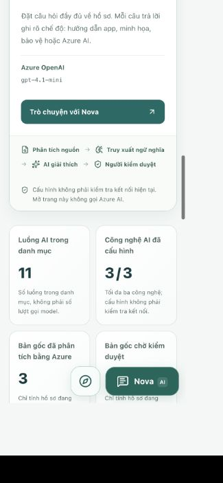

# AI dashboard directory

Local feature branch: `feature/nova-trust-and-review`. No cloud deployment or master/develop update is part of this change.

## What changed

- Overview includes a searchable catalogue of 15 current capabilities: 11 AI-assisted workflows and 4 application/human-review controls.
- Document/layout, tables/evidence, hybrid RAG, Nova, summaries, payroll/statement explanation, inconsistency explanation and email drafts are linked to their existing workflows.
- Validation and reference-set evaluation remain labelled rules. Human review and transparency remain case-management controls, not AI predictions.
- Links open Documents, AI Studio, Controls or Evaluation; buttons open Nova or the exact existing review-center tab (library, tasks or privacy). Opening a workflow never submits a question, uploads a PDF, sends an email or triggers analysis.
- Search is accent-insensitive and includes capability titles, descriptions and providers; category filters expose their selected state and empty results offer reset.
- EN, DE and VI contain the same feature IDs and descriptions. Demo mode labels non-model behavior and disables authenticated review-center actions.

## Statistics and data flow

Catalogue count is static and explicitly labelled, not an activity measurement. Configured AI engines are derived from the authenticated configuration-only metadata endpoint already used by the workspace. Missing metadata shows an em dash; configuration is not a live health check or a permission/availability guarantee for a particular case.

Azure document and pending-review counts are computed from the selected tenant-authorized case's original-backed, non-missing documents. Reference-only values and documents from other cases do not contribute. No additional inference request is made for statistics or search.

Backend, OAuth permissions, database schema, Azure resources and quotas are unchanged. Existing case-scoped controls still apply when an actual task is requested.

## Verification

- Frontend directory tests cover destinations, translated catalogue parity, selected-case statistics, unavailable configuration, local/demo/rule labels, filters and rendered links. The task/chat schemas share seven controlled task IDs.
- TypeScript, lint and Next.js production build passed. Docker web was rebuilt; backend and database volumes were preserved.
- Final frontend verification: 174 tests passed; lint, TypeScript and Docker production build passed. Java: 155 tests, 154 passed and one opt-in live document test skipped; no failures/errors.
- Live keyless Azure test: `TEST_AZURE_TASKS=1 node scripts/test-oauth.mjs` passed 38 checks, including all three new task prompts, three real Azure answers on the existing fictional empty case, persisted answer history and DE/VI section presence. This checks the workflow, not calibrated answer/translation accuracy. No new PDF was uploaded.
- Browser: Keycloak local login succeeded; all 15 catalogue rows and selected-case metadata rendered; accent-insensitive search, category filtering, empty-result reset, Documents/RAG links, task-library tab and reviewer-task tab were tested. The bilingual task fills an unsent editable draft.
- Mobile-width layout showed no horizontal overflow; temporary viewport settings were reset. All nine long-running Docker services remained up. `storage-init` is a successful one-shot initializer, not a service expected to stay running.
- The visible authenticated preview is `http://localhost:3000/vi#overview`. No changes were committed, pushed or merged to master/develop; no Vercel/cloud rollout was performed.

## Three additional Azure OpenAI tasks

The existing keyless Azure deployment now supports `review-checklist`, `terminology` and `bilingual-summary` in the controlled task library. These are three application workflows using the **same Azure OpenAI service**, not three new Azure resources or vendor models.

- Checklist: available evidence, missing documents, unknowns and specific human checks with sources; never an automated decision.
- Terminology: only labels actually found in case evidence, preserving German labels, amounts and page sources. No invented deduction causes, tax/legal definitions or financial advice.
- Bilingual summary: paired German/Vietnamese sections regardless of interface language, matching citations and exact values. It is not a certified translation.

Each workflow prepares an editable prompt without inference, then calls the existing model only after Send. Tenant/case authorization, shared quotas, privacy disclosure, immutable answer history and admin case-scoped disable remain in force. Prompt version: `nova-evidence-2026-10-v3`.

Azure Document Intelligence continues to read source layout/text/tables. Local ONNX + Qdrant/BM25 remains local RAG, **not Azure AI Search**. No Speech, Translator, AI Search or additional paid Azure resource was created.
