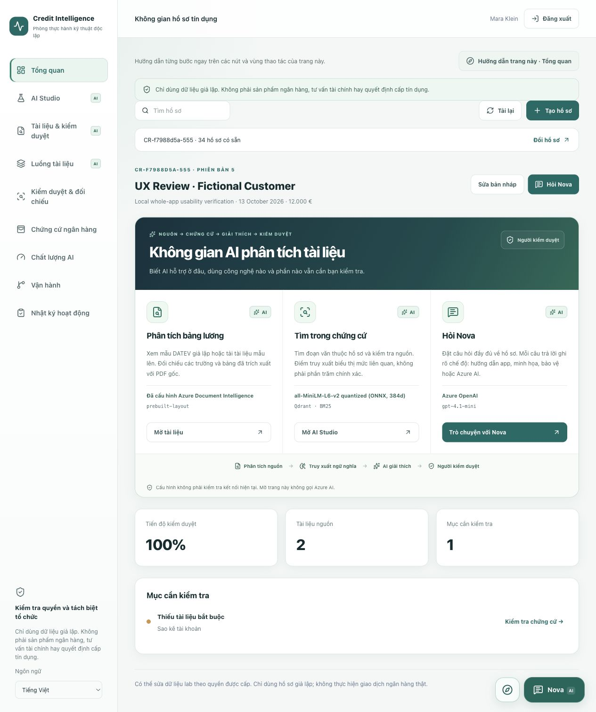
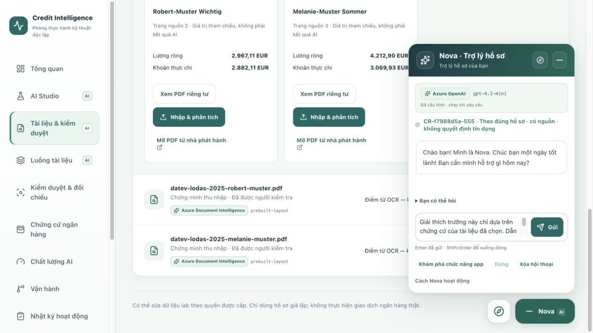
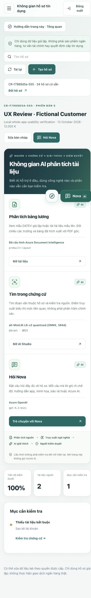

# Visible, explainable document AI

Local UI improvement — 13 October 2026. The app remains an **AI bank-document analysis lab**, without payment features or automatic lending decisions.

## What users can recognize

| Surface | Engine and honest boundary |
| --- | --- |
| Documents / pipeline | Azure Document Intelligence and its configured model, or local PDFBox/Tesseract. Layout/text analysis is separate from field-extraction rules. |
| Each document | The recorded provider/model for that particular source; fixture reference values are not labelled as Azure extraction. |
| AI Studio | Actual configured local embedding model, vector store and BM25/feature ranking. Search results still report the observed backend, including fallback. |
| Nova | Azure OpenAI deployment name from the authenticated backend, or deterministic demo. App-help answers are labelled as no LLM call. |
| Review & insights | Deterministic checks and amount-only matching. Nova can explain them on request; they are not AI fraud or lending verdicts. |
| Quality | Rules benchmark on synthetic text, not a measurement of Azure OCR/LLM accuracy. |
| Banking evidence / audit | Read-only fixture context and persisted review history. |

The overview moves the three AI entry points above the metrics. Navigation marks AI-capable sections; pages explain their actual engine and limitations. Shared AI / rules / demo / unknown labels use EN/DE/VI copy. A missing configuration response stays unknown, not silently “Azure is working.”

## Explain a field

Open source evidence and click **Explain this field with Nova**. This closes the viewer and opens an editable, source-referenced question. No request is sent until the user submits. The question asks Nova to separate source text from interpretation and identify manual verification needs. Existing case-scoped authorization and read-only tools remain unchanged; this does not introduce document approval or account-write tools.

## Configuration endpoint

`GET /api/cases/ai-capabilities` requires a verified tenant and an advisor/reviewer/admin role. It returns:

- Configured Azure OpenAI deployment name, not credentials or the resource URL.
- Document provider/model and processing mode.
- Retrieval model choice, vector-store type, ranking method and language limitation.
- `scope: configuration-only`, `automaticInference: false`.

It performs no inference, connection probe, embedding warmup, vector search or Azure token request. Configuration is **not** a current health check. No endpoint, key, token, case contents or Qdrant address is returned. Deployment names are bounded and format-checked.

## AI upgrades to prioritize next — not implemented by this UI change

1. **German/Vietnamese retrieval:** the current quantized MiniLM embedding is English-focused. Establish a multilingual reference benchmark, then compare a multilingual embedding and a learned reranker against the present formula. Keep per-case/tenant filtering and a deterministic fallback.
2. **Stronger document evidence:** preserve bounding regions per field/table and highlight them in the PDF. Extend payroll/statement layout coverage and keep net earnings distinct from payout. Do not replace missing evidence with model guesses.
3. **Structured AI explanations:** schema-validated outputs with per-claim source references, unsupported-claim rejection and explicit uncertainty. The new explanation entry point reuses the existing Nova, not a new assessment model.
4. **Separate quality evaluation:** labelled scan/OCR, field extraction, retrieval and LLM-answer sets. Report failures and coverage independently rather than calling the current rules F1 “AI accuracy.”
5. **Cross-document review:** identity/period reconciliation before interpreting amount matches. Use AI to explain inconsistencies; leave evidence confirmation and any consequential decision to a person.

No new paid Azure resource, model deployment, permission grant, API key or cloud deployment was made for this UI improvement.

## Verification

- **132 frontend tests passed**, lint and TypeScript passed, Docker production web build succeeded.
- **140 Java tests passed**, one opt-in live Azure test skipped. Offline Maven verification/package succeeded; SBOM generation was skipped in offline mode.
- **33 local OAuth/API checks passed**, including real configuration metadata through Java and Next.js plus the retired no-payment boundary. One fictional integration case (`CR-8465b875-bb5`) was retained. A final-image read-only rerun passed **24 checks** without creating cases.
- Browser metadata reported Azure Document Intelligence `prebuilt-layout`, Azure OpenAI deployment `gpt-4.1-mini`, and quantized MiniLM/ONNX with Qdrant. These are configuration facts, not a current Azure health/accuracy claim.
- Actual local retrieval of `Netto-Verdienst Robert-Muster` returned 36 indexed chunks, backend `qdrant` and the recorded MiniLM embedding, with source-linked results. No Azure inference was called.
- A field-explanation click opened a source-referenced draft; message count stayed at one greeting, proving no automatic send. Section navigation minimized Nova; reopening preserved the exact draft.
- AI / rules / read-only labels were checked across the workspaces, with overview wording in EN/DE/VI. At 390px, the sidebar was hidden, cards were one column and document width stayed within the viewport. The override was reset.
- No browser console errors were observed at the final check. Original document files, cases, authentication databases and previous work were preserved; only local web/API containers were replaced.

No commit, push, Vercel/cloud deployment, VM start, permission change, new model deployment or new Azure inference was performed in this UI update. The unit tests explicitly check demo/unknown provenance, configurable model names, authenticated GET-only metadata, no inference side effects and opt-in field explanation.

## Screenshots

Authenticated local UI; fictional records only. No original publisher-owned PDF is republished in these captures.

