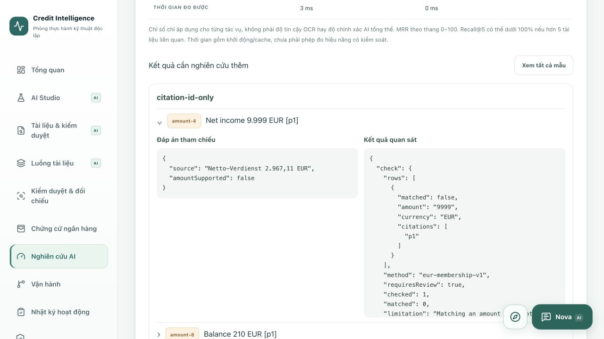

# AI Research Lab

The lab studies banking document extraction, evidence retrieval and safety using synthetic references. It does not execute payments or make lending decisions.

Experiments are case- and tenant-scoped. A result reports its dataset hash, implementation version, configuration, measured duration and limitations. Local benchmark runs do not send documents to Azure and do not represent an Azure OCR or LLM quality measurement.

## Run

1. Start the existing authenticated Docker stack.
2. Open `/vi#evaluation` (also available in English and German).
3. Choose Document extraction, Multilingual retrieval, Instruction protection or Numeric evidence.
4. Run the comparison, expand mismatched rows and inspect reference vs observed values.
5. Use the history selector to inspect an earlier run. Export JSON for reproducible review.

`GET /api/cases/{caseId}/platform/experiments` reads configuration/history without inference. `POST` accepts only `DOCUMENTS`, `RETRIEVAL`, `SAFETY` or `NUMERIC`. ADVISOR, REVIEWER and ADMIN roles are required, with a verified tenant and an accessible case. Redis enforces six runs per minute per account when enabled. No Azure API keys, tokens or user-supplied model/tool names are accepted.

## Protocols

- Documents: the 40 labelled synthetic text references are also rendered into small readable PDFs. The local PDFBox extraction path actually reads these bytes. Exact field comparisons keep unsupported layouts, spelling errors and missing fields visible. This is not scan OCR, a DATEV reference validation or a trained classifier.
- Retrieval: 12 fixed EN/DE/VI queries compare BM25, vector and hybrid on an isolated 40-reference corpus. Relevance means the expected field occurs in the reference labels; it is not sentence-level human judgement. Guarded passages are excluded for all methods. Recall@5 is retrieved relevant references divided by all relevant references; with more than five relevant items its ceiling is below 100%. MRR@5 and hit rate@5 are shown on a 0–100 scale. The reference benchmark never mutates the live Qdrant index.
- Safety: 12 manually labelled passages measure regex precision, recall and F1 for the hostile positive class. Benign security-related wording can trigger false positives. The test does not establish robustness against untested attacks.
- Numeric: 11 fixed answers compare the application's actual citation-ID checker with a supplemental EUR membership check scoped to each cited paragraph. German/English decimal formats and negative signs are normalized. Unknown IDs, omitted citations, changed amounts and currency mismatches require review. A matching number can still refer to the wrong field/person/period: one sample intentionally demonstrates this limitation.

Reports are immutable `lab_records` entries of kind `research-run`, scoped by verified tenant and case. The current API returns up to 60 newest records. Browser export strips actor identity and unknown properties. Reference inputs are fixed fixtures, not the selected case's documents; the case determines access/history ownership only.

The dataset hash covers the reference JSON. The implementation fingerprint covers compiled ResearchLab, NumericEvidence, RagEngine, DocumentExtractor, EvidenceGuard and AnswerEvidence classes, including the protocol definitions. Protocol versions and runtime model/configuration are recorded separately. Durations are observations with cold-start/cache effects, not controlled performance claims. ONNX/test-fallback modes must not be pooled in one comparison.

## Deliberate research boundaries

Live Azure-vs-local OCR comparisons, scan-image gold sets, LLM answer evaluation, redaction, and identity/period-aware cross-document scoring remain separate research work. They are not marked as implemented or measured. The current addition does not automatically send PDFs/history to Azure, create resources, execute payments or make lending decisions.

## Local verification — 2026-10-14

- Frontend: lint, TypeScript and 179 tests passed; Docker production build passed.
- Java: full suite 163 tests, zero failures/errors, one opt-in live-Azure test skipped.
- Real OAuth/PKCE → Next.js proxy → Java → PostgreSQL: 45 checks passed, including execution of all four suites, saved history, rejection of anonymous requests/unknown protocols and unchanged case documents.
- Browser: ran all four protocols, opened a mismatched numeric sample, reopened the case and selected a saved report. JSON export downloaded and checked: no actor identity or token; zero provider calls.
- The updated page tour was followed through all three research targets: protocol selection, explicit execution and result inspection. The tour performs no experiment automatically.
- Existing nine long-running local containers remain running. No volumes or case data removed; no Azure resources created.

The experiments expose research gaps rather than hiding them: four document-reference layouts/labels still fail exact extraction, Vietnamese retrieval misses remain visible, and benign security language causes a regex false positive. EUR membership passes these fixed numerical fixtures but cannot establish field/identity/period correctness.

