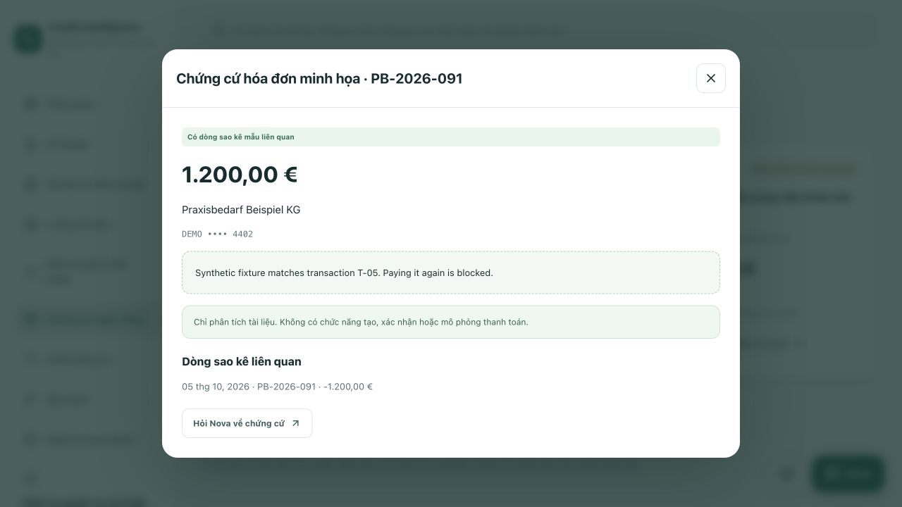

# AI bank-document analysis only

Scope clarified on **13 October 2026**. Credit Intelligence Lab analyses fictional bank documents; it is not a transactional banking app. No payments are available, including mock payments, drafts, confirmations or payment-order exports.

## Retained workflows

- DATEV sample PDF import/preview, bounded asynchronous scanning and extraction.
- Azure Document Intelligence, local extraction fallback, source-linked fields and tables.
- Human evidence review, net earnings vs. payout and amount-only statement reconciliation.
- AI Studio retrieval, citations, Nova explanations and guided page tours.
- Read-only account/statement/invoice fixtures, search, filters, CSV and linked-entry inspection.
- Evaluation, tenant/role separation, operation status and audit history.

Fixture account balances are **not** extracted from the uploaded PDFs. Missing invoice-to-statement links do not prove non-payment. Amount matches do not verify identity, period or authenticity. Reviewer notes and evidence confirmations are not credit approvals.

## Removed surfaces

- Invoice payment preparation, debit-account selection, confirmation and simulation status controls.
- Java draft/confirm business methods and controller mappings.
- Next.js proxy allowlisting of payment endpoints.
- `pain.001` teaching XML generation/download and `/platform/sample-xml`.
- Nova guidance offering payment simulations; its invoice tool no longer returns legacy payment drafts.

The old POST routes under `/api/cases/{caseId}/banking/payments` return **404** through Next.js and **403** at Java for authenticated lab roles. The retired XML route returns **404**. These are intentional scope restrictions, not broken functionality.

Existing PostgreSQL snapshots, old payment records and document history were not deleted or rewritten. Legacy DTO fields remain only for persisted-snapshot compatibility. Reading old records cannot create transactions or change balances.

## Local regression verification

- Frontend: **119 tests passed**, lint and TypeScript passed.
- Java: **135 tests passed**, **1 live Azure test skipped**; Maven verification/package succeeded. Offline execution skips SBOM generation; no new SBOM claim is made.
- Security tests deny both retired payment writes for ADVISOR, REVIEWER and ADMIN.
- Service tests preserve a legacy snapshot byte-for-byte across reads/restarts and expose only `snapshot` and `balance` as public operations.
- Local web production image built successfully; only web/API containers replaced. Database and Keycloak volumes retained.

- Local OAuth/API integration: **31 checks passed**, including PKCE login, scoped Java/proxy reads, both retired payment-write paths blocked, unchanged PostgreSQL snapshot after attempts, removed XML, refresh and logout. One fictional case (`CR-e04ed1d2-e61`) was added by this test and retained.
- Browser: existing Keycloak session survived replacement; EN/DE/VI evidence labels checked. Invoice inspection displayed the linked statement entry and no payment controls. Asking Nova opened a draft, not an automatic send; Enter submitted a local product-help guide, whose read-only tool returned the current fixture context. Review & insights had no payment XML control.

No Git commit, push, cloud deployment, VM start, new Azure resource or new Azure inference is part of this change. The opt-in live Document Intelligence test was not rerun in this scope follow-up.

## Screenshot

Authenticated local UI, fictional invoice and preserved historical fixture text. The legacy wording inside the raw source is retained deliberately; the app has no payment controls.

