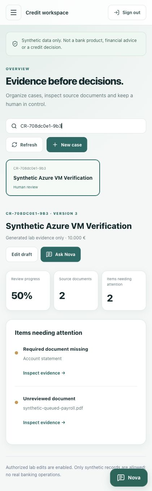
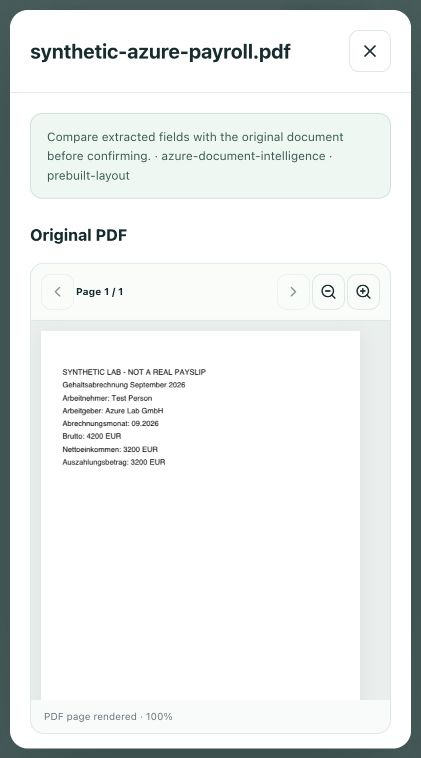

# Azure backend + Vercel frontend

This is a **single-VM, synthetic demonstration**, not a highly available banking deployment. The frontend stays on `credit-intelligence-lab.vercel.app`. Terraform manages a dedicated Azure resource group; existing shared AI resources are read by ID, not created or destroyed.

## Architecture

```text
Browser → Next.js / Vercel
  ├─ OAuth Authorization Code + PKCE → HTTPS /auth → Keycloak
  └─ Next.js API proxy + user access token → HTTPS /api → Java
Azure Linux VM
  ├─ Caddy: HTTPS, automatic TLS renewal, public 80/443 only
  ├─ Java 21: validated issuer/audience/roles/tenant; document worker
  ├─ Keycloak 26.8: production mode, PostgreSQL-backed auth state
  ├─ PostgreSQL: separate case and identity databases
  ├─ Qdrant: persistent vectors + local MiniLM embeddings
  ├─ Redis: bounded shared rate limits
  ├─ ClamAV: private INSTREAM antivirus with persisted definitions
  ├─ OpenTelemetry collector: local traces, bounded Docker logs
  └─ storage-init: one-shot directory ownership, exits successfully
Java → VM Managed Identity → existing Azure OpenAI + Document Intelligence
```

No database, Redis, vector database, ClamAV or OTLP port is public. Keycloak admin/master-realm paths are blocked at the public gateway; administer through SSH and the internal Keycloak administration CLI. Java and Keycloak bind their host diagnostic ports only to `127.0.0.1`.

## Cost assumptions

- Default VM: `Standard_D2as_v4`, Linux, 2 vCPU / 8 GiB, Germany West Central. This subscription has v4 quota; v5 quota was zero and the first v5 allocation was rejected before creating a VM.
- One 128-GiB Standard SSD OS disk holds Docker images and persistent volumes.
- One Standard public IPv4, with an Azure-provided DNS name (no purchased domain).
- No AKS, ACR, NAT Gateway, Bastion, Front Door, paid monitoring workspace, or managed database.
- Indicative retail rates checked 12 October 2026: VM ~€0.0915/hour, SSD ~€8.4477/month plus operations, public IPv4 ~€0.0044/hour. EUR prices are estimates, not an invoice or guaranteed student offer.
- 8–12 hours is roughly €0.9–€1.3 before disk operations, traffic, tax and Azure AI calls. Image builds consume billed VM time. Runtime and peak memory must be measured; increasing to 16 GiB costs more and is not automatic.
- Terraform creates a daily Azure shutdown schedule in UTC. `prepare` chooses approximately eight hours from that command; subsequent starts do not reset that time. Verify **Stopped (deallocated)**, not merely a stopped Docker stack. Disk/IP fees continue while retained.
- Budget alerts are not a hard spending cap. This lab does not promise zero costs or automatic deletion.

## Prepare and deploy

Prerequisites: Azure CLI login with create-resource and scoped role-assignment permissions, Terraform >=1.5.7, Node.js, SSH/SCP, an available VM-family quota, and existing shared AI endpoints/deployments. Docker is installed on the VM by cloud-init; local Docker is only needed for validation.

From the repository root:

```bash
az login
terraform -chdir=infra/azure/vm-lab init
node scripts/azure-vm-lab.mjs prepare
terraform -chdir=infra/azure/vm-lab validate
node scripts/azure-vm-lab.mjs plan
# Inspect the plan and cost before this paid operation:
node scripts/azure-vm-lab.mjs apply
node scripts/azure-vm-lab.mjs deploy
node scripts/azure-vm-lab.mjs credentials
```

The script sends backend source only, not `.env`, Terraform state, local database volumes, Azure CLI credentials, private PDFs or DATEV publisher PDFs. It generates new SQL, admin and advisor passwords on the VM. The public lab advisor is **not** assigned the known local `demo-password`. The private advisor credentials are saved to `.local/azure-vm/advisor.json`, mode 0600, only when requested by the operator action.

Terraform state/plan, private SSH key, operator variables and credentials are ignored by Git. Treat them as private; keep an encrypted backup of the Terraform state and SSH key. Terraform does not store any SQL/Keycloak password or Azure API key. It only grants the VM identity `Cognitive Services OpenAI User` and `Cognitive Services User` on the two specific AI resources.

## Connect Vercel only after backend verification

Set these **Production** variables in the existing frontend project:

| Variable | Value |
|---|---|
| `NEXT_PUBLIC_DEMO_MODE` | `false` |
| `NEXT_PUBLIC_KEYCLOAK_URL` | Terraform `keycloak_url` output |
| `NEXT_PUBLIC_KEYCLOAK_REALM` | `credit-intelligence` |
| `NEXT_PUBLIC_KEYCLOAK_CLIENT_ID` | `credit-intelligence-web` |
| `CREDIT_API_URL` | Terraform `backend_url` output |

Public-prefixed values are configuration, never secrets. The browser receives a Keycloak access token; Java validates it. Vercel does not need an Azure model API key for this architecture. Rebuild Next.js after changing public variables. Stage a Production deployment, test the backend and PKCE flow, then promote the tested build. The realm accepts only the exact main Vercel origin; staged deployment URLs are intentionally not OAuth redirect targets.

Verify: trusted HTTPS → OIDC discovery → PKCE login/code exchange → authorized cases → persisted case edits → authenticated PDF upload → ClamAV → Azure layout → evidence review → Qdrant retrieval → Azure Nova → refresh/logout. `HTTP 200` or a configured identity alone is not proof that the full flow works.

## Stop / start

```bash
node scripts/azure-vm-lab.mjs status
node scripts/azure-vm-lab.mjs stop
node scripts/azure-vm-lab.mjs start
```

Stopping deallocates compute, does not delete volumes. After restarting, Docker services restart with `unless-stopped`; the one-shot initializer may remain exited with code 0. Frontend can still load while the backend is off, but sign-in, live AI, database and upload actions will be unavailable. Check the existing UTC shutdown schedule before starting a new demo session.

For SSH, use the dedicated `.local/azure-vm/id_ed25519` key. A changed operator IP needs an explicitly reviewed Terraform update to `ssh_source_cidr`; never open SSH to `0.0.0.0/0`. Do not expose the diagnostic ports just to avoid an SSH tunnel.

## Persistence and teardown

The new cloud databases seed synthetic lab content. Existing local user accounts/files are **not migrated**. Migration requires a separate reviewed backup/restore operation. Losing/deleting the OS disk loses this cloud lab's databases, files and vectors; the single VM has no failover or external automated backup.

Before a permanent teardown, export any cloud data you need. Review `terraform plan -destroy` and delete only resources in this stack's state. Do not delete `ai-shared`, the frontend Vercel project or local Docker volumes. The helper deliberately offers no automatic `destroy` action. Keep local and cloud synthetic tests separate.

## Deployment status

Terraform applied successfully on 12 October 2026 using `Standard_D2as_v4` after a v5-family quota rejection. The dedicated VM has HTTPS gateway, persistent disk, two scoped AI role assignments and a daily shutdown schedule at **01:41 UTC (03:41 Europe/Berlin on this date)**. The authenticated frontend is live at https://credit-intelligence-lab.vercel.app/en. The first verified Azure-backed release was `dpl_FFq6Yzn4xEyeR29e7eYHwFrREeqT`, staged and tested before promotion, from feature base `5e16616` plus working changes. These changes are consolidated into `master` and synchronized to `develop` for the subsequent Git-backed release; Vercel deployment history identifies the exact current deployment.

Frontend validation: 70 tests passed, lint and TypeScript checks passed, final Vercel build passed. Java validation: 126 tests passed, one real-Azure test skipped in the isolated unit-test run; real Azure was checked separately by the cloud smoke test.

### Live verification

- Direct Azure backend: **26 boundaries passed**, 12 October 2026 at 18:14 UTC.
- Vercel production proxy: **26 boundaries passed**, final release rechecked on 12 October 2026 at 18:27 UTC. Both new synthetic PDFs were stored and processed in case `CR-708dc0e1-9b3`.
- Browser: clicked production Sign in, completed the private advisor login, returned to the workspace, loaded persisted cloud cases and received a real Azure Nova response about uploaded synthetic payroll. Original PDF rendered with `azure-document-intelligence / prebuilt-layout` and extracted net/payout fields. Browser logout returned to the signed-out screen; sign-in again on the final release loaded the saved cases. No browser console errors were captured in that test; Vercel's error-log query returned no entries (not a guarantee of complete telemetry).
- Nine long-running Azure containers were running; health-checked Java, Keycloak, SQL, Redis and ClamAV were healthy. Combined observed container memory was approximately 2.1 GiB at idle after tests (not a peak-load benchmark); disk used approximately 8.1 GiB of 123 GiB available.
- Keycloak corrections covered build-time `/auth`, stateless cluster naming and canonical HTTPS `/auth` issuer. Frontend packaging explicitly includes the shared Nova JSON catalog, while excluding Java outputs, private files and Terraform state.
- The DATEV library was not prepared in the initial 12 October environment. On 14 October the operator explicitly approved the two fictional publisher pages for production. The dedicated `references` action checks exact hashes, installs them privately, and never puts them in Git/public assets. The authenticated Vercel route now reads the Java library on the VM. See [current release verification](RELEASE_2026-10-14.md).

This proves the checked demonstration flow, **not** high availability, load capacity, calibrated AI accuracy, external backups or banking-production readiness. The VM shutdown schedule remains enabled to limit compute costs.

### Production screenshots

Authenticated mobile workspace with a persisted cloud verification case:



Original generated PDF rendered in the authenticated evidence viewer:



To run the synthetic cloud check after credentials have been saved:

```bash
node scripts/test-azure-vm.mjs
# After the authenticated frontend is released:
node scripts/test-azure-vm.mjs --frontend
```

These tests create new synthetic verification cases and send generated one-page PDFs to the existing Azure resource. They never upload local/DATEV private files. Reports are stored privately in `.local/azure-vm/`; no token or password is logged.
