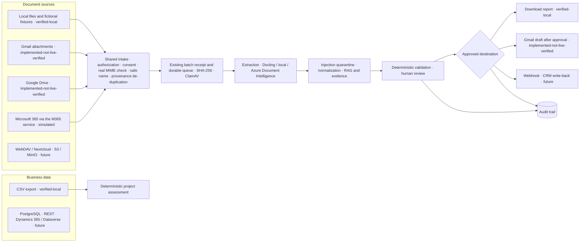

# Provider-neutral document sources and destinations

The workspace does not depend on any single vendor. Local PDFs are the default, and every use case runs offline with bundled fictional documents. Gmail, Google Drive, Microsoft 365 and Azure are optional adapters. They only list and fetch documents or deliver a result that a person approved. All of them feed one shared pipeline.



No connector carries its own OCR, RAG, queue, evidence or review logic. The Java contracts live in `services/credit-api/src/main/java/dev/creditlab/sources/`: `DocumentSource`, `BusinessDataSource` and `ResultDestination`.

## Status labels

Labels describe what was actually tested. Configuration alone never upgrades a label, and the page never shows a simulated connector as a real one.

| Adapter | Label | What it means here |
| --- | --- | --- |
| Local files and fixtures | `verified-local` | Runs in tests and in Docker without a network call |
| Gmail attachments | `implemented-not-live-verified` | Code and tests use a mocked Gmail API only. No real mailbox was tested |
| Google Drive | `implemented-not-live-verified` | Mocked Drive API only. No real Drive was tested |
| Microsoft 365 | `simulated` with the M365 service's mock provider; `implemented-not-live-verified` when that service uses its Graph provider | Fictional SharePoint-style documents. No tenant was tested |
| Download report | `verified-local` | Generated locally |
| Gmail draft | `implemented-not-live-verified` | Mocked Gmail API only |
| CSV business data | `verified-local` | Parsed locally for the deterministic assessment |
| WebDAV, S3/MinIO, PostgreSQL, generic REST, Dynamics 365/Dataverse, webhook, CRM write-back | `future` | Disabled descriptors with no network code |

`live-verified` is not assigned to any adapter, because no live run has been recorded.

## Run fully offline (default)

```bash
node scripts/docker-local.mjs
```

The default stack contains no Google, Microsoft or Azure credential. In **Data Pipelines → Integrations**:

1. Choose **Local files and fictional fixtures**, preview, select up to four PDFs, confirm consent and import. They go through the same scan, extraction and review as uploads.
2. Run **Use cases → Run deterministic check** for any of the eight use cases. Each result reports `networkCalls: 0`.
3. Calculate the **Project assessment** from the fictional CSV.

The authenticated acceptance check runs the same flow through Keycloak, the Next.js proxies and Java. It creates one dedicated fictional dossier, imports a local fixture and a simulated Microsoft 365 document, waits for ClamAV and extraction, and checks labels, duplicates, review gating, the report and the audit trail:

```bash
TEST_CONNECTORS=1 node scripts/test-oauth.mjs
```

To confirm that nothing calls the cloud:

- `GET /api/connectors` shows Gmail and Drive with `enabled: false`.
- `docker compose ... config` contains no `GOOGLE_*` variable unless you add `docker-compose.google.yml`.
- The ETL worker runs with `network_mode: none`.
- CI runs every connector test against loopback mocks without any credential.

## Optional: Google Gmail and Drive

### 1. Create a Google Cloud OAuth client

1. Create or select a Google Cloud project that you control.
2. Go to **APIs & Services → Library** and enable **Gmail API** and **Google Drive API**.
3. Under **OAuth consent screen**, choose the *Testing* publishing status and add only your own test accounts.
4. Under **Credentials → Create credentials → OAuth client ID**, choose **Web application**.
5. Add the authorized redirect URI exactly as `http://localhost:3000/oauth/google/callback`. Use your HTTPS origin for another host; the path must stay `/oauth/google/callback`.

### 2. Configure the server, not the browser

Copy the Google lines from `.env.example` into the git-ignored `.env.google.local` and fill them in:

```dotenv
GOOGLE_OAUTH_CLIENT_ID=YOUR-CLIENT-ID.apps.googleusercontent.com
GOOGLE_OAUTH_CLIENT_SECRET=your-client-secret
GOOGLE_OAUTH_REDIRECT_URI=http://localhost:3000/oauth/google/callback
CONNECTOR_TOKEN_KEY=output-of-openssl-rand-base64-32
```

Then start the stack with the optional layer:

```bash
node scripts/docker-local.mjs --with-google-connectors
```

The variables are injected only into the Java API container. Never commit this file or paste its values into issues or logs.

### 3. Scopes and why they are needed

| Feature | Scope | Reason |
| --- | --- | --- |
| Gmail source | `gmail.readonly` | Search messages and download PDF attachments. Never sends, labels, modifies or deletes mail |
| Drive source | `drive.readonly` | List and download PDFs in folders you choose, including shared drives you can access. `drive.file` would be narrower but needs the Google Picker, which is not implemented |
| Gmail draft (optional, requested separately) | `gmail.compose` | Create a draft after your approval. Google's scope also allows sending; this application only calls `drafts.create`, never `send` |

### 4. Revoke access

- **Integrations → Disconnect and revoke** revokes the refresh token at Google (best effort), deletes the encrypted copy and writes an audit event.
- You can also remove access at any time at <https://myaccount.google.com/permissions>.
- Rotating `CONNECTOR_TOKEN_KEY` makes stored tokens unreadable. Reconnect afterwards.

## Security model

| Control | Implementation |
| --- | --- |
| Minimal scopes | Read-only scopes per feature; draft creation needs a separate consent |
| OAuth | Authorization code with PKCE (S256) and single-use state bound to tenant and user, expiring after 10 minutes |
| Code transfer | The callback moves code and state into an HttpOnly, SameSite=Lax cookie scoped to `/api/connectors`. Page JavaScript and browser history never see them |
| Token storage | Refresh tokens are encrypted with AES-256-GCM. The additional authenticated data binds each ciphertext to tenant, user and provider. Access tokens exist only in server memory. Nothing is sent to the browser |
| Logs and errors | Responses carry stable codes (for example `CONNECTOR_REAUTH_REQUIRED`), never provider bodies or tokens |
| Ownership | Credentials, sync statistics and imports are scoped to tenant, user and dossier. Every document operation re-checks dossier access in Java |
| Redirect URI | Must be HTTPS (or loopback in development) with the exact path `/oauth/google/callback` |
| SSRF | Provider endpoints must match an exact HTTPS host allowlist. Internal HTTP is allowed only for the named `m365-poc` service. URLs are never built from user or document text |
| Files | Magic-byte PDF check (the declared MIME is advisory), `%%EOF` presence, 3 MB limit before and after download, safe base names, executable double extensions rejected |
| De-duplication | Provenance key (source, external ID, revision), then the queue's content hash per dossier |
| Untrusted content | Subjects, names and PDF text are data. The existing injection guard quarantines instruction-like text before evidence is attached |
| Destinations | Drafts need human-reviewed fields, an exact preview, explicit approval and an unchanged content hash. They are never sent |
| Audit | Connect, disconnect, preview, import, analysis, review, report and draft events are recorded with actor and counts |

Errors are distinguished: an expired or revoked token means reconnect, missing permission means `SCOPE_NOT_GRANTED`, and an owner restriction means `SOURCE_DOWNLOAD_NOT_ALLOWED`. Rate limits and server errors are retried at most three times with backoff (`Retry-After` is honoured up to 8 s). A POST is never repeated after an uncertain failure.

## Use cases

Every use case has fictional PDFs labelled `FIKTIVE DATEN`, fields to extract, expected deterministic results, one answerable question with page evidence and one unanswerable question that must be refused. The catalog is `services/credit-api/src/main/resources/use-cases/catalog.json`. Regenerate it with `scripts/prepare-use-case-fixtures.py`.

| Use case | Deterministic result |
| --- | --- |
| Project and real-estate assessment | Totals, cost variance, revenue scenarios, margin, cost per m² and schedule variance computed in Java from CSV; review thresholds only |
| Document intake from email | Fictional Gmail message → PDF attachment → shared pipeline (mock API) |
| Classification and extraction | Invoice type; net + VAT = gross |
| Project status summary | Labelled status lines and risk count |
| Contract and risk check | Penalty rate, cap and warranty compared with review thresholds; not legal advice |
| Order – change order – invoice – acceptance | Existing dossier review: EUR 1,200 variance, two open defects |
| ESG evidence completeness | Present / missing / pending evidence; no certification |
| Knowledge assistant | Answer only with cited evidence; refuse unsupported questions |

A language model may explain these results or draft a report. It never computes them, and no result is a legal, investment, payment, valuation or ESG certification decision.

## Limitations

- No adapter was tested against a real Google account or Microsoft tenant.
- `gmail.compose` and `drive.readonly` are broader than ideal (see the scopes table).
- Access-token caching is per Java instance, and a revoked token is detected on the next call.
- In simulated mode, the Microsoft 365 adapter reads through the M365 service's fixed local principal. Live Graph access per user still needs Entra delegation, which the Java adapter does not implement.
- Excel files must be exported as CSV first; `.xlsx` parsing is not implemented.
- The webhook and CRM destinations and the WebDAV, S3, PostgreSQL, REST and Dataverse adapters are planned descriptors only.
