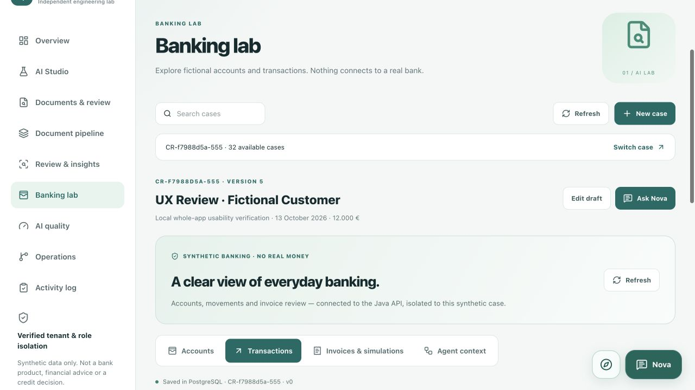
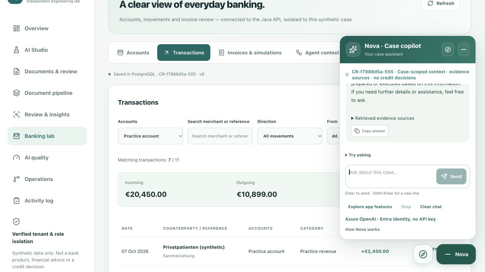
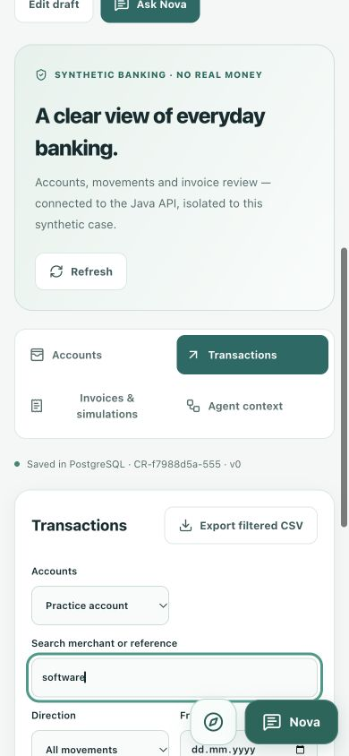
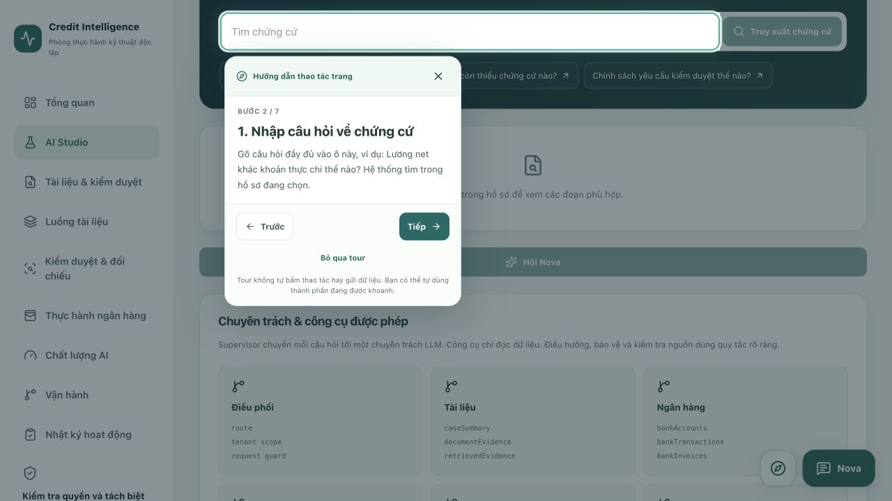

# Customer-style UX audit — 13 October 2026

**Scope clarification after this audit:** this is an AI bank-document analysis app, with no payment functionality, including simulations. Legacy payment UI/API and payment XML examples were removed; stored fixture history was retained. See [analysis-only verification](ANALYSIS_ONLY.md). Earlier screenshots below predate this clarification.

## Scope

Authenticated **local Docker** lab, tested through the browser, Java API and PostgreSQL. The walkthrough used fictional case `CR-f7988d5a-555` ("UX Review · Fictional Customer"). Existing cases, evidence, failure history and earlier edits were preserved. Banking remains synthetic; no bank network or real money movement was added.

This is a bounded engineering walkthrough, not an assertion that every possible edge case or device is defect-free. No Git commit, push, cloud deployment, VM start or Azure permission change was performed.

## Findings implemented

| Finding | Change |
| --- | --- |
| Banking's wide table enlarged the whole mobile page | Contained grid/table widths; mobile transaction cards. Browser checks measured page width = viewport width at 390px and 320px. |
| Filters gave no count, reset action or totals | Matching count, clear filters, incoming/outgoing/net totals over visible rows, accent-insensitive search, date-only formatting. Date input applies on input and native change. CSV exports precisely the filtered rows. |
| A transaction offered no focused inspection or explanation | Read-only detail dialog with date, account, category, reference and amount. "Explain this transaction" opens a Nova draft; it does not send automatically. |
| The long case strip distracted from the task | Compact switcher with searchable, bounded options. Selecting/saving a case updates its URL; changing language keeps the selected case and workspace. |
| Review showed English rule codes and opaque document IDs | Localized priority/title/explanation, source filenames and human field labels. Raw rule evidence remains in expandable technical details, not rewritten. |
| Old failed jobs could look like a new processing failure | Failed history entries identify when a newer same-digest job is available; history is retained. |
| Queue review status stayed stale after a PDF confirmation | Platform reloads when the saved case version changes. Verified on Melanie without manually refreshing the page. |
| Nova was difficult to start and inspect | Opt-in localized question suggestions, answer copy with success/failure feedback, preserved failed question, clearer limit handling, synchronous send guard and reset state on Clear. Shared conversation scroller follows only when the reader is near the bottom; a Latest button is available otherwise. |
| Simulation wording could resemble real payments | Banking tab explicitly says "Invoices & simulations"; original role checks, source confirmation and idempotent mock workflow remain. |

The React/AI-SDK review retained the existing version-matched transport, case/tenant authorization, source controls, input composition safeguards and explicit user submission. No new provider, database table, package, write-capable AI tool or persistent chat-content store was introduced.

## Browser walkthrough

| Workspace / boundary | Actual check |
| --- | --- |
| Login/session | Existing local advisor browser session; signed OAuth/PKCE API tests, refresh/logout, replay rejection and unknown-case protection |
| Overview/intake | Created the fictional audit case, edited its purpose, retained versioned changes and searched/reselected it with the compact picker |
| Documents & review | Private DATEV preview; both previously approved fictional Robert/Melanie pages imported with explicit Azure confirmation; original rendered, Robert zoom 100 → 125 → 100; field confirmation persisted |
| Document pipeline | Real ClamAV scan and Azure extraction; Robert 9 tables, Melanie 11; queue reflected confirmed fields automatically |
| AI Studio | Actual ONNX/Qdrant/BM25 retrieval: 18 chunks, returned Robert field/page/table evidence. Full seven-step native page tour completed; tour made no AI request |
| Review & insights | Friendly rule labels, filename/field reconciliation; saved a fictional reviewer note, subsequently read it in Operations |
| Banking lab | Three account cards; all four tabs; blocked recipient and already-paid invoice states; filters/count/reset/empty state, detail-to-Nova draft and CSV download. API tests exercised mock draft/confirmation, no debit before confirmation and no double debit on retries |
| AI quality | Ran the actual 40-labelled synthetic-text evaluation and inspected its failures; metrics were not prefilled |
| Operations | PostgreSQL, Redis configuration, real agent traces and saved review note displayed. No monitoring infrastructure provisioned |
| Activity log | Creation/edit/extraction/review events appeared for the audit case |
| Nova | Real Azure answer in Vietnamese distinguished Robert net/payout with document sources; source button opened the correct PDF; Enter sent; copy reported success. English Azure answer returned the three correct mock balances. Suggestions only filled the draft; app-guide reply used no cloud request |
| Locales / mobile | EN/DE/VI labels; DE/EN transitions retained `CR-f7988d5a-555#studio`/banking context. Banking card layout checked at 390 × 844 and 320 × 800; temporary viewport override reset |

### Exact sample results

- Robert: net `2.967,11`, payout `2.882,11`, 9 Azure tables.
- Melanie: net `4.212,90`, payout `3.069,93`, 11 Azure tables.
- Banking filter: practice account, outgoing, 2–4 October inclusive → **3 / 11** transactions, outgoing **9.350,00 EUR**.
- Software filter → **1 / 11**, CSV contained only `T-06`'s software movement, amount `-349.00`. Browser saved `synthetic-CR-f7988d5a-555-transactions.csv` in Downloads.
- Nova's banking reply: practice **34,551.00 EUR**, personal **7,035.00 EUR**, reserve **12,000.00 EUR**, explicitly mock data.
- Narrow synthetic-text benchmark: precision **100%**, recall **90.5%**, field F1 **95%**, retrieval Recall@5 **54.7%**, two injection examples quarantined. These are **not** Azure OCR/LLM accuracy, calibrated groundedness or credit suitability. Retrieval remains an improvement area.

No publisher PDF was redistributed in Git or screenshots. The only cloud document inputs were the two previously approved fictional DATEV pages.

## Public-source comparison

These are design references, not a claim of feature parity, official endorsement or banking certification. Original implementation was written in this project's existing Next.js/Java stack; upstream code was not copied.

- [Microsoft Java banking assistant](https://github.com/Azure-Samples/agent-openai-java-banking-assistant): conversational access to account/transaction APIs and Document Intelligence. Inspected its [question input](https://github.com/Azure-Samples/agent-openai-java-banking-assistant/blob/main/app/frontend/src/components/QuestionInput/QuestionInput.tsx) for submission/disabled-state patterns. This lab keeps explicitly submitted, read-only AI explanations; it does not adopt the sample's payment execution or direct attachment-to-payment flow.
- [Apache Fineract backoffice](https://github.com/apache/fineract-backoffice-ui): role-specific operational workflows. Inspected its [client transaction list](https://github.com/apache/fineract-backoffice-ui/blob/main/src/app/features/clients/transactions/client-transactions-list.component.ts) and [transaction detail dialog](https://github.com/apache/fineract-backoffice-ui/blob/main/src/app/features/loans/transaction-detail-dialog.component.ts). Applied the inspection-first pattern, visible counts, date presentation and localized labels; did not adopt undo/adjust-money APIs.
- [Mifos X web app](https://github.com/openMF/web-app): Angular reference UI backed by Fineract. Used as a separation-of-frontend/backend and workflow reference; did not add its lending/deposit product catalogue to this lightweight lab.
- [Backbase Stream Services](https://github.com/Backbase/stream-services): documented access-controlled ingestion, transactions, audit and approval integrations. This is a backend accelerator, not a complete open-source retail-bank UI. Kept the lab's existing scoped API and mock audit/confirmation boundaries; no Backbase integration was installed.

## Verification and limits

- **119 frontend tests passed**, lint and TypeScript passed.
- Java offline Maven verify: **134 passed**, one additional opt-in live test skipped, zero failures/errors. Offline SBOM generation was skipped; no new security certification is claimed.
- **40 OAuth/reference/banking integration checks passed**; a final-image, read-only OAuth/reference pass completed **29 checks** without creating another case.
- Docker Next.js production build passed; final web image was restarted, Java/Keycloak/database volumes retained.
- Actual Azure document/chat behavior was checked separately through explicitly authorized browser flows, not inferred from skipped unit tests.
- No browser console errors were observed in the final check. Physical-device Safari/VoiceOver, penetration tests, restore drills, representative OCR/LLM evaluation and cloud-production behavior were not independently certified by this audit. Latest-message following is additionally covered by scroll-threshold regression tests; this report does not claim every possible streaming/scroll interaction was exercised.

Local test records and CSV remain available for reproduction. For running the stack and credential renewal, see [Azure AI runbook](AZURE_AI.md); for historical audit coverage, see [LOCAL_UI_AUDIT.md](LOCAL_UI_AUDIT.md).

## Screenshots

