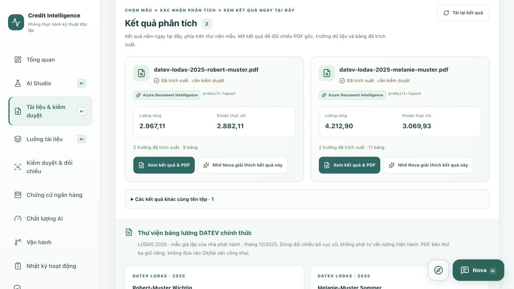
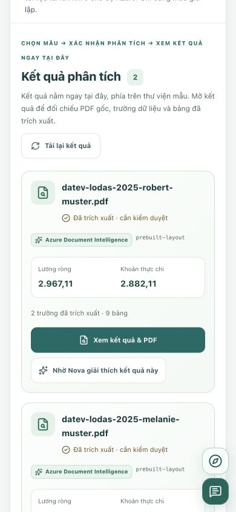

# Document analysis: a visible result, not an unexplained percentage

The document page now keeps the user on one workflow: **choose a fictional sample → explicitly confirm processing → follow status here → open the result**.

## What changed

- **Analysis results** appear above the sample library, not below two large sample cards. Full filenames, extracted net/payout values, field/table counts and a primary **View result & PDF** button identify the useful outcome.
- Queue acceptance returns a validated `QUEUED` receipt. The page remains on Documents, scrolls to the results and polls the existing authenticated case-scoped status endpoint while work is active. Completion refreshes the case; no result link is offered for an unattached job.
- A prepared sample with a completed job for its exact approved SHA-256 changes its action to **View existing result**. An active job changes it to **Processing · view status**. These actions do not upload or call Azure again. Filename matching alone does not identify an official sample's result.
- A duplicate response explains that no second analysis started and refreshes the existing status/result instead of presenting a generic conflict and leaving the user to search.
- Earlier jobs with the same digest do not override a later job. Older document results with the same filename remain in an explicit history section, with a warning that identical names do not imply identical contents. No database records, source files or audit history were deleted.
- Overall OCR and per-field extraction signals live in collapsed detail sections in the review window, with explicit accuracy/credit-score disclaimers. They no longer compete with filenames or result buttons in the main list.
- Library reference amounts are collapsed and labelled **reference values, not AI predictions**; they are not presented as a newly generated result.
- Starting an import/upload or opening evidence minimizes Nova without discarding its conversation/draft. On the mobile document page the launcher/help controls form a narrow column rather than a wide strip across result-action labels. The read-only explanation button still opens an editable, document-referenced question; it never sends automatically.
- English, German and Vietnamese copy and page-tour guidance follow the same flow.

## Preserved boundaries

The existing Java worker, ClamAV, Azure configuration, OIDC roles, upload limits, expiry, duplicate guards and human-review requirements are unchanged. No API key, resource, paid deployment or extra permission was added. This is a UI/workflow upgrade, not a new OCR model or a claim of calibrated accuracy.

## Verification

- 157 frontend tests passed; lint, TypeScript and Docker production build passed.
- Regression coverage includes exact-hash association, newer failure/pending jobs, expiry/unavailable originals, complete-but-unattached results, missing recognition scores, reference/demo labels, preserved history and read-only existing-result actions.
- Browser checks use the existing fictional DATEV case, its stored Azure results and private original. New queued/retry/failure transitions are covered with test fixtures; no new PDF was sent to Azure for this UI audit.
- Publisher-owned PDF contents are not copied into repository screenshots. Screenshots show the results interface only.

