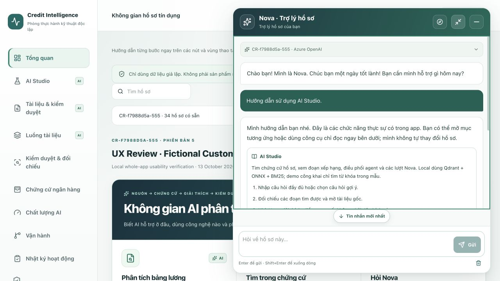
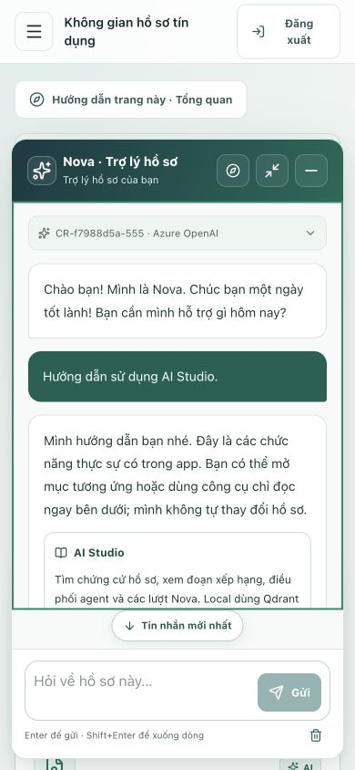

# Nova reading-space upgrade

## Why the old chat became unreadable

In the user's local window (523 × 757 CSS pixels), the 360-pixel-wide panel reserved separate fixed rows for model identity, case context, suggestions, the composer, actions and disclosures. With suggestions expanded, the actual message scroller measured approximately **4 pixels high**. The answers existed, but almost none of their content was visible.

## Layout changes

- A non-modal, bottom-right window: 440 pixels wide by default, with an optional 660-pixel reading mode. Its height is bounded by the available viewport, not a full-page backdrop.
- One flexible message scroller. Model details, case context, suggestions and navigation shortcuts live inside it; opening them cannot consume the fixed reading area.
- One pinned composer dock with Enter/Shift+Enter guidance, stop while generating, and an accessible clear button. The textarea grows only within a bounded height.
- Header controls remain available for the page tour, reading-mode toggle and minimization. The redundant launcher row is hidden while the window is open.
- Reading older messages pauses following; **Latest messages** explicitly returns to the bottom in a separate row, never overlaying the answer text. Resizing follows only if the reader was already at the bottom. Expanding a disclosure does not forcibly scroll past it.
- Mobile opening focuses the panel, not the textarea, so it does not immediately summon the keyboard. Visual Viewport events keep the window within the visible area when the on-screen keyboard changes it.
- EN/DE/VI labels, keyboard access to the message scroller, visible focus, and wrapping of long source identifiers remain available.

The same structure is used by the authenticated Nova and the deterministic browser demo. No chat transport, Azure identity, role permissions, quotas or case data were changed.

## Design references

These are design references, not installed third-party messengers or a claim that there is one mandatory chatbot size:

- [Intercom Messenger](https://www.intercom.com/help/en/articles/6612589-set-up-and-customize-the-messenger): a bottom-right launcher and distinct conversation/help experiences.
- [AI Elements Conversation](https://elements.ai-sdk.dev/components/conversation): a dedicated message scroller and a return-to-bottom control.
- [W3C reflow guidance](https://www.w3.org/WAI/WCAG22/Understanding/reflow.html): content remains usable within a narrow viewport without unnecessary two-direction scrolling. This patch is not a full WCAG conformance audit.

## Verification boundary

Verified in local Docker on 13 October 2026:

| Check | Result |
| --- | --- |
| Frontend suite | 141 passing tests; lint and TypeScript passed |
| Docker production build | Passed; final web image `2d654ac543d637bb103e862e4e9634acfa4ffe18e267ded5e392a2f76143981d` is running |
| Desktop 1280 × 720 | Approximately 488 pixels when following; 445 pixels with a separate latest-message row while reading history; 440-pixel compact / 660-pixel expanded window |
| Mobile 390 × 844 | 448-pixel reading area with the separate latest-message row; panel and composer inside the viewport |
| Latest-message control | Its rectangle starts below the message scroller and ends above the composer: it does not cover answer text |
| Narrow, short viewport 320 × 256 | 61-pixel scrollable reading area; header and composer remain visible; no horizontal overflow in the message scroller |
| Enter / Shift+Enter | App-guide submission / newline confirmed in the browser |
| Minimize / reopen | Draft and existing conversation retained |
| Open model context | Reading height and scroll position retained |
| Browser console | No captured warnings or errors after verification |

Frontend regressions cover keyboard submission, localized reading controls, metadata/suggestions inside the scroller, pinned composer structure and visible-viewport geometry. Browser checks use existing fictional local cases and app-guide replies; no new payslip upload, Azure inference or cloud deployment is required to test this layout.

The software-keyboard geometry is covered by pure tests and small-height browser checks. A physical iOS/Android keyboard has not been tested; verify on a real device before claiming universal mobile-keyboard compatibility.
