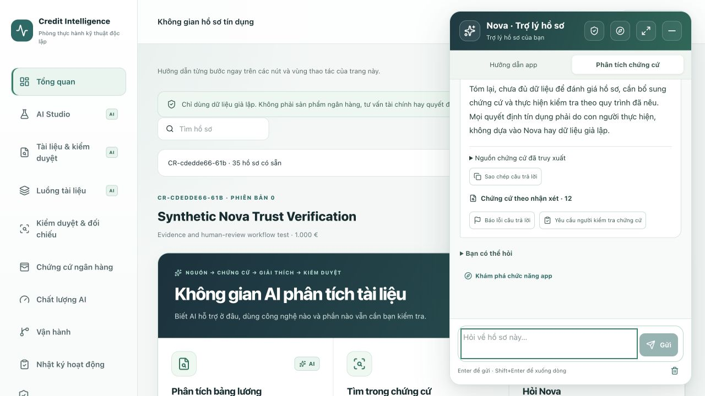
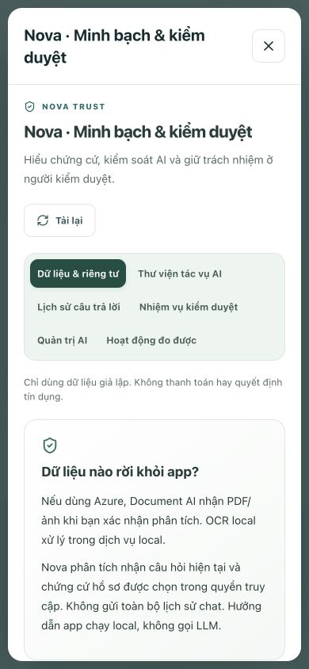

# Nova trust and human review

## Scope

Branch: `feature/nova-trust-and-review`. Existing Next.js + Java + Keycloak + PostgreSQL and shared keyless Azure integrations are preserved. No paid service, Azure resource, payment tool, automated credit decision, cloud deployment or master merge is added.

## User workflow

1. Open **AI transparency & review** in the workspace or Nova's shield.
2. Read which inputs leave the device: explicitly confirmed PDFs for Document Intelligence; the current question and selected permitted evidence for Nova. Static app guidance does not call an LLM. Reading this center does not run inference.
3. Choose one of seven controlled tasks. The app fills a draft; the user decides whether to edit and send it.
4. Inspect the response's paragraph-level citations. Open only a page present in the selected case's document. Review the original before confirming any fields.
5. Report an incorrect amount, person, unsupported source or other issue. Feedback does not become verified fact. A correction request is an unsent draft; a subsequently generated revision has its own immutable answer ID and `revisionOf` link.
6. Create a review task after explicit confirmation. An authorized reviewer claims it and leaves a note to return/resolve it. Reopening preserves history. Task completion is not loan approval or blanket approval of the AI answer.

## Storage and permissions

- `lab_records`: `trust-answer`, `trust-feedback`, `trust-task`, `trust-feature`, `trust-event`, `field-review`. Every query includes verified tenant and case ID.
- Keycloak ADVISOR/REVIEWER/ADMIN can read and report; only REVIEWER/ADMIN can transition tasks, and only ADMIN can change case-scoped AI availability.
- Answer and feedback records are insert-only. Request UUIDs support idempotent retries; conflicting reuse fails. Task/feature updates use optimistic payload/version checks. Stale case writes are rejected.
- Server-side checks run before a disabled task can call the model. Case-scoped controls do not change OAuth permissions, OCR availability or another case.
- Protected original PDFs use authenticated requests and `no-store`; tokens are never embedded in PDF URLs. Model/provider configuration metadata contains no secret or endpoint.
- Visible-chat clear is not record deletion. Answer/feedback/task history has no automatic retention purge yet; configured document retention remains separate. Use fictional data only.

## Honest evidence and metrics

`SOURCE_LINKED` means the cited ID exists in the response's selected sources. It is **not semantic verification, calibrated confidence or factual accuracy**. Uncited/invalid citations require review. Per-paragraph display is bounded to 30 paragraphs, 2,000 characters each; stored answer is bounded to 12,000 characters.

Original page links verify that the document/page exists. Field highlights require one exact original text item and supported geometry. If absent, duplicated, scanned or rotated, the viewer displays the page and explicitly reports that no unique region was located. No approximate region is presented as exact.

The activity panel reports observed answer duration, feedback/task counts, citation absence and reviewer field edits, using the latest 60 records per category. It does not report billed cost, token usage, total historic backlog, customer handling time, hallucination rate or invented savings. Model ID is the configured deployment name, not an independently pinned vendor model revision. The owner is an operational role, not an assigned individual. Lab controls are not banking-production certification.

## Verification

- Frontend tests cover safe schemas, citation targets, exact PDF match/fallback, task allowlists, authentication, HTTP methods and language parity.
- Java `TrustWorkflowTest` covers immutable original/revision records, tenant/case isolation, citation limitations, feedback/task idempotency, unsent correction/task drafts, stale writes, task owner/state/version checks, controls, measured metrics and H2-backed persistence.
- Security integration tests reject anonymous/foreign access and advisor attempts to perform reviewer/admin actions.
- `TEST_TRUST=1 node scripts/test-oauth.mjs` exercises local Keycloak PKCE login, a fictional case, one real Azure answer, saved feedback, unsent correction, task transitions and a fresh PostgreSQL read. It leaves labelled fictional test records for inspection. It does not upload PDFs or send emails/payments.

## Verified local build — 13 October 2026

- Frontend: 165 tests passed; lint and TypeScript passed; Next.js production build passed in Docker.
- Java: 154 tests, 153 passed and one opt-in live Document Intelligence test skipped; zero failures/errors. No new PDF upload was performed for this upgrade.
- Live local integration: 43 checks passed, including Keycloak PKCE/refresh/logout, real keyless Azure OpenAI, trust records in PostgreSQL, draft-only correction, reviewer state transitions, idempotency and role/version guards. The labelled case is `CR-cdedde66-61b`.
- Docker web/API were recreated without rebuilding or deleting database volumes. Java runtime fallback reused the existing trusted local application image after Docker Hub metadata for the standard base timed out. The tested JAR was packaged with Maven; the repository's standard Dockerfile remains unchanged. This fallback is local only, not a registry publication or reproducible clean-registry build claim.
- Browser: all six center sections loaded; saved history was read; a second feedback report prepared an unsent correction; Enter sent the correction through the real Azure model and cleared revision context only after success. The original and revision remained separate. Reviewer claim/resolve updated task history from four to six steps.
- Original DATEV PDF viewer rendered locally without a new Azure upload. Selecting the payout field located one exact PDF text region; unsupported/ambiguous geometry still falls back to the page.
- Responsive check at 390 × 844: viewport and scroll widths both 390; the dialog was 370 px wide without horizontal overflow. The temporary viewport override was reset.

### Real local screenshots

