# Platform verification

Verified locally on 11 October 2026. This records technical checks, not AI accuracy or lending suitability.

## Public-demo release verification (2026-10-12)

The requested release separates the public Vercel frontend from the full local
Java/Keycloak/Azure platform. Earlier sections below are dated historical runs;
their "no push/deployment" statements describe those runs, not this release.

- Standalone browser fixtures cover all nine workspaces. No Java API or login
  is required. Nova is explicitly deterministic, not a public Azure/LLM service.
- The sample PDF rendered and its source link opened from Nova. Accounts,
  transaction filtering and invoice inspection worked without backend calls.
- Upload, case edits, manual confirmation and payment preparation are disabled.
  Demo mode also rejects server proxy/chat requests even if stale settings
  contain an API URL.
- No fabricated OCR confidence or benchmark metrics are published in demo mode.
  The 40-reference dataset and existing local results are documented separately.
- 40 frontend tests passed; lint, TypeScript and the production Next.js build
  passed. Java Maven verification passed: 116 tests total, zero failures/errors,
  one opt-in live test skipped.
- GitHub and Vercel naming are aligned to `credit-intelligence-lab`. The
  public frontend uses `NEXT_PUBLIC_DEMO_MODE=true`.

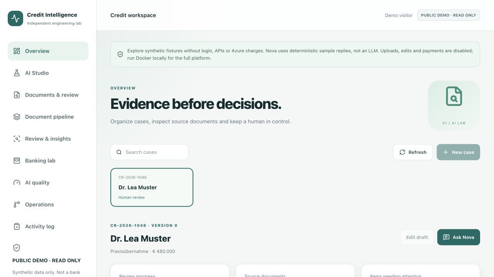
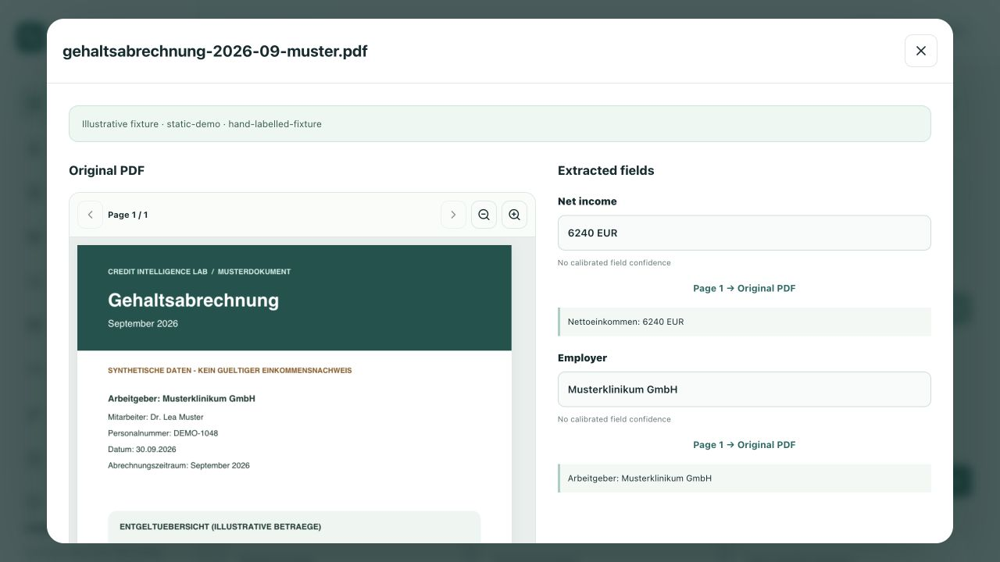

## Whole-app follow-up (2026-10-12)

The owner requested a user-style audit and local fixes. The existing branch remains `codex/apobank-ai-platform`; no commit, Git push, cloud deployment, permission change or quota reset was performed.

### Fixes reproduced and retested

1. Combined test flags selected the RAG case while asking/validating a banking balance. The question, selected case and expected-answer checks now use the same scenario. The final combined integration passed, including the actual Azure banking answer.
2. Sending the entire UI transcript could reject a next question after a long assistant answer or more than 20 messages. The version-matched AI SDK transport now sends only the latest user question, matching the existing stateless Java contract. Regression tests use a 25-message transcript with long answers. The UI explicitly explains that prior replies are not conversational memory.
3. A guarded response was displayed as disconnected Azure. Guarded, synthetic, verified Azure and unknown modes now have distinct labels in EN/DE/VI. Clear chat also clears error/mode state.
4. An upload-duplicate warning leaked from Document pipeline into AI quality. Action notices are now scoped to their originating workspace; switching to quality no longer shows that pipeline warning.
5. A completed queue entry continued to imply pending review after the user confirmed its fields. The queue now reads the saved document's review status and distinguishes extraction completion from reviewer confirmation.
6. Navigation preserved a deep scroll position, hiding the new screen's heading/controls. Selecting a workspace now returns to the top of the page.

### Coverage and results

| Flow | Verified evidence |
| --- | --- |
| Login/session | Browser PKCE sign-in; API signature/audience/tenant checks; refresh/logout/code replay tests |
| Overview/intake | Created `CR-95b8d0c5-0c6` through the UI; edited purpose/co-applicant/amount; version and database data retained |
| Documents/evidence | Actual queued Azure payroll extraction; PDF rendered; 100 ↔ 125% zoom; saved source-confirmed fields and audit; source button opened the correct PDF |
| Pipeline | UI sample queue, duplicate rejection, ClamAV scan, byte-identical original and updated reviewer status; legacy upload also rejects antivirus test content |
| AI Studio | Real Qdrant/ONNX/BM25 results from the selected case; named page/field sources and Document routing |
| Review & insights | Balanced fictional journal, amount-only payroll match, append-only note visible in Operations; downloaded XML contains NON-SUBMITTABLE and an invalid demo IBAN |
| Banking lab | Account cards and reference filtering; API draft/confirmation/idempotency checks on fictional movements; CSV construction covered by unit tests, browser save not independently confirmed in this run |
| AI quality | Run button produced the 40-reference report, failure cases and confusion counts; P=100%, R=90.5%, field F1=95%, retrieval Recall@5=54.7% |
| Operations/activity | Connected PostgreSQL/Redis/local-object-store state, persisted note and case-edit/upload/review audit entries |
| Mobile/languages | 390 × 844 viewport, menu access, English/German/Vietnamese transitions; data and authentication retained |

- **35 frontend tests passed**; lint, typecheck and Docker Next.js production build passed.
- **115 Java tests passed**, with one additional opt-in live unit test skipped and zero failures/errors. Real Azure was tested separately through the integration.
- `TEST_PLATFORM=1 TEST_BANKING=1 TEST_CHAT=azure node scripts/test-oauth.mjs` passed on the updated local stack. It includes real Azure `prebuilt-layout`, RAG, scanner rejection, review-state refresh, invalid amount (400), stale draft (409), wrong method (405), guarded mode and the actual scoped Azure banking answer.
- Final browser Nova check passed on `CR-95b8d0c5-0c6`: instruction override showed the correct guarded label; Clear chat removed it; the next real Azure answer reported **6240 EUR** from the September PDF with an exact page/chunk citation, named PDF source buttons and the Entra/no-key badge. Clicking that source opened the correct rendered PDF and fields. The final browser console check returned no errors. This is one evidence-backed sample, not a representative LLM accuracy result.
- All nine long-running project containers are running. `storage-init` completes once with exit 0; Sprachraum containers remain stopped to avoid the port conflict.

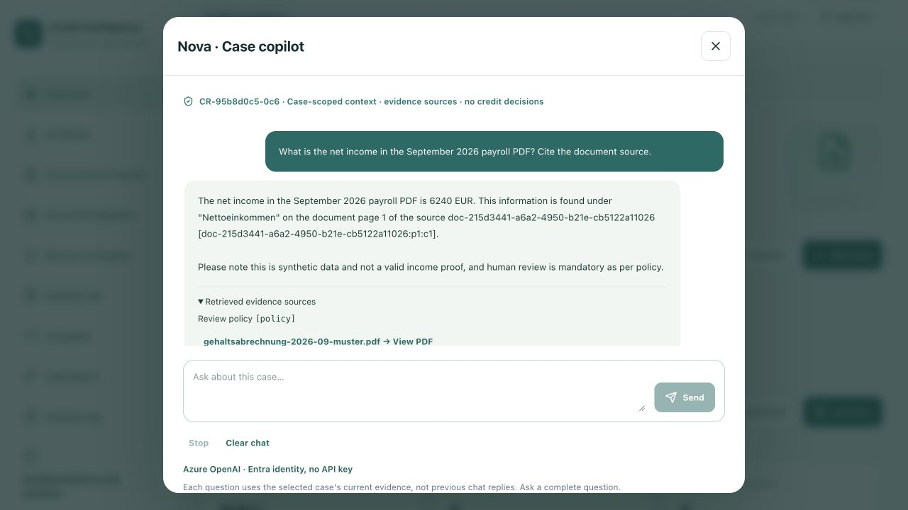

### Remaining boundaries

Language switching currently returns to Overview and requires reselecting a case; persisted records are not lost. Browser downloads can depend on the embedded browser's save handling; only the XML artifact was independently checked here. This audit is not physical-device/cross-browser certification. Cloud Blob/Insights, released security workflows, calibrated factual groundedness and real-document accuracy remain unverified as described below.

## Latest reliability-platform verification (2026-10-11)

This section supersedes the earlier counts and platform descriptions below. Changes remain local on `codex/apobank-ai-platform`; no commit, push or cloud deployment was performed in this upgrade.

### Automated and live checks

- **30 TypeScript tests passed**; lint, typecheck and the Docker Next.js production build passed.
- **114 Java tests passed, 1 opt-in live test skipped**, with zero failures/errors. The independently executed integration below exercised Azure rather than relying on that skipped unit test.
- Production npm dependency audit: **0 known vulnerabilities**. Java CycloneDX SBOM generated locally. New GitHub security/signing workflows are prepared but have not been executed or published.
- All **nine long-running Docker services** are running: web, Java API, Keycloak, two PostgreSQL databases, Qdrant, Redis, ClamAV and the OTLP collector. Six configured container health checks report healthy; web, Qdrant and OTLP were verified by their working UI/retrieval/span flows rather than a container health check. Storage initialization exited successfully; existing volumes were preserved.
- `TEST_PLATFORM=1 TEST_DATEV=1 node scripts/test-oauth.mjs` passed against the rebuilt local stack, including PKCE, tenant/audience/role enforcement, proxy boundaries, refresh/logout and OAuth-code replay rejection.
- Real local ONNX MiniLM embeddings, tenant/case-filtered Qdrant and BM25 hybrid retrieval returned case sources. Instruction-override input was rejected before retrieval.
- The **40-reference synthetic text** benchmark measured precision **100%**, recall **90.5%**, field F1 **95.0%**, and retrieval Recall@5 **54.7%**. Two injection samples were quarantined. These are narrow lab results, **not OCR, Azure or LLM accuracy**; retrieval quality still needs improvement.
- New asynchronous upload returned 202, rejected duplicate content with 409, completed ClamAV scanning and actual Azure `prebuilt-layout`, persisted fields/page evidence and returned a byte-identical authenticated original. An earlier separate run also restarted the API while the durable queue was pending and verified completion after recovery.
- Harmless EICAR antivirus-test content was blocked through **both** the new queue and the legacy synchronous upload before Azure extraction. The latter also rejects stale case versions before a provider call.
- With the owner's earlier explicit consent, the two fictional DATEV references passed Azure extraction again: Robert's page returned **9 tables / 185 cells**, and Melanie's **11 tables / 214 cells**. Net earnings and payout remained separate; original byte checks passed. Third-party PDFs remain ignored/local and are not redistributed.
- Private case and Keycloak backups were created and restored into **separate test databases**. Live databases were not overwritten. HTTP spans were observed in the local OpenTelemetry collector.

### Browser checks and boundaries

- Exercised all five new workspace screens, ranked source inspection, evaluation failures/confusion results, queue statuses, authenticated PDF review, Azure table expansion, saved reviewer notes, and the explicitly non-submittable XML download.
- Final rebuilt-web retest returned actual Qdrant passages and routed the salary/statement query to the Document specialist with read-only tools. The quality dashboard rendered its persisted scores, Operations showed PostgreSQL/Redis/local-object-store state and the saved review. The final browser console check returned no errors.
- Checked the 390 × 844 mobile layout, scrollable navigation, and switching German → English without losing the authenticated session or persisted data. This is a browser viewport check, not physical-device certification.
- Current upgraded Nova live-chat verification is **blocked by the existing account's daily token reservation limit (HTTP 429)**. Earlier Azure chat checks below are historical evidence, not a new pass for the upgraded path. No quota was raised/reset and no extra reviewer account/access was created.
- Azure Blob and Application Insights have **not** been provisioned/connected. The default object store and telemetry are local Docker services. Cloud alerts, signed releases and an independent security/model assessment remain pending.
- Reranking and lexical overlap are transparent heuristics; citation-ID validity does not prove truth. The supervisor routes to one read-only specialist, not five autonomous agents. Existing banking actions remain fictional and no bank/payment connection was added.

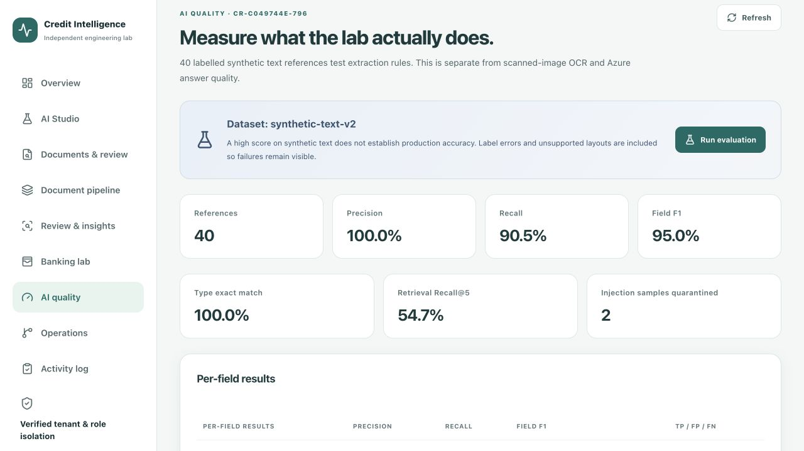

## Earlier local feature checks (historical increments)

### Follow-up public payroll and whole-app audit

- Latest checks: **98 Java tests passed, 1 opt-in live test skipped; 26 TypeScript tests passed**. Lint, typecheck and the Docker Next.js production build passed. The earlier counts below record earlier increments.
- After explicit owner consent, two one-page fictional DATEV LODAS 2025 references passed real Azure analysis in case `CR-aa162f08-0bf`. Net earnings and payout were separately correct on both samples, and the authenticated originals were byte-identical. Nova reported all four values with document/page sources. Third-party PDFs stay outside Git and public assets; see [PUBLIC_PAYROLL_TESTS.md](PUBLIC_PAYROLL_TESTS.md) for source, limits and reproduction.
- Whole-app browser audit exercised Keycloak login, case create/edit, all five navigation sections, case search, transaction-reference filtering and a downloaded CSV containing only the filtered movement. The quality screen correctly distinguishes the 20-record deterministic rules benchmark from Azure/OCR accuracy; audit events are visible.
- `TEST_BANKING=1 node scripts/test-oauth.mjs` passed again after the extraction changes: JWT/tenant boundaries, banking draft/confirmation, exactly one simulated movement, idempotency, refresh/logout and OAuth-code replay rejection. No actual bank transfer was made.
- Browser upload of a synthetic PNG scan succeeded through the real Azure provider in case `CR-6c499559-6b9`, retaining the net, employer and date. Its preview initially rejected the deliberate octet-stream original-download header. Fixed the viewer to validate PNG/JPEG bytes and make a typed transient object URL; SVG/HTML signatures are rejected by tests.
- Additional UI fixes: exact issue-to-document links with readable names; visible upload progress; double-submit guard; provider-specific sample labels; separated payout field; correctly scoped input labels and model-confidence wording. No cloud deployment or Git push was performed.
- Final browser retest on the rebuilt image: the authenticated PNG original rendered alongside all three Azure-extracted fields. Reviewer confirmation persisted version 3. German and Vietnamese UI labels rendered; the public-reference review opened directly from an overview issue, showed distinct net/payout values, and PDF zoom 100 → 125 → 100 plus Escape/focus restoration passed. Changing locale currently opens Overview again; stored case data is retained.
- Final console check returned no errors. The selected public-reference case shows both uploaded originals and an official publisher link in the Vietnamese documents view. No physical phone benchmark or exhaustive cross-browser certification is claimed.

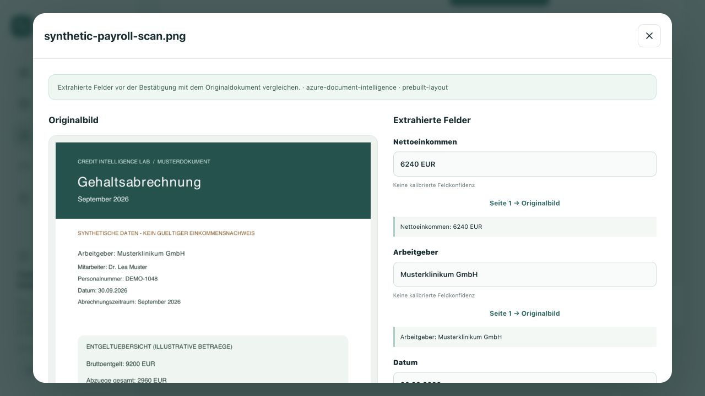

### Shared Azure AI and PDF evidence viewer

- 91 offline Java tests passed; 1 opt-in Azure live test skipped in the ordinary run. 23 TypeScript tests, lint/typecheck and the Docker Next.js production build passed. Production npm dependency audit reported 0 known vulnerabilities.
- Real Azure OpenAI was verified through Keycloak PKCE → Next.js proxy → Java → the existing `gpt-4.1-mini` deployment in `vietphung-ai-shared`. The assistant streamed actual model output in `azure-entra` mode; it did not use the deterministic demo fallback.
- The owner explicitly approved `Cognitive Services OpenAI User` for their own Entra account, scoped only to `vietphung-ai-shared`. No Owner role, new deployment or API key was created.
- `TEST_PAYROLL=1 TEST_CHAT=azure node scripts/test-oauth.mjs` passed on synthetic case `CR-732693bb-0bf`: three new Gehaltsabrechnung PDFs were served by the Docker web app, analyzed by Azure Document Intelligence, persisted with their originals and downloaded through the authenticated proxy with identical SHA-256 hashes. Extracted net values were `6240 EUR`, `6380 EUR` and `3200 EUR`. Nova correctly read September's `6240 EUR` with document/page source identifiers.
- `TEST_BANKING=1 TEST_CHAT=azure node scripts/test-oauth.mjs` passed on synthetic case `CR-60dd1736-69b`: banking seed, explicit human-checked simulated payment, idempotency, audit persistence and a real Azure answer reading the updated `32071 EUR` practice balance with account sources. No real payment or autonomous credit decision was performed.
- The shared Azure profile uses a short-lived, read-only token-file bridge renewed on the Mac by `scripts/docker-azure.mjs`. Keep that helper running. This local credential is Entra authentication, not cloud Managed Identity. Missing required Azure configuration fails closed rather than silently selecting demo mode.
- The new sample library provides three clearly marked fictional payroll PDFs. PDF.js renders originals inside the workspace using same-origin worker/font assets; document requests carry the session token in a header, not in the URL. Uploaded originals are not placed in the public sample directory.
- The document viewer shows the original PDF alongside editable fields and source-page buttons. Legacy fixtures without an uploaded original explicitly say so. The field panel is labelled “Extracted fields”; OCR confidence is not presented as field accuracy.
- Final browser check: the September original rendered beside `6240 EUR`, `Musterklinikum GmbH` and `30.09.2026`; the October sample preview rendered; Nova answered the payroll question with `6240 EUR` and the Entra mode badge. Expanding sources showed named PDF/page links, and clicking one opened the original evidence view. Confirming the synthetic September evidence saved version 5 with `Human-verified` status. No browser console errors were observed.

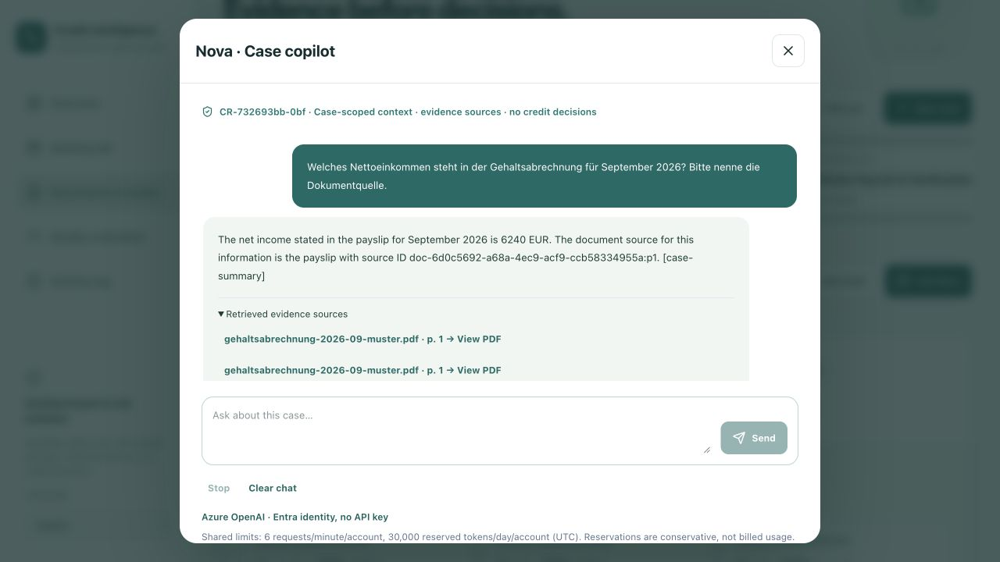

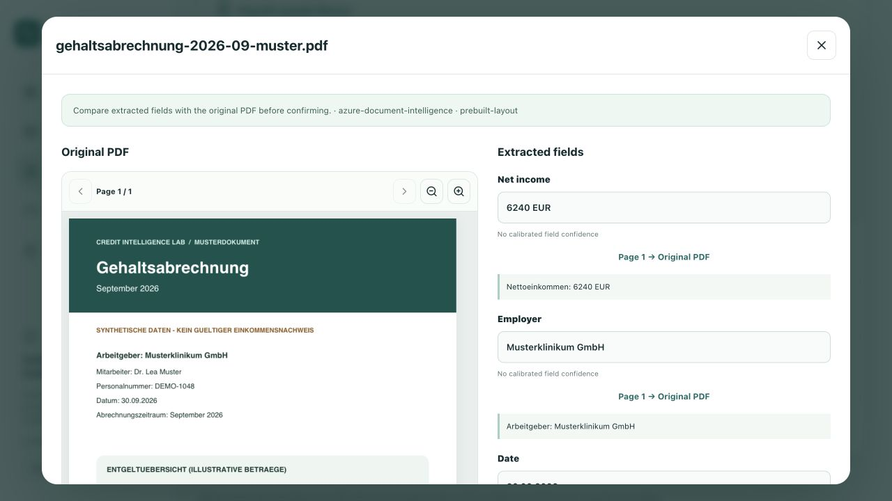

### Banking workbench addition

- Initial banking increment: 88 offline Java tests passed; 1 opt-in Azure live test skipped. 21 TypeScript tests, lint/typecheck and the Docker Next.js production build passed. The later shared-Azure increment above supersedes these counts.
- Updated both web and Java containers locally; existing PostgreSQL volumes and Keycloak accounts retained.
- `TEST_BANKING=1 TEST_CHAT=demo node scripts/test-oauth.mjs` passed: PKCE login, tenant-scoped seed, draft without debit, draft retry idempotency, already-paid invoice rejection, explicit confirmation, exactly one simulated debit/audit event and confirmation retry without double-debit.
- Browser check passed: account cards, transaction search by reference, already-paid invoice blocking, sample-source checkbox, draft and confirmation dialogs, persisted simulated payment and audit entries. Switching EN/DE/VI retained the saved banking state. Nova's German local reply showed updated balances, 12 movements, source identifiers and its no-payment-execution boundary. No browser console errors were observed.
- Responsive CSS was reviewed; no physical-phone performance or mobile device benchmark is claimed.
- Banking fixtures live in the new `banking_lab` table. They are not extracted from uploaded PDFs. No actual transfer, bank integration, MCP server or supervisor multi-agent implementation was added. Azure OpenAI was subsequently live-tested as recorded above.

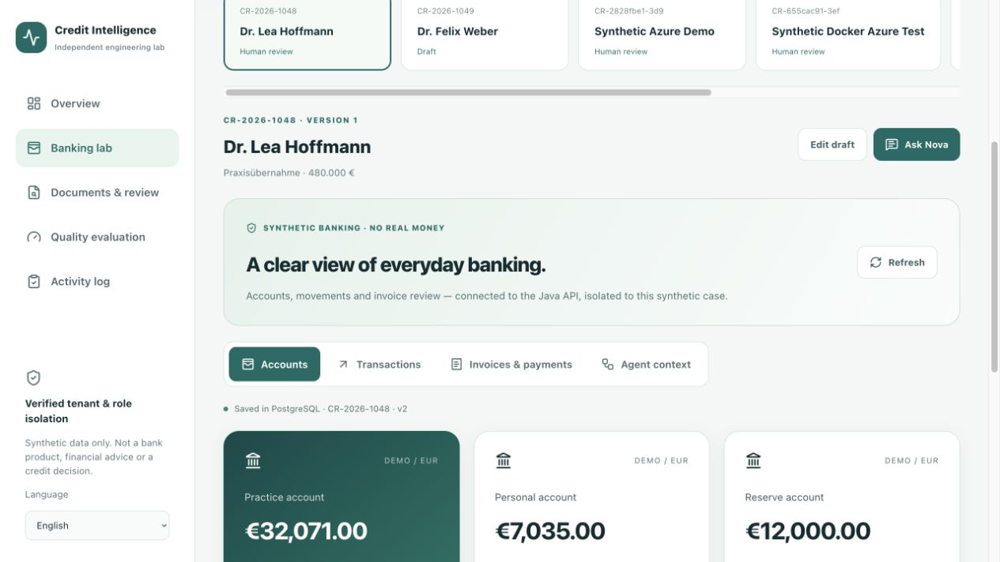

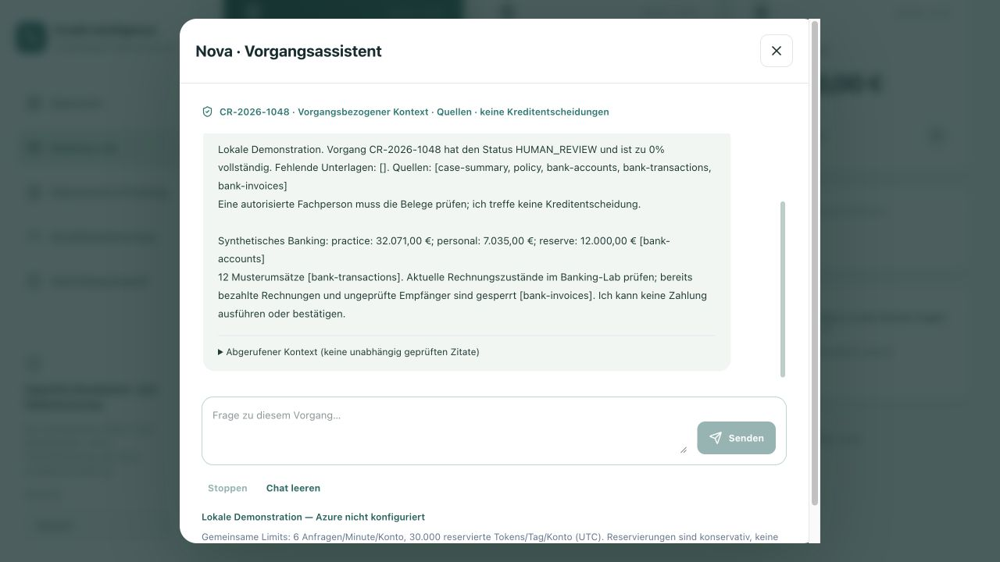

- 91 offline Java tests cover JWT signature/issuer/audience checks, tenant/role authorization, optimistic persistence, shared quotas, provider selection/fail-closed behaviour, normalized Azure/custom fields, upload format/F0 page limits, 20 labelled extraction references, 12 deterministic assistant safety cases, short-lived token-file validation/renewal, required Azure AI configuration and banking simulation safety. A separate opt-in Azure live test is excluded from ordinary offline runs.
- 23 TypeScript tests cover API parsing, multilingual translations, retrieval scoping, chatbot guardrails, proxy-aware same-origin validation, banking cent arithmetic/CSV, authenticated document/banking transport and multilingual sample-PDF assets.
- Docker Compose contains separate persistent databases for identity and synthetic case data. All five services now run in Docker, including Next.js and Java (host app processes stopped). Keycloak/Java/database health checks passed; web returned the authenticated workspace. `unless-stopped` restart policies are configured.
- Docker Azure integration passed with `TEST_DOCUMENT=azure TEST_CHAT=demo node scripts/test-oauth.mjs`: PKCE, tenant-scoped Java/proxy responses, short-lived Azure token file, synthetic PDF extraction with `prebuilt-layout`, net income `3200 EUR`, one-page evidence and required human review. The local helper must remain running for Azure token renewal; this is not cloud Managed Identity. No production deployment was performed.
- PDFBox extracts PDF text. Local Tesseract `deu+eng` handles images/scanned pages and retains page evidence plus OCR word score where available.
- The 20-reference exact-match benchmark is 100% for the narrow deterministic rules. It is not an OCR or LLM accuracy claim.
- Live Azure Document Intelligence was verified on `vietphung-documents-shared` in `ai-shared`, West Europe, F0. Java used Azure CLI Entra authentication with key-based authentication disabled. A generated synthetic one-page payroll PDF returned `prebuilt-layout`, three extracted fields, page evidence and review status. Three additional payroll samples were subsequently verified as recorded above. These checks prove connectivity on those samples, not representative extraction accuracy.
- Browser demonstration passed with real Keycloak PKCE login, PostgreSQL case creation and the authenticated Next.js → Java → Azure upload flow. The workspace rendered `synthetic-payroll.pdf`, provider `azure-document-intelligence`, model `prebuilt-layout`, `3200 EUR`, `Muster GmbH`, `01.10.2026`, and page evidence. The OCR word score was 99%; this is not a field-accuracy benchmark.

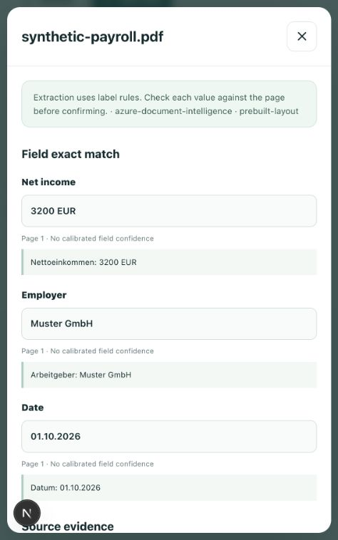
- The Azure Bicep template compiles successfully and provisions a Managed Identity, Document Intelligence and least-privilege role assignment; Azure OpenAI creation is optional and quota-dependent.
- Production deployment remains intentionally pending for the Keycloak backup/migration gate and case-database provisioning.

## Working local platform

- Five Docker services: Next.js workspace, Java 21/Spring Boot API, Keycloak 26.8.0, identity PostgreSQL 17 and case PostgreSQL 17.
- Real Authorization Code + PKCE login through the browser, with a synthetic advisor account.
- Case and document fields rendered from the authorized Java response.
- API authorization based on verified signature, issuer, expiry, audience, roles and business-tenant claims.
- PostgreSQL-backed authentication state: authorization-code exchange succeeds after restarting Keycloak between login and token exchange.
- Session refresh/logout, rejection of invalid JWTs, disabled password grants and one-use OAuth-code enforcement.
- Base Compose provides a clearly labelled deterministic demo; the shared-Azure override provides the separately verified live model. Both remain scoped to the authorized case.
- Desktop and 390 × 844 mobile UI checked: navigation, document details, evaluation page and chat.
- Dialog keyboard checks: Tab returns focus inside the chat after a quick action disappears; Escape closes the dialog and restores focus. No browser console errors were observed in the final local check.

### Automated checks

| Check | Result |
|---|---|
| TypeScript unit tests | 26 passed |
| Java service/security/JWT/extraction/assistant/banking tests | 98 passed, 1 opt-in live test skipped |
| Azure Document Intelligence synthetic payroll library | Passed: 3 PDFs, correct sample net values, prebuilt-layout, authenticated originals |
| Azure OpenAI live assistant | Passed: streamed model output, payroll and banking context, named sources |
| Go startup-proxy tests and production auth image build | Passed |
| Keycloak realm/PKCE/tenant/audience configuration check | Passed |
| Lint, TypeScript and Next.js production build | Passed |
| Production npm dependency audit | 0 known vulnerabilities |
| Azure Bicep compile | Passed |
| Full OAuth + demo chat + restart integration | Passed |

Run the integration yourself:

```bash
docker compose up --build --wait --wait-timeout 180
TEST_CHAT=demo TEST_WRITE=1 TEST_RESTART_KEYCLOAK=1 TEST_RESTART_API=1 node scripts/test-oauth.mjs
```

The test prints checks only, never credentials or tokens. Restart testing applies only to the local Docker platform.

For the current shared-Azure profile, keep the first command running in its own terminal:

```bash
node scripts/docker-azure.mjs start
TEST_PAYROLL=1 TEST_CHAT=azure node scripts/test-oauth.mjs
TEST_BANKING=1 TEST_CHAT=azure node scripts/test-oauth.mjs
```

The Azure tests send only generated fictional examples. Do not run the base-profile startup command over the Azure stack unless you intentionally want to switch back to local extraction/demo AI.

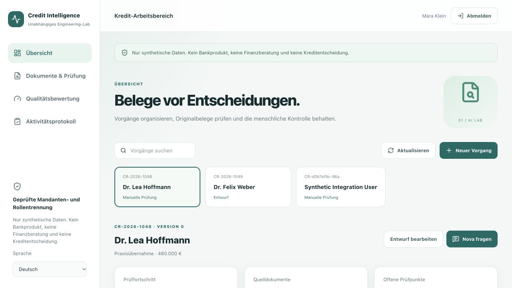

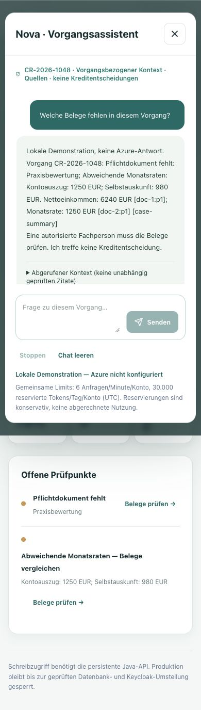

## Online release: remaining boundary

The existing public Java container answers its health endpoint. The current cloud Keycloak login form accepts the demo advisor, but the token exchange fails with `invalid_grant` when requests reach different instances. Keycloak 26.8 stateless mode is prepared to persist this authentication state in PostgreSQL.

The cloud database upgrade has **not** been executed. A private database backup requires explicit owner approval because it includes authentication accounts and configuration. The latest fixes have not been pushed to `master`, because its Git deployment would trigger that migration.

Until the upgrade and production end-to-end test succeed, do not describe the public deployment, cloud login or Azure response as completed. Azure calls now originate in the Java API through Microsoft Entra Managed Identity, not an API-key path, but a configured identity alone is not proof of a successful model or Document Intelligence response.

## Product scope

This is a synthetic engineering lab with persistent local case editing, bounded uploads, source-backed extraction and human review. Its 20-reference rules benchmark does not measure OCR or Azure answer accuracy, and the system never makes a credit decision. Public demo credentials must never gain access to real customer records. Regulated deployment still needs encrypted object storage, malware scanning, retention, consent, backups, monitoring and independent security/model review.
