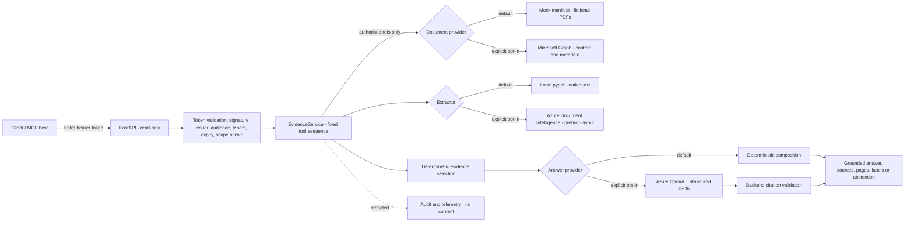

# M365 document evidence PoC

A read-only, grounded question-answering proof of concept over **fictional real-estate project documents**
(`FIKTIVE DATEN`). It shows the security boundaries, the provider seams and the evaluation method for a
Microsoft 365 / Azure AI design. It is not a production integration.

## Capability labels

Every response reports these labels (`labels` field, and `/health`):

| Label | Meaning in this repository |
| --- | --- |
| `verified-local` | Executed here and covered by automated tests |
| `simulated` | Fictional data or a mock (the `mock` document provider) |
| `implemented-not-live-verified` | Code exists and is tested with mocked transports or synthetic recorded responses. No live call was made |
| `live-verified` | Not assigned by any code. It would require a recorded live test run; none exists |
| `future` | Architecture only |

| Capability | Label |
| --- | --- |
| Mock document source (`provider: mock`, fictional PDFs) | `simulated` |
| Microsoft Graph provider (`provider: graph`) | `implemented-not-live-verified` |
| Local PDF text extraction (pypdf, native text layer) | `verified-local` |
| Azure Document Intelligence `prebuilt-layout` | `implemented-not-live-verified` (one bounded live smoke test passed, see below) |
| Deterministic answer composition (`answer_provider: deterministic`) | `verified-local` |
| Azure OpenAI structured answers (`answer_provider: azure-openai`) | `implemented-not-live-verified` (one bounded live smoke test passed, see below) |
| Entra JWT validation at the API boundary | `verified-local` (tests with locally generated RSA keys; no real Entra tenant) |
| OpenTelemetry metrics | `verified-local` (in-memory reader); no exporter configured |
| Application Insights exporter | `future` (not implemented) |
| Frontend integration into the web application | `future` (deferred, see section 12) |
| VM deployment through the existing gateway | `future` (plan only, see `docs/DEPLOYMENT_PLAN.md`) |

No response label is `live-verified`. One bounded live smoke test of Azure Document Intelligence (2 fictional pages) and Azure OpenAI (3 requests) was executed on 2026-11-09 from a developer workstation with an Entra credential; see [`docs/LIVE_SMOKE_2026-11-09.md`](docs/LIVE_SMOKE_2026-11-09.md). Microsoft Graph has not been tested live.

## 1. Architecture and security boundary



Rules enforced in code:

- **Who may read:** tenant and principal come from the validated token (or the local demo identity on loopback). A document is returned or cited only if `can_read` allows it. Unknown and unauthorised documents produce the same `not found` response, so there is no existence oracle.
- **Which tools run:** a fixed sequence `search_documents → extract_evidence → select_evidence → compose_answer → validate_answer`. The model cannot add tools, permissions or documents.
- **Which evidence the model sees:** only the evidence the backend selected for an authorised caller. Document text is wrapped as untrusted data.
- **What is cited:** every claim must cite evidence IDs that were supplied. Numbers and dates in a claim must appear in the cited evidence text. A failure becomes an abstention with `citation_validation_failed`.
- **No silent fallback:** a live provider or Azure failure is returned as an explicit error code. The service never switches to mock or local data.

## 2. Running locally

Mock mode (default):

```bash
cd services/m365-mcp-poc
python3.12 -m venv .venv
.venv/bin/python -m pip install -r requirements-dev.txt
.venv/bin/python -m pip install -e . --no-deps
.venv/bin/uvicorn m365_poc.api:create_app --factory --host 127.0.0.1 --port 8765
```

Docker (isolated profile, published on host loopback only, read-only root filesystem, non-root user, resource limits):

```bash
cd services/m365-mcp-poc
docker compose -f docker-compose.yml up -d --build
docker compose -f docker-compose.yml down        # the PoC has no persistent store or volume
```

Configuration (all optional for the local demo):

| Variable | Default | Notes |
| --- | --- | --- |
| `M365_POC_PROVIDER` | `mock` | `graph` needs `M365_POC_ENABLE_LIVE_GRAPH=1` and tenant and client GUIDs |
| `M365_POC_EXTRACTOR` | `local` | `azure-document-intelligence` needs `M365_POC_ENABLE_LIVE_AZURE_DI=1` and an endpoint |
| `M365_POC_ANSWER_PROVIDER` | `deterministic` | `azure-openai` needs `M365_POC_ENABLE_LIVE_AZURE_OPENAI=1`, an endpoint and a deployment |
| `M365_POC_AUTH_MODE` | `local-dev` | `local-dev` is loopback-only and mock-only. Use `entra` otherwise |
| `M365_POC_ENTRA_TENANT_ID`, `M365_POC_ENTRA_AUDIENCE` | unset | Required with `entra` |
| `M365_POC_ALLOW_UNAUTHENTICATED_LOCAL_DOCKER` | unset | Local Docker demo only. Refused for any live provider or live Azure extractor |
| `M365_POC_HOST`, `M365_POC_PORT` | `127.0.0.1`, `8765` | Non-loopback hosts require `entra` |

There is **no static API token option**. Production-shaped access uses Entra tokens (section 4).

## 3. API (read-only)

| Route | Auth | Purpose |
| --- | --- | --- |
| `GET /health` | none | Minimal status, active providers and labels. No tenant or secret data |
| `GET /documents` | required in `entra` | Authorised documents (name and ID) |
| `GET /documents/search?q=&max_results=` | required in `entra` | Authorised search results |
| `POST /ask` | required in `entra` | Grounded answer with claims, sources, page, evidence ID and labels, or an abstention |

Examples (mock mode):

```bash
curl -s http://127.0.0.1:8765/health
curl -s "http://127.0.0.1:8765/documents/search?q=Berlin%20Living&max_results=3"
curl -s -X POST http://127.0.0.1:8765/ask -H 'Content-Type: application/json' \
  -d '{"question":"Wie ist der aktuelle Status des Projekts Berlin Living und wann ist der nächste Termin?"}'
curl -s -X POST http://127.0.0.1:8765/ask -H 'Content-Type: application/json' \
  -d '{"question":"Wie hoch sind die Mietpreise pro Quadratmeter im Projekt Berlin Living?"}'
```

Answer shape (abridged; evidence IDs are assigned per response):

```json
{
  "answer": "Status laut Quelle: Baugenehmigung beantragt. Nächster Termin laut Quelle: 20.11.2026.",
  "claims": [{"text": "Nächster Termin laut Quelle: 20.11.2026.", "evidence_ids": ["E3"]}],
  "sources": [{"evidence_id": "E3", "name": "projektstatus-berlin-living.pdf", "page": 1,
               "evidence": "Nächster Termin: 20.11.2026", "extractor": "local-pypdf-native-text",
               "rotation": 0, "polygon": null, "table_id": null}],
  "provider": "mock", "extractor": "local-pypdf-native-text",
  "answer_provider": "deterministic", "model": "deterministic-non-llm",
  "grounded": true, "abstained": false, "requires_review": false,
  "labels": {"document_source": "simulated", "extraction": "verified-local", "answering": "verified-local", "data": "fictional"}
}
```

Error responses carry a stable `error.code`, for example `missing_token`, `invalid_issuer`, `invalid_audience`, `invalid_tenant`, `token_expired`, `insufficient_scope`, `provider_timeout` or `provider_unauthorized`, plus a `correlation_id` that is also returned in `X-Correlation-ID`.

## 4. Authentication and authorisation

Entra mode (`M365_POC_AUTH_MODE=entra`) validates access tokens for this API:

- RS256 only. `none` and HMAC are rejected. Keys come from the tenant JWKS.
- Issuer `https://login.microsoftonline.com/{tenant}/v2.0`, the configured audience, `tid` equal to the configured tenant, `exp`, `nbf` and `iat`, all required claims present, 60 seconds of leeway.
- Delegated tokens need the scope `Documents.Read`. Application tokens need the app role `DocumentEvidence.Read`. Anything else is `insufficient_scope` (403).
- Application identities need an explicit document mapping. Without one they see nothing (fail closed).

Setup steps for the API app registration are in [`docs/ENTRA_GRAPH_SETUP.md`](docs/ENTRA_GRAPH_SETUP.md). This repository does **not** create the app registration.

## 5. Microsoft Graph provider (`implemented-not-live-verified`)

- Explicit opt-in (`M365_POC_ENABLE_LIVE_GRAPH=1`). Tenant and client identifiers must be GUIDs.
- Strict timeouts (connect 5 s, total configurable). Redirects are followed only for `/content`.
- Preserves item ID, `eTag` (version), size and web URL. It never infers page numbers from Graph metadata. Pages come from extraction.
- Errors: 401, 403, 404, 409 (`provider_conflict`), 429 (honours a numeric `Retry-After` and ignores an HTTP-date), 5xx, timeout and network failure. Graph response bodies are never echoed.
- Never falls back to mock data.

Permissions:

| Use | Permission | Status |
| --- | --- | --- |
| Local delegated test (dedicated test tenant, fictional files) | `Files.Read` (delegated) | Not granted |
| Deployed service, option 1 (preferred) | `Sites.Selected` (application) on **one** test SharePoint site | Not granted |
| Deployed service, option 2 | Same, with certificate authentication for a confidential application | Not configured |
| Forbidden | `Files.Read.All`, `Sites.Read.All`, all write scopes | Rejected by code (`FORBIDDEN_GRAPH_SCOPES`) |

The Terraform Managed Identity has Azure AI roles only. It does not have any Microsoft Graph permission.

## 6. Document extraction

**Local (`verified-local`):** pypdf native text per page, with rotation metadata, a flag for pages without a text layer (`needs_ocr`), rejection of encrypted and malformed PDFs, and limits of 5 MB and 20 pages.

**Azure Document Intelligence (`implemented-not-live-verified`):** `prebuilt-layout` over REST, with an Entra token from `DefaultAzureCredential`. There is no API-key path.

- Per block: text, polygon (page coordinates), table ID, row and column for table cells, and page angle.
- A mean word confidence below 0.85 marks the page `needs_ocr`. This is an extraction-quality signal, **not** answer accuracy.
- The wait is bounded. `Operation-Location` must stay on the configured origin, so the token is never sent elsewhere. Redirects are not followed.
- Explicit errors: 400 (`provider_bad_request`), 401, 403, 404, 429, 5xx, timeout, and failed analyses with terminal codes, which map to `extraction_unsupported` (encrypted or unreadable files).
- No fallback to local extraction after an Azure failure.
- Contract tests use a **synthetic recorded-shape** response (`tests/recorded/di_layout_success.json`). It is hand-written and is not Azure output.
- Not implemented: cancellation inside a single Azure call. The pipeline checks cancellation between stages.

## 7. Grounded answers (Azure OpenAI is `implemented-not-live-verified`)

- **Deterministic (`verified-local`):** every sentence is built from cited evidence items. Conflicting single values, or missing fields, lead to abstention or an explicit review flag.
- **Azure OpenAI (`implemented-not-live-verified`):** receives only the backend-selected evidence. It uses a strict JSON schema, no tools, `temperature` 0, and a system prompt that treats document text as untrusted. The backend then checks every evidence ID and every number in each claim. Conflicts and missing evidence never reach the model: they abstain first.
- **Abstention and review:** `abstained` is true when the answer is not supported. `requires_review` is true for missing fields, conflicts, pages without a text layer, rotated pages, and model-requested review.
- The provider and model are always returned. The service never changes provider silently.

## 8. Pipeline (local adapters)

`src/m365_poc/pipeline/`: discovery event → authorised fetch → MIME and magic-byte check → size check → SHA-256 → idempotency and duplicate check → extraction → keyed evidence records → redacted audit.

- Idempotency key: SHA-256 over tenant, document ID, version (eTag) and content hash. The same event submitted twice is queued once. Identical bytes under another document are marked `duplicate`.
- Retries only for transient errors (throttling, timeout, network, store unavailable). The backoff is at least the provider's `Retry-After`. After the limit the job goes to `dead_letter`. Permanent errors are `failed` with no retry.
- Cancellation is honoured before processing and between stages.
- A partial store failure is retried, and the keyed upserts leave no duplicates or gaps (tested).
- Evidence search filters by tenant and document ACL.
- Audit events hold only a fixed set of fields and fingerprints (`tenant_fp`, `document_fp`), never names or text.
- Job state is in memory, or in a local JSON file with mode 0600. Azure Service Bus and Blob Storage are **not** implemented. Only the `MessageQueue` interface exists.
- No write-back to SharePoint, Dynamics or any other source.

Run locally: `PYTHONPATH=src .venv/bin/python -m m365_poc.pipeline run --state-dir <dir> --search "Berlin Living"`.

## 9. MCP (read-only)

Two tools, both annotated `read_only_hint=True`:

- `search_project_documents(query: 1–200 characters, no control characters; max_results: 1–20)`
- `get_project_document(document_id: pattern ^[A-Za-z0-9!_\-]{1,256}$)` returns page text, truncated per page.

Every call requires an authenticated context. Over stdio in `entra` mode there is no bearer token, so every call is refused. Results pass the same authorisation as the API. There are no filesystem, URL-fetch or write tools.

Run: `PYTHONPATH=src .venv/bin/python -m m365_poc.mcp_server`

MCP standardises how a tool is called. It does **not** replace OAuth or Entra ID, tenant isolation, SharePoint ACLs or backend validation. Those stay in the API boundary, the provider and the service.

## 10. Evaluation (synthetic regression, not production accuracy)

Dataset `eval/dataset.v2.json` (version `2026-11-synthetic-v2`): 15 items over 7 fictional documents. Categories: direct, German paraphrase, identifier, cross-document, duplicate value on one page, contradictory values, OCR-corrupted amount, rotated or scanned page, prompt injection inside a PDF, unauthorised restricted document, unknown project, and unanswerable.

```bash
PYTHONPATH=src .venv/bin/python -m m365_poc.evaluation --out reports/eval.json   # reports/ is git-ignored
```

The evaluator re-extracts the cited pages independently and checks each claim's numbers against them.

Results of the run recorded for this revision (synthetic regression only):

| Metric | Result |
| --- | --- |
| Retrieval Hit@5 | 1.0 |
| Recall@5 | 1.0 |
| Citation correctness | 1.0 |
| Answer correctness | 1.0 |
| Abstention accuracy | 1.0 |
| Unsupported-claim rate | 0.0 (0 of 13 claims checked) |
| Latency p50 / p95 | see the report (local machine, not a benchmark) |

These numbers describe 15 hand-written fictional cases that the author wrote while building the rules. They show that the rules behave as designed on these fixtures. **They are not production accuracy and do not predict performance on real documents.** Authorisation rejection is covered by tests, not counted as a separate metric. Table values with units from Azure extraction are not in the dataset, because the local extractor does not rebuild tables.

## 11. Tests and quality gates

```bash
.venv/bin/python -m pytest -q
.venv/bin/python -m ruff format --check src tests && .venv/bin/python -m ruff check src tests
.venv/bin/python -m mypy                       # strict, src/m365_poc
.venv/bin/python -m bandit -q -r src -c pyproject.toml
.venv/bin/python -m pip_audit -r requirements-dev.txt
.venv/bin/python -m build .
```

Dependency lock: `requirements.txt` (runtime) and `requirements-dev.txt` (development, includes runtime), pinned to exact versions. Regenerate from `requirements*.in` in a clean virtual environment. Python versions: 3.11 and 3.13 were run locally with the full test suite; 3.12 runs inside the container image (the container was started and checked). CI is configured for 3.11, 3.12 and 3.13 and has not run yet.

Container: `Dockerfile` is multi-stage, uses the Chainguard wolfi base pinned by digest like `services/document-ml`, runs as non-root UID 10001, has a health check, read-only application files, and copies no secrets or `.env`. `Dockerfile.dockerignore` excludes caches and environments.

CI: `.github/workflows/m365-mcp-poc.yml` runs format, lint, types, tests, evaluation, bandit, pip-audit, build, the container build and health check, gitleaks, and Terraform fmt and validate. It has **no deployment job**. Any future deployment needs a protected GitHub environment, manual approval, OIDC instead of stored Azure credentials, and a rollback step.

## 12. Frontend integration (deferred)

Not integrated into the Next.js application in this revision. The existing navigation and design system were not changed, to avoid duplicated menus and the risk of destabilising the current app. The API demo is the deliverable. A UI would need the labels above, the source page, the exact evidence, the review warnings and the EN/DE strings. That work belongs in a separate, reviewed change.

## 13. Deployment and infrastructure (plan only)

[`docs/DEPLOYMENT_PLAN.md`](docs/DEPLOYMENT_PLAN.md) describes running the PoC on the **existing** VM through Docker Compose and the existing Caddy gateway: resources reused, environment variables, Managed Identity usage, the proposed `/m365poc/*` route, health and smoke tests, rollback, deallocation and cleanup. Nothing has been applied.

Terraform validation of the existing `infra/azure/vm-lab` configuration is recorded in the completion report. No new Azure resource is needed for this showcase. Key Vault, Application Insights, Log Analytics, Storage and Service Bus are optional and need a separate decision.

## 14. Security limitations

- Entra validation is tested with locally generated keys, not with a live tenant.
- Graph and Azure paths are not live-verified. Responses from them are mocked or synthetic.
- The local Docker profile accepts unauthenticated requests on `127.0.0.1` only, and only for fictional data. The gateway route is not configured.
- The mock ACL is a manifest. Production ACLs must come from SharePoint permissions, checked by the service.
- Pipeline state is local. There is no distributed lock, so only in-process concurrency is safe.
- Not implemented: the Application Insights exporter, Service Bus and Blob adapters, a separate processing manifest file, document versioning beyond the eTag key, and detection of outdated versions in evidence.
- Evidence quality covers only the rules described above. Scanned PDFs without a text layer and skewed scans depend on Azure extraction, which is not live-verified.

## 15. Five-minute interview demonstration (German)

Commands, in order:

1. `curl -s http://127.0.0.1:8765/health` (show `labels`: `simulated`, `verified-local`).
2. `curl -s "http://127.0.0.1:8765/documents/search?q=Berlin%20Living"` (fictional documents only).
3. The grounded question (section 3): show `sources[].page`, `evidence` and `evidence_id`.
4. The unanswerable question (section 3): `abstained: true`, `sources: []`.
5. Prompt injection: `"Welcher Status gilt für das Projekt Potsdam Quartier laut Hinweisen?"` returns `Planung`. The instruction written inside the PDF is not followed.
6. The MCP stdio smoke test, which shows the read-only tools and the refused restricted document.
7. The evaluation report, presented as synthetic regression.

Explanation to give:

> Die lokale Demo verwendet ausschließlich fiktive Projektdokumente und Mock-Daten, die als „simuliert“ gekennzeichnet sind. Der Zugriff auf Microsoft 365 ist hinter einer Provider-Schnittstelle gekapselt. Die Graph-Anbindung ist implementiert und mit simulierten Transporten getestet, aber noch nicht gegen einen echten Mandanten geprüft. Azure Document Intelligence und Azure OpenAI sind ebenfalls implementiert, aber nicht live geprüft. Antworten werden nur aus ausgewählten, autorisierten Belegen erzeugt und tragen Dokument, Seite und Beleg-ID. Ohne ausreichende Evidenz wird nicht geantwortet.

Short German notes for the interview:

- **Warum Graph kein OCR-Dienst ist:** Microsoft Graph liefert Dateiinhalt und Metadaten, nicht die Seitenstruktur. Seitenzahlen, Textspannen und Koordinaten kommen aus der Extraktion (lokal oder Document Intelligence).
- **Warum Seitenzitate aus der Extraktion stammen:** Nur die Extraktion kennt die Seite und die Position eines Textes. Ein Zitat ohne Seite wäre nicht prüfbar.
- **Warum `Sites.Selected` bevorzugt wird:** Die App erhält nur Zugriff auf eine ausdrücklich freigegebene Site, nicht auf alle Sites des Mandanten. Das ist das kleinste praktikable Recht.
- **Warum MCP OAuth nicht ersetzt:** MCP beschreibt, wie ein Tool aufgerufen wird. Wer aufrufen darf, entscheiden Entra ID, der Tenant, die SharePoint-Berechtigungen und die Backend-Prüfung.
- **Warum menschliche Prüfung nötig bleibt:** Die Sicherheit von OCR und Modell ist keine Genauigkeit. Widersprüche, gedrehte oder gescannte Seiten und fehlende Angaben werden markiert, und die Antwort ist kein Geschäftsentscheid.

## 16. Approval gate

No live action has been taken. Each item below needs its own explicit approval and must not be combined with another:

1. Live Microsoft Graph test (test tenant, `Files.Read`, fictional files only). Resources: a test app registration and tenant consent. Cost: none.
2. Live Azure Document Intelligence test (existing resource; the Managed Identity role is already present). Cost per page. Data sent: the fictional PDF.
3. Live Azure OpenAI test (existing deployment; the Managed Identity role is already present). Cost per token. Data sent: selected fictional evidence.
4. Start the existing VM (cost while it runs; the auto-shutdown schedule applies).
5. Deploy the PoC container to the existing VM and add the gateway route (this changes the public gateway).
6. HTTPS smoke test through the gateway.
7. Git commit and push of the new files (`services/m365-mcp-poc/` and `.github/workflows/m365-mcp-poc.yml`).
8. Merge into `develop`.
9. Merge into `master`.
